# 通信协议

> 不能说同一种语言的 agents 不是团队，只是对着虚空喊话的陌生人。

**Type:** Build
**Languages:** TypeScript
**Prerequisites:** Phase 14 (Agent Engineering), Lesson 16.01 (Why Multi-Agent)
**Time:** ~120 minutes

## 学习目标

- 实现 MCP tool discovery 和 invocation，让 agents 可以使用外部 servers 暴露的 tools。
- 构建 A2A Agent Card 和 task endpoint，让一个 agent 可以通过 HTTP 把工作委派给另一个 agent。
- 比较 MCP（tool access）、A2A（agent-to-agent）、ACP（enterprise audit）和 ANP（decentralized trust），并解释每个 protocol 解决什么问题。
- 把多个 protocols 接入同一个系统：agents 通过 MCP 发现 tools，通过 A2A 委派 tasks。

## 问题

你把系统拆成了多个 agents：researcher、coder、reviewer。它们各自很擅长自己的工作。但现在你需要它们真的能互相沟通。

第一反应通常很直接：传字符串。Researcher 返回一坨文本，coder 尽力解析。它能工作，直到 coder 误解 research summary，或者两个 agents 死锁、彼此等待，或者不同团队构建的 agents 需要协作。突然之间，“just pass strings” 崩掉了。

这就是 communication protocol problem。没有共享 contract 来定义 agents 如何交换信息，multi-agent systems 就会脆弱、不可审计，并且无法扩展到你亲手写的少数 agents 之外。

AI 生态已经形成了四类协议，各自解决问题的一部分：

- **MCP** 用于 tool access。
- **A2A** 用于 agent-to-agent collaboration。
- **ACP** 用于 enterprise auditability。
- **ANP** 用于 decentralized identity and trust。

本课会读真实 wire formats，构建可运行实现，并把四个协议接到一个统一系统里。

## 概念

### Protocol Landscape

把四个协议想成不同层级，每一层回答一个不同问题：

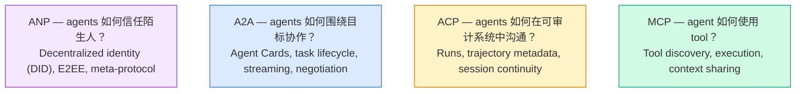

它们不是竞争关系。它们在不同层解决不同问题。

### MCP 回顾

MCP 在 Phase 13 已经深入讲过。快速回顾：MCP 标准化 LLM 如何连接外部 tools 和 data sources。它是一个 **client-server** 协议：agent 作为 client，发现并调用 server 暴露的 tools。

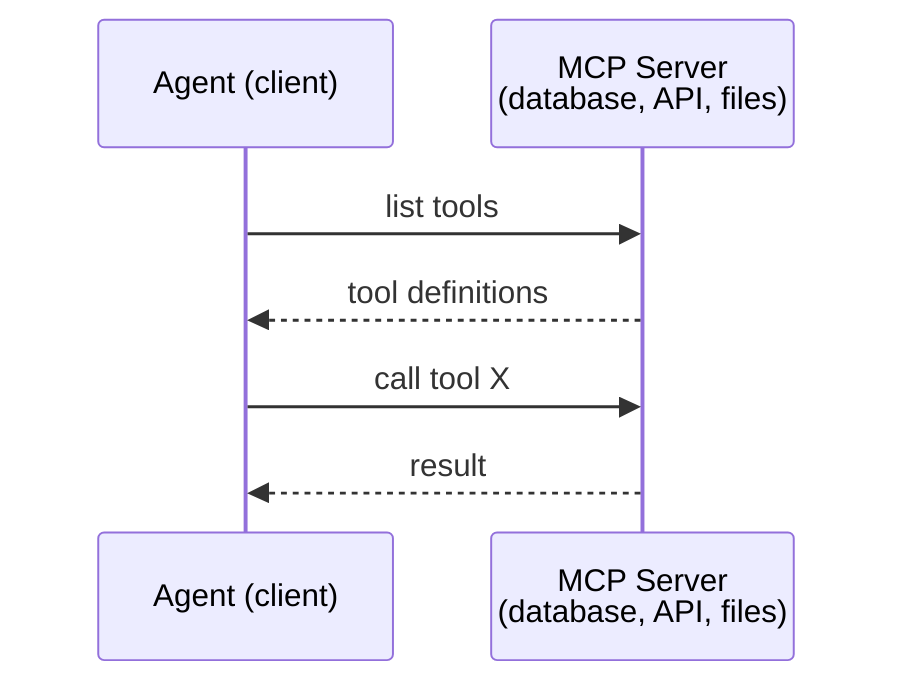

MCP 是 **agent-to-tool** communication。它不解决 agents 之间如何彼此说话。

### A2A（Agent2Agent Protocol）

**Created by:** Google（现在归 Linux Foundation，`lf.a2a.v1`）
**Spec version:** 1.0.0
**Problem:** autonomous agents 如何协作、协商，并彼此委派任务？

A2A 是 **peer-to-peer agent collaboration** 的协议。MCP 把 agent 连到 tools；A2A 把 agent 连到其他 agents。每个 agent 在 well-known URL 发布一个 **Agent Card**，其他 agents 通过它发现 capabilities、协商接口，并委派 tasks。

#### A2A 如何工作

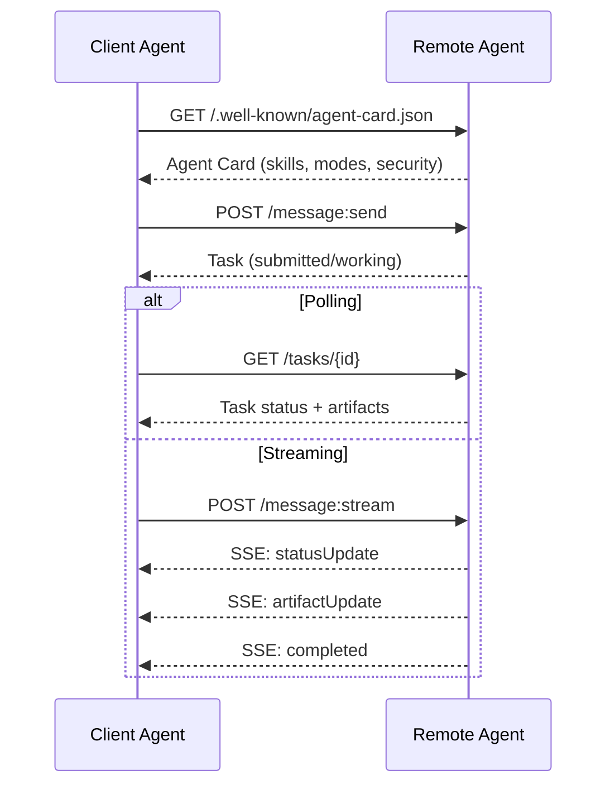

#### 真实 Agent Card

A2A Agent Card 会服务在 `GET /.well-known/agent-card.json`：

```json
{
  "name": "Research Agent",
  "description": "Searches documentation and summarizes findings",
  "version": "1.0.0",
  "supportedInterfaces": [
    {
      "url": "https://research-agent.example.com/a2a/v1",
      "protocolBinding": "JSONRPC",
      "protocolVersion": "1.0"
    },
    {
      "url": "https://research-agent.example.com/a2a/rest",
      "protocolBinding": "HTTP+JSON",
      "protocolVersion": "1.0"
    }
  ],
  "provider": {
    "organization": "Your Company",
    "url": "https://example.com"
  },
  "capabilities": {
    "streaming": true,
    "pushNotifications": false
  },
  "defaultInputModes": ["text/plain", "application/json"],
  "defaultOutputModes": ["text/plain", "application/json"],
  "skills": [
    {
      "id": "web-research",
      "name": "Web Research",
      "description": "Searches the web and synthesizes findings",
      "tags": ["research", "search", "summarization"],
      "examples": ["Research the latest changes in React 19"]
    }
  ],
  "securitySchemes": {
    "bearer": {
      "httpAuthSecurityScheme": {
        "scheme": "Bearer",
        "bearerFormat": "JWT"
      }
    }
  },
  "security": [{ "bearer": [] }]
}
```

注意三点：

- **Skills** 描述 agent 能做什么。每个 skill 有 ID、tags、支持的 input/output MIME types。
- **supportedInterfaces** 可以列出多个 protocol bindings。一个 agent 可以同时说 JSON-RPC、REST 和 gRPC。
- **Security** 内建在 card 里。Client 在发第一条请求前就知道需要什么 auth。

#### Task Lifecycle

Task 是 A2A 的核心工作单元。它会在定义好的 states 之间移动：

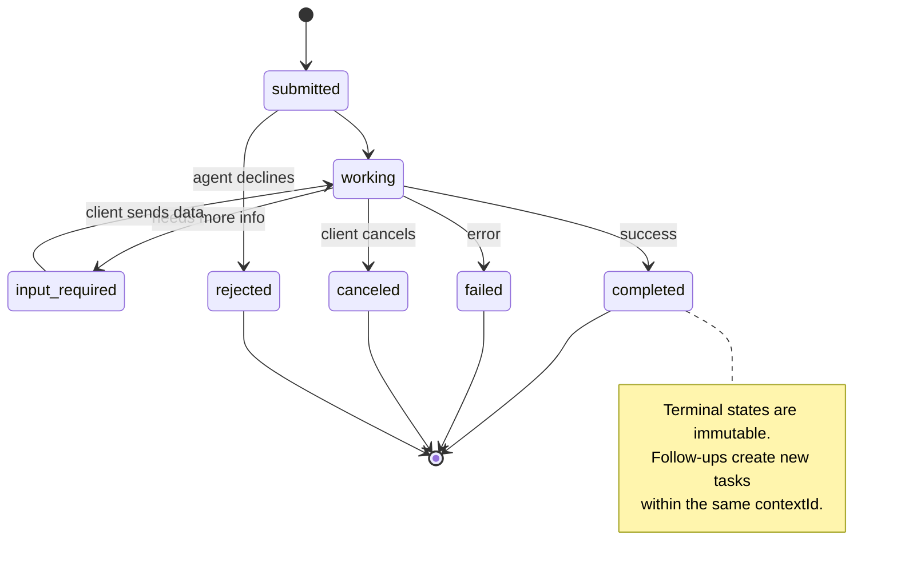

Spec 还定义了 `UNSPECIFIED` sentinel；这里列出实际使用的 8 个 states：

| State | Terminal? | Meaning |
|---|---|---|
| `TASK_STATE_SUBMITTED` | No | 已确认收到，但还没处理 |
| `TASK_STATE_WORKING` | No | 正在处理 |
| `TASK_STATE_INPUT_REQUIRED` | No | Agent 需要 client 提供更多信息 |
| `TASK_STATE_AUTH_REQUIRED` | No | 需要 authentication |
| `TASK_STATE_COMPLETED` | Yes | 成功完成 |
| `TASK_STATE_FAILED` | Yes | 出错结束 |
| `TASK_STATE_CANCELED` | Yes | 完成前被取消 |
| `TASK_STATE_REJECTED` | Yes | Agent 拒绝任务 |

一旦 task 到达 terminal state，它就是 immutable。没有后续 messages。Follow-up 会在同一个 `contextId` 下创建新 task。

#### Wire Format

A2A 使用 JSON-RPC 2.0。Client 发送 task：

```json
{
  "jsonrpc": "2.0",
  "id": 1,
  "method": "SendMessage",
  "params": {
    "message": {
      "messageId": "msg-001",
      "role": "ROLE_USER",
      "parts": [{ "text": "Research React 19 compiler features" }]
    },
    "configuration": {
      "acceptedOutputModes": ["text/plain", "application/json"],
      "historyLength": 10
    }
  }
}
```

Agent 返回 task：

```json
{
  "jsonrpc": "2.0",
  "id": 1,
  "result": {
    "task": {
      "id": "task-abc-123",
      "contextId": "ctx-xyz-789",
      "status": {
        "state": "TASK_STATE_COMPLETED",
        "timestamp": "2026-03-27T10:30:00Z"
      },
      "artifacts": [
        {
          "artifactId": "art-001",
          "name": "research-results",
          "parts": [{
            "data": {
              "findings": [
                "React 19 compiler auto-memoizes components",
                "No more manual useMemo/useCallback needed",
                "Compiler runs at build time, not runtime"
              ]
            },
            "mediaType": "application/json"
          }]
        }
      ]
    }
  }
}
```

Streaming 使用 SSE：

```text
POST /message:stream HTTP/1.1
Content-Type: application/json
A2A-Version: 1.0

data: {"task":{"id":"task-123","status":{"state":"TASK_STATE_WORKING"}}}

data: {"statusUpdate":{"taskId":"task-123","status":{"state":"TASK_STATE_WORKING","message":{"role":"ROLE_AGENT","parts":[{"text":"Searching documentation..."}]}}}}

data: {"artifactUpdate":{"taskId":"task-123","artifact":{"artifactId":"art-1","parts":[{"text":"partial findings..."}]},"append":true,"lastChunk":false}}

data: {"statusUpdate":{"taskId":"task-123","status":{"state":"TASK_STATE_COMPLETED"}}}
```

### ACP（Agent Communication Protocol）

**Created by:** IBM / BeeAI
**Spec version:** 0.2.0（OpenAPI 3.1.1）
**Status:** 正在 Linux Foundation 下 merge into A2A
**Problem:** agents 如何在具备 auditability、session continuity 和 trajectory tracking 的系统中沟通？

ACP 是 **enterprise protocol**。很多摘要会误说 ACP 使用 JSON-LD；它不是。ACP 是通过 OpenAPI 定义的 REST/JSON API。它的特别之处是 **TrajectoryMetadata**：每个 agent response 都可以携带生成该 response 的 reasoning steps 和 tool calls 的详细日志。

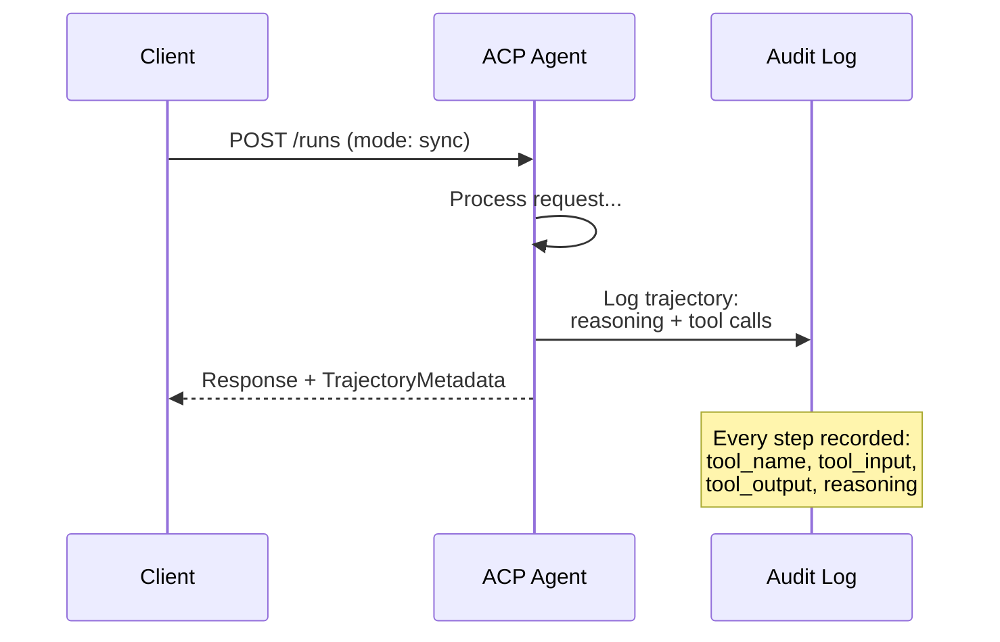

#### ACP 中的 Agent Discovery

ACP 定义四种 discovery methods：

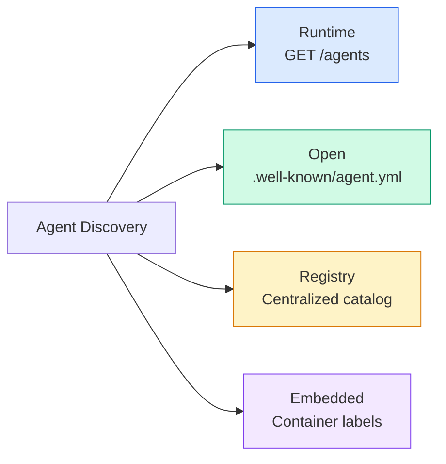

ACP 的 **AgentManifest** 比 A2A Agent Card 更简单：

```json
{
  "name": "summarizer",
  "description": "Summarizes documents with source citations",
  "input_content_types": ["text/plain", "application/pdf"],
  "output_content_types": ["text/plain", "application/json"],
  "metadata": {
    "tags": ["summarization", "RAG"],
    "framework": "BeeAI",
    "capabilities": [
      {
        "name": "Document Summarization",
        "description": "Condenses long documents into key points"
      }
    ],
    "recommended_models": ["llama3.3:70b-instruct-fp16"],
    "license": "Apache-2.0",
    "programming_language": "Python"
  }
}
```

#### Run Lifecycle

ACP 使用 “Runs”，不是 “Tasks”。Run 是一次 agent execution，有三种模式：

| Mode | Behavior |
|---|---|
| `sync` | Blocking。Response 包含完整结果。 |
| `async` | 立即返回 202。通过 `GET /runs/{id}` polling status。 |
| `stream` | SSE stream。Agent 工作时不断发 events。 |

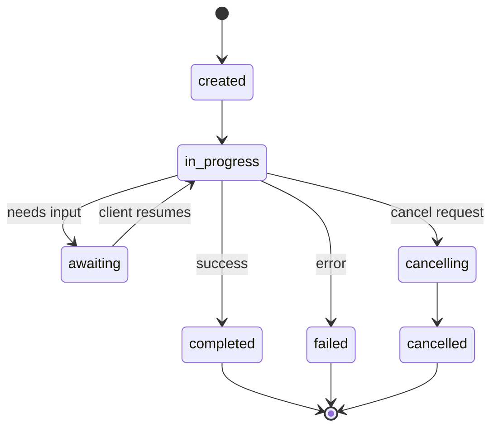

#### TrajectoryMetadata：Audit Trail

这是 ACP 的关键差异点。每个 message part 都可以包含 metadata，展示 agent 做了什么：

```json
{
  "role": "agent/researcher",
  "parts": [
    {
      "content_type": "text/plain",
      "content": "The weather in San Francisco is 72F and sunny.",
      "metadata": {
        "kind": "trajectory",
        "message": "I need to check the weather for this location",
        "tool_name": "weather_api",
        "tool_input": { "location": "San Francisco, CA" },
        "tool_output": { "temperature": 72, "condition": "sunny" }
      }
    }
  ]
}
```

对 regulated industries 来说，这很有价值。每个答案都带一条可证明的 reasoning chain：调用了哪些 tools、输入是什么、输出是什么。不再是黑箱。

ACP 也支持用于 source attribution 的 **CitationMetadata**：

```json
{
  "kind": "citation",
  "start_index": 0,
  "end_index": 47,
  "url": "https://weather.gov/sf",
  "title": "NWS San Francisco Forecast"
}
```

### ANP（Agent Network Protocol）

**Created by:** Open-source community（由 GaoWei Chang 发起）
**Repo:** [github.com/agent-network-protocol/AgentNetworkProtocol](https://github.com/agent-network-protocol/AgentNetworkProtocol)
**Problem:** 不同组织的 agents 如何在没有中央 authority 的情况下互相信任？

ANP 是 **decentralized identity protocol**。它用 W3C Decentralized Identifiers（DIDs）和 end-to-end encryption 建立 trust。A2A 通过已知 endpoint 发现 agents；ANP 让 agents 通过密码学证明自己的身份。

ANP 有三层：

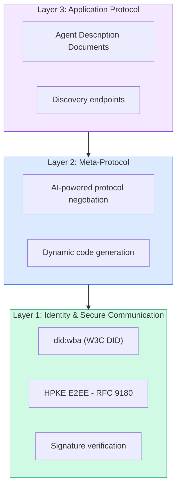

#### DID Documents

ANP 使用自定义 DID method：`did:wba`（Web-Based Agent）。例如 `did:wba:example.com:user:alice` 会解析到 `https://example.com/user/alice/did.json`：

```json
{
  "@context": [
    "https://www.w3.org/ns/did/v1",
    "https://w3id.org/security/suites/jws-2020/v1"
  ],
  "id": "did:wba:example.com:user:alice",
  "verificationMethod": [
    {
      "id": "did:wba:example.com:user:alice#key-1",
      "type": "EcdsaSecp256k1VerificationKey2019",
      "controller": "did:wba:example.com:user:alice"
    },
    {
      "id": "did:wba:example.com:user:alice#key-x25519-1",
      "type": "X25519KeyAgreementKey2019",
      "controller": "did:wba:example.com:user:alice"
    }
  ],
  "authentication": [
    "did:wba:example.com:user:alice#key-1"
  ],
  "keyAgreement": [
    "did:wba:example.com:user:alice#key-x25519-1"
  ],
  "humanAuthorization": [
    "did:wba:example.com:user:alice#key-1"
  ],
  "service": [
    {
      "id": "did:wba:example.com:user:alice#agent-description",
      "type": "AgentDescription",
      "serviceEndpoint": "https://example.com/agents/alice/ad.json"
    }
  ]
}
```

关键点：

- **Key separation** 被强制执行。Signing keys（secp256k1）和 encryption keys（X25519）分开。
- **`humanAuthorization`** 是 ANP 特有的。使用这些 keys 前需要 explicit human approval（biometric、password、HSM）。Fund transfers 这类 high-risk operations 走这条路径。
- **`keyAgreement`** keys 用于 HPKE end-to-end encryption（RFC 9180）。
- **service** section 链接到 Agent Description document。

#### ANP 中的 Trust 如何工作

ANP 不使用 web-of-trust 或 endorsement graph。Trust 是 bilateral，并且每次 interaction 都直接验证：

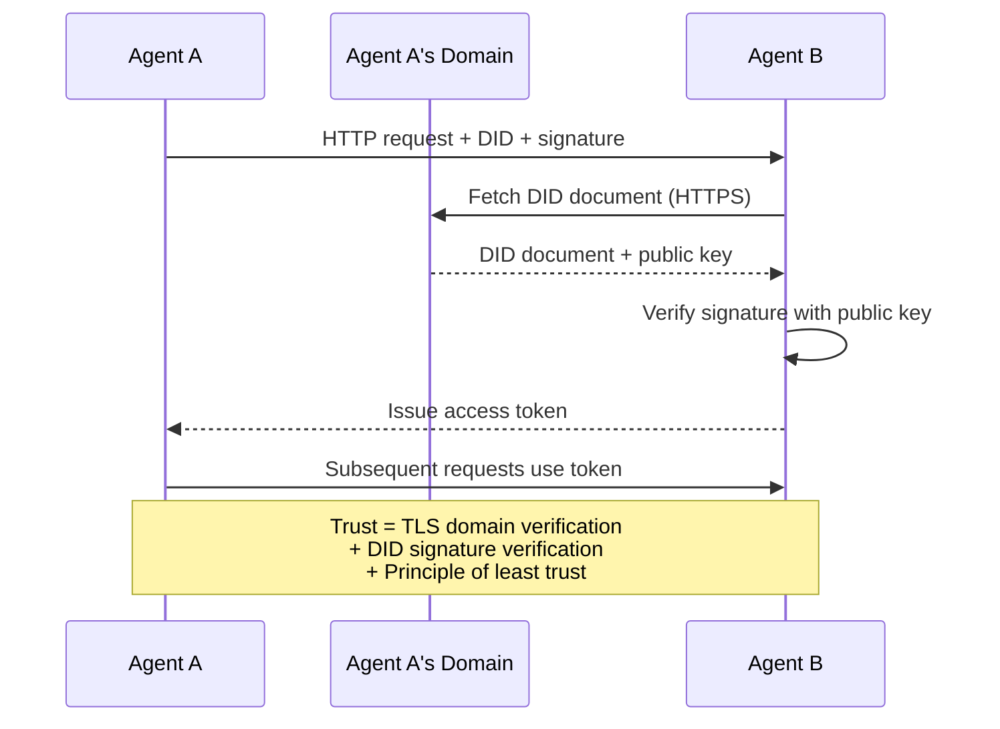

Trust 来自三处：

1. **Domain-level TLS** 验证 DID document host。
2. **DID cryptographic signatures** 验证 agent identity。
3. **Principle of least trust** 只授予最小权限。

没有 gossip-based trust propagation，也没有 PageRank scoring。你通过 DID 直接验证每个 agent。

#### Meta-Protocol Negotiation

这是 ANP 最新颖的功能。两个来自不同生态的 agents 相遇时，不需要预先约定 data formats。它们用自然语言协商：

```json
{
  "action": "protocolNegotiation",
  "sequenceId": 0,
  "candidateProtocols": "I can communicate using:\n1. JSON-RPC with hotel booking schema\n2. REST with OpenAPI 3.1 spec\n3. Natural language over HTTP",
  "modificationSummary": "Initial proposal",
  "status": "negotiating"
}
```

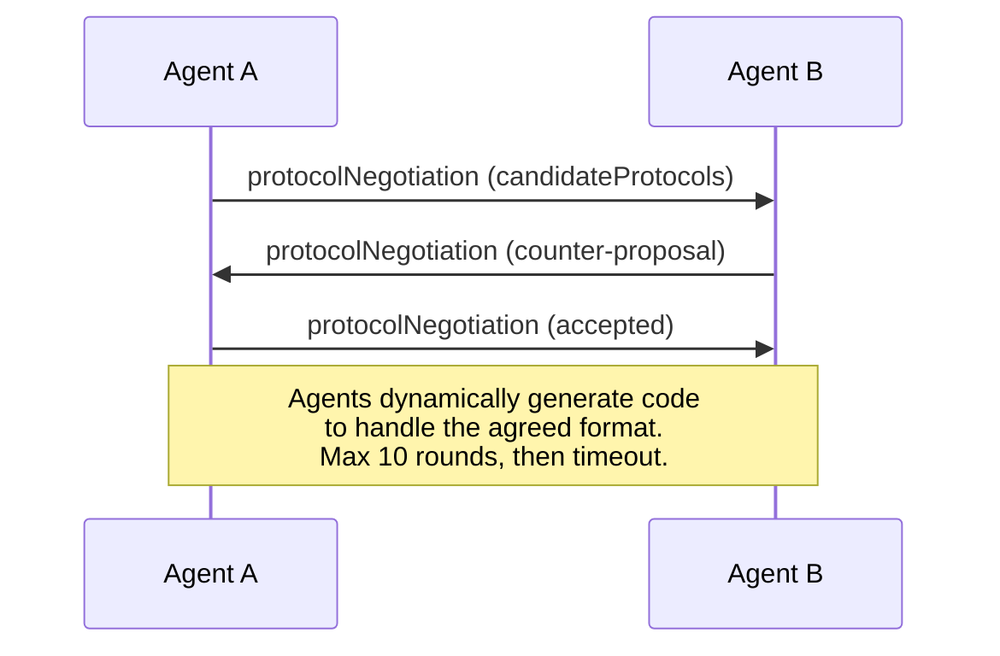

Agents 最多来回协商 10 轮，直到同意一个格式，然后动态生成 code 处理它。Status values：`negotiating`、`rejected`、`accepted`、`timeout`。

这意味着两个从未见过彼此的 agents，可以在没有人预先定义 shared schema 的情况下协商出沟通方式。

### 对比表

| | MCP | A2A | ACP | ANP |
|---|---|---|---|---|
| **Created by** | Anthropic | Google / Linux Foundation | IBM / BeeAI | Community |
| **Spec format** | JSON-RPC | JSON-RPC / REST / gRPC | OpenAPI 3.1 (REST) | JSON-RPC |
| **Primary use** | Agent to Tool | Agent to Agent | Agent to Agent | Agent to Agent |
| **Discovery** | Tool listing | `/.well-known/agent-card.json` | `GET /agents`, `/.well-known/agent.yml` | `/.well-known/agent-descriptions`, DID service endpoints |
| **Identity** | Implicit (local) | Security schemes (OAuth, mTLS) | Server-level | W3C DID (`did:wba`) with E2EE |
| **Audit trail** | N/A | Basic (task history) | TrajectoryMetadata | Not formally specified |
| **State machine** | N/A | 9 task states | 7 run states | N/A |
| **Streaming** | N/A | SSE | SSE | Transport-agnostic |
| **Unique feature** | Tool schemas | Agent Cards + Skills | Trajectory audit trail | Meta-protocol negotiation |
| **Best for** | Tools & data | Dynamic collaboration | Regulated industries | Cross-org trust |
| **Status** | Stable | Stable (v1.0) | Merging into A2A | Active development |

### 它们如何一起工作

现实中的 enterprise system 通常同时使用多个协议：

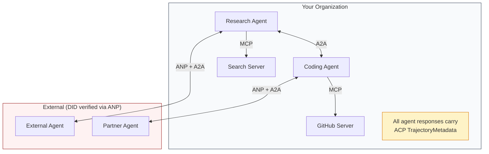

- **MCP** 把每个 agent 连到它的 tools。
- **A2A** 处理 agents 之间的 collaboration（internal 和 external）。
- **ACP** 为 auditability 把 responses 包装进 trajectory metadata。
- **ANP** 为你不控制的 agents 提供 identity verification。

## Build It

本课的完整实现位于 `code/main.ts`。它把四个 protocol patterns 压缩成一个可运行的 TypeScript demo。核心步骤如下。

### Step 1：Core Message Types

每个 multi-agent system 都从 message format 开始。这里定义的 `MessagePart` 支持 text、structured data 和 files，形状对应 A2A/ACP 的 multimodal parts；`TrajectoryEntry` 对应 ACP 的 TrajectoryMetadata。

```typescript
type MessageRole = "user" | "agent";

type MessagePart =
  | { kind: "text"; text: string }
  | { kind: "data"; data: unknown; mediaType: string }
  | { kind: "file"; name: string; url: string; mediaType: string };

type TrajectoryEntry = {
  reasoning: string;
  toolName?: string;
  toolInput?: unknown;
  toolOutput?: unknown;
  timestamp: number;
};

type AgentMessage = {
  id: string;
  role: MessageRole;
  parts: MessagePart[];
  trajectory?: TrajectoryEntry[];
  replyTo?: string;
  timestamp: number;
};
```

### Step 2：A2A Agent Card 与 Registry

`AgentRegistry` 保存 `AgentCard`，并支持按 skill tags、input MIME types 或 name 发现 agents。这比简单的 name-to-capability map 丰富得多，和 A2A spec 支持的 discovery model 一致。

关键 API：

- `register(card)`：发布一个 Agent Card。
- `discoverBySkillTag(tag)`：按能力标签查找 agents。
- `discoverByInputMode(mimeType)`：按输入类型查找 agents。
- `resolve(name)`：按名称解析 agent。

### Step 3：A2A Task Lifecycle

`TaskManager` 实现完整 task state machine：`submitted`、`working`、`input-required`、`auth-required`、`completed`、`failed`、`canceled`、`rejected`。Handlers 是 async generators，会不断 yield `statusUpdate` 和 `artifactUpdate` events，对应 SSE streaming model。

Terminal states（`completed`、`failed`、`canceled`、`rejected`）之后，task 不再接受更新。这个约束是协议语义，不只是实现细节。

### Step 4：ACP-Style Audit Trail

`AuditableRunner` 把每次 agent execution 包成一个 audit entry：

- 输入 messages。
- 输出 messages。
- reasoning/tool-call trajectory。
- run status。
- `sessionId`。
- started/completed timestamps。

你可以按 agent、session 或 individual run 查询 audit log。这就是 ACP TrajectoryMetadata 的简化实现。

### Step 5：ANP-Style Identity Verification

`IdentityRegistry` 模拟 DID resolution 和 signature verification。真实生产环境会通过 HTTP 从 agent domain 拉取 DID document；本课用内存 registry 替代。每个 identity 都有 DID document、private key 和 public key，并区分 authentication、key agreement 和 human authorization。

### Step 6：Protocol Gateway

Gateway 把四个协议接成一个 flow：

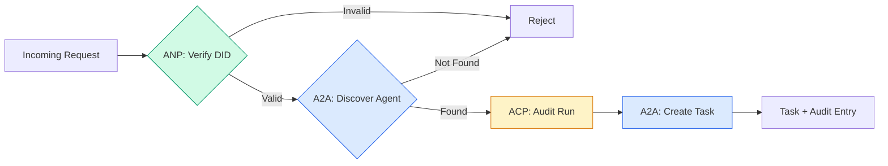

一次 `delegateTask` 做四件事：

1. **ANP**：通过 DID signature 验证 caller identity。
2. **A2A**：发现 target agent，并检查 capabilities。
3. **ACP**：把 execution 包进带 trajectory 的 audit trail。
4. **A2A**：创建具备完整 lifecycle tracking 的 task。

### Step 7：Wire It All Together

Demo 会注册 researcher 和 coder 两个 agents，给 researcher 添加 research skill，给 coder 和 researcher 创建 DID identities，然后通过 gateway 从 coder 委派一个 research task 给 researcher。运行时会打印：

- A2A agent discovery 结果。
- ANP signature verification 结果。
- A2A task ID、task state 和 artifacts。
- ACP audit run ID、status 和 trajectory steps。
- Full audit log summary。

运行：

```bash
npx tsx main.ts
```

## What Goes Wrong

Protocols 解决 happy path。生产中常坏在这些地方：

**Schema drift.** Agent A 的 Agent Card 声称输出 `application/json`，但 JSON schema 在版本之间变了。Agent B 按旧格式解析，得到垃圾。修复：给 skills 和 output schemas 做版本化。A2A Agent Card 的 `version` 就是为此存在。

**State machine violations.** 一个 handler yield 了 `completed` event 后又想继续 yield artifacts。Task 已经 immutable。代码要么静默丢弃更新，要么报错。修复：yield 前检查 terminal state。`TaskManager` 用 terminal-state break 强制执行。

**Trust resolution failures.** Agent A 想验证 Agent B 的 DID，但 Agent B 的 domain down 了。DID document 拉不到。你是 fail open（接受未验证 agents）还是 fail closed（拒绝一切）？ANP 推荐结合 principle of least trust 做 fail closed。

**Trajectory bloat.** ACP trajectory logging 强大但昂贵。一个复杂 agent 每次 run 调 200 次 tools，会生成巨大 audit entries。修复：让 trajectory verbosity 可配置。合规场景记录 tool names 和 IO；非监管 workload 可以跳过 reasoning steps。

**Discovery thundering herd.** 50 个 agents 启动时同时查询 `GET /agents`。修复：用 TTL 缓存 Agent Cards，错开 discovery intervals，或使用 push-based registration 替代 polling。

## Use It

### Real Implementations

**A2A** 最成熟。Google 的 [official spec](https://github.com/google/A2A) 已在 Linux Foundation 下开源，提供 Python 和 TypeScript SDKs。如果你的 agents 需要 dynamic discovery 和 collaboration，从这里开始。

**ACP** 正在 merge into A2A。IBM 的 [BeeAI project](https://github.com/i-am-bee/acp) 把 ACP 做成 REST-first alternative，但 trajectory metadata 概念正在被 A2A ecosystem 吸收。即使用 A2A 做 transport，也应该使用 ACP patterns（trajectory logging、run lifecycle）。

**ANP** 最实验性。[community repo](https://github.com/agent-network-protocol/AgentNetworkProtocol) 提供 Python SDK（AgentConnect）。Meta-protocol negotiation 概念确实新颖，值得关注 cross-organizational agent deployments。

**MCP** 已在 Phase 13 覆盖。如果你想让 agents 使用 tools，MCP 是标准选择。

### Picking the Right Protocol

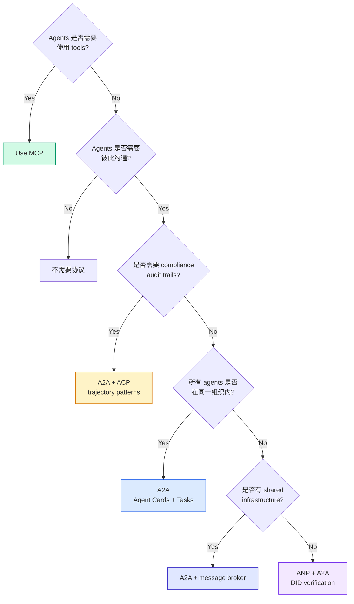

## Ship It

本课产出：

- `code/main.ts`：四种 protocol patterns 的完整实现。
- `outputs/prompt-protocol-selector.md`：一个帮助你为系统选择协议的 prompt。

## 练习

1. **Multi-hop task delegation.** 扩展 `TaskManager`，让 agent handler 能把 subtasks 委派给其他 agents。Researcher 接收 task 后，把 “search” 和 “summarize” 委派给两个 specialist agents，等待两者完成，再把结果合并进自己的 artifacts。

2. **Streaming audit trail.** 修改 `AuditableRunner` 支持 streaming mode。不要等完整结果；当 trajectory entries 增加时，实时 yield `AuditEntry` updates。使用 async generator 生成 audit snapshots。

3. **DID rotation.** 给 `IdentityRegistry` 加 key rotation。Agent 应该能发布带新 keys 的 DID document，同时保留 `previousDid` reference。Verifier 在 grace period 中应接受 current 和 previous key 的 signatures。

4. **Protocol negotiation.** 实现 ANP 的 meta-protocol 概念。两个 agents 交换 `protocolNegotiation` messages，带候选 formats（例如 “I can speak JSON-RPC” vs “I prefer REST”）。最多 3 轮后同意一种 format 或 timeout。Agreed format 决定它们使用哪个 `TaskManager` 或 `AuditableRunner`。

5. **Rate-limited discovery.** 添加一个 `RateLimitedRegistry` wrapper，用 configurable TTL 缓存 Agent Card lookups，并限制每个 agent 每秒的 discovery queries。模拟 100 个 agents 启动时互相发现的 thundering herd，并测量差异。

## 关键术语

| Term | What people say | What it actually means |
|------|----------------|----------------------|
| MCP | “AI tools 的协议” | 让 agents 发现和使用 tools 的 client-server protocol。Agent-to-tool，不是 agent-to-agent。 |
| A2A | “Google 的 agent protocol” | Linux Foundation 下的 peer-to-peer agent collaboration protocol。通过 Agent Cards discovery，9-state task lifecycle，通过 SSE streaming。支持 JSON-RPC、REST 和 gRPC bindings。 |
| ACP | “Enterprise agent messaging” | IBM/BeeAI 的 REST API，用于带 TrajectoryMetadata 的 agent runs：每个 response 都携带 reasoning 和 tool calls 的完整链条。正在 merge into A2A。 |
| ANP | “Decentralized agent identity” | Community protocol，使用 `did:wba` (DID) 做 cryptographic identity、HPKE 做 E2EE，并用 AI-powered meta-protocol negotiation 让陌生 agents 协商沟通方式。 |
| Agent Card | “Agent 的名片” | 位于 `/.well-known/agent-card.json` 的 JSON document，描述 skills、支持的 MIME types、security schemes 和 protocol bindings。 |
| DID | “Decentralized ID” | W3C standard，用于托管在 agent 自有 domain 上的 cryptographically verifiable identities。ANP 使用 `did:wba` method。 |
| TrajectoryMetadata | “Audit receipt” | ACP 把 reasoning steps、tool calls 及其 inputs/outputs 附加到每个 agent response 的机制。 |
| Meta-protocol | “Agents 协商怎么说话” | ANP 方法：agents 用 natural language 动态同意 data formats，然后生成 code 来处理这些 formats。 |
| Task | “一个工作单元” | A2A 的 stateful object，从 submission 跟踪到 completion。到达 terminal state 后 immutable。 |

## 延伸阅读

- [Google A2A specification](https://github.com/google/A2A)：official spec and SDKs（v1.0.0，Linux Foundation）。
- [IBM/BeeAI ACP specification](https://github.com/i-am-bee/acp)：agent runs 和 trajectory metadata 的 OpenAPI 3.1 spec。
- [Agent Network Protocol](https://github.com/agent-network-protocol/AgentNetworkProtocol)：DID-based identity、E2EE、meta-protocol negotiation。
- [Model Context Protocol docs](https://modelcontextprotocol.io/)：Anthropic MCP specification（Phase 13 已覆盖）。
- [W3C Decentralized Identifiers](https://www.w3.org/TR/did-core/)：ANP 所依赖的 identity standard。
- [RFC 9180 (HPKE)](https://www.rfc-editor.org/rfc/rfc9180)：ANP 用于 E2EE 的 encryption scheme。
- [FIPA Agent Communication Language](http://www.fipa.org/specs/fipa00061/SC00061G.html)：modern agent protocols 的 academic precursor。
