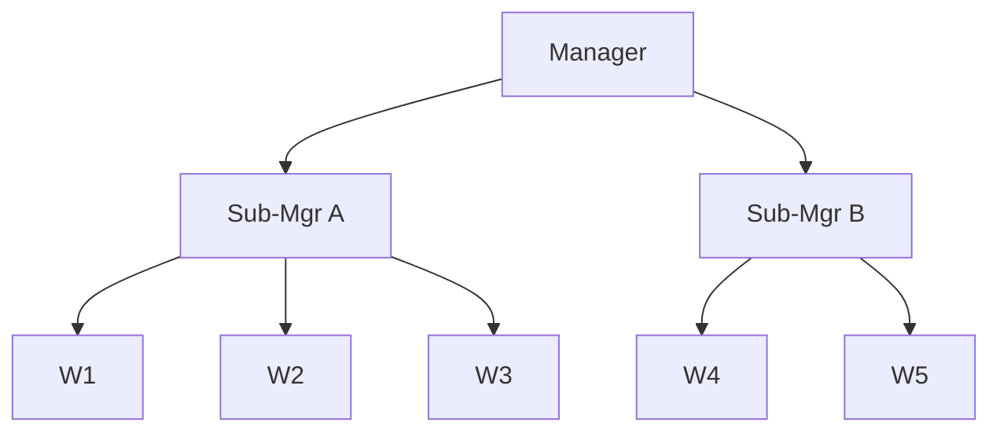

# 层级架构及其失败模式

> Hierarchical 就是嵌套 supervisor。Manager agents 管 sub-managers，sub-managers 再管 workers。CrewAI 的 `Process.hierarchical` 是教科书版本：一个 `manager_llm` 动态委派任务并验证输出。LangGraph 的等价写法是 `create_supervisor(create_supervisor(...))`。当任务本身就像真实 org chart 时，这是自然模式。它也是最容易坍缩成 managerial looping 的模式：manager agents 分配工作不当、误读 sub-outputs，或无法达成共识。Sequential 往往会赢。

**Type:** Learn + Build
**Languages:** Python (stdlib)
**Prerequisites:** Phase 16 · 05 (Supervisor Pattern)
**Time:** ~60 minutes

## 问题

一旦理解了 supervisor pattern，下一个自然问题就是：“如果 workers 本身也是 supervisors 呢？”团队有 sub-teams；公司有部门之上的部门。Hierarchical architectures 正是在镜像这种结构。

问题是：LLM managers 不是 human managers。Human manager 对自己的 reports 知道什么有稳定先验。LLM manager 每一轮都会根据 context 中的内容重新推理 org。Context 中一点点漂移，整棵树就会错误分配工作。

## 概念

### 形状



每个 internal node 都会 plan、delegate、synthesize。只有 leaves 真正做工作。

### 适合的地方

- **清晰的组织映射。** 如果真实任务本身就是部门式的（“legal review the doc, finance review the doc, engineering review the doc, then summarize for exec”），hierarchy 是显式结构。
- **局部 summarization。** 每个 sub-manager 会在 top manager 看到之前，先综合自己团队的输出。Top manager 看到的是三个 sub-manager summaries，而不是十五个 worker outputs。

### 会坏在哪里

2026 年 post-mortems 反复看到三种 failure modes：

1. **Task assignment error。** Manager 读到目标后，幻觉出一个 decomposition，并把任务委派给错误的 sub-manager。因为 sub-manager 会顺从地处理分配给它的任务，错误往往只在 top synthesis 时暴露出来，比 human 能发现的位置晚了一层。
2. **Output misinterpretation。** Sub-manager 返回 “unable to verify claim X”。Top manager 总结成 “claim X not confirmed”。Meaning 在每一层都会漂移。
3. **Consensus loops。** 两个 sub-managers 意见不一致；top manager 要求它们 reconcile；它们继续向下重新委派；workers 重新运行；sub-managers 返回略有不同的 answers；循环开始。CrewAI 的 `Process.hierarchical` 用 step limits 防护这一点，但 limit 本身现在成了 hyperparameter。

### 决策问题

Sequential（linear pipeline）vs hierarchical：你的任务真的有独立 sub-teams，还是一个 linear flow 伪装成 tree？如果是后者，用 sequential。如果是前者，可以用 hierarchical，但要明确预算 reconciliation rules。

### CrewAI 的实现

`Process.hierarchical` 会把 manager LLM 接到 specialist crews 之上。Manager：

- 接收 top-level task，
- 把 subtasks 分配给 crews，
- 评估 crew outputs，
- 决定 accept、re-delegate，或 iterate。

文档：https://docs.crewai.com/en/introduction（在 Core Concepts 下查找 “Hierarchical Process”）。

### LangGraph 的实现

LangGraph 使用嵌套的 `create_supervisor` 调用。Inner supervisor 有自己的 graph；outer supervisor 把 inner graph 当作 opaque node。调试时这比 CrewAI 更干净（你可以分别 step through 每个 graph），但更难表达 tree 的 dynamic reshaping。

参考：https://reference.langchain.com/python/langgraph-supervisor。

## Build It

`code/main.py` 运行一个 3-level hierarchy：

- top manager：把 task 拆成 “engineering” 和 “legal” branches，
- engineering sub-manager：拆成 “frontend” 和 “backend” workers，
- legal sub-manager：一个 worker。

Demo 对比 happy path（所有人意见一致）和 **perturbed path**：top manager 的 decomposition 把 “legal” 误标成 “finance”，然后观察错误如何 cascade。Sub-manager 顺从地做 finance work，top synthesizer 报告 finance findings，而原始 legal question 没有得到回答。

运行：

```bash
python3 code/main.py
```

输出会清楚并排展示两条路径中的 “what was asked” 和 “what was delivered”。

## Use It

`outputs/skill-hierarchy-fitness.md` 会评估给定 task 应该使用 hierarchical、sequential，还是 flat supervisor。Inputs：task description、org structure、reconciliation budget。Output：pattern recommendation，并指出需要防护的具体 failure modes。

## Ship It

如果你要上线 hierarchical：

- **把 tree depth 限制在 2。** 三层已经会把大多数错误藏出 observability。
- **明确 reconciliation budget。** 在 top manager 必须 commit 之前设置 max rounds。通常是 2。
- **每次 synthesis 都要有 provenance。** 每个 node 的 summary 必须引用产生它的 leaf outputs。
- **对 decomposition drift 告警。** 记录 manager 每一步的 decomposition；和 user query 做 diff。如果 decomposition 不再覆盖 query，触发 alert。

## 练习

1. 运行 `code/main.py`，比较 happy 和 perturbed。需要经过几层 manager hand-off，top output 才会完全偏离 user question？
2. 添加第三层（top → sub → sub-sub → worker）。随着 depth 增长，测量 perturbed path 自我纠正和完全发散的频率。
3. 在每个 sub-manager 下实现一个 “canary” worker，它始终被原样询问 original user question。用 canary answer 检测 decomposition drift。当 canary 和 synthesized answer 不一致时，manager 应该如何反应？
4. 阅读 CrewAI 的 `Process.hierarchical` docs。找出 CrewAI 应用的一个具体 guardrail（step limit、manager_llm constraint），并描述它针对哪种 failure mode。
5. 比较 nested LangGraph supervisors 和 CrewAI hierarchical。哪一个更容易低成本检测 reconciliation loops？

## 关键术语

| Term | What people say | What it actually means |
|------|----------------|------------------------|
| Hierarchical | “Org chart pattern” | Supervisors over supervisors；只有 leaves 做工作。 |
| Manager LLM | “The boss” | 在 internal node 上 decomposition、assignment、validation 的 LLM。 |
| Decomposition drift | “The boss lost the plot” | Top manager 的 split 不再覆盖 original question。 |
| Reconciliation loop | “Endless meetings” | Sub-managers 不一致；top re-delegates；workers re-run；循环直到 budget 耗尽。 |
| Depth-2 ceiling | “Don't go deeper than 2 levels” | 经验 guardrail：3+ levels 会让 observability 坍塌。 |
| Canary question | “Ground truth at every level” | 一个始终被原样询问 original query 的 worker，用于检测 drift。 |
| Provenance chain | “Who said what” | 从每个 synthesis 追溯到产生它的 leaf outputs。 |

## 延伸阅读

- [CrewAI introduction — Process.hierarchical](https://docs.crewai.com/en/introduction) — textbook hierarchical with a manager LLM
- [LangGraph supervisor reference](https://reference.langchain.com/python/langgraph-supervisor) — nested supervisor via `create_supervisor`
- [Anthropic engineering — Research system](https://www.anthropic.com/engineering/multi-agent-research-system) — 为什么 Anthropic 刻意选择 flat supervisor，而不是 hierarchical
- [Cemri et al. — Why Do Multi-Agent LLM Systems Fail?](https://arxiv.org/abs/2503.13657) — MAST taxonomy；coordination failures 部分记录了 decomposition drift
