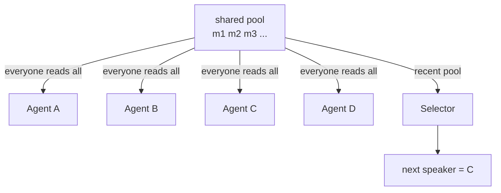

# Group Chat 与 Speaker Selection

> AutoGen GroupChat 和 AG2 GroupChat 让 N 个 agents 共享同一个 conversation；selector function（LLM、round-robin 或 custom）选择下一位 speaker。这是 emergent multi-agent conversation 的原型——agents 不知道自己在一个静态 graph 中的角色，它们只是对 shared pool 作出反应。AutoGen v0.2 的 GroupChat semantics 在 AG2 fork 中被保留下来；AutoGen v0.4 把它重写成 event-driven actor model。Microsoft 于 2026 年 2 月让 AutoGen 进入 maintenance mode，并把它与 Semantic Kernel 合并进 Microsoft Agent Framework（2026 年 2 月 RC）。GroupChat primitive 同时存在于 AG2 和 Microsoft Agent Framework 中——学一次，到处用。

**Type:** Learn + Build
**Languages:** Python (stdlib)
**Prerequisites:** Phase 16 · 04 (Primitive Model)
**Time:** ~60 minutes

## 问题

Static graphs（LangGraph）在 workflow 已知时很棒。真实 conversations 不是静态的：有时 coder 会问 reviewer，有时问 researcher，有时问 writer。硬编码每一种可能 handoff 会导致 edge explosion。你想要的是 *agents reacting to a shared pool*，再用某个 function 决定谁下一轮发言。

这正是 AutoGen GroupChat 做的事。

## 概念

### 形状



每个 agent 都能看到每条 message。每一轮都会调用 selector function 来选择下一位 speaker。

### 三种 selector flavors

**Round-robin。** 固定循环。确定性。随 N 线性扩展，但忽略上下文——即使话题是 legal review，也可能轮到 coder。

**LLM-selected。** 调用一个 LLM，读取 recent pool 并返回最佳 next speaker。上下文感知，但慢：每一轮都会额外增加一次 LLM call。AutoGen 的默认方式。

**Custom。** 一个 Python function，内部可以放任何你想要的逻辑。典型做法是：LLM-selected 加 fallback rules（例如，“coder 之后永远把 verifier 放到下一轮”）。

### ConversableAgent API

```python
agent = ConversableAgent(
    name="coder",
    system_message="You write Python.",
    llm_config={...},
)
chat = GroupChat(agents=[coder, reviewer, tester], messages=[])
manager = GroupChatManager(groupchat=chat, llm_config={...})
```

`GroupChatManager` 持有 selector。当一个 agent 完成一轮后，manager 调用 selector，selector 返回下一个 agent。循环会一直继续，直到满足 termination condition。

### Termination

三种常见模式：

- **Max rounds。** 对总 turns 设置硬上限。
- **"TERMINATE" token。** Agents 可以发出一个 sentinel message；manager 看到后停止。
- **Goal-reached check。** 每轮运行一个 lightweight verifier，当 chat 完成目标时停止。

### AutoGen → AG2 分裂，以及 Microsoft Agent Framework 合并

2025 年初，Microsoft 开始围绕 event-driven actor model 对 AutoGen 做一次大重写（v0.4）。社区 fork 了 AutoGen v0.2 的 GroupChat semantics，形成 AG2，保留了早期采用者已经集成的 API。

2026 年 2 月，Microsoft 宣布 AutoGen 进入 maintenance mode，并把 event-driven actor model 合并进 **Microsoft Agent Framework**（2026 年 2 月 RC，现在已和 Semantic Kernel 合并）。GroupChat concept 在两条路线中都保留下来；实现细节不同。对于 v0.2-compatible code，AG2 是首选 upstream。

### GroupChat 适合什么时候

- **Emergent conversations。** 你不想预先连好每一种可能的 next-speaker。
- **Role-mixing tasks。** Coder 问 researcher，researcher 问 archivist，archivist 又问回 coder。Flow 不是 DAG。
- **Exploratory problem-solving。** 想象“brainstorm meeting”，不是“assembly line”。

### 什么时候会失败

- **Strict determinism。** LLM selector 可能不一致。同一个 prompt，不同运行，不同 next speakers。
- **Sycophancy cascades。** Agents 会服从发言最自信的人。需要显式 counter-prompt。
- **Context bloat。** 每个 agent 都读取每条 message；10 轮之后 context 会很大。用 projections（Lesson 15）来限制 views。
- **Hot speakers。** 某个 agent 因为 selector 偏爱它的 specialties 而主导 conversation。把 speaker balance 加成 selector feature。

### Group chat vs supervisor

相同 primitives，不同 defaults：

- Supervisor：一个 agent 规划，其他 agents 执行。Selector 是“问 planner 下一步做什么”。
- Group chat：所有 agents 都是 peers；selector 是 shared pool 上的一个 function。

两者都使用 Lesson 04 的四个 primitives。Group chat 默认使用 LLM-selected orchestration 和 full-pool shared state。

## Build It

`code/main.py` 会用 stdlib 从零实现一个 GroupChat。三个 agents（coder、reviewer、manager），round-robin 和 LLM-selected 两种 variants，并在 `TERMINATE` token 上 termination。

Demo 会打印 conversation transcript，以及两种 variants 下 selector 的 decision trace。

运行：

```bash
python3 code/main.py
```

## Use It

`outputs/skill-groupchat-selector.md` 会为给定任务配置 GroupChat selector：round-robin vs LLM-selected vs custom，以及 selector inputs（recent messages、agent specialties、turn counts）应该使用哪些。

## Ship It

Checklist：

- **Max rounds cap。** 永远要有。典型任务设为 10–20。
- **Speaker-balance metric。** 跟踪每个 agent 的 turns；imbalance 超过阈值时 alert。
- **Termination token。** `TERMINATE` 或一个专门的 verifier agent。
- **Projection or scoped memory。** 约 10 条 messages 之后，考虑只给每个 agent 一个 scoped view，防止 context bloat。
- **Selector logging。** 对于 LLM-selected variants，同时记录 selector 的 input 和 choice。否则无法 debug。

## 练习

1. 运行 `code/main.py`。比较 round-robin 和 LLM-selected 下的 conversation。哪一个 agent 在各自模式下占主导？
2. 在 selector 中添加 “max-speaks-per-agent” rule。它如何影响 transcript？
3. 实现一个 goal-reached termination：当 reviewer 返回 “approved” 时停止。它有多经常能在 round cap 之前触发？
4. 阅读 AutoGen stable docs 中的 GroupChat（https://microsoft.github.io/autogen/stable/user-guide/core-user-guide/design-patterns/group-chat.html）。找出 `GroupChatManager` 使用的默认 selector。
5. 阅读 AG2 repo（https://github.com/ag2ai/ag2），并比较它的 v0.2 GroupChat 与 v0.4 event-driven version。v0.4 增加了哪个具体性质（throughput、fault-tolerance、composability）？

## 关键术语

| Term | 常见说法 | 实际含义 |
|------|----------|----------|
| GroupChat | “Agents in one chat room” | Shared message pool + selector function。AutoGen / AG2 primitive。 |
| Speaker selection | “Who talks next” | 选择下一个 agent 的 function。Round-robin、LLM-selected 或 custom。 |
| GroupChatManager | “The meeting host” | AutoGen component，拥有 selector，并负责 turns loop。 |
| ConversableAgent | “The base agent” | AutoGen base class；一个能发送和接收 messages 的 agent。 |
| Termination token | “The 'stop' word” | 结束 chat 的 sentinel string（通常是 `TERMINATE`）。 |
| Hot speaker | “One agent dominates” | Selector 不断选择同一个 agent 的 failure mode。 |
| Context bloat | “Pool grows unbounded” | 每个 agent 都读取所有 prior messages；context 随 turns 增长。 |
| Projection | “Scoped view” | Shared pool 的 role-specific view，用来防止 context bloat。 |

## 延伸阅读

- [AutoGen group chat docs](https://microsoft.github.io/autogen/stable/user-guide/core-user-guide/design-patterns/group-chat.html) — the reference implementation
- [AG2 repo](https://github.com/ag2ai/ag2) — community AutoGen v0.2 continuation
- [Microsoft Agent Framework docs](https://microsoft.github.io/agent-framework/) — the merged successor, RC February 2026
- [AutoGen v0.4 release notes](https://microsoft.github.io/autogen/stable/) — event-driven actor model rewrite details
