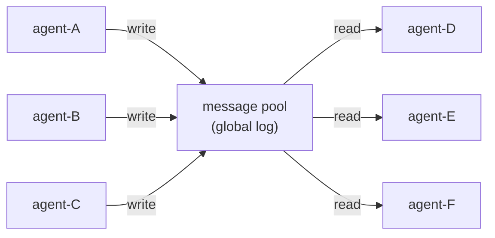
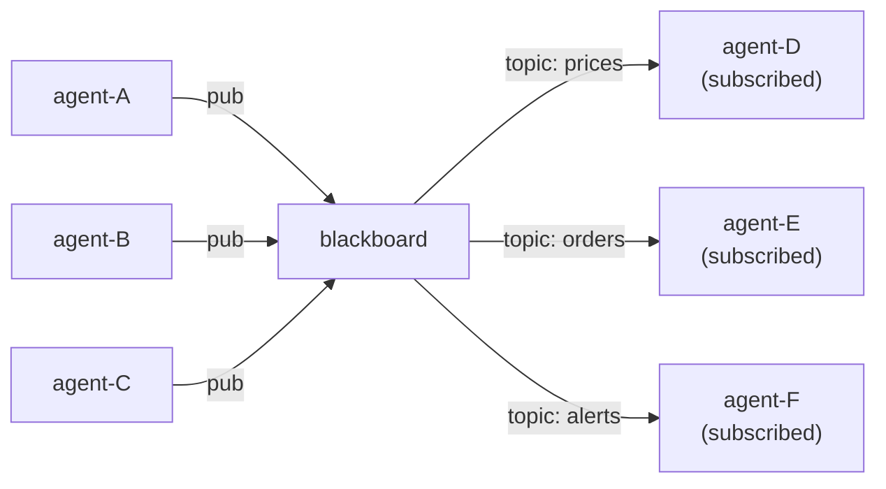

# Shared Memory 与 Blackboard Patterns

> 2026 年的 multi-agent systems 中并存两种方法：**message pool**（所有人都看见所有人的 messages，例如 AutoGen GroupChat 或 MetaGPT）和 **blackboard with subscription**（agents 订阅相关 events，例如 Context-Aware MCP 或 Matrix framework）。两者都是 multi-agent system 中唯一 stateful 的部分，这也意味着有趣的 bugs 都住在这里。参考 failure mode 是 **memory poisoning**：一个 agent hallucinate 了一个 “fact”，其他 agents 把它当成 verified，accuracy 以比立即 crash 更难 debug 的方式逐渐衰减。本课用 stdlib 构建两种结构，注入一次 poisoning attack，并展示三个 production 中真正有效的 mitigations。

**Type:** Learn + Build
**Languages:** Python（stdlib，`threading`）
**Prerequisites:** Phase 16 · 04（Primitive Model），Phase 16 · 09（Parallel Swarm Networks）
**Time:** ~75 minutes

## 问题

Multi-agent systems 需要一个地方让 agents 共享 facts。一个字面选项是“把所有东西都通过 messages 传递”——但这只是用额外 copying 重新发明 shared state。另一个选项是“给所有人一个 global log”——但 global logs 会无界增长，并且很容易被 poison。第三个选项是“为每个 agent 投影一个 view”——可扩展，但 schema-heavy。

当某个 agent hallucinate 并把 hallucination 写进 shared state 后，每个下游读取这个 state 的 agent 都会把 hallucination 当作事实采纳。等人类注意到时，reasoning chain 已经深入五步，root cause 是第三条曾经写入的 message。Debug multi-agent accuracy decay 比 debug crash 更难。

这就是 memory poisoning。它是 MAST taxonomy（Cemri et al., arXiv:2503.13657）中第二多文档记录的 failure family，而且是结构性的：任何没有 provenance、没有 unwritable verifier 的 shared-memory design，最终都会表现出它。

## 概念

### 两种主要拓扑

**Full message pool.** 每个 agent 读取每条 message。AutoGen GroupChat 和 MetaGPT 使用这种方式。它简单、透明、可检查，但超过约 10 个 agents 后就不再扩展，因为每个 agent 的 context 会被其他 agents 的工作塞满。



**Blackboard with subscription.** Agents 声明自己对哪些 topics 感兴趣；substrate 只路由相关 messages。CA-MCP（arXiv:2601.11595）和 Matrix decentralized framework（arXiv:2511.21686）使用这种方式。它能扩展得更远，但需要提前做 schema design，才能让 subscriptions 有意义。



### 什么时候各自胜出

- **Full pool** 在 agents 数量少（< 10）、角色异质、conversation short-horizon 时胜出。每个人都看见一切时，“谁说了什么”很容易推理。
- **Blackboard** 在 agents 很多、role 同质但 instance 很多（swarms）、conversation long-running 时胜出。Routing 会节省 token cost 并减少 context pollution。

Production systems 经常混合使用：顶层 planning layer 是小型 full pool；底层 worker layer 是 blackboards。

### 一个 memory poisoning 场景

三个 agents 做 research task。Agent A 是 retrieval agent。Agent B 是 summarizer。Agent C 是 analyst。

1. A fetch 一个页面，并向 shared state 写入 message：“The study reports a 42% accuracy improvement.”
2. fetched page 实际写的是 “4.2% improvement.” A hallucinate 了 decimal。
3. B 读取 shared state 后写入：“Large 42% accuracy gain reported (source: A).”
4. C 读取 shared state 后写入：“Recommend adoption — 42% lift is transformative.”
5. final report 引用了一个从未存在过的 42% 数字。

没有 agent crash。没有 test fail。系统“工作了”。hallucination 通过 shared state 从一个 agent 的 context 跨进了每个下游 agent 的 reasoning。

### 为什么这是结构性问题

没有 shared state 时，agent A 的 hallucination 会留在 A 的 context 里。下游 agents 会重新 fetch 或重新 derive，也许能抓住错误。有了 naive shared state，A 的 context 变成每个人的 context，hallucination 就被洗成事实。

问题不是 shared state 本身，而是 shared state **没有 provenance，也没有 independent verifier**。三个 mitigations 会处理这件事：

1. **每次 write 都标注 provenance。** Shared state 中的每条 entry 都记录谁写的、何时写的、在什么 prompt 下写的，以及（如果适用）agent 引用了什么 source。下游 agents 会根据 provenance 保持怀疑。
2. **Writes 要 versioned；把它们视为 append-only。** correction 是一条 supersede 旧 entry 的新 entry，而不是 in-place update。audit trail 被保留。
3. **至少保留一个不能写 shared state 的 agent。** read-only verifier agent 抽样 entries、重新 fetch sources，并标记 inconsistencies。因为它不能写入 pool，所以它不会被 pool poisoning。

### Blackboard precedent（Hayes-Roth, 1985）

Blackboard pattern 比 LLM agents 早四十年。Hayes-Roth（1985，“A Blackboard Architecture for Control”）描述了 specialist Knowledge Sources：它们观察 global blackboard，贡献 partial solutions，并触发其他 sources。2026 年的 blackboard（CA-MCP、Matrix）是同一个 pattern，只是 Knowledge Sources 变成 LLM agents，partial solutions 变成 JSON blobs。旧文献已经记录了 write contention、opportunistic control 和 consistency 的解决方法，现代系统正在重新发现这些东西。

### Projection vs full view

纯 blackboard 会给每个 subscriber 同样的 projection（topic-scoped）。更激进的设计是 **per-agent projection**：每个 agent 得到一个为其 role 定制的 view。LangGraph 的 state reducers 是 2026 年的 canonical implementation：reducer function 把 global state fold 成 role-specific slice。

Per-agent projection 扩展性更好，但需要 schema。没有 schema，你就会在每个 agent 的 prompt 里重建 ad-hoc projection。

### Write-contention patterns

多个 agents 同时写入是 concurrency problem，不只是 LLM problem。三种 pattern 有效：

- **Sequential writer（single producer）。** 所有 writes 都通过一个 coordinator agent 串行化。简单，但会成为 bottleneck。
- **Optimistic concurrency with versioning。** 每条 entry 都有 version；writers 在 version mismatch 时 fail 并 retry。经典 database technique。
- **Topic partitioning。** 不同 agents 拥有不同 topics。没有 cross-topic contention。需要设计好的 partition boundaries。

大多数 2026 frameworks 默认使用 sequential writer，因为 LLM calls 慢到 contention 很少见，bottleneck 不太伤。

### Unwritable verifier

最承重的 mitigation 是 read-only verifier。实现规则：

- Verifier 和 team 共享 state（读取 blackboard 或 pool）。
- Verifier 没有 shared state 的 write handle，只能写入单独的 verification channel。
- Verifier 独立 fetch writes 中引用的 sources，并标记 disagreement。
- Verifier 自己的 outputs 会路由给 human 或单独的 decision agent，永远不喂回 pool。

如果没有这种隔离，verifier 的 outputs 会变成 pool 中的新 entries。也就是说，poisoned pool 会 poison verifier，然后 verifier 又会 poison 它自己的 verifications。

## Build It

`code/main.py` 用 stdlib Python 实现了两种拓扑，外加一个 toy poisoning attack 和三种 mitigations。

- `MessagePool`：thread-safe append-only log，支持 full read-out。
- `Blackboard`：topic-keyed pub/sub，带 per-agent subscriptions。
- `ProvenanceEntry`：每次 write 记录 `(writer, timestamp, prompt_hash, source_uri)`。
- `PoisoningScenario`：运行一个 three-agent research task，其中 agent A hallucinate 了 decimal。打印 final report。
- `Verifier`：一个 read-only agent，会重新 fetch sources 并标记 inconsistencies。在 verifier present 的情况下运行同一场景。

运行：

```bash
python3 code/main.py
```

Expected output：

- Run 1（no verifier）：hallucinated 42% 传播到 final report。
- Run 2（with verifier）：verifier 标记 inconsistency，pool 被标为 “flagged”，final report 包含 retraction。

## Use It

`outputs/skill-memory-auditor.md` 是一个 skill，会审计任意 multi-agent system 的 shared-memory design，检查 provenance、versioning 和 verifier separation。在新的 multi-agent architecture 进 production 前运行它。

## Ship It

对于任何 shared-memory design：

- 在每次 write 上记录 provenance：`(writer, timestamp, prompt_hash, tool_calls_cited, source_uri)`。
- 让 log append-only。Corrections 是引用 superseded entry 的新 entries。
- 部署至少一个 read-only verifier agent，并给它 independent source access。
- 把 verifier output 路由到单独 channel，不要送回 shared pool。
- 记录 writes 中 supersessions 的比例。这个比例上升，是 hallucination patterns 的早期证据。

## 练习

1. 运行 `code/main.py`。确认 run 1 会传播 hallucination，而 run 2 会抓住它。
2. 添加第二个 hallucination：agent B 编造 dataset size。Verifier 应该抓住两者，而不需要为任何一个手工定制。
3. 把 full pool 切换成带 topic partitions（`prices`、`summaries`、`analyses`）的 blackboard。Topic partitioning 会让哪些 poisoning scenarios 更难成功？又对哪些没有帮助？
4. 阅读 Hayes-Roth（1985，“A Blackboard Architecture for Control”）。找出本文没有讨论的两个 control patterns，并说明 2026 systems 会如何受益。
5. 阅读 CA-MCP（arXiv:2601.11595）。把它的 Shared Context Store 映射到 `code/main.py` 中的 MessagePool 或 Blackboard class。CA-MCP 在这些 primitives 之上还添加了什么？

## 关键术语

| Term | What people say | What it actually means |
|------|----------------|------------------------|
| Message pool | “Shared chat history” | 每个 agent 都读取的 append-only log。完全透明，但扩展性差。 |
| Blackboard | “Shared workspace” | Topic-keyed pub/sub。Agents 订阅相关 topics。扩展得更远。 |
| Provenance | “Who wrote what” | 每次 write 上的 metadata：writer、timestamp、prompt、sources。 |
| Memory poisoning | “Hallucinations spreading” | 一个 agent 的错误进入 shared state，下游 agents 把它当成事实采纳。 |
| Append-only | “No in-place updates” | Corrections 是 supersede 旧 entry 的新 entries。保留 audit trail。 |
| Unwritable verifier | “Independent auditor” | Read-only agent，重新 fetch sources 并标记 inconsistencies。 |
| Projection | “Scoped view” | 从 global state 计算出的 per-agent view。LangGraph reducers 是 canonical case。 |
| Knowledge Source | “Specialist agent” | Hayes-Roth 1985 对 blackboard participant 的称呼。 |

## 延伸阅读

- [Cemri et al. — Why Do Multi-Agent LLM Systems Fail?](https://arxiv.org/abs/2503.13657) — MAST taxonomy；memory poisoning 是 coordination-failure sub-family
- [CA-MCP — Context-Aware Multi-Server MCP](https://arxiv.org/abs/2601.11595) — coordinated MCP servers 的 Shared Context Store
- [Matrix — decentralized multi-agent framework](https://arxiv.org/abs/2511.21686) — 没有 central orchestrator 的 message-queue-based blackboard
- [LangGraph state and reducers](https://docs.langchain.com/oss/python/langgraph/workflows-agents) — production 中的 per-agent projection pattern
- [Anthropic — How we built our multi-agent research system](https://www.anthropic.com/engineering/multi-agent-research-system) — production deployment 中的 provenance 和 verification notes
