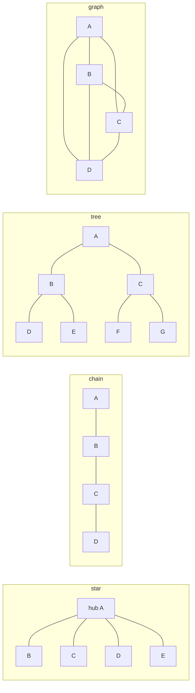

# Voting、Self-Consistency 与 Debate Topology

> 最便宜的 aggregation：采样 N 个独立 agents，然后 majority-vote。Wang 等人在 2022 年的 self-consistency 用一个模型采样 N 次来做这件事。Multi-agent 把它扩展为 **heterogeneous** agents，用来逃离 monoculture：不同模型、不同 prompts、不同 temperatures、不同 contexts。超过 majority vote 之后，debate topology 会变得重要：MultiAgentBench（arXiv:2503.01935，ACL 2025）评估了 star / chain / tree / graph coordination，并发现 **graph 最适合 research**，但超过约 4 个 agents 后会出现 “coordination tax”。AgentVerse（ICLR 2024）记录了两种 emergent patterns：volunteer behaviors 和 conformity behaviors。而 conformity 既是特性（找到 consensus），也是风险（groupthink，Lesson 24）。本课会绘制 topology space，实现每种 variant，并测量 coordination tax。

**Type:** Learn + Build
**Languages:** Python (stdlib)
**Prerequisites:** Phase 16 · 07 (Society of Mind and Debate), Phase 16 · 14 (Consensus and BFT)
**Time:** ~75 minutes

## 问题

Debate 可以提高准确率（Du et al., arXiv:2305.14325）。它也可能降低准确率。Debate 是否有帮助，取决于四个结构选择：

1. 谁和谁对话（topology）。
2. 多少轮（Du 2023：rounds 和 agents 都独立重要）。
3. Agents 是否 heterogeneous（不同 base models 会打破 monoculture）。
4. 是否存在 adversarial voice（steel-manning vs. straw-manning）。

很多团队把“跑 5 个 agents 然后 vote”硬接到任务上，结果反而比 single agent 更差。这些失败不是随机的。它们和 topology 与 heterogeneity 有关。本课就是 topology map。

## 概念

### Self-consistency，single-model baseline

Wang 等人在 2022 年的 “Self-Consistency Improves Chain of Thought Reasoning” 中，用 temperature > 0 从同一个模型采样 N 次，并对 reasoning-path answers 做 majority-vote。它在 GSM8K 上的结果是：N=40 samples 相比单次 greedy decode 有显著提升。Self-consistency 是 multi-agent voting 的 single-agent 前身。

限制是：self-consistency 使用一个 base model。Errors 天然相关。如果模型有系统性 bias，所有 N 个 samples 都会共享它。

### Multi-agent vote，heterogeneous extension

把 N 个 samples 换成 N 个 *different* agents。不同 base models（Claude、GPT、Llama）、不同 prompts、不同 tool access。收益是 uncorrelated errors。成本是不同 agents 有不同开销，协调它们会增加 overhead。

Heterogeneous debate 在 2026 年的 canonical name 是 **A-HMAD**，即 Adversarial Heterogeneous Multi-Agent Debate。这个名称还不是普遍采用，但论文会用它表示“不同模型参与 debate，从而减少 monoculture collapse 带来的 correlated errors”。

### 四种 topologies



Star：一个 hub，其他 agents 只和 hub 对话。等价于没有 back-channel 的 supervisor-worker。
Chain：线性结构，每个 agent 看到前一个 agent 的输出。类似 pipeline。
Tree：层级结构，由 hierarchical agent systems 使用（Lesson 06）。
Graph：any-to-any。包括 fully-connected clique 和任意 DAGs。

### Coordination tax（MultiAgentBench）

MultiAgentBench（MARBLE，ACL 2025，arXiv:2503.01935）在包含 research、coding 和 planning 的 task suite 上 benchmark 了 star、chain、tree、graph。关键测量结果：

- **Graph** topology 在 research tasks 上获胜。信息 any-to-any 流动；agents 可以彼此 critique。
- **Star** 在 fast-answer factual tasks 上获胜。Hub 会过滤和整合。
- **Chain** 在 stepwise pipelines（分阶段 refinement）上获胜。
- **Coordination tax** 在 graph topology 超过约 4 个 agents 后出现。Wall-clock 和 token cost 增长得比质量更快。

4-agent ceiling 是经验性的，不是根本限制。它反映的是 2026 年 LLM context capacity：每个 agent 的 context 会被 peers 的输出填满，而当所有人都能看到所有人后，加入 agent N+1 的 marginal value 会下降。

### Multi-Agent Debate Strategies（“Should we be going MAD?”）

arXiv:2311.17371 是 2023 年关于 MAD strategies 的 survey。被其他研究复现的关键发现是：和 self-consistency *结构相似* 的 MAD variants（independent sampling + aggregation）在相同 budget 下经常不如 self-consistency。MAD 最有帮助的时候，是 agents 真正 heterogeneous，并且 debate 有 adversarial structure（有一个 agent 负责反对）。

### AgentVerse emergent patterns

AgentVerse（ICLR 2024，https://proceedings.iclr.cc/paper_files/paper/2024/file/578e65cdee35d00c708d4c64bce32971-Paper-Conference.pdf）记录了两种即使没有显式设计也会从 multi-agent debate 中涌现的 behaviors：

- **Volunteer。** 一个 agent 主动提供帮助（“I can take the next step”）。有用之处：它把工作分配给最适合某个 subtask 的 agent。
- **Conformity。** 一个 agent 会调整自己的立场以匹配 critic，即使 critic 是错的。这是 debate 版 sycophancy（Lesson 14）。

Conformity 解释了为什么 debate-until-agreement 会奖励强势者。Bounded rounds 加一个 separate judge 可以缓解。

### Heterogeneity：真正推动 accuracy 的旋钮

2024 到 2026 年 practical literature 中出现了一个模式：把 N 个 agents 中的一个换成不同 base model，带来的 accuracy bump 通常大于把 N 增加 1。直觉是 monoculture：每一个新的 independent-error source，都比一个额外的 correlated sample 更有价值。

在极限情况下，heterogeneity 胜过 numerosity。对于大多数有 clean ground truth 的任务，三个不同模型胜过同一模型的五个 copies。

### Jury methods

Sibyl framework（在 Minsky-LLM 文献中被引用）形式化了一个 “jury”：一小组 specialized agents，在每个 stage 通过 voting 来 refine answers。和普通 majority vote 不同，jury 有 roles：一个 agent cross-examines，一个提供 context，一个给 plausibility 打分。Jury methods 位于 plain vote（便宜，但易受 monoculture 影响）和 full MAD（昂贵，易受 conformity 影响）之间。

### 什么时候 vote-with-debate 占优

- 问题有 ground truth（fact、math、code behavior）。Vote convergence 有意义。
- Agents 可以访问不同 sources 或 tools（heterogeneity 可用）。
- Rounds 是 bounded 的（通常 2-3 轮），并且有 separate judge 或 verifier。
- Budget 支持 3-5 个 agents。在 graph topology 上超过 5-7 个 agents 后，coordination tax 会占主导。

### 什么时候 vote-with-debate 会伤害结果

- 问题是 opinion-shaped。Agents 会收敛到看起来最自信的答案，而不是最正确的答案。
- 所有 agents 共享一个 base model。Monoculture 让 consensus 失去意义。
- Rounds 不设上限。Conformity 每次都会赢。
- 任务很简单。一个带 self-consistency N=5 的 single agent 更便宜，也一样准确。

## Build It

`code/main.py` 实现了：

- `run_star(agents, hub, question)`：hub 轮询每个 worker 并 aggregate。
- `run_chain(agents, question)`：顺序 refinement。
- `run_tree(root, children, question)`：depth-2 aggregation 的 hierarchical 结构。
- `run_graph(agents, question, rounds)`：all-to-all debate，bounded rounds。
- 一个 scripted heterogeneity dial：每个 agent 都有一个 `error_bias`，表示它的 systematic wrongness。
- 一个 measurement harness，在 N=3、5、7 下运行每种 topology，并报告 (accuracy, total_tokens, wallclock_simulated)。

运行：

```bash
python3 code/main.py
```

预期输出：一个 topology × N → (accuracy, tokens, latency) 表格。在 research-style tasks 上，graph 会在 N=3-5 时获胜；在 fast-factual tasks 上，star 会获胜；N=7 的 graph 会展示 coordination tax（latency 增长快于 accuracy）。

## Use It

`outputs/skill-topology-picker.md` 是一个 skill，会读取 task description，并推荐 topology（star / chain / tree / graph）、N（agents 数量）、heterogeneity profile（使用哪些 base models）和 round bound。

## Ship It

对于任何 ensemble：

- 从 **self-consistency at N=5** 开始，使用一个 strong base model。它是便宜 baseline。
- 如果 accuracy 很重要，升级到 **heterogeneous voting at N=3**。测量 delta。
- 只有在任务有结构（research、multi-step）且 bounded rounds 可行时，才升级到 **debate topology**。
- 永远记录 minority cluster。当 minority 持续正确时，你得到了 diversity signal。
- 在 accuracy 之外同时 benchmark wall-clock 和 tokens。“10 倍成本换来更好准确率”是 business decision。

## 练习

1. 运行 `code/main.py`。绘制 graph topology 的 coordination-tax curve：accuracy vs N、tokens vs N。曲线在什么 N 出现 inflection？
2. 实现 A-HMAD：三个 agents，带有刻意不同的 biases。在 Lesson 14 的 monoculture attack 上，all-same-bias baseline 和 A-HMAD 相比如何？
3. 给 graph topology 添加一个 “judge” role，它不投票，只给 final consensus 打分。这会改变 emergent conformity behavior 吗？
4. 阅读 AgentVerse paper（ICLR 2024）。找出你的实现最明显展示了哪种 emergent behavior。你能通过 prompt change 引出相反行为吗？
5. 阅读 MultiAgentBench（arXiv:2503.01935）第 4 节（topology experiments）。用你的 harness 在论文中的一个 task 上复现 “graph-wins-research” 结果。

## 关键术语

| Term | 常见说法 | 实际含义 |
|------|----------|----------|
| Self-consistency | “Sample N times, vote” | Wang 2022。单个模型，N 个 temperature>0 samples，对 reasoning paths 做 majority vote。 |
| Heterogeneity | “Different models” | 不同 base models 或 prompt families 组成的 ensemble。打破 monoculture。 |
| MAD | “Multi-agent debate” | Agents 在多轮中交换 critiques 的通用术语。见 Du 2023。 |
| A-HMAD | “Adversarial Heterogeneous MAD” | 强调不同模型 + adversarial structure 的 MAD variant。 |
| Topology | “Who talks to whom” | Star、chain、tree、graph。决定 information flow。 |
| Coordination tax | “Diminishing returns” | 在 graph 中超过约 4 个 agents 后，cost 增长快于 quality。 |
| Volunteer behavior | “Unprompted help” | AgentVerse emergent pattern：一个 agent 主动提出接下一步。 |
| Conformity behavior | “Agreement under pressure” | AgentVerse emergent pattern：一个 agent 和 critic 对齐。 |
| Jury | “Small specialized panel” | Sibyl-style ensemble，带有 roles（examiner、context、scorer）。 |

## 延伸阅读

- [Wang et al. — Self-Consistency Improves Chain of Thought Reasoning](https://arxiv.org/abs/2203.11171) — single-model baseline
- [Du et al. — Improving Factuality and Reasoning via Multiagent Debate](https://arxiv.org/abs/2305.14325) — both agents AND rounds matter independently
- [MultiAgentBench / MARBLE](https://arxiv.org/abs/2503.01935) — topology benchmark showing graph best for research, chain for pipelines
- [Should we be going MAD?](https://arxiv.org/abs/2311.17371) — MAD-strategy survey; finds MAD often loses to self-consistency at equal budget
- [AgentVerse (ICLR 2024)](https://proceedings.iclr.cc/paper_files/paper/2024/file/578e65cdee35d00c708d4c64bce32971-Paper-Conference.pdf) — volunteer and conformity emergent patterns
- [MARBLE repo](https://github.com/ulab-uiuc/MARBLE) — reference benchmark implementation
