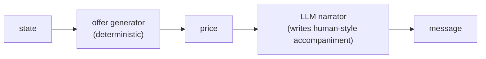

# 谈判与议价

> Agents 会协商资源、价格、任务分配和条款。2026 年 benchmark set 已经很清楚：NegotiationArena（arXiv:2402.05863）显示 LLM 可以通过 persona manipulation（“desperation”）把 payoff 提高约 20%；“Measuring Bargaining Abilities”（arXiv:2402.15813）显示 buyer 比 seller 更难，scale 也帮不上忙，而它们的 **OG-Narrator**（deterministic offer generator + LLM narrator）把 deal rate 从 26.67% 推到 88.88%；Large-Scale Autonomous Negotiation Competition（arXiv:2503.06416）运行了约 18 万次 negotiations，发现 **chain-of-thought-concealing** agents 会通过向对手隐藏 reasoning 获胜；Bhattacharya et al. 2025 基于 Harvard Negotiation Project metrics 排名：Llama-3 最有效，Claude-3 更 aggressive，GPT-4 最 fair。本课会实现 Contract Net Protocol（FIPA 祖先，Lesson 02），接入一个 LLM-style buyer/seller，运行 OG-Narrator-style decomposition，并测量每种结构选择如何改变 deal rate。

**Type:** Learn + Build
**Languages:** Python (stdlib)
**Prerequisites:** Phase 16 · 02 (FIPA-ACL Heritage), Phase 16 · 09 (Parallel Swarm Networks)
**Time:** ~75 minutes

## 问题

两个 agents 需要就价格达成一致。如果只给它们纯语言 prompts，让它们自己谈，2024-2026 年的 LLM 在紧密参数化的 bargains 上成交率低得惊人（arXiv:2402.15813 中约 27%）。Scale 不能修复这个问题：GPT-4 在结构上并不比 GPT-3.5 更会 bargaining；它更擅长的是 bargaining 的 *language*。

根本问题是 LLM 把两个工作混在了一起：决定 offer，以及叙述 offer。OG-Narrator 把它们拆开：一个 deterministic offer generator 计算 numeric moves；LLM 只负责 narrate。Deal rate 会跳到约 89%。

这和 classical multi-agent finding 相呼应：把 mechanism 和 communication layer 解耦会赢。Contract Net Protocol（FIPA, 1996; Smith, 1980）是参考 task-market mechanism。把 LLM 插到 narration slot 里，就得到一个现代 LLM-powered task market。

## 概念

### 一段话解释 Contract Net

Smith 1980 年的 Contract Net Protocol：一个 **manager** 广播 **call for proposals (cfp)**；**bidders** 用包含 offers 的 **propose** messages 回复；manager 选择 winner，并向 winner 发送 **accept-proposal**，向 losers 发送 **reject-proposal**。Winner 执行工作。可选消息：**refuse**（bidder 拒绝提出 proposal）。FIPA 把它编码为 `fipa-contract-net` interaction protocol。

### 为什么 OG-Narrator 会赢

“Measuring Bargaining Abilities of Language Models”（arXiv:2402.15813）观察到：

- LLM 经常破坏 bargaining rules（以不合理价格报价，忽略另一方的 ZOPA）。
- 它们 anchor 得很差（接受糟糕 first offers；counter-offer 是象征性金额，而不是战略金额）。
- Scale alone 不能修复这些问题。更大的模型生成更可信的语言，但战略错误相似。

OG-Narrator decomposition：



Offer generator 是一种 classical negotiation strategy：Rubinstein bargaining model、Zeuthen strategy，或者简单的 price tit-for-tat。LLM 负责 narrate。Message 包含 deterministic price 和 natural-language framing。

Deal rate 上升，是因为：

- Prices 会保持在 bargaining zone 内。
- Anchors 是 strategic，而不是 emotional。
- LLM 做它擅长的事情：writing。

### NegotiationArena findings

arXiv:2402.05863 提供了 canonical benchmark。主要发现：

- LLM 可以通过采用 personas（“I am desperate to sell this by Friday”）把 payoffs 提高约 20%。Persona manipulation 是真实 tactic。
- Fair/cooperative agents 会被 adversarial agents 利用；防御需要 explicit counter-posturing。
- Symmetric pair-ups 在大约 40% 的 benchmark scenarios 中会收敛到 inequitable outcomes。

这不是说 “LLMs are bad negotiators”。更准确地说是：“LLMs negotiate too much like humans, including the exploitable parts.”

### Chain-of-thought concealment

Large-Scale Autonomous Negotiation Competition（arXiv:2503.06416）在许多 LLM strategies 上运行了约 18 万次 negotiations。Winners 会向 counterparts 隐藏自己的 reasoning：

- 如果 agent 把 “I will only go to $75; my reservation price is $70” 打印到公开可见的 scratchpad，opponent 就会读到它。
- Winners 私下计算 strategy；output channel 只包含 offer 和最低限度的 narration。

这是 2026 年对 classical game theory 的回声（Aumann 1976 关于 rationality and information）：暴露 private valuation 会损失 payoff。LLM 并不会直觉地理解这一点，它们会很自然地把 reservations 写进 reasoning traces，而这些 traces 可能被 counterpart 看到。

工程结论：把 private-scratchpad context 和 public-message context 分开。不是可选项。

### Bhattacharya et al. 2025 的模型排名

基于 Harvard Negotiation Project metrics（principled negotiation、BATNA respect、interest reciprocity）：

- **Llama-3** 在达成 bargains 上最有效（deal rate + payoff）。
- **Claude-3** 是最 aggressive 的 negotiator（high anchors、late concessions）。
- **GPT-4** 最 fair（pairings 之间 payoff variance 最小）。

这是 2025 年的快照。重点不是 2026 年 4 月哪个模型赢，而是不同 base models 有持续存在的 negotiation styles。Heterogeneous ensembles（Lesson 15）会把这一点作为 diversity source。

### 用 Contract Net + LLM 做任务分配

Contract Net 在 LLM multi-agent 中的现代复用方式：

1. Manager agent 把 task 分解成 units。
2. 广播包含 task description 的 `cfp` 给 worker agents。
3. 每个 worker 返回一个 offer：`(price, eta, confidence)`，其中 price 可以是 tokens、compute units 或 dollars。
4. Manager 选择 winners（单个或多个，取决于 task）并 award。
5. 被拒绝的 workers 可以继续为其他 tasks bid。

这种方式可以很好扩展到 100+ workers，因为 coordination 是 broadcast-and-respond，而不是 synchronous chat。Production 中的用法包括 Microsoft Agent Framework 的 orchestration patterns，以及一些 LangGraph implementations。

### LLM-Stakeholders Interactive Negotiation

NeurIPS 2024（https://proceedings.neurips.cc/paper_files/paper/2024/file/984dd3db213db2d1454a163b65b84d08-Paper-Datasets_and_Benchmarks_Track.pdf）引入了带 **secret scores** 和 **minimum-acceptance thresholds** 的 multi-party scorable games。每个 stakeholder 都有 private utilities；LLM 必须从 messages 中推断它们。这是 two-party bargaining 到 N-party coalition formation 的泛化。它和带 heterogeneous worker capabilities 的 production task markets 直接相关。

### Narration-vs-mechanism rule

横跨 2024-2026 年的 negotiation benchmarks，一致的工程规则是：

> 让 LLM narrate。不要让 LLM compute the offer。

如果 offer 需要是数字（price、ETA、quantity），就从 negotiation state 确定性生成它，再让 LLM 生成 framing。如果 offer 需要是 proposal structure（task decomposition、role assignment），可以让 LLM draft，但在发送前必须用 schema 和 constraint-check 验证。

## Build It

`code/main.py` 实现了：

- `ContractNetManager`、`ContractNetTask`、`Bid`：manager + bidders，broadcast cfp，collect proposals，award。
- `og_narrator_bargain(state, rng)`：OG-Narrator buyer，使用 deterministic Zeuthen-style concession 向 midpoint 让步。
- `seller_response(state, rng)`：deterministic seller counter-offer policy（两种风格的 structural ground truth）。
- `naive_llm_bargain(state, rng)`：模拟 all-LLM bargainer，以高方差选择价格，经常落在 ZOPA 外。
- Measurement：1000 trials 的 deal rate，每个 trial 都采样新的 reservation prices。

运行：

```bash
python3 code/main.py
```

Expected output：naive-LLM deal rate 约 65-75%；OG-Narrator deal rate 约 85-95%；15-25 个百分点的差距就是把 offer-generation 从 narration 中拆出来的结构优势。此外还会有一个 Contract Net task-market allocation example，包含三个 bidders 和一个 task。

## Use It

`outputs/skill-bargainer-designer.md` 会设计 bargaining protocol：谁生成 offers（deterministic 或 LLM），谁 narrates，private scratchpads 如何与 public messages 分离，以及如何监控 deal rate。

## Ship It

Production bargaining checklist：

- **Separate scratchpad。** Private state 永远不能进入 counterpart 的 context。这一点不可协商。
- **Deterministic offer generation。** Prices、quantities、ETAs：compute，不要 prompt。
- **Validate all incoming offers** against a schema。在 protocol boundary 拒绝 out-of-ZOPA offers。
- **Bound rounds。** 最多 3-5 rounds；deadlock 时 escalate 到 mediator。
- **Measure deal rate and payoff variance** continuously。Deal rate 下降是一种 symptom，常见原因是 prompt drift 或 counterpart-side attack。
- **Log all rejected proposals** with the deterministic rationale。对于 Contract Net managers，losing bidders 需要理解为什么失败。

## 练习

1. 运行 `code/main.py`。确认 OG-Narrator 在 deal rate 上击败 naive-LLM。差距是多少？
2. 实现 **persona-based payoff improvement**（arXiv:2402.05863）：buyer 只在 narration 中采用 “desperate to buy this week” persona，offer generator 不变。Deal rate 或 payoff 是否变化？
3. 实现 chain-of-thought **concealment**：维护一个不会传给 counterpart 的 private scratchpad string。如果你不小心泄漏它会怎样（通过交换 channels 来模拟）？
4. 把 Contract Net 扩展成带 reserve price 的 N-bidder auction。当所有 bids 都超过 reserve 时，manager 如何在 lowest-price 和 highest-quality 之间选择？你会选择哪种 award rule，为什么？
5. 阅读 Bhattacharya et al. 2025 关于 Harvard Negotiation Project metrics 的内容。实现两个不同风格的 bargainers（aggressive vs fair）。在 symmetric 和 asymmetric pairings 下测量 payoff variance。

## 关键术语

| Term | What people say | What it actually means |
|------|----------------|------------------------|
| Contract Net | “Task market” | Smith 1980, FIPA 1996。cfp + propose + accept/reject。Canonical task-market。 |
| ZOPA | “Zone of possible agreement” | Buyer's max 与 seller's min 的重叠区。区外 offers 无法成交。 |
| BATNA | “Best alternative to a negotiated agreement” | 如果 deal 失败，你的 fallback。决定 reservation price。 |
| OG-Narrator | “Offer generator + narrator” | Decomposition：deterministic offer，LLM narration。 |
| Zeuthen strategy | “Risk-minimizing concession” | Classical offer-generator，根据 risk limits 让步。 |
| Rubinstein bargaining | “Alternating-offer equilibrium” | 带 discounting 的 infinite-horizon bargaining game-theoretic model。 |
| CoT concealment | “Hide your reasoning” | arXiv:2503.06416 的 winners 保留 private scratchpads；public channel 只展示 offer。 |
| Persona manipulation | “Emotional posturing” | arXiv:2402.05863：desperation/urgency personas 带来约 20% payoff gain。 |

## 延伸阅读

- [NegotiationArena](https://arxiv.org/abs/2402.05863) — benchmark；persona manipulation 和 exploitation findings
- [Measuring Bargaining Abilities of Language Models](https://arxiv.org/abs/2402.15813) — OG-Narrator 和 buyer-harder-than-seller result
- [Large-Scale Autonomous Negotiation Competition](https://arxiv.org/abs/2503.06416) — 约 18 万次 negotiations；chain-of-thought concealment 获胜
- [LLM-Stakeholders Interactive Negotiation (NeurIPS 2024)](https://proceedings.neurips.cc/paper_files/paper/2024/file/984dd3db213db2d1454a163b65b84d08-Paper-Datasets_and_Benchmarks_Track.pdf) — 带 secret utilities 的 multi-party scorable games
- [Smith 1980 — The Contract Net Protocol](https://ieeexplore.ieee.org/document/1675516) — classical mechanism，IEEE Transactions on Computers
