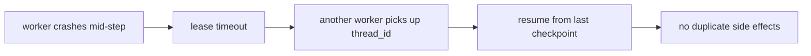
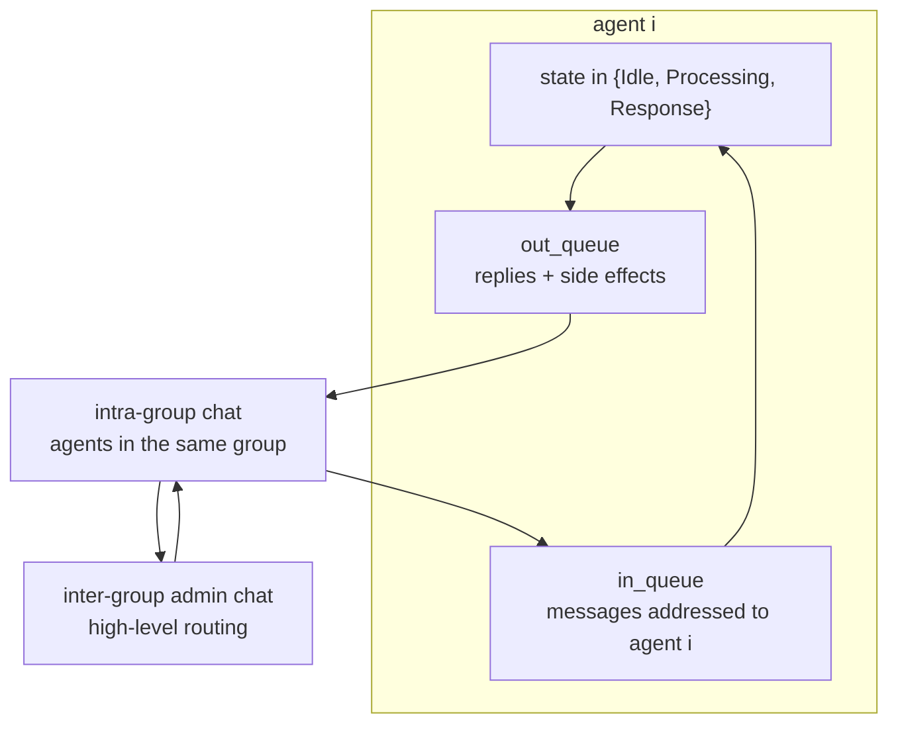

# 生产扩展：Queues、Checkpoints、Durability

> 把 multi-agent systems 扩展到数千个 concurrent runs，需要 **durable execution**。LangGraph runtime 会在每个 super-step 后写入一个由 `thread_id` 标识的 checkpoint（默认 Postgres）；worker crash 会释放 lease，由另一个 worker resume。Agents 可以无限期 sleep，等待 human input。**MegaAgent**（arXiv:2408.09955）使用 per-agent producer-consumer queue，包含三种状态（Idle / Processing / Response），以及 two-layer coordination（intra-group chat + inter-group admin chat）。对于 LLM streaming，**fiber/async** 胜过 thread-per-job：threads 99% 的时间都在等待 tokens 时空闲，fibers 会在 I/O 上 cooperative yield。反方观点：Ashpreet Bedi 的 “Scaling Agentic Software” 主张在 load 证明必要前使用 **FastAPI + Postgres + nothing else**——简单架构能走得比预期更远。本课会构建 durable checkpoint log、带 state transitions 的 per-agent work queue、async-vs-thread demo，并落到务实的 “start simple” rule。

**Type:** Learn + Build
**Languages:** Python (stdlib, `asyncio`, `sqlite3`)
**Prerequisites:** Phase 16 · 09 (Parallel Swarm Networks), Phase 16 · 13 (Shared Memory)
**Time:** ~75 minutes

## 问题

一个 prototype multi-agent system 在一台 laptop 上用三个 agents 和一个 in-memory event loop 可以工作。你把它搬到生产环境后：

- Agents 有时会运行数小时（long research、human-in-the-loop waits）。
- Worker processes 会 crash。重启会丢失 state。
- Peak load 是 average 的 10 倍；你需要 horizontal scaling。
- 用户按 agent-run 付费；你需要 exactly-once semantics 来计费。

In-memory event loop 做不到这些。你需要底层的 durable execution layer。2026 年的 canonical options 是：

1. 带 checkpoints 的 workflow engine（Temporal、LangGraph runtime）。
2. 带 state store 的 message queue（Postgres + SQS/RabbitMQ）。
3. Actor-model frameworks（MegaAgent 的 producer-consumer per agent）。
4. Hand-rolled FastAPI + Postgres（Bedi 的观点）。

本课会构建这些方案的 miniature。

## 概念

### Durable execution，核心模式

Durable-execution engine 会在每个 “step”（LangGraph 叫 super-step）之后持久化完整 program state。发生 crash 时：



这个模式成立需要满足：

- **Serializable state。** 所有 agent state 都必须可持久化。带 live database connections 的 function closures 无法 survive。
- **Deterministic resume。** 给定相同 state 和相同 inputs，agent 会生成相同 actions（或者把 LLM calls 交给外部 deterministic oracle）。
- **Idempotent side effects。** 外部调用（tool calls、payments）必须 idempotent，或使用 deduplication key。

LangGraph 在每个 super-step 后写 checkpoint；Temporal 在每个 activity 后写；Restate 使用 event-sourced journals。三者实现的是同一种模式。

### LangGraph runtime

每个 agent 都有一个 `thread_id`；state 是 typed dict；每个 super-step 都会向 checkpoints table 写入一行。Resume 时，runtime 从最后一个 checkpoint replay，而不是从头开始。Agents 可以 `interrupt()` 来等待 human input；runtime 会持久化并释放 worker。当 input 到达后，任意 worker 都可以 resume。

这是 2026 年 4 月的 reference production design。

### MegaAgent 的 per-agent queue

arXiv:2408.09955 描述了一个 scale experiment：在一个 cluster 中运行数千个 concurrent agents。架构如下：



Two-layer coordination 让 intra-group conversation 可以密集发生，同时让 inter-group 保持稀疏——这是让数千 agents 的成本保持线性时使用的模式。

### Async vs thread-per-job

LLM calls 是 I/O-bound。一个等待下一个 token 的 thread 99% 时间都是 idle。Threads 每个约消耗 1MB RAM；在 10,000 个 concurrent calls 下，光 stacks 就是 10GB。

Fibers（Python `asyncio`、Go goroutines、Rust `tokio`）会在 I/O 上 cooperative yield。同样 10,000 个 calls 可以轻松放进一个 process。在 LLM-agent scale 下，async 不是 optimization，而是 architecture。

例外：CPU-bound post-processing（embedding、tokenizer tricks）仍然需要 threads 或 processes。把你的 I/O layer 和 CPU layer 分开。

### Bedi 的反方观点

“Scaling Agentic Software”（Ashpreet Bedi，2026）认为，大多数团队在测量 load 之前就过度设计。务实默认值是：

- FastAPI + Postgres。
- 每个 agent run 是一行；state 使用 optimistic concurrency 原地更新。
- 通过 `pg_notify` 或简单 Celery worker 做 background jobs。
- Retry policy 放在 application code 中。

对于低于约 100 个 concurrent agent-runs、且任务可管理的负载，这往往就是你需要的全部。等测量到它失败时再升级。

规则是：当你遇到简单架构无法解决的具体问题时，再采用 durable-execution frameworks。过早采用会把时间烧在没有回报的 ceremonies 上。

### Exactly-once semantics

对于付费 agent runs，你需要 “exactly-once effective”（at-least-once delivery + idempotent consumer）。工程手段包括：

- **每个 run 一个 dedup key。** 把它包含在每个 side-effect call 中。
- **Outbox pattern。** Side effects 先写入 table，然后由单独 process 执行。两个步骤都 idempotent。
- **Compensating transactions。** 当 side effect 成功但 tracking write 失败时，安排 compensate。

这些是 database-engineering patterns，不是 LLM 专属。LLM tax 只是 LLM calls 很慢；其他部分都是标准 distributed systems。

### Rainbow deployment

Anthropic 的 multi-agent research system 使用 “rainbow deployments”：多个 agent runtime 版本并行运行，这样 long-running agents 不必在每次 code deploy 时被杀掉。新版本在一小部分 traffic 上 canary；等旧版本 agents 完成后再 retire old versions。

这对 long-running stateful systems 来说是标准做法；2026 年的适配是 agents 可以存活数小时，所以 deployment cycles 必须容纳这一点。

### Canonical production checklist

- Durable state（checkpoints、snapshots，或 outbox + replayable log）。
- Idempotent side effects。
- LLM calls 使用 async I/O layer。
- At-least-once delivery with dedup。
- Stateful workloads 使用 rainbow/canary deployment。
- Observability：per-agent traces、super-step audit、retry counter。

## Build It

`code/main.py` 实现了：

- `CheckpointStore`：SQLite-backed checkpoint log，以 thread-id 作为 key。每个 super-step append 一行。
- `run_with_checkpoint(agent, thread_id)`：模拟 mid-run crash；第二个 worker 从最后 checkpoint resume。
- `AgentQueue`：per-agent Idle / Processing / Response state machine，带一个小 work queue。
- `demo_async_vs_threads()`：用 asyncio 和 threads 运行 500 个 concurrent simulated “LLM calls”；报告 wall-clock 和 peak memory（近似值）。

运行：

```bash
python3 code/main.py
```

预期输出：模拟 crash 后 checkpoint resume 成功；async version 在 < 1s 内处理 500 个 concurrent calls；thread version 需要数秒，并且每个 concurrent unit 的 memory 使用高几个数量级。

## Use It

`outputs/skill-scaling-advisor.md` 会根据 load、state-retention needs 和 deploy frequency，为 durable-execution choice 提供建议：FastAPI + Postgres、LangGraph runtime、Temporal 或 custom。

## Ship It

Canonical production hardening：

- **Start simple（Bedi's rule）。** 使用 FastAPI + Postgres，直到你测量到它失败。
- **优化前先 instrument everything。** Per-run latency histogram、per-step time、retry count、failure categorization。
- **Side effects 使用 outbox pattern。** 尤其是 payments 和 external API calls。
- **Rainbow deploys。** Deploys 期间绝不杀掉 in-flight agent runs。
- **当你遇到具体问题时采用 durable-execution engines（Temporal / LangGraph / Restate）：** 小时级 human-in-the-loop waits、cross-region coordination、complex retry/compensation policies。
- **I/O layer 使用 async。** Threads 只用于 CPU-bound post-processing。

## 练习

1. 运行 `code/main.py`。确认 checkpoint resume 工作；测量 async vs thread concurrency difference。
2. 实现一个 **outbox** table：每个 tool call 先写入 outbox，然后由单独 goroutine/task 执行。通过运行两次 tool call 来验证 idempotency。
3. 模拟一个 **rainbow deploy**：两个 concurrent runtime versions；把一半新的 thread_ids 路由到每个版本；确认旧版本上的 in-flight threads 没有被中断。
4. 阅读 LangGraph runtime doc（下面链接）。找出 runtime 中哪些 features 在 hand-rolled FastAPI + Postgres 版本里复制起来最耗时。这是采用它的理由，还是可以推迟？
5. 阅读 MegaAgent（arXiv:2408.09955）第 3 节。Two-layer coordination（intra-group + inter-group admin chat）是显式的。画出你会如何把它映射到两个 queue families 的 message queue。

## 关键术语

| Term | 常见说法 | 实际含义 |
|------|----------|----------|
| Durable execution | “Persist the program state” | Engine 在每个 super-step 后写 state；crash recovery 是 deterministic。 |
| Super-step | “Transactional boundary” | Checkpoints 之间的 work unit。LangGraph term。 |
| thread_id | “Agent run identifier” | 绑定 checkpoints 和 resume logic 的 key。 |
| Idempotency | “Safe to retry” | 重复执行 side effect 的结果与执行一次相同。 |
| Outbox pattern | “Decouple side effects” | 把 intent 写入 table；单独 executor 执行并标记 done。 |
| At-least-once delivery | “Possible duplicates” | Message queue semantics；dedup key 让 consumer 达到 effective-once。 |
| Rainbow deploy | “Overlapping versions” | Long-running workloads 期间多个 runtime versions 并发存在。 |
| Async fiber | “Cooperative yielding” | User-mode concurrency；对 I/O-bound loads 来说比 threads 便宜。 |
| Checkpoint | “State snapshot” | Super-step boundary 上的 serialized state；resume 的关键。 |

## 延伸阅读

- [LangChain — The runtime behind production deep agents](https://www.langchain.com/conceptual-guides/runtime-behind-production-deep-agents) — LangGraph runtime design
- [MegaAgent](https://arxiv.org/abs/2408.09955) — per-agent producer-consumer queue; two-layer coordination at thousands of concurrent agents
- [Matrix](https://arxiv.org/abs/2511.21686) — decentralized framework with message queues as the coordination substrate
- [Temporal docs](https://docs.temporal.io/) — the reference workflow engine for durable execution
- [Anthropic — Multi-agent research system](https://www.anthropic.com/engineering/multi-agent-research-system) — production lessons including rainbow deployment
