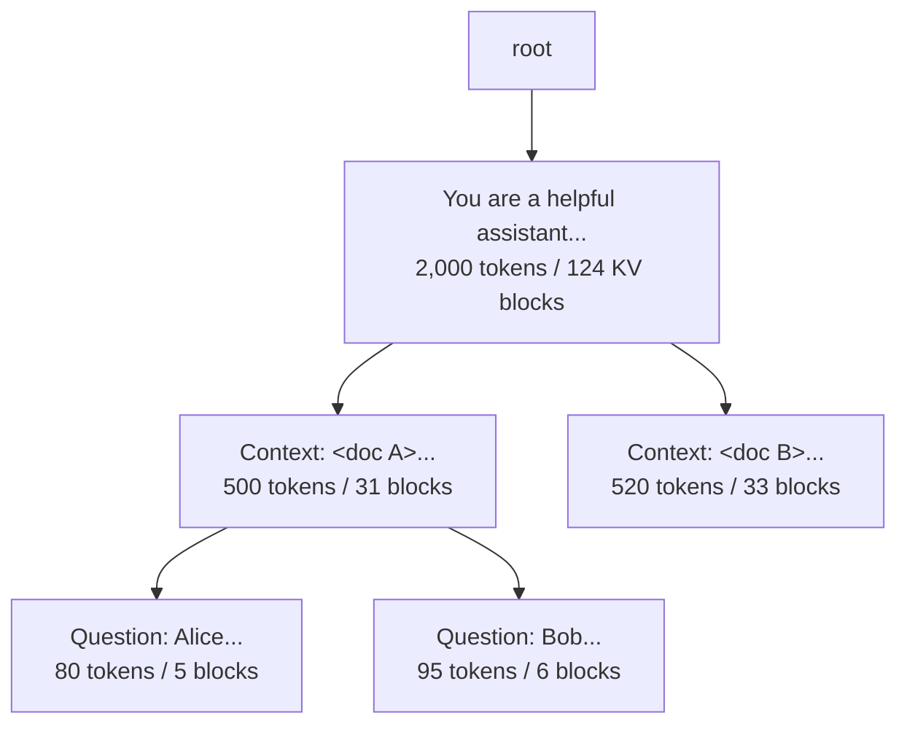

# SGLang 与面向 Prefix-Heavy Workloads 的 RadixAttention

> SGLang 把 KV cache 当作一等、可复用的资源，并存储在 radix tree 中。vLLM 按 FCFS（first-come, first-served）调度请求，而 SGLang 的 cache-aware scheduler 会优先处理 shared prefix 更长的请求，本质上是一次 depth-first radix traversal，让 hot branches 持续驻留在 HBM 中。在 Llama 3.1 8B 上，使用 ShareGPT-like 1K prompts 时，SGLang 达到约 16,200 tok/s，vLLM 约 12,500 tok/s，领先约 29%。在 prefix-heavy RAG workloads 上，这个优势可达 6.4x。在 voice-cloning 形态的 workloads 上，cache hit rate 超过 86%。到 2026 年，SGLang 已部署在 xAI、LinkedIn、Cursor、Oracle、GCP、Azure、AWS 的 400,000+ GPUs 上。陷阱是：当 prefix ordering 不一致时，6.4x 会消失，ordering 才是工程师真正能拉动的杠杆。

**Type:** Learn
**Languages:** Python（stdlib，玩具版 radix-tree cache + cache-aware scheduler）
**Prerequisites:** Phase 17 · 04 (vLLM Serving Internals), Phase 14 (Agentic RAG)
**Time:** ~75 minutes

## 学习目标

- 画出 RadixAttention：prefixes 如何存储在 radix tree 中，以及 KV blocks 如何在 rooted at same branch 的 sequences 之间共享。
- 解释 cache-aware scheduling，以及为什么 FCFS 不适合 prefix-heavy traffic。
- 给定 prefix-cache hit rate 和 prompt length distribution，计算 workload 的预期 speedup。
- 说出让 6.4x 真正发生、而不是白白丢掉的 prompt-ordering discipline。

## 问题

经典 serving 把每个 request 的 prompt 当作 opaque。即使 5,000 个 RAG requests 都以同一个 2,000-token system prompt 加同一个 retrieval preamble 开头，vLLM 也会把这个 2,000-token prefix prefill 5,000 次。GPU 一遍又一遍做同样的工作。

观察是：agentic 和 RAG workloads 中的 prompts 几乎总是共享长 prefix。System prompt、tool schemas、few-shot examples、retrieval headers、conversation history 都会跨请求重复。如果你只存一次这个 prefix 的 KV cache 并复用它，就不必再次 prefill。

RadixAttention 做的正是这件事。Tokens 被索引在 radix tree 中；每个 node 都拥有从 root 到该 node 的 token sequence 对应的 KV blocks。新 request 会沿树走一遍：任何 token 匹配的 node 都会复用该 node 的 KV blocks。Prefill cost 变成只和“新的”suffix 成正比，而不是和完整 prompt 成正比。

挑战在 scheduling。如果两个 requests 共享 2,000-token prefix，而第三个 request 只共享同一 prefix 的 200 tokens，你希望先一起服务两个 long-shared requests，让长 prefix 留在 HBM 里。FCFS 恰好相反：它服务先到的人，可能在下一个 long-prefix request 命中前就把 hot branch 驱逐掉。

## 概念

### Radix tree 作为 KV index

Radix tree（compact trie）存储 token sequences。每个 node 拥有一个 token range，以及为该 range 计算出的 KV blocks。Children 会把 sequence 延伸一个或多个 tokens。



一个新 request 带着 system prompt + “Context: &lt;doc A&gt;” + “Question: Carol” 进入。Scheduler 走树：system prefix 匹配（复用 124 blocks），doc-A branch 匹配（复用 31 blocks），然后只为 “Question: Carol” 分配 fresh blocks（4 blocks）。Prefill cost：4 blocks 的新 tokens。没有树时：160 blocks。Prefill 约节省 40x。

### Cache-aware scheduling

如果 cache 一直 churn，radix-tree-backed reuse 就没有意义。两个关键策略：

1. **Depth-first dispatch。** 从 queue 里挑下一个 request 时，优先选择与当前 running set 位于同一个 branch 的 requests。这样 hot branch 会保持 pinned。
2. **Branch-level LRU，而不是 block-level LRU。** 驱逐整条 branches（从最少使用的 leaves 开始），而不是单独驱逐 blocks，让 cache shape 匹配 radix shape。

FCFS 两者都违反。一个共享 2,000 tokens 的 request 排在一个只共享 50 tokens 的 request 后面，然后 2,000-token branch 为了容纳 50-token request 被驱逐。

### 你应该记住的 benchmark 数字

- Llama 3.1 8B、H100、ShareGPT 1K prompts：SGLang 约 16,200 tok/s，vLLM 约 12,500 tok/s（约 29% edge）。
- Prefix-heavy RAG（same system + same doc，varying question）：SGLang 最高 6.4x。
- Voice cloning workloads：86.4% prefix-cache hit rate。
- SGLang customers 的 production hit rates：取决于 prompt discipline，约 50-99%。
- 到 2026 年部署在 400,000+ GPUs 上。

### Ordering gotcha

6.4x 依赖一致的 prompt-template ordering。如果你的 client 在某些 requests 中按 `[system, tools, context, history, question]` 构造 prompt，又在另一些 requests 中按 `[system, context, tools, history, question]` 构造，树就找不到 shared prefix。人类看起来共享的 prefix，对 radix tree 来说是两条不同 sequences。

工程师的杠杆：你的 prompt template 就是 cache key。固定顺序。把所有 immutable 内容（system、tools、schemas）放最前面。接着放 retrieval context。最后放 user question。不要把 dynamic content 交错插入 prefix。

研究中的真实案例：把 dynamic content 从 cacheable prefix 中移出去后，一个部署的 cache hit rate 从 7% 提升到 74%。

### RadixAttention 何时赢，何时输

胜出场景：

- RAG（相同 retrieval preamble，不同 question）。
- Agents（相同 tool schemas，不同 query）。
- 带长 system prompt 的 chat。
- 带重复 preambles 的 voice / vision workloads。

失效场景（回到 vLLM-level throughput）：

- Unique prompts 的 single-shot generation（code completion、没有 system prompt 的 open-ended chat）。
- 每个 request 都把 unique content 插入 prefix 的 dynamic prompts。

### 为什么这是 scheduler problem，而不只是 kernel problem

你可以把 KV reuse 实现成一个 kernel trick。SGLang 的洞察是：只有 scheduler 让 hot branch 保持 resident，reuse 才会真正产生收益。朴素的 “available 就 reuse” 策略会在 mixed load 下让 cache churn。Radix-tree-indexed scheduler 才是把 kernel trick 变成 29% production edge 的东西。

### 与 vLLM 的关系

这两个系统不是严格竞争关系。2026 年，vLLM 已加入 prefix caching（`--enable-prefix-caching`）和 cache-aware router（Rust 写的 vLLM Router）。差距缩小了，但没有完全消失：SGLang 的整套 stack 是 radix-first；vLLM 是后 graft 上去的。对于 prefix reuse 主导的 workloads，SGLang 仍然是默认选择。对于没有强 prefix patterns 的 general-purpose serving，vLLM 仍然相当甚至更好。

```figure
roofline
```

## Use It

`code/main.py` 实现了一个玩具版 radix-tree KV cache，以及一个带两种策略的 scheduler：FCFS 和 cache-aware。它会让同一个 workload 分别跑过两者，报告 prefix-cache hit rate 和 throughput delta。然后运行一个 “scrambled ordering” workload，展示 6.4x 如何坍塌。

## Ship It

本课产出 `outputs/skill-radix-scheduler-advisor.md`。给定 workload description（prompt-template shape、retrieval pattern、concurrent tenants 数量），它会生成 prompt-ordering prescription，并给出是否采用 SGLang 的 go/no-go 判断。

## 练习

1. 运行 `code/main.py`。在同一个 workload 上比较 FCFS 和 cache-aware。差距来自哪里：prefill savings、decode savings，还是 queue delay？
2. 修改 workload，让 prompts 随机排列 `[system, tools, context]`。重新运行。Hit rate 会怎样？为什么？
3. 计算在 Llama 3.1 8B 上，把一个 2,000-token system prompt 作为一条 radix branch 常驻所需的 HBM 成本。与没有 prefix reuse 的 16-sequence batch 成本比较。
4. 阅读 SGLang RadixAttention paper。用三句话解释为什么在 prefix-heavy load 下，tree-shaped LRU eviction 胜过 block-shaped LRU。
5. 一个客户报告 cache hit rate 只有 8%。说出三个可能原因，以及每个原因对应要跑的 diagnostic。

## 关键术语

| Term | 大家常说 | 实际含义 |
|------|----------|----------|
| RadixAttention | “the SGLang thing” | 把 KV cache 索引为 radix tree，让 shared prefixes 复用 blocks。 |
| Radix tree | “compact trie” | 每个 node 拥有一个 token range 及其 KV blocks 的树。 |
| Cache-aware scheduler | “hot-branch-first” | 优先调度共享 resident branch 的 requests。 |
| Prefix-cache hit rate | “how much of your prompt was free” | 由复用 KV blocks 服务的 prompt tokens 占比。 |
| FCFS | “first-come first-served” | 破坏 prefix locality 的默认调度。 |
| Branch-level LRU | “evict the leaf” | 与 radix shape 匹配的 eviction policy。 |
| Prompt template ordering | “the cache key” | Prompt 组件顺序决定 radix tree 能共享什么。 |
| System prompt pinning | “resident prefix” | 保持 immutable system 部分常驻，避免 eviction thrash。 |

## 延伸阅读

- [SGLang GitHub](https://github.com/sgl-project/sglang) — source 和 docs。
- [SGLang documentation](https://sgl-project.github.io/) — RadixAttention 和 scheduling details。
- [SGLang paper — Efficiently Programming Large Language Models (arXiv:2312.07104)](https://arxiv.org/abs/2312.07104) — design reference。
- [LMSYS blog — SGLang with RadixAttention](https://www.lmsys.org/blog/2024-01-17-sglang/) — benchmark numbers 和 scheduler rationale。
- [vLLM — Prefix Caching](https://docs.vllm.ai/en/latest/features/prefix_caching.html) — vLLM 自己的 radix-like implementation，供对比。
