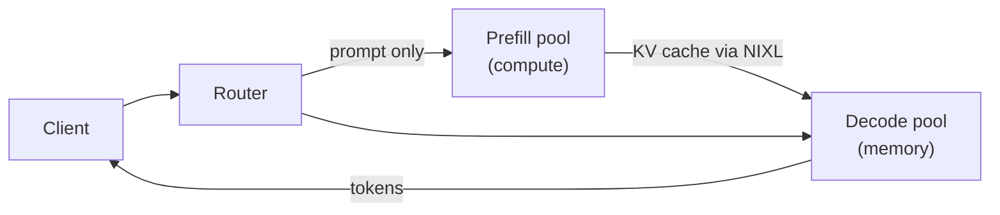

# 解耦式 Prefill/Decode：NVIDIA Dynamo 与 llm-d

> Prefill 是 compute-bound；decode 是 memory-bound。把两者放在同一张 GPU 上会浪费其中一种资源。Disaggregation 会把它们拆到独立 pools，并通过 NIXL（RDMA/InfiniBand，或 TCP fallback）在二者之间传输 KV cache。NVIDIA Dynamo（GTC 2025 发布，1.0 GA）位于 vLLM/SGLang/TRT-LLM 之上——它的 Planner Profiler + SLA Planner 会自动 rate-match prefill:decode ratios 来满足 SLO。NVIDIA 发布的 throughput gains 大致在这个区间：developer.nvidia.com（2025-06）展示了 GB200 NVL72 + Dynamo 上 DeepSeek-R1 MoE 在 medium-latency regime 下约 6x improvement；Dynamo product page（developer.nvidia.com，未标日期）宣传 GB300 NVL72 + Dynamo 相比 Hopper 可达到最高 50x MoE throughput。“30x” 数字是 full-stack Blackwell + Dynamo + DeepSeek-R1 reports 的社区汇总；我们没有找到一个 primary source 精确声明 30x，所以把它当作 directional claim。llm-d（Red Hat + AWS）是 Kubernetes-native：prefill / decode / router 作为独立 Services，并为每个 role 配置 HPA。llm-d 0.5 增加 hierarchical KV offloading、cache-aware LoRA routing、UCCL networking、scale-to-zero。经济性方面：多个客户披露的内部汇总显示，在 constant SLA 下从 colocated serving 切到 Dynamo disaggregated 后，$2M 级 inference spend 可节省 30-40%（即 $600-800K/year）；这个具体 $2M→$600-800K 数字是内部 composite，不是单个 published case study——可作为数量级锚点，不要当作 reference citation。短 prompts（<512 tokens、短输出）无法抵消 transfer cost。

**Type:** Learn
**Languages:** Python (stdlib, toy disaggregated-vs-colocated simulator)
**Prerequisites:** Phase 17 · 04 (vLLM Serving Internals), Phase 17 · 08 (Inference Metrics)
**Time:** ~75 minutes

## 学习目标

- 解释为什么 prefill 和 decode 有不同的最佳 GPU allocation，并量化 colocation 下的浪费。
- 画出 disaggregated architecture：prefill pool、decode pool、通过 NIXL 做 KV transfer、router。
- 说出 disaggregation 不划算的条件（短 prompts、短 outputs）。
- 区分 NVIDIA Dynamo（stack-above）和 llm-d（Kubernetes-native），并把它们匹配到合适的 operational context。

## 问题

你在 8 张 H100 上运行 Llama 3.3 70B。Mixed workload（long prompts + short outputs）下，GPUs 在 decode 期间空闲，因为大部分 compute 都花在 prefill 上。换一种 workload（short prompts + long outputs），相反的浪费又会出现。Colocated prefill + decode 意味着你同时 over-provision 两种资源。

预算影响：20-40% GPU time 被浪费在错误资源上。你在购买 H100 compute 来跑 memory-bound decode，或者购买 H100 HBM bandwidth 来跑 compute-bound prefill。两者都是昂贵浪费。

Disaggregation 会把 prefill 和 decode 拆到独立 pools，并按各自 bottleneck sizing。KV cache 会通过 high-bandwidth interconnect 从 prefill pool 传到 decode pool。

## 概念

### 为什么 bottlenecks 不同

**Prefill**：在完整 input prompt 上运行一次 transformer forward。Matrix multiplications 主导；compute-bound。H100 FP8 可提供约 2000 TFLOPS useful throughput。Batch efficiency 很好——一次 forward 处理许多 tokens。

**Decode**：一次生成一个 token，每次 iteration 都读取完整 weights。Memory-bandwidth-bound。HBM3 约 3 TB/s。只有在高并发时 batch efficiency 才好——weights read 可以在 batch 中摊销。

Colocating them：你买的是同时针对两者优化的 GPUs。H100 两者都擅长，但无论运行哪种 phase 成本都一样。规模化后，你会希望 prefill pool 使用 H100 / compute-heavy，decode pool 使用 H200 / memory-heavy，或搭配激进 quantization。

### Architecture

NIXL 是 NVIDIA 的 inter-node transport。有 RDMA/InfiniBand 时使用它们，否则 fallback 到 TCP。Transfer latency 是真实存在的——70B FP8 上 4K-token prompt 的 KV cache 通常需要 20-80 ms。这就是短 prompts 不适合 disaggregation 的原因：transfer tax 会超过节省。

### Dynamo vs llm-d

**NVIDIA Dynamo**（GTC 2025 发布，1.0 GA）：

- 作为 orchestrator 位于 vLLM、SGLang、TRT-LLM 之上。
- Planner Profiler 测量 workload，SLA Planner 自动配置 prefill:decode ratios。
- Rust core，Python extensibility。
- Throughput gains：NVIDIA 报告 GB200 NVL72 + Dynamo 上 DeepSeek-R1 MoE 在 medium-latency regime 下为 6x（developer.nvidia.com，2025-06）；关于 full Blackwell + Dynamo + DeepSeek-R1 stack “up to 30x” 的社区报告缺少单一 primary source，应当视为 directional。
- GB300 NVL72 + Dynamo：Dynamo product page（developer.nvidia.com，未标日期）宣称相比 Hopper 可达到最高 50x MoE throughput。

**llm-d**（Red Hat + AWS，Kubernetes-native）：

- Prefill / decode / router 作为独立 Kubernetes Services。
- Per-role HPA，信号分别来自 queue depth（prefill）和 KV utilization（decode）。
- `topologyConstraint packDomain: rack` 会把 prefill+decode cliques 放在同一 rack，以获得 high-bandwidth KV transfer。
- llm-d 0.5（2026）：hierarchical KV offloading、cache-aware LoRA routing、UCCL networking、scale-to-zero。

如果你想要 managed stack-above orchestrator，用 Dynamo。如果你想要 Kubernetes-native primitives，并且已经投入 CNCF ecosystem，用 llm-d。

### 经济性

内部 composite（不是单个 published case study，只是数量级锚点）：

- Colocated serving 的 inference spend 为 $2M/year。
- 切到 Dynamo disaggregated。
- Same request volume，same P99 latency SLA。
- 报告 savings：$600K-$800K/year（30-40% reduction）。
- 没有新增 hardware。

我们从多个客户披露中合成这个数字，而不是引用一个单一 case study；最接近的公开 datapoint 是 Baseten 的 Dynamo KV routing 带来 2x faster TTFT / 61% higher throughput（baseten.co，2025-10），以及 VAST + CoreWeave 对 40-60% KV hit rate 下 60-130% more tokens/$ 的预测（vastdata.com，2025-12）。Savings 来自 right-sizing each pool；prefill-heavy workloads（带 8K+ prefixes 的 RAG）比 balanced workloads 更受益。

### 什么时候不要 disaggregate

- Prompts < 512 tokens 且 outputs < 200 tokens：transfer tax 主导收益。
- 小集群（< 4 GPUs）：没有足够 pool diversity。
- 团队无法运维 two GPU pools with per-role scaling：Dynamo 会有帮助，但不是零成本。
- 没有 RDMA fabric：TCP transfer tax 更重。

### Router 与 Phase 17 · 11 的集成

Disaggregated routers 是 KV-cache-aware 的（Phase 17 · 11）。请求会落到持有其 prefix 的 decode pool；如果没有 match，它会走 prefill → decode。Hit rate 与 disaggregation 会复合——cache-aware router 决定新的 prefill 是否根本需要发生。

### MoE on Blackwell 才是真正的大数字来源

GB300 NVL72 + Dynamo 相比 Hopper baselines 展示 50x MoE throughput。MoE expert routing 在 prefill 上 compute-heavy，但在 decode 上 memory-heavy（expert caches），所以 disaggregation 是双重收益。2026 frontier model serving 以 MoE 为主（DeepSeek-V3、未来 GPT-5 variants）。

### 需要记住的数字

Benchmark numbers 会漂移——NVIDIA 和 inference stack 每个季度都会发布更新结果。引用前重新检查。

- DeepSeek-R1 on GB200 NVL72 + Dynamo：medium-latency regime 下相比 baseline 约 6x throughput（developer.nvidia.com，2025-06）；full Blackwell + Dynamo stack 的社区 “up to 30x” claims 是没有单一 primary source 的 directional aggregates。
- GB300 NVL72 + Dynamo：相比 Hopper 最高 50x MoE throughput（developer.nvidia.com，未标日期）。
- Savings anchor（internal composite，不是单个 case study）：constant SLA 下，$2M annual spend 可节省 $600-800K/year。
- Disaggregation threshold：prompts >512 tokens + outputs >200 tokens。
- NIXL 传输 KV：70B FP8 上 4K-prompt KV 约 20-80 ms。

## Use It

`code/main.py` 模拟 colocated vs disaggregated serving。它会报告 throughput、cost per request 和 prompt-length crossover。

## Ship It

本课产出 `outputs/skill-disaggregation-decider.md`。给定 workload 和 cluster，它会判断是否应该 disaggregate。

## 练习

1. 运行 `code/main.py`。Prompt length 到多少时，disaggregation 会超过 colocation？
2. 为一个 P99 prefix length 8K、output 300 的 RAG service 设计 prefill pool 和 decode pool。
3. Dynamo vs llm-d：为一个 pure-Kubernetes shop 且没有 Python runtime preference 的团队选择一个。
4. 计算 KV transfer cost：70B FP8 上 4K prefill = 约 500 MB KV。RDMA 100 GB/s 下 transfer = 5 ms；TCP 10 GB/s 下 = 50 ms。哪个会影响你的 SLA？
5. MoE expert routing 会改变 KV access patterns。对于每个 token 激活不同 experts 的 MoE，disaggregation 会如何表现？

## 关键术语

| Term | What people say | What it actually means |
|------|----------------|------------------------|
| Disaggregated serving | “split prefill/decode” | 为每个 phase 使用独立 GPU pools |
| NIXL | “NVIDIA transport” | Dynamo 的 inter-node KV transfer（RDMA/TCP） |
| NVIDIA Dynamo | “the orchestrator” | vLLM/SGLang/TRT-LLM 的 stack-above coordinator |
| llm-d | “Kubernetes native” | Red Hat + AWS K8s disaggregated stack |
| Planner Profiler | “Dynamo auto-config” | 测量 workload，配置 pool ratios |
| SLA Planner | “Dynamo policy” | 自动 rate-match prefill:decode 以满足 SLO |
| `packDomain: rack` | “llm-d topology” | 把 prefill+decode 放在同一 rack 以加速 KV |
| UCCL | “unified collective” | llm-d 0.5 的 scale-to-zero networking layer |
| MoE expert routing | “expert per token” | DeepSeek-V3 pattern；disaggregation 有帮助 |

## 延伸阅读

- [NVIDIA — Introducing Dynamo](https://developer.nvidia.com/blog/introducing-nvidia-dynamo-a-low-latency-distributed-inference-framework-for-scaling-reasoning-ai-models/)
- [NVIDIA — Disaggregated LLM Inference on Kubernetes](https://developer.nvidia.com/blog/deploying-disaggregated-llm-inference-workloads-on-kubernetes/)
- [TensorRT-LLM Disaggregated Serving blog](https://nvidia.github.io/TensorRT-LLM/blogs/tech_blog/blog5_Disaggregated_Serving_in_TensorRT-LLM.html)
- [llm-d GitHub](https://github.com/llm-d/llm-d)
- [llm-d 0.5 release notes](https://github.com/llm-d/llm-d/releases)
