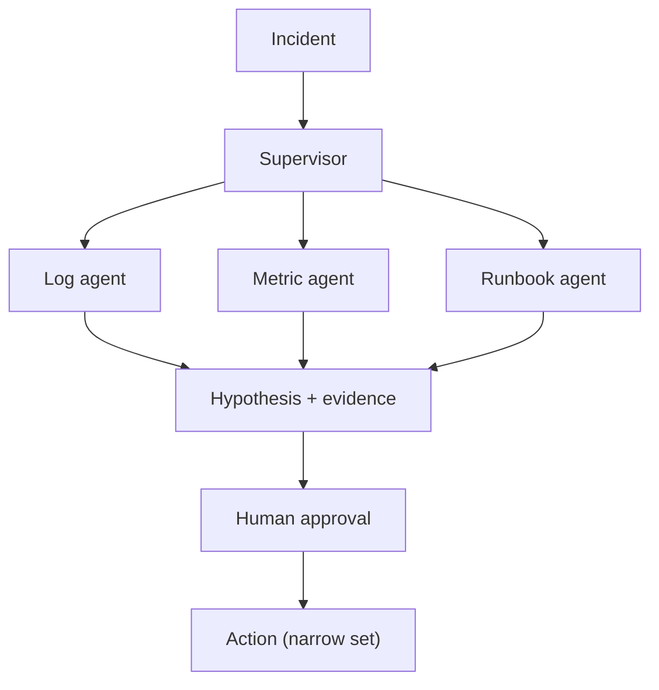

# 面向 AI 的 SRE：多智能体事件响应、Runbooks、预测检测

> AI SRE 使用 LLM，并通过 RAG 把它们 grounding 到基础设施数据（logs、runbooks、service topology）上，从而自动化调查、记录和协调阶段。2026 年的架构模式是 multi-agent orchestration：由 supervisor 协调多个 specialized agents（logs、metrics、runbooks）；AI 提出假设和查询，人类批准需要判断力的动作。Datadog Bits AI 和 Azure SRE Agent 已经把它做成 managed products。Runbooks 也在演进：NeuBird Hawkeye 使用 adversarial evaluation（两个模型分析同一个 incident；一致 = 有信心，不一致 = 不确定）；operational memory 会在团队成员变化后继续保留。Auto-remediation 仍然谨慎：AI 建议，人类批准。完全自治的动作只适合很窄的范围（restart pod、rollback specific deploy），并且必须有严格 guardrails；任何宣称“设好就不用管”的说法都在过度承诺。前沿方向是 pre-incident prediction。MIT 研究报告称，一个基于历史 logs + GPU temperatures + API error patterns 训练的 LLM，能提前 10-15 分钟预测 89% 的 outages。预测：到 2026 年底，95% 的 enterprise LLMs 会拥有 automated failover。

**Type:** Learn
**Languages:** Python (stdlib, toy multi-agent incident triage simulator)
**Prerequisites:** Phase 17 · 13 (Observability), Phase 17 · 24 (Chaos Engineering)
**Time:** ~60 minutes

## 学习目标

- 画出 multi-agent AI SRE architecture：supervisor + specialized agents（logs、metrics、runbooks）+ human approval gate。
- 解释为什么 auto-remediation 应该是窄范围动作（restart pod、revert deploy），而不是宽范围动作（重新设计 service）。
- 命名 adversarial evaluation pattern（NeuBird Hawkeye）：两个模型一致 = confidence；不一致 = escalate。
- 引用 MIT 89% early-detection 结果，并说明 operational constraint：没有 actuation 的预测只是 dashboards。

## 问题

On-call engineer 在凌晨 3 点收到告警：“checkout error rate 很高。”他们打开 Datadog、Loki、三份 runbooks 和 deploy log。30 分钟后，他们才发现 root cause 是 vLLM 的 KV cache spike 导致 OOM。重启 pod 后，错误消失。

到 2026 年，这类调查的前 20 分钟已经可以自动化。按 service 聚合 logs、关联最近 deploys、匹配 runbooks，这些都是 RAG + tool-use。一个受监督的 agent 可以完成 first-pass triage，并在人类打开 Datadog 之前给出假设。

Fully autonomous remediation 是另一个问题。Restart pod：安全。Scale GPU pool：如果 policy 允许，也安全。重新设计 service：绝对不行。真正的纪律，是把这条窄边界画清楚。

## 概念

### Multi-agent architecture

Supervisor 会把 incident 拆成多个 sub-queries。Specialized agents 拥有 tool access（log search、PromQL、doc retrieval）。Supervisor 综合结果，把 hypothesis + evidence 呈现给人类。人类批准或改向。

### Auto-remediation scope

**安全（窄范围）**：restart pod、revert specific deploy、在预先批准的边界内 scale pool、启用预先批准的 feature flag。

**不安全（宽范围）**：修改 service topology、修改 resource limits、部署新代码、修改 IAM、变更 databases。

任何宣称“set it and forget it”的供应商都在过度承诺。随着 AI SRE 成熟，安全集合会增长，但边界是真实存在的。

### Adversarial evaluation (NeuBird Hawkeye)

两个模型独立分析同一个 incident。如果它们对 root cause 一致，confidence 较高。如果它们不一致，就把两个 hypotheses 都展示出来并 escalate 给人类。这个模式很简单，但能有效过滤 hallucinated root causes。

### Operational memory

团队流动是传统 SRE 的沉默杀手：tribal knowledge 会离开。AI SRE 把 runbooks + post-mortems 存进 vector DB；agents 在每次新 incident 中检索这些历史。当新工程师加入时，AI 仍然拥有完整历史。

### Pre-incident prediction

MIT 2025 研究：一个基于历史 logs、GPU temperatures、API error patterns 训练的 LLM，在 test set 上能提前 10-15 分钟预测 89% 的 outages。

Reality check：没有 actuation 的预测只是 dashboards。真正的 operational question 是：“当我们预测到风险时，要做什么？”Pre-emptive drain？Pager？Auto-scale？答案取决于 policy。

### 2026 年的产品

- **Datadog Bits AI** — Datadog 内部的 managed SRE copilot。
- **Azure SRE Agent** — Azure-native。
- **NeuBird Hawkeye** — adversarial eval + operational memory。
- **PagerDuty AIOps** — triage + deduplication。
- **Incident.io Autopilot** — incident commander + coordination。

### Runbooks as code

Runbooks 正在从 Confluence pages 演进为带 structured sections（symptom、hypothesis、verify、act）的 versioned markdown。结构化 runbooks 会让 RAG retrieval 更好。任何 AI-SRE rollout 的第一步，都应该是把非结构化 runbooks 转成结构化格式。

### 你应该记住的数字

- MIT early-detection：89% outages，10-15 分钟 lead time。
- Multi-agent triage：supervisor +（logs、metrics、runbooks）+ human。
- Safe auto-remediation set：restart pod、revert deploy、在边界内 scale。
- Adversarial eval：两个模型独立分析；agreement = confidence。

## Use It

`code/main.py` 会模拟一个 multi-agent triage：log agent 找到错误，metric agent 找到 CPU spike，runbook agent 匹配到已知问题。Supervisor 会给 hypotheses 排序。

## Ship It

本课产出 `outputs/skill-ai-sre-plan.md`。给定当前 on-call、incident volume、team maturity，它会设计一套 AI SRE rollout。

## 练习

1. 运行 `code/main.py`。如果 log agent 和 metric agent 不一致会怎样？Supervisor 如何 resolve？
2. 为你的 service 定义三个“safe” auto-remediation actions，并逐一说明理由。
3. 写一个 structured runbook template：sections、required fields、verification commands。
4. Predictive detection 提前 12 分钟触发。你的 policy 是 pager、pre-drain，还是两者都做？
5. 论证一个 3 人团队是否应该在 2026 年采用 AI SRE，还是继续等待。考虑 maturity、volume、risk。

## 关键术语

| Term | What people say | What it actually means |
|------|----------------|------------------------|
| AI SRE | “agent for on-call” | LLM-backed incident investigation + coordination |
| Supervisor agent | “the orchestrator” | 把 incidents 拆成 sub-queries 的 top-level agent |
| Specialized agent | “domain agent” | 拥有 tool access（logs、metrics、runbooks）的 sub-agent |
| Auto-remediation | “AI fixes it” | 窄范围、预先批准的 action；不是宽范围 re-architecture |
| Operational memory | “vector runbooks” | 放进 vector DB、用于 RAG 的 post-mortems + runbooks |
| Adversarial eval | “two-model check” | 独立分析；agreement = confidence |
| NeuBird Hawkeye | “the adversarial one” | 采用 adversarial-eval + memory pattern 的产品 |
| Bits AI | “Datadog's SRE agent” | Datadog-managed AI SRE |
| Pre-incident prediction | “early detection” | outage prediction 的 10-15 分钟 lead time |

## 延伸阅读

- [incident.io — AI SRE Complete Guide 2026](https://incident.io/blog/what-is-ai-sre-complete-guide-2026)
- [InfoQ — Human-Centred AI for SRE](https://www.infoq.com/news/2026/01/opsworker-ai-sre/)
- [DZone — AI in SRE 2026](https://dzone.com/articles/ai-in-sre-whats-actually-coming-in-2026)
- [Datadog Bits AI](https://www.datadoghq.com/product/bits-ai/)
- [NeuBird Hawkeye](https://www.neubird.ai/)
- [awesome-ai-sre](https://github.com/agamm/awesome-ai-sre)
