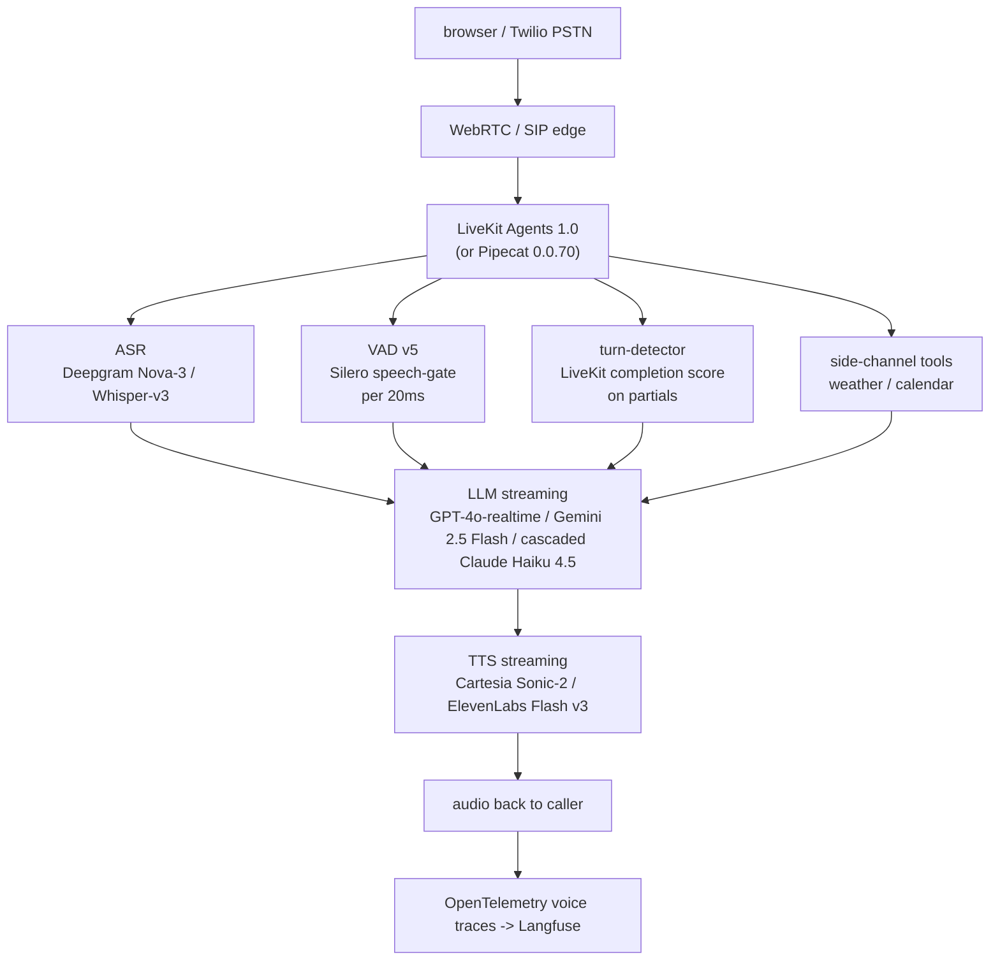

# Capstone 03 — 实时语音助手（ASR 到 LLM 到 TTS）

> 一个“感觉对”的 voice agent 需要端到端延迟低于 800ms，知道你什么时候停止说话，能处理 barge-in，并且能在不让对话卡住的情况下调用工具。Retell、Vapi、LiveKit Agents 和 Pipecat 在 2026 年都达到了这个门槛。它们的形态相同：streaming ASR、turn-detector、streaming LLM、streaming TTS，全部通过 WebRTC 连接，并在每一跳设置激进的 latency budgets。构建一个，测量 WER、MOS 和 false-cutoff rate，并在 packet loss 下运行它。

**Type:** Capstone
**Languages:** Python (agent + pipeline), TypeScript (web client)
**Prerequisites:** Phase 6 (speech and audio), Phase 7 (transformers), Phase 11 (LLM engineering), Phase 13 (tools), Phase 14 (agents), Phase 17 (infrastructure)
**Phases exercised:** P6 · P7 · P11 · P13 · P14 · P17
**Time:** 30 hours

## 问题

Voice 是 2025-2026 年移动最快的 AI UX 类别。Technical ceiling 每个季度都在下降。OpenAI Realtime API、Gemini 2.5 Live、Cartesia Sonic-2、ElevenLabs Flash v3、LiveKit Agents 1.0 和 Pipecat 0.0.70 都让 sub-800ms first-audio-out 触手可及。门槛不只是 latency，而是 interaction feel：不打断用户、不被用户卡住、能从句中 interruption 恢复、能在对话中调用工具而不让音频停滞，还要能承受抖动的移动网络。

你无法通过拼接三个 REST calls 达到这种体验。架构必须是端到端 pipelined streaming。真正构建之后，failure modes 会变得可见：为 phone audio 调好的 VAD 被背景电视触发；turn-detector 等待永远不会出现的 punctuation；TTS 在发出音频前先缓冲 400ms。这个 capstone 的目标是在 load 下逐个修复这些问题，并发布 latency-and-quality report。

## 概念

Pipeline 有五个 streaming stages：**audio in**（来自 browser 或 PSTN 的 WebRTC）、**ASR**（来自 Deepgram Nova-3 或 faster-whisper 的 streaming partial transcripts）、**turn detection**（VAD 加一个读取 partial transcripts 中 completion cues 的小型 turn-detector model）、**LLM**（一旦判断 turn complete 就开始 streaming tokens）、**TTS**（在第一个 LLM token 之后约 200ms 内开始 streaming audio out）。

三个 cross-cutting concerns。**Barge-in**：当用户在 agent 说话时开始说话，TTS 会取消，ASR 立刻接管。**Tool use**：对话中的 function calls（weather、calendar）必须在 side channel 上运行，不能让音频停滞；如果 latency 超过 300ms，agent 会预先填充一个 acknowledgment token（“one second...”）。**Backpressure**：在 packet loss 下，partial transcripts 会被保留，VAD 提高 speech-gate threshold，agent 避免覆盖尚未 acknowledged 的 message。

Measurement bar 是定量的。在 Hamming VAD benchmark、15 dB SNR 下 WER 低于 8%。100 次 measured calls 上 first-audio-out p50 低于 800ms。False-cutoff rate 低于 3%。TTS MOS 高于 4.2。单台 g5.xlarge 上支持 50 concurrent calls。这些数字就是 deliverable。

## 架构



## Stack

- Transport：LiveKit Agents 1.0（WebRTC）加 Twilio PSTN gateway；Pipecat 0.0.70 作为 alternate framework。
- ASR：Deepgram Nova-3（streaming，sub-300ms first partial）或 self-hosted faster-whisper Whisper-v3-turbo。
- VAD：Silero VAD v5 加 LiveKit turn-detector（读取 partial transcripts 的小型 transformer）。
- LLM：OpenAI GPT-4o-realtime 用于 tight integration，Gemini 2.5 Flash Live，或 cascaded Claude Haiku 4.5（streaming completions，separate audio path）。
- TTS：Cartesia Sonic-2（最低 first-byte）、ElevenLabs Flash v3，或 open-source Orpheus 用于 self-host。
- Tools：FastMCP side-channel，用于 weather/calendar/booking；如果 tool 超过 300ms，agent 先发 filler。
- Observability：OpenTelemetry voice spans，Langfuse voice traces with audio replay。
- Deployment：单台 g5.xlarge（24GB VRAM）用于 self-hosted Whisper + Orpheus；hosted APIs 用于最低 latency。

## Build It

1. **WebRTC session。** 启动一个 LiveKit room 和一个 streaming microphone audio 的 web client。在 server 上附加一个加入 room 的 agent worker。

2. **ASR streaming。** 把 20ms PCM frames 送入 Deepgram Nova-3（或 GPU 上的 faster-whisper）。订阅 partial 和 final transcripts。记录 per-partial latency。

3. **VAD and turn detector。** 在 frame stream 上运行 Silero VAD v5。在 speech-end event 上，用最新 partial transcript 调用 LiveKit turn-detector。只有当 VAD 认为已经 silence 500ms 且 turn-detector completion score > 0.6 时，才 commit 为 “turn complete”。

4. **LLM stream。** 在 turn complete 后，使用 running conversation 加 final transcript 启动 LLM call。Stream tokens out。在第一个 token 出现时交给 TTS。

5. **TTS stream。** Cartesia Sonic-2 把 audio chunks streaming 回来。第一个 chunk 必须在第一个 LLM token 之后 200ms 内离开 server。把 chunks 发到 LiveKit room；client 通过 WebRTC jitter buffer 播放。

6. **Barge-in。** 当 VAD 在 TTS 播放期间检测到新的 user speech，立即 cancel TTS stream，丢弃剩余 LLM output，并 re-arm ASR。发布一个 `tts_canceled` span。

7. **Tool side channel。** 注册 weather 和 calendar 作为 function-calling tools。调用时并发触发；如果 300ms 内没有返回，让 LLM 发出 “one second, let me check” 作为 filler；tool 返回后继续。

8. **Eval harness。** 录制 100 次 calls。计算 WER（对比 held-out transcript）、false-cutoff rate（用户还在句中时 TTS 被取消）、first-audio-out p50、TTS MOS（human 或 NISQA），以及 jitter-loss test（丢弃 3% packets）。

9. **Load test。** 用 synthetic caller 在单台 g5.xlarge 上驱动 50 concurrent calls。测量 sustained first-audio-out p95。

## Use It

```text
caller: "what is the weather in tokyo tomorrow"
[asr  ] partial @280ms: "what is the"
[asr  ] partial @540ms: "what is the weather"
[turn ] completion score 0.82 at @820ms; commit
[llm  ] first token @960ms
[tool ] weather.tokyo tomorrow -> 68/52 partly cloudy @1140ms
[tts  ] first audio-out @1040ms: "Tokyo tomorrow will be partly cloudy..."
turn latency: 1040ms user-stop -> audio-out
```

## Ship It

`outputs/skill-voice-agent.md` 是 deliverable。给定一个 domain（customer support、scheduling 或 kiosk），它会启动一个 LiveKit agent，并把 ASR/VAD/LLM/TTS pipeline 调到 measurement bar。Rubric：

| Weight | Criterion | How it is measured |
|:-:|---|---|
| 25 | End-to-end latency | 100 次 recorded calls 上 p50 first-audio-out 低于 800ms |
| 20 | Turn-taking quality | Hamming VAD benchmark 上 false-cutoff rate 低于 3% |
| 20 | Tool-use correctness | 对话中的 tool calls 返回正确数据，且不让 audio 停滞 |
| 20 | Reliability under packet loss | 注入 3% packet drop 时的 WER 和 turn-taking stability |
| 15 | Eval harness completeness | 带 public config 的 reproducible measurements |
| **100** | | |

## 练习

1. 把 Deepgram Nova-3 换成 g5.xlarge 上的 faster-whisper v3 turbo。测量 latency 和 WER gap。指出 CPU-vs-GPU decisions 在哪里重要。

2. 添加 interruption-arbitration policy：当用户在 tool call 期间 barge in，agent 应该怎么做？比较三种 policies（hard cancel、finish-tool-then-stop、queue next turn）。

3. 运行 adversarial turn-detector test：让用户在句中长暂停。调节 VAD silence threshold 和 turn-detector score threshold，使 false-cutoff 最低，同时不超过 900ms。

4. 通过 Twilio 把同一个 agent 部署到 PSTN。比较 PSTN first-audio-out 和 WebRTC。解释 jitter-buffer 和 codec differences。

5. 为非英语语言（Japanese、Spanish）添加 voice activity detection。测量 Silero VAD v5 false-trigger rate，并与 language-specific fine-tunes 对比。

## 关键术语

| Term | What people say | What it actually means |
|------|-----------------|------------------------|
| Turn detection | “End of utterance” | 给定 VAD silence 和 partial transcript，判断用户是否说完的 classifier |
| Barge-in | “Interruption handling” | 当 VAD 检测到新的 user speech 时，取消正在播放的 TTS |
| First-audio-out | “Latency” | 从用户停止说话到第一个 audio packet 离开 server 的时间 |
| VAD | “Speech gate” | 把 audio frames 分类为 speech 或 silence 的模型；Silero VAD v5 是 2026 年默认选择 |
| Jitter buffer | “Audio smoothing” | Client-side buffer，短暂持有 packets 以吸收 network variance |
| Filler | “Acknowledgment token” | 当 tool 很慢时，agent 发出的短语，用来避免沉默 |
| MOS | “Mean opinion score” | 感知语音质量评分；NISQA 是 automated proxy |

## 延伸阅读

- [LiveKit Agents 1.0](https://github.com/livekit/agents) — reference WebRTC agent framework
- [Pipecat](https://github.com/pipecat-ai/pipecat) — alternate Python-first streaming agent framework
- [OpenAI Realtime API](https://platform.openai.com/docs/guides/realtime) — reference for integrated speech models
- [Deepgram Nova-3 documentation](https://developers.deepgram.com/docs) — streaming ASR reference
- [Silero VAD v5](https://github.com/snakers4/silero-vad) — VAD reference model
- [Cartesia Sonic-2](https://docs.cartesia.ai) — low-latency TTS reference
- [Retell AI architecture](https://docs.retellai.com) — production voice agent architecture
- [Vapi.ai production stack](https://docs.vapi.ai) — alternate production reference
