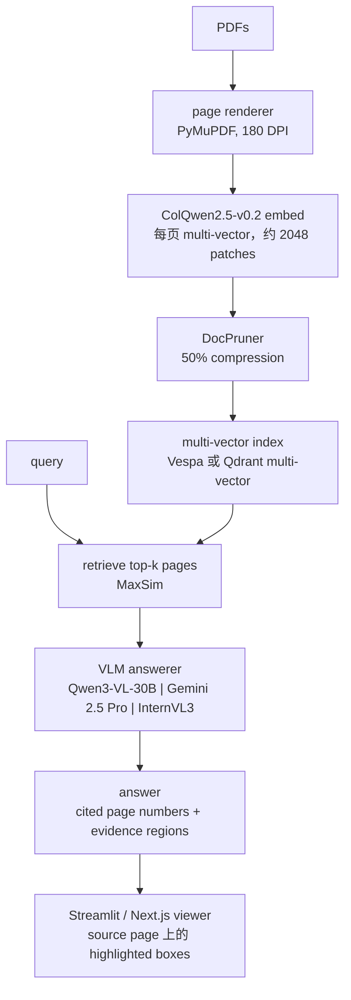

# Capstone 04 - 多模态文档问答（Vision-First PDF、表格、图表）

> 2026 年的文档问答前沿已经从 “先 OCR 再文本检索” 转向 vision-first late interaction。ColPali、ColQwen2.5 和 ColQwen3-omni 把每一页 PDF 当作图像处理，用 multi-vector late interaction 生成嵌入，并让查询直接关注 page patches。在金融 10-K、科学论文和手写笔记上，这种模式大幅优于 OCR-first。你将端到端构建一条 10k pages 的 pipeline，并发布它与 OCR-then-text 的并排对比。

**Type:** Capstone
**Languages:** Python（pipeline）, TypeScript（viewer UI）
**Prerequisites:** Phase 4（computer vision）, Phase 5（NLP）, Phase 7（transformers）, Phase 11（LLM engineering）, Phase 12（multimodal）, Phase 17（infrastructure）
**Phases exercised:** P4 · P5 · P7 · P11 · P12 · P17
**Time:** 30 hours

## 问题

企业内部有大量会被 OCR pipelines 搞坏的 PDF：扫描版 10-K 中旋转的表格、充满公式的科学论文、只有作为图像才有意义的图表、手写批注。如果把这些文档当成 text-first 问题，就会丢掉一半信号。2026 年的答案是在原始页面图像上做 late-interaction multi-vector retrieval。ColPali（Illuin Tech）引入了这一路线；ColQwen2.5-v0.2 和 ColQwen3-omni 继续提高准确率。在 ViDoRe v3 上，vision-first retrieval 明显高于 OCR-then-text，并且在图表、表格和手写内容上的差距更大。

代价是存储和延迟。ColQwen embedding 不是单个 1024-dim vector，而是每页约 2048 个 patch vectors。原始存储会膨胀。DocPruner（2026）可以在没有可测准确率损失的情况下剪掉 50%。你将索引 10k pages，测量 ViDoRe v3 nDCG@5，把回答延迟控制在 2 秒以内，并与 OCR-then-text baseline 直接比较。

## 概念

Late interaction 的意思是：每个 query token 都会和每个 patch token 打分，然后对每个 query token 取最大分数并求和。你获得的是细粒度匹配，不需要把整页压成一个 pooled vector。Multi-vector index（Vespa、Qdrant multi-vector 或 AstraDB）会存储这些 per-patch embeddings，并在检索时运行 MaxSim。

Answerer 是一个 vision-language model。它接收 query 和 top-k retrieved pages 的图像，然后写出带 evidence regions（bounding boxes 或 page references）的回答。Qwen3-VL-30B、Gemini 2.5 Pro 和 InternVL3 是 2026 年的前沿选择。对于公式和科学记号，可以把 OCR fallback（Nougat、dots.ocr）作为可选 text channel 拼接进去。

Evaluation 是一个二维矩阵。一条轴是 content type（纯文本段落、密集表格、柱状图/折线图、手写笔记、公式）。另一条轴是 retrieval approach（vision-first late interaction、OCR-then-text、hybrid）。每个 cell 都记录 nDCG@5 和 answer accuracy。最终交付物是一份报告。

## 架构



## 技术栈

- Page rendering：PyMuPDF（fitz），180 DPI，portrait-normalized
- Late-interaction model：ColQwen2.5-v0.2 或 ColQwen3-omni（Hugging Face 上的 vidore team）
- Index：带 multi-vector field 的 Vespa，或 Qdrant multi-vector，或带 MaxSim 的 AstraDB
- Pruning：DocPruner 2026 policy（保留 high-variance patches，50% compression，accuracy loss < 0.5%）
- OCR fallback（公式 / 密集表格）：dots.ocr 或 Nougat
- VLM answerer：self-hosted Qwen3-VL-30B 或 hosted Gemini 2.5 Pro；InternVL3 作为 fallback
- Evaluation：ViDoRe v3 benchmark，M3DocVQA 用于 multi-page reasoning
- Viewer UI：Next.js 15，用 canvas overlay 展示 evidence regions

## Build It

1. **Ingest。** 遍历一个包含 10k PDF pages 的语料，覆盖 10-K、科学论文和扫描文档。把每页渲染成 1536x2048 PNG。持久化 `{doc_id, page_num, image_path}`。

2. **Embed。** 在每张 page image 上运行 ColQwen2.5-v0.2。输出形状约为 2048 个 patch embeddings，每个 dim 128。应用 DocPruner，只保留信号最高的一半。写入 Vespa multi-vector field 或 Qdrant multi-vector。

3. **Query。** 对每个 incoming query，用 query tower 生成 embedding（token-level embeddings）。在 index 上运行 MaxSim：对每个 query token，取它与 page patch embeddings 的最大 dot-product，然后求和。返回 top-k pages。

4. **Synthesize。** 用 query 和 top-5 page images 调用 Qwen3-VL-30B。Prompt："Answer using only the supplied pages. Cite each claim by (doc_id, page) and name the region (figure, table, paragraph)."

5. **Evidence regions。** 对 answer 做 post-process，抽取 cited regions。如果 VLM 产出 bounding boxes（Qwen3-VL 会），就在 viewer 中把它们渲染为 overlays。

6. **OCR fallback。** 对识别为 equation-dense 的页面（基于 image variance 的 heuristic），运行 Nougat 或 dots.ocr，并把 OCR text 作为额外 channel 与图像一起传入。

7. **Eval。** 运行 ViDoRe v3（retrieval nDCG@5）和 M3DocVQA（multi-page QA accuracy）。同时在同一语料、同一 synthesizer 上运行 OCR-then-text pipeline。产出 content-type × approach matrix。

8. **UI。** 先做 Streamlit prototype；再做 Next.js 15 production viewer，支持逐页 evidence-region overlay。

## Use It

```console
$ doc-qa ask "what was the 2024 operating margin change for segment EMEA?"
[retrieve]   top-5 pages in 320ms (ColQwen2.5, MaxSim, Vespa)
[synth]      qwen3-vl-30b, 1.4s, cited (form-10k-2024, p. 88) + (..., p. 92)
answer:
  EMEA operating margin moved from 18.2% to 16.8%, a 140bp decline.
  cited: 10-K-2024.pdf p.88 (Table 4, Segment Operating Margin)
         10-K-2024.pdf p.92 (MD&A, Operating Performance)
[viewer]     open with highlighted bounding boxes overlaid on p.88 Table 4
```

## Ship It

`outputs/skill-doc-qa.md` 描述交付物：一个 vision-first multimodal document QA system，它针对特定语料调优，并在 ViDoRe v3 上与 OCR-then-text baseline 做评估。

| Weight | Criterion | How it is measured |
|:-:|---|---|
| 25 | ViDoRe v3 / M3DocVQA accuracy | Benchmark numbers vs OCR-text baseline and published leaderboard |
| 20 | Evidence-region grounding | 被引用 region 中实际包含 answer span 的比例 |
| 20 | Storage and latency engineering | DocPruner compression ratio、index p95、answer p95 |
| 20 | Multi-page reasoning | 在 hand-labeled 100-question multi-page set 上的 accuracy |
| 15 | Source-inspection UX | Viewer clarity、overlay fidelity、side-by-side comparison tools |
| **100** | | |

## 练习

1. 在同一个 corpus 上测量 ColQwen2.5-v0.2 与 ColQwen3-omni。哪些页面一个模型检索正确、另一个漏掉？给 index 增加一个 "content class" tag，用它按类型路由。

2. 激进剪枝 embeddings（75%、90%）。找到 compression cliff：ViDoRe nDCG@5 低于 OCR baseline 的那个点。

3. 构建 hybrid：并行运行 OCR-then-text 和 ColQwen，用 RRF 融合，再用 cross-encoder rerank。Hybrid 是否优于任一单独方案？它在哪些地方最有帮助？

4. 把 Qwen3-VL-30B 换成更小的 VLM（Qwen2.5-VL-7B）。测量 accuracy-per-dollar curve。

5. 增加 handwritten-note support。渲染 handwriting corpus，用 ColQwen embed，测量 retrieval。与 handwriting OCR pipeline 对比。

## 关键术语

| Term | 大家常说 | 实际含义 |
|------|----------|----------|
| Late interaction | "ColPali-style retrieval" | Query tokens 分别与 page patches 打分；MaxSim 聚合 |
| Multi-vector | "Per-patch embedding" | 每个 document 有许多 vectors，而不是一个 pooled vector |
| MaxSim | "Late-interaction scoring" | 对每个 query token，取 document vectors 中的最大相似度；再求和 |
| DocPruner | "Patch compression" | 2026 年的 pruning 方法，保留 50% patches，准确率损失可忽略 |
| ViDoRe v3 | "Document-retrieval benchmark" | 2026 年衡量 visual-document retrieval 的标准 |
| Evidence region | "Cited bounding box" | Source page 上定位 answer span 的 bbox |
| OCR fallback | "Equation channel" | 与 vision 一起使用的 text pipeline，处理公式或表格密集页面 |

## 延伸阅读

- [ColPali（Illuin Tech）repository](https://github.com/illuin-tech/colpali) - late-interaction doc retrieval 参考实现。
- [ColPali paper（arXiv:2407.01449）](https://arxiv.org/abs/2407.01449) - foundational method paper。
- [Hugging Face 上的 ColQwen family](https://huggingface.co/vidore) - production-ready checkpoints。
- [M3DocRAG（Adobe）](https://arxiv.org/abs/2411.04952) - multi-page multimodal RAG baseline。
- [Vespa multi-vector tutorial](https://docs.vespa.ai/en/colpali.html) - reference serving stack。
- [Qdrant multi-vector support](https://qdrant.tech/documentation/concepts/vectors/#multivectors) - alternate index。
- [AstraDB multi-vector](https://docs.datastax.com/en/astra-db-serverless/databases/vector-search.html) - alternate managed index。
- [Nougat OCR](https://github.com/facebookresearch/nougat) - equation-capable OCR fallback。
