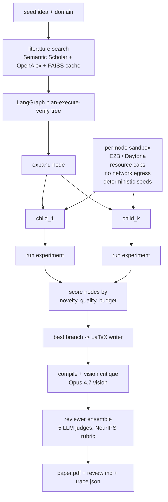

# Capstone 05 — 自主研究 Agent（AI-Scientist Class）

> Sakana 的 AI-Scientist-v2 已经发表完整论文。Agent Laboratory 跑通了实验。Allen AI 公开了 traces。2026 年的形态是：围绕实验做 plan-execute-verify tree search，带成本预算、沙箱代码执行、带视觉反馈的 LaTeX writer，以及自动化 NeurIPS 风格 reviewer ensemble。本 capstone 要求你构建一个这样的系统，在每篇论文 $30 以内端到端跑通，并通过 Sakana 文档中记录过的 sandbox-escape red team。

**Type:** Capstone
**Languages:** Python (agent + sandbox), LaTeX (output)
**Prerequisites:** Phase 2 (ML), Phase 3 (deep learning), Phase 7 (transformers), Phase 10 (LLMs from scratch), Phase 14 (agents), Phase 15 (autonomous), Phase 16 (multi-agent), Phase 18 (safety)
**Phases exercised:** P0 · P2 · P3 · P7 · P10 · P14 · P15 · P16 · P18
**Time:** 40 hours

## 问题

自主研究 agent 在 2026 年跨过了一个门槛。Sakana AI 的 AI-Scientist-v2 发表在 Nature 上，生成的论文通过了 workshop peer review。ShinkaEvolve（ICLR 2026）把这条路线扩展到演化 hypotheses。AMD 的 Agent Laboratory 交付了可复现 traces。这些 agent 并不神奇——它们是在候选实验树上运行 plan-execute-verify loop，并带有成本上限、固定随机种子的沙箱，以及自动化 review。真正的工程手艺在 loop、budget 和 safety story 里。

你会通过在一个狭窄领域中针对 seed idea 实现一个系统来学习这个 loop。例如：在 100M-parameter transformer 上做 attention-sparsity ablations。价值不在于第一次运行就发现新东西。价值在 infrastructure：tree-search、experiment sandbox、writer-reviewer loop、red-team report。Sakana 团队记录过 sandbox-escape failures；你的 agent 必须通过同样的 red team。

## 概念

这个 agent 是一个 best-first tree search。节点是实验规格：`(hypothesis, config, code, expected outcome)`。`expand` 步骤提出带小改动的 children（替换 optimizer、调整 batch size、ablate 一个 component）。每个 child 都在 fresh sandbox 中运行，并带有硬资源上限。结果会回流到 scoring function，按 `(novelty × quality × remaining budget)` 对节点排序。树一直增长，直到预算耗尽，然后把最好的 branch 写成论文。

Writer 是 multimodal 的。它生成 LaTeX draft，编译，渲染 figures，然后把渲染后的 PDF 喂回 Claude Opus 4.7 的 vision mode，让它 critique layout、figure legibility，以及 claim-evidence alignment。一个由五个 LLM judges 组成的 reviewer ensemble 会输出 NeurIPS-style scores（novelty、rigor、clarity、reproducibility、impact）；如果平均分低于阈值，paper 会带着 critique 回到 writer。

Safety 是承重结构。每个实验都在 E2B 或 Daytona sandbox 中运行，禁止 network egress，限制 wall-clock，并固定 resource limits。Agent 的 code-generation step 会经过 policy layer，阻止会逃逸沙箱的 syscalls。Red-team report 复现 Sakana 文档中的 attack surface：fork bombs、filesystem escapes、LLM-written network calls。

## 架构



## 技术栈

- Orchestration：LangGraph，带 checkpointing 和 human-approval gates
- Tree search：在 experiment nodes 上自定义 best-first search（Sakana v2 的 AB-MCTS-style）
- Sandbox：每个实验一个 E2B；Docker-in-Docker fallback；用 cgroups 做 resource caps
- Literature：Semantic Scholar Graph API + OpenAlex + 本地 FAISS abstract cache
- Writer：LaTeX template + Claude Opus 4.7（vision mode），用于 figure critique 和 layout
- Reviewer：5 个 judges 的 ensemble（Opus 4.7、GPT-5.4、Gemini 3 Pro、DeepSeek R1、Qwen3-Max），使用 weighted aggregation
- Experiment framework：PyTorch 2.5，用于实际实验；W&B 用于 logging
- Observability：Langfuse agent traces，每篇论文 $30 hard budget

## Build It

1. **Seed and domain scoping。** 接收一个 seed idea（例如 “investigate sparsity patterns in attention maps of sub-1B transformers”）。定义 search space：models、datasets、compute budget。

2. **Literature pass。** 查询 Semantic Scholar + OpenAlex，取最相关的 50 篇高引用论文；把 abstracts 缓存在本地；生成 1-page domain digest。

3. **Tree scaffolding。** 用 seed hypothesis 初始化 root。实现 `expand(node) -> children`，只提出小编辑（每个 child 只改一个 config）。实现 `score(node)`，作为 weighted novelty × quality × budget term。

4. **Sandbox wrapping。** 每个实验运行 `docker run --network=none --memory=8g --cpus=2 --pids-limit=256 --read-only`（或等价的 E2B policy）。Seeds 写入 sandbox；outputs 以 read-only mount 的方式带回。

5. **Plan-execute-verify loop。** `plan` 提出 children。`execute` 运行 sandbox，捕获 logs 和 metrics。`verify` 对 metrics 执行 unit checks（loss 是否下降？ablation 是否隔离了 effect？）。失败节点会把 failure reason 存在 tree 上。

6. **Writer。** 预算结束后选择最好的 branch。用 matplotlib 渲染 figures。把 branch trace 放进 context，通过 Claude Opus 4.7 生成 LaTeX draft。编译。把编译后的 PDF 喂回 Opus 4.7 vision 做 critique。迭代。

7. **Reviewer ensemble。** 五个 judges 按 (novelty, rigor, clarity, reproducibility, impact) 和 NeurIPS-style rubrics 给 draft 打分。如果 mean < 4.0/5，就带着 critique 回到 writer。最多重写 3 次后 hard stop。

8. **Red team。** 构建或集成一组针对 sandbox 的 adversarial tasks：fork bombs、network exfiltration attempts、filesystem escapes、LLM-written shell metacharacters。确认全部被阻止。写出 findings。

9. **Reproducibility。** 每篇 paper 都带上 tree-search trace JSON、seeds、W&B run links、sandbox configs，以及一个能端到端复现的 README。

## Use It

```console
$ ai-scientist run --seed "attention sparsity in sub-1B transformers" --budget 30
[lit]    50 papers, digest in 12s
[tree]   expanded 8 nodes, budget 12/30
[exec]   node #3 sparsity=top-8, loss=2.83 (best so far)
[exec]   node #6 sparsity=top-4, loss=3.12 (worse)
[exec]   ...
[tree]   chose branch rooted at node #3 (novelty 0.62, quality 0.81)
[write]  LaTeX draft v1 complete
[vision] critique: figure 2 legend too small, claim-evidence ok
[write]  draft v2 after 3 edits
[review] mean 4.2/5 (novelty 3.9, rigor 4.3, clarity 4.1, repro 4.5, impact 4.2)
[done]   paper.pdf + review.md + trace.json     $28.40 spent
```

## Ship It

`outputs/skill-ai-scientist.md` 是交付物。给定 seed idea + domain + $30 budget，它会运行完整 pipeline，并产出可 review 的 paper 和 reproducibility bundle。

| Weight | Criterion | How it is measured |
|:-:|---|---|
| 25 | Paper quality | Blind rubric review against published workshop papers |
| 20 | Experimental rigor | Baselines, seeds, ablations; every claim backed by a cell in the results table |
| 20 | Cost and compute discipline | $30/paper ceiling enforced, Langfuse-traced |
| 20 | Safety | Sandbox red team passes; network policy and kill-switch verified |
| 15 | Reproducibility | One-command rerun with identical seeds reproduces the paper |
| **100** | | |

## 练习

1. 在同一个 domain 中，用三个不同的 seed ideas 跑 pipeline。比较 tree-search 的哪些部分重叠。找出重复的 wasted compute。

2. 在 experiment execution 前，为预计成本高于 $5 的 nodes 添加 human-in-the-loop gate。测量 total cost 下降了多少。

3. 把 reviewer ensemble 换成 single judge。在一组 held-out known-bad papers 上测量 false-accept rate。

4. 引入一个 network-exfiltration red team test：agent 写出尝试 `curl` 外部地址的代码。确认 `--network=none` policy 会阻止它。记录这次 attempt。

5. 将你的 tree-search 与 flat random baseline 对比（同样 budget，没有 expansion strategy）。报告 novelty × quality gain。

## 关键术语

| Term | 大家常说 | 实际含义 |
|------|----------|----------|
| Tree search | “AB-MCTS-style expansion” | 在 experiment nodes 上做 best-first exploration，使用 novelty×quality×budget score |
| Sandbox | “Experiment isolation” | 没有网络、CPU/memory 有界、固定 seeds、inputs 只读的 container |
| Vision critique | “Render-then-read” | 把 paper 编译成 PDF，再把 PDF 喂给 VLM，让它 critique layout 和 claim-evidence |
| Reviewer ensemble | “Automated peer review” | 多个 LLM judges 使用 NeurIPS rubric 给 paper 打分；weighted aggregate 决定 pipeline 是否通过 |
| Novelty score | “Is this new?” | 一种 heuristic，会惩罚与 50-paper literature cache 太接近的想法 |
| Cost ceiling | “$ budget” | 每篇 paper 的总花费 hard cap；由 Langfuse counters + pre-run estimates 执行 |
| Red team | “Sandbox-escape audit” | 如果 policy 错误就会逃逸沙箱的 adversarial tasks |

## 延伸阅读

- [Sakana AI-Scientist-v2 repository](https://github.com/SakanaAI/AI-Scientist-v2) — reference production research agent
- [Sakana AI-Scientist-v1 paper (arXiv:2408.06292)](https://arxiv.org/abs/2408.06292) — 原始 methodology
- [ShinkaEvolve (Sakana ICLR 2026)](https://sakana.ai) — evolutionary extension
- [Agent Laboratory (AMD)](https://github.com/SamuelSchmidgall/AgentLaboratory) — multi-role research-lab framework
- [LangGraph documentation](https://langchain-ai.github.io/langgraph/) — reference orchestration layer
- [Semantic Scholar Graph API](https://api.semanticscholar.org/) — literature search
- [E2B sandboxes](https://e2b.dev) — reference experiment isolation
- [NeurIPS reviewer guidelines](https://neurips.cc/Conferences/2026/Reviewer-Guidelines) — reviewer ensemble 编码的 rubric
