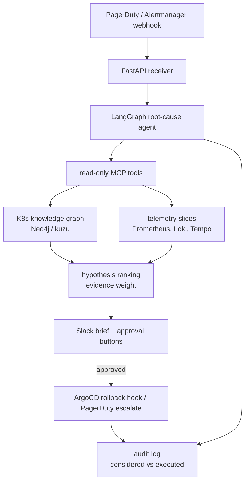

# Capstone 06 - Kubernetes DevOps 故障排查 Agent

> AWS 的 DevOps Agent 已经 GA，Resolve AI 发布了 K8s playbooks，NeuBird 演示了 semantic monitoring，Metoro 把 AI SRE 绑定到 per-service SLO。Production shape 已经稳定：alert webhook 触发后，agent 读取 telemetry，遍历 K8s objects graph，排序 root-cause hypotheses，然后把带 approval buttons 的 Slack brief 发出去。默认 read-only。每个 remediation 都由 human gate 控制。这个 capstone 就是这个 agent：在 20 个 synthetic incidents 上评估，并在三个 shared cases 上与 AWS 的 Agent 对比。

**Type:** Capstone
**Languages:** Python (agent), TypeScript (Slack integration)
**Prerequisites:** Phase 11 (LLM engineering), Phase 13 (tools and MCP), Phase 14 (agents), Phase 15 (autonomous), Phase 17 (infrastructure), Phase 18 (safety)
**Phases exercised:** P11 · P13 · P14 · P15 · P17 · P18
**Time:** 30 hours

## 问题

2025-2026 年的 SRE narrative 变成了：“AI agents triage incidents，humans approve remediations。”AWS DevOps Agent、Resolve AI、NeuBird、Metoro、PagerDuty AIOps 都已经在 production 中交付了这种形态。Agent 读取 Prometheus metrics、Loki logs、Tempo traces、kube-state-metrics，以及 K8s objects 的 knowledge graph。它在五分钟内产出带 telemetry citations 的 ranked root-cause hypothesis。没有 Slack 中的明确 human approval，它绝不执行 destructive commands。

大部分难点是 scoping 和 safety，而不是 reasoning。Agent 需要一个 read-only-by-default RBAC surface、一个 hardened MCP tool server，以及每条 command 被 considered vs executed 的 audit logs。它需要知道自己什么时候超出能力范围并 escalate。它还必须足够便宜，避免 OOM-kill cascades 生成一张 $5k agent bill。

## 概念

Agent 在 knowledge graph 上运行。Nodes 是 K8s objects（Pods、Deployments、Services、Nodes、HPAs、PVCs）加 telemetry sources（Prometheus series、Loki streams、Tempo traces）。Edges 编码 ownership（Pod -> ReplicaSet -> Deployment）、scheduling（Pod -> Node）和 observation（Pod -> Prometheus series）。这个 graph 由 kube-state-metrics sync 保持新鲜，并在每次 alert 时重新 sample。

Alert 触发后，agent 从 affected object 开始做 root cause。它沿 edges 遍历，拉取相关 telemetry slices（last 15 minutes），并起草 hypothesis。Hypothesis 按 evidence 排序：有多少 telemetry citations 支持它、信息有多新、有多 specific。Top-3 hypotheses 会发到 Slack，附带 graph-path visualizations，以及 remediation actions 的 approval buttons。

Remediation 被 gate 控制。默认允许的 actions 都是 read-only。Destructive actions（scaling down、rolling back、deleting Pods）需要 Slack approval；ArgoCD rollback hooks 需要一个 agent 自己永远不持有的 auth token。Audit log 记录 agent *considered* 的每条 command，而不只是 executed 的 command，这样 review process 可以捕捉 near-misses。

## Architecture



## Stack

- Observability sources：Prometheus、Loki、Tempo、kube-state-metrics
- Knowledge graph：K8s objects + telemetry edges 的 Neo4j（managed）或 kuzu（embedded）
- Agent：LangGraph，带 per-tool allow-list，默认 read-only
- Tool transport：FastMCP over StreamableHTTP；destructive tools 放在 approval gate 后面的独立 server
- Models：Claude Sonnet 4.7 做 root-cause reasoning，Gemini 2.5 Flash 做 log summarization
- Remediation：ArgoCD rollback webhook、PagerDuty escalate、Slack approval card
- Audit：append-only structured log（considered、executed、approved、outcome）
- Deployment：K8s deployment，使用自己的 narrow RBAC role；独立 namespace

## Build It

1. **Graph ingestion。** 每 30s 将 kube-state-metrics sync 到 Neo4j/kuzu。Nodes：Pod、Deployment、Node、Service、PVC、HPA。Edges：OWNED_BY、SCHEDULED_ON、EXPOSES、MOUNTS、SCALES。Telemetry overlay edges：OBSERVED_BY（某个 Pod 被某个 Prometheus series 观察）。

2. **Alert receiver。** FastAPI endpoint 接收 PagerDuty 或 Alertmanager webhooks。提取 affected object(s) 和 SLO breach。

3. **Read-only tool surface。** 用 FastMCP 包装 kubectl、Prometheus query、Loki logql、Tempo traceql。每个 tool 都有 narrow RBAC verb（`get`、`list`、`describe`）。Default server 中没有 `delete`、`exec`、`scale`。

4. **Root-cause agent。** LangGraph 包含三个 nodes：`sample` 拉取 last-15-minutes telemetry slice，`walk` 查询 graph 中的 neighboring objects，`hypothesize` 生成带 telemetry citations 的 ranked root-cause candidates。

5. **Evidence scoring。** 每个 hypothesis 的 score = recency * specificity * graph-path length inverse * citation count。返回 top-3。

6. **Slack brief。** 发布一个 attachment，其中包含 hypothesis、graph-path visualization（server-side 渲染的 subgraph image），以及最多一个 remediation action 的 approval buttons。

7. **Remediation gate。** Destructive tools（scale down、roll back、delete）位于第二个 MCP server 上，并受 approval token 保护。只有 Slack card 被 human approve 后，agent 才能调用它们。

8. **Audit log。** Append-only JSONL：对每个 candidate command，记录它是否被 considered、是否 executed、由谁 approved。每天发往 S3。

9. **Synthetic incident suite。** 构建 20 个 scenarios：OOMKill cascade、DNS flap、HPA thrash、PVC fill、noisy neighbor、faulty sidecar、bad ConfigMap rollout、certificate rotation、image-pull backoff 等。用 root-cause accuracy 和 time-to-hypothesis 评分 agent。

## Use It

```console
webhook: alert.pagerduty.com -> checkout-api SLO breach, error rate 14%
[graph]   affected: Deployment checkout-api (3 Pods, Node ip-10-2-3-4)
[walk]    neighbors: ReplicaSet checkout-api-abc, Service checkout-api,
           recent rollout 14m ago
[sample]  prometheus error_rate 14%, up-trend; loki 500s on /api/v2/pay
[hypo]    #1 bad rollout: latest image checkout-api:v2.41 fails /healthz
          citations: deploy.yaml (rev 42), prometheus errorRate, loki 500 stack
[slack]   [ROLL BACK to v2.40]  [ESCALATE]  [IGNORE]
          (approval required; agent does not roll back unilaterally)
```

## Ship It

`outputs/skill-devops-agent.md` 是交付物。给定一个 K8s cluster 和 alert source，agent 会产出 ranked root-cause hypotheses，以及一个 Slack-gated remediation flow。

| Weight | Criterion | How it is measured |
|:-:|---|---|
| 25 | RCA accuracy on scenario suite | 20 个 synthetic incidents 中 root cause 正确率 >=80% |
| 20 | Safety | Audit log 中 destructive-action guard 从不在没有 Slack approval 时触发 |
| 20 | Time-to-hypothesis | 从 alert 到 Slack brief 的 p50 低于 5 分钟 |
| 20 | Explainability | 每个 hypothesis 都有 graph paths 和 telemetry citations |
| 15 | Integration completeness | PagerDuty、Slack、ArgoCD、Prometheus end-to-end working |
| **100** | | |

## 练习

1. 在 AWS DevOps Agent demo 的同三个 incidents 上运行你的 agent。发布 side-by-side。报告 agent 发生 divergence 的地方。

2. 添加一个 “near-miss” audit，用于标记 agent *considered* 的任何如果没有 approval 就会 destructive 的 command。测量一周内的 near-miss rate。

3. 将 hypothesis model 从 Claude Sonnet 4.7 换成 self-hosted Llama 3.3 70B。测量 RCA accuracy delta 和 dollar per incident。

4. 构建 causal filter：区分 correlated telemetry spikes 和真正的 root cause。在 20-scenario labels 上训练一个 small classifier。

5. 添加 rollback dry-run：在具有相同 manifest 的 staging cluster 上执行 ArgoCD rollback。先在 live cluster 中验证 rollback plan，再显示 Slack approval button。

## 关键术语

| Term | What people say | What it actually means |
|------|-----------------|------------------------|
| K8s knowledge graph | “Cluster graph” | Nodes = K8s objects + telemetry series；edges = ownership、scheduling、observation |
| Read-only-by-default | “Scoped RBAC” | Agent 的 service account 只有 get/list/describe verbs；destructive verbs 位于 approval 后面的独立 server |
| Audit log | “Considered vs executed” | 每个 candidate command 的 append-only record：是否运行、由谁 approved |
| Hypothesis ranking | “Evidence score” | Recency × specificity × graph-path length inverse × citation count |
| Slack approval card | “HITL gate” | 带 remediation buttons 的 interactive Slack message；human 点击前 agent 不能继续 |
| Telemetry citation | “Evidence pointer” | 支持某个 claim 的 Prometheus query、Loki selector 或 Tempo trace URL |
| MTTR | “Time to resolution” | 从 alert fire 到 SLO recovery 的 wall-clock time |

## 延伸阅读

- [AWS DevOps Agent GA](https://aws.amazon.com/blogs/aws/aws-devops-agent-helps-you-accelerate-incident-response-and-improve-system-reliability-preview/) — 2026 年 canonical reference
- [Resolve AI K8s troubleshooting](https://resolve.ai/blog/kubernetes-troubleshooting-in-resolve-ai) — competitor reference
- [NeuBird semantic monitoring](https://www.neubird.ai) — semantic-graph approach
- [Metoro AI SRE](https://metoro.io) — SLO-first production framing
- [kube-state-metrics](https://github.com/kubernetes/kube-state-metrics) — cluster-state source
- [LangGraph](https://langchain-ai.github.io/langgraph/) — reference agent orchestrator
- [FastMCP](https://github.com/jlowin/fastmcp) — Python MCP server framework
- [ArgoCD rollback](https://argo-cd.readthedocs.io/en/stable/user-guide/commands/argocd_app_rollback/) — gated remediation target
