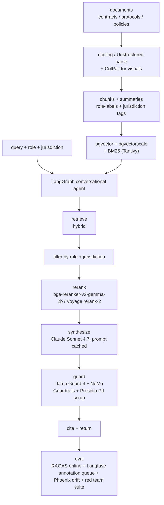

# Capstone 08 — 面向受监管垂直领域的生产级 RAG Chatbot

> Harvey、Glean、Mendable 和 LlamaCloud 在 2026 年都运行着同一种 production shape。用 docling 或 Unstructured 做 ingest，用 ColPali 处理 visuals。Hybrid search。用 bge-reranker-v2-gemma 做 re-rank。用 Claude Sonnet 4.7 合成答案，并让 prompt caching 命中率达到 60-80%。用 Llama Guard 4 和 NeMo Guardrails 做 guard。用 Langfuse 和 Phoenix 做 watch。用 RAGAS 在 200-question golden set 上打分。把它构建在一个受监管领域（legal、clinical、insurance）里；这个 capstone 的目标是通过 golden set、red team 和 drift dashboard。

**Type:** Capstone
**Languages:** Python (pipeline + API), TypeScript (chat UI)
**Prerequisites:** Phase 5 (NLP), Phase 7 (transformers), Phase 11 (LLM engineering), Phase 12 (multimodal), Phase 17 (infrastructure), Phase 18 (safety)
**Phases exercised:** P5 · P7 · P11 · P12 · P17 · P18
**Time:** 30 hours

## 问题

Regulated-domain RAG（legal contracts、clinical trial protocols、insurance policies）是 2026 年最常落地的 production shape，因为 ROI 明确，stakes 也具体。Harvey（Allen & Overy）为 legal 场景构建了它。Mendable 交付 developer-docs 版本。Glean 覆盖 enterprise search。这个 pattern 是：high-fidelity ingest、hybrid retrieve with rerank、带 citation enforcement 和 prompt caching 的 synthesize、多层 safety guard，以及持续 monitor drift。

难点不在 model 本身。难点是 jurisdiction-aware compliance（HIPAA、GDPR、SOC2）、citation-level auditability、cost control（当 hit rate 高时，prompt caching 可获得 60-90% discount）、通过 RAGAS faithfulness 做 hallucination detection，以及当 source documents 更新但 index 没跟上时做 drift detection。这个 capstone 要求你在一个 200-question golden set 上交付全部能力，并配套一个 red-team suite。

## 概念

Pipeline 有两侧。**Ingestion**：docling 或 Unstructured 解析 structured documents；ColPali 处理 visually rich documents；chunks 会得到 summaries、tags 和 role-based access labels。Vectors 进入 pgvector + pgvectorscale（低于 50M vectors）或 Qdrant Cloud；sparse BM25 同时运行。**Conversation**：LangGraph 处理 memory 和 multi-turn；每个 query 执行 hybrid retrieval，用 bge-reranker-v2-gemma-2b rerank，用 Claude Sonnet 4.7（prompt-cached）synthesize，通过 Llama Guard 4 和 NeMo Guardrails，再输出 citation-anchored response。

Eval stack 有四层。**Golden set**（200 个带 citations 的 labeled Q/A）用于 correctness。**Red team**（jailbreaks、PII extraction attempts、off-domain questions）用于 safety。**RAGAS** 在每个 turn 自动评估 faithfulness / answer relevance / context precision。**Drift dashboard**（Arize Phoenix）每周观察 retrieval quality 和 hallucination score。

Prompt caching 是成本杠杆。Claude 4.5+ 和 GPT-5+ 支持缓存 system prompts + retrieved context。当 hit rate 达到 60-80% 时，每次 query 的成本会下降 3-5x。Pipeline 必须围绕 stable prefixes 设计（system prompt + reranked context first），才能获得高 cache hit rates。

## 架构



配套 SVG 资产：`assets/rag-stack.svg`。

## Stack

- Ingestion：Unstructured.io 或 docling 用于 structured documents；ColPali 用于 visually-rich PDFs。
- Vector DB：低于 50M vectors 时使用 pgvector + pgvectorscale；否则使用 Qdrant Cloud。
- Sparse：带 field weights 的 Tantivy BM25。
- Orchestration：LlamaIndex Workflows（ingestion）+ LangGraph（conversation）。
- Re-ranker：self-hosted bge-reranker-v2-gemma-2b 或 hosted Voyage rerank-2。
- LLM：带 prompt caching 的 Claude Sonnet 4.7；fallback 是 self-hosted Llama 3.3 70B。
- Eval：RAGAS 0.2 online，DeepEval 用于 hallucination 和 jailbreak suites。
- Observability：self-hosted Langfuse with annotation queue；Arize Phoenix 用于 drift。
- Guardrails：Llama Guard 4 input/output classifier、NeMo Guardrails v0.12 policy、Presidio PII scrub。
- Compliance：chunks 上的 role-based access labels；GDPR/HIPAA jurisdiction tags。

## Build It

1. **Ingestion。** 用 Unstructured 或 docling 解析你的 corpus（认真构建时是 1000-10000 documents）。对于 scanned / visual-heavy pages，路由到 ColPali。产出带 summaries、role-labels、jurisdiction tags 的 chunks。

2. **Index。** Dense embeddings（Voyage-3 或 Nomic-embed-v2）进入 pgvector + pgvectorscale。通过 Tantivy 建 BM25 side-index。Role 和 jurisdiction filters 作为 payload。

3. **Hybrid retrieve。** 先按 role+jurisdiction filter；再并行 dense + BM25；用 reciprocal rank fusion merge；top-20 进入 reranker；top-5 进入 synth。

4. **Synthesize with prompt caching。** System prompt + static policies 放在 cache header；reranked context 作为 cache extension；user question 作为 uncached suffix。稳态目标是 60-80% cache hit rate。

5. **Guardrails。** Llama Guard 4 处理 input；NeMo Guardrails rails 阻止 off-domain questions 或 policy-forbidden topics；Presidio scrub 输出中意外出现的 PII；citation enforcement post-filter。

6. **Golden set。** 由 domain expert 标注 200 个 Q/A pairs，每条带 (answer, citations)。按 exact-citation match、answer correctness、faithfulness（RAGAS）给 agent 打分。

7. **Red team。** 50 个 adversarial prompts：jailbreaks（PAIR、TAP）、PII exfiltration attempts、off-domain、cross-jurisdiction leaks。按 pass/fail 和 severity 打分。

8. **Drift dashboard。** Arize Phoenix 每周追踪 retrieval quality（nDCG、citation faithfulness）。当下降 5% 时 alert。

9. **Cost report。** Langfuse：prompt-caching hit rate、tokens per query，以及按 stage 分解的 $/query。

## Use It

```console
$ chat --role=analyst --jurisdiction=GDPR
> what is the data-retention obligation for EU user profiles under our contract?
[retrieve]  hybrid top-20 filtered to GDPR + analyst-role
[rerank]    top-5 kept
[synth]     claude-sonnet-4.7, cache hit 74%, 0.8s
answer:
  The contract (Section 12.4, Master Services Agreement dated 2024-03-11)
  obligates EU user profile deletion within 30 days of termination per GDPR
  Article 17. The DPA amendment (DPA-v2.1, Section 5) extends this to 14 days
  for "restricted" category data.
  citations: [MSA-2024-03-11 s12.4, DPA-v2.1 s5]
```

## Ship It

`outputs/skill-production-rag.md` 描述 deliverable：一个部署在 regulated-domain 中的 chatbot，带 compliance labels，通过 rubric，并接入 live drift monitoring。

| Weight | Criterion | How it is measured |
|:-:|---|---|
| 25 | RAGAS faithfulness + answer relevance | Golden set（200 Q/A）上的 online scores |
| 20 | Citation correctness | 带可验证 source anchors 的 answers 占比 |
| 20 | Guardrail coverage | Llama Guard 4 pass rate + jailbreak suite results |
| 20 | Cost / latency engineering | Prompt-cache hit rate、p95 latency、$/query |
| 15 | Drift monitoring dashboard | 带 weekly retrieval-quality trend 的 Phoenix live dashboard |
| **100** | | |

## 练习

1. 在另一个 jurisdiction 下构建第二个 corpus slice（例如在 GDPR 旁边加 HIPAA）。用 20-question cross-jurisdiction probe 演示 role+jurisdiction filtering 如何防止 cross-leak。

2. 在一周 production traffic 上测量 prompt-cache hit rate。识别哪些 queries 会破坏 cache prefix。重构它。

3. 添加带 10k-token summary buffer 的 multi-turn memory。测量 conversation 增长时 faithfulness 是否下降。

4. 把 Claude Sonnet 4.7 换成 self-hosted Llama 3.3 70B。测量 $/query 和 faithfulness delta。

5. 添加 “unsure” mode：如果 top reranked scores 低于阈值，agent 不回答，而是说 “I do not have confident citations”。测量 false-confidence reduction。

## 关键术语

| Term | What people say | What it actually means |
|------|-----------------|------------------------|
| Prompt caching | “Cached system + context” | Claude/OpenAI feature：命中时 cached prefix tokens 折扣 60-90% |
| RAGAS | “RAG evaluator” | 自动评估 faithfulness、answer relevance、context precision |
| Golden set | “Labeled eval” | 200+ expert-labeled Q/A with citations；ground truth |
| Jurisdiction tag | “Compliance label” | 附着在 chunks 上的 GDPR/HIPAA/SOC2 scope，由 retrieval filter 强制执行 |
| Citation faithfulness | “Grounded answer rate” | 有多少 claims 被 retrievable source spans 支撑 |
| Drift | “Retrieval quality decay” | nDCG 或 citation score 的 weekly change；alert threshold 是 5% |
| Red team | “Adversarial eval” | Pre-release jailbreak、PII extraction、off-domain probes |

## 延伸阅读

- [Harvey AI](https://www.harvey.ai) — reference legal production stack
- [Glean enterprise search](https://www.glean.com) — reference RAG at enterprise scale
- [Mendable documentation](https://mendable.ai) — developer-docs RAG reference
- [LlamaCloud Parse + Index](https://docs.llamaindex.ai/en/stable/examples/llama_cloud/llama_parse/) — managed ingestion
- [Anthropic prompt caching](https://docs.anthropic.com/en/docs/build-with-claude/prompt-caching) — the cost-lever reference
- [RAGAS 0.2 documentation](https://docs.ragas.io/) — the canonical RAG eval framework
- [Arize Phoenix](https://github.com/Arize-ai/phoenix) — reference drift observability
- [Llama Guard 4](https://ai.meta.com/research/publications/llama-guard-4/) — 2026 safety classifier
- [NeMo Guardrails v0.12](https://docs.nvidia.com/nemo-guardrails/) — policy rail framework
