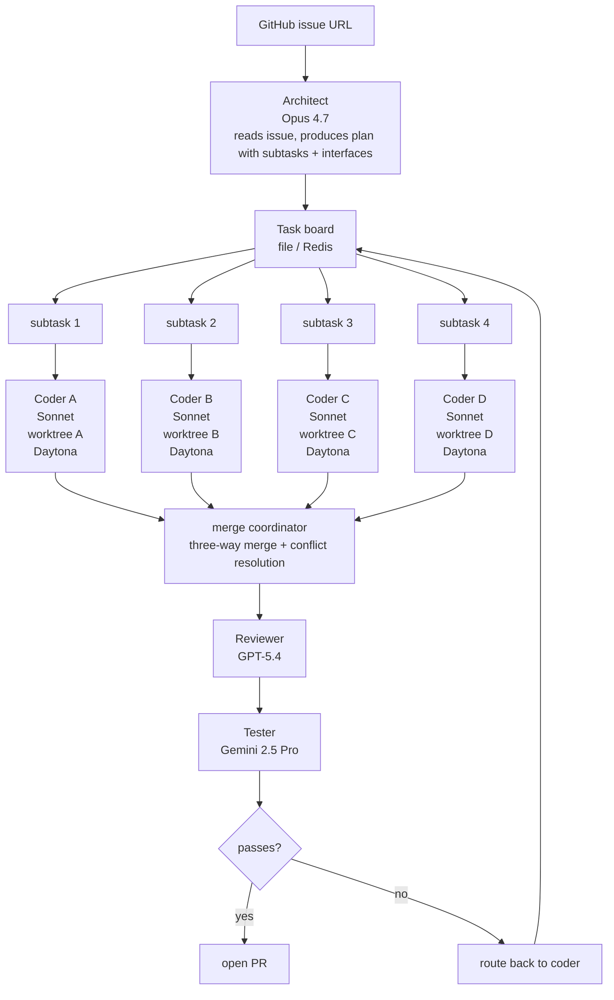

# Capstone 10 — 多 Agent 软件工程团队

> SWE-AF 的 factory architecture、MetaGPT 的 role-based prompting、AutoGen 0.4 的 typed actor graph、Cognition 的 Devin，以及 Factory 的 Droids，都收敛到了 2026 年同一种形态：architect 负责 plan，N 个 coders 在并行 worktrees 中工作，reviewer 把关，tester 验证。Parallel worktrees 把 wall-clock 转成 throughput。Shared state 和 handoff protocols 成了 failure surface。这个 capstone 要求你构建这个团队，在 SWE-bench Pro 上评估，并报告哪些 handoffs 会坏、坏得有多频繁。

**Type:** Capstone
**Languages:** Python / TypeScript (agents), Shell (worktree scripts)
**Prerequisites:** Phase 11 (LLM engineering), Phase 13 (tools), Phase 14 (agents), Phase 15 (autonomous), Phase 16 (multi-agent), Phase 17 (infrastructure)
**Phases exercised:** P11 · P13 · P14 · P15 · P16 · P17
**Time:** 40 hours

## 问题

单 agent coding harness 在大型任务上会撞到天花板。不是因为任何单个 agent 很弱，而是因为 200k-token context 无法同时容纳 architecture plan、四个并行 codebase slices、reviewer commentary 和 test output。Multi-agent factories 会拆分问题：architect 拥有 plan，coders 在 parallel worktrees 中实现，reviewer 把关，tester 验证。SWE-AF 的 “factory” architecture、MetaGPT 的 roles、AutoGen 的 typed actor graph，这三种说法描述的是同一种形态。

Failure surface 是 handoff。Architect 计划了 coder 无法实现的东西。Coders 产出互相冲突的 diffs。Reviewer 批准了 hallucinated fix。Tester 和仍在写代码的 coder 发生 race。你将构建一个这样的团队，在 50 个 SWE-bench Pro issues 上运行，追踪每一次 handoff，并发布 post-mortem。

## 概念

Roles 是 typed agents。**Architect**（Claude Opus 4.7）读取 issue，写 plan，并把它拆成带明确 interfaces 的 subtasks。**Coders**（Claude Sonnet 4.7，N 个并行实例，每个都在一个 `git worktree` + Daytona sandbox 中）独立实现 subtasks。**Reviewer**（GPT-5.4）读取 merged diff，然后 approve 或请求具体修改。**Tester**（Gemini 2.5 Pro）在隔离环境中运行 test suite，并用 artifacts 报告 pass/fail。

通信通过 shared task board 完成（file-backed 或 Redis）。每个 role 消费自己被允许处理的 tasks。Handoffs 是 A2A-protocol-typed messages。协调关注点包括：merge-conflict resolution（coordinator role 或 automatic three-way merge）、shared-state synchronization（coders 开始后 plan 冻结；replans 是单独事件），以及 reviewer gatekeeping（reviewer 不能批准自己写的 changes，也不能批准自己提出的 changes）。

Token amplification 是隐藏成本。每个 role boundary 都会增加 summary prompts 和 handoff context。一个 40-turn single-agent run 会变成四个 roles 合计 160 turns。Rubric 特别衡量 token efficiency vs single-agent baseline，因为问题不是 “multi-agent 是否可行”，而是 “它是否每花一美元都更划算”。

## 架构



## 技术栈

- Orchestration：LangGraph，带 shared state + per-agent sub-graphs
- Messaging：A2A protocol（Google 2025），用于 typed inter-agent messages
- Models：Opus 4.7（architect）、Sonnet 4.7（coders）、GPT-5.4（reviewer）、Gemini 2.5 Pro（tester）
- Worktree isolation：每个 coder 一个 `git worktree add` + Daytona sandbox
- Merge coordinator：自定义 three-way merge + LLM-mediated conflict resolution
- Eval：SWE-bench Pro（50 issues）、SWE-AF scenarios、HumanEval++ unit tests
- Observability：Langfuse，带 role-tagged spans 和 per-agent token accounting
- Deployment：K8s，每个 role 是单独 Deployment，并基于 backlog 做 HPA

## Build It

1. **Task board。** File-backed JSONL，包含 typed messages：`plan_request`、`subtask`、`diff_ready`、`review_needed`、`test_needed`、`approved`、`rejected`、`replan_needed`。Agents subscribe to tags。

2. **Architect。** 读取 GitHub issue，用 Opus 4.7 运行 plan template，要求显式 subtask interfaces（会 touched 的 files、public functions、test impact）。输出一个带 subtask DAG 的 `plan_request`。

3. **Coders。** N 个 parallel workers，每个从 board 上 claim 一个 subtask。每个 worker 都 spawn 一个 fresh `git worktree add` branch 和 Daytona sandbox。实现 subtask。输出 `diff_ready`，其中包含 patch + test deltas。

4. **Merge coordinator。** 当所有 coders 完成后，将 N 个 branches three-way merge 到 staging branch。只有存在 file-level overlap 时，才使用 LLM-mediated conflict resolution。

5. **Reviewer。** GPT-5.4 读取 merged diff。不能 approve 自己 authored 的 diffs。输出 `approved`（no-op）或 `review_feedback`，后者包含具体 change requests，并 route 回相关 coder。

6. **Tester。** Gemini 2.5 Pro 在 clean sandbox 中运行 test suite。捕获 artifacts。输出 `test_passed` 或 `test_failed`，并附带 stacktraces。失败测试 loop back 到拥有 failing subtask 的 coder。

7. **Handoff accounting。** 每个跨越 role boundary 的 message 都在 Langfuse 中生成 span，记录 payload size 和使用的 model。计算 per-subtask token amplification：`(coder_tokens + reviewer_tokens + tester_tokens + architect_share) / coder_tokens`。

8. **Eval。** 在 50 个 SWE-bench Pro issues 上运行。与 single-agent baseline（一个 Sonnet 4.7，在单个 worktree 中）比较 pass@1 和 $-per-solved-issue。

9. **Post-mortem。** 对每个 failed issue，识别坏掉的 handoff（plan 太模糊、merge conflict、reviewer false-approve、tester flake）。产出 handoff-failure histogram。

## Use It

```console
$ team run --issue https://github.com/acme/widget/issues/842
[architect] plan: 4 subtasks (parser, cache, api, migration)
[board]     dispatched to 4 coders in parallel worktrees
[coder-A]   subtask parser  -> 42 lines, tests pass locally
[coder-B]   subtask cache   -> 88 lines, tests pass locally
[coder-C]   subtask api     -> 31 lines, tests pass locally
[coder-D]   subtask migration -> 19 lines, tests pass locally
[merge]     3-way merge: 0 conflicts
[reviewer]  comments on cache (thread pool sizing); routed to coder-B
[coder-B]   revision: 92 lines; submits
[reviewer]  approved
[tester]    all 412 tests pass
[pr]        opened #3382   4 coders, 1 revision, $4.90, 18m
```

## Ship It

`outputs/skill-multi-agent-team.md` 是交付物。给定 issue URL 和 parallelism level，这个团队会产出 merge-ready PR，并附带 per-role token accounting。

| Weight | Criterion | How it is measured |
|:-:|---|---|
| 25 | SWE-bench Pro pass@1 | Matched 50-issue subset, pass@1 |
| 20 | Parallel speedup | Wall-clock vs single-agent baseline |
| 20 | Review quality | False-approval rate on injected-bug probe |
| 20 | Token efficiency | Total tokens per solved issue vs single-agent |
| 15 | Coordination engineering | Merge-conflict resolution, handoff-failure histogram |
| **100** | | |

## 练习

1. 在运行中向一个 diff 注入明显 bug（在 main body 前额外加一个 `return None`）。测量 reviewer 的 false-approve rate。调优 reviewer prompt，直到 false-approval 低于 5%。

2. 减少到两个 coders（architect + coder + reviewer + tester，其中 coder 顺序执行两个 subtasks）。比较 wall-clock 和 pass rate。

3. 把 merge coordinator 替换成 single-writer constraint（subtasks 只修改互不重叠的 file sets）。测量 architect 的 planning burden。

4. 把 reviewer 从 GPT-5.4 换成 Claude Opus 4.7。测量 false-approval rate 和 token cost delta。

5. 添加第五个 role：documenter（Haiku 4.5）。Review 后它产出 changelog entry。测量 documentation quality 是否值得额外的 token spend。

## 关键术语

| Term | 大家常说 | 实际含义 |
|------|----------|----------|
| Parallel worktree | “Isolated branch” | `git worktree add` 为每个 coder 创建一个 fresh working tree |
| Task board | “Shared message bus” | File 或 Redis typed message store，agents 订阅它 |
| Handoff | “Role boundary” | 从一个 role 的 context 跨到另一个 role 的任何 message |
| Token amplification | “Multi-agent overhead” | 同一任务中跨 roles 的 total tokens / single-agent tokens |
| A2A protocol | “Agent-to-agent” | Google 2025 typed inter-agent messages spec |
| Merge coordinator | “Integrator” | 运行 three-way merge 并调解 conflicts 的 component |
| False approval | “Reviewer hallucination” | Reviewer 批准了带 known bugs 的 diff |

## 延伸阅读

- [SWE-AF factory architecture](https://github.com/Agent-Field/SWE-AF) — 2026 multi-agent factory reference
- [MetaGPT](https://github.com/FoundationAgents/MetaGPT) — role-based multi-agent framework
- [AutoGen v0.4](https://github.com/microsoft/autogen) — Microsoft 的 typed actor framework
- [Cognition AI (Devin)](https://cognition.ai) — reference product
- [Factory Droids](https://www.factory.ai) — alternate reference product
- [Google A2A protocol](https://developers.google.com/agent-to-agent) — inter-agent messaging spec
- [git worktree documentation](https://git-scm.com/docs/git-worktree) — isolation substrate
- [SWE-bench Pro](https://www.swebench.com) — evaluation target
