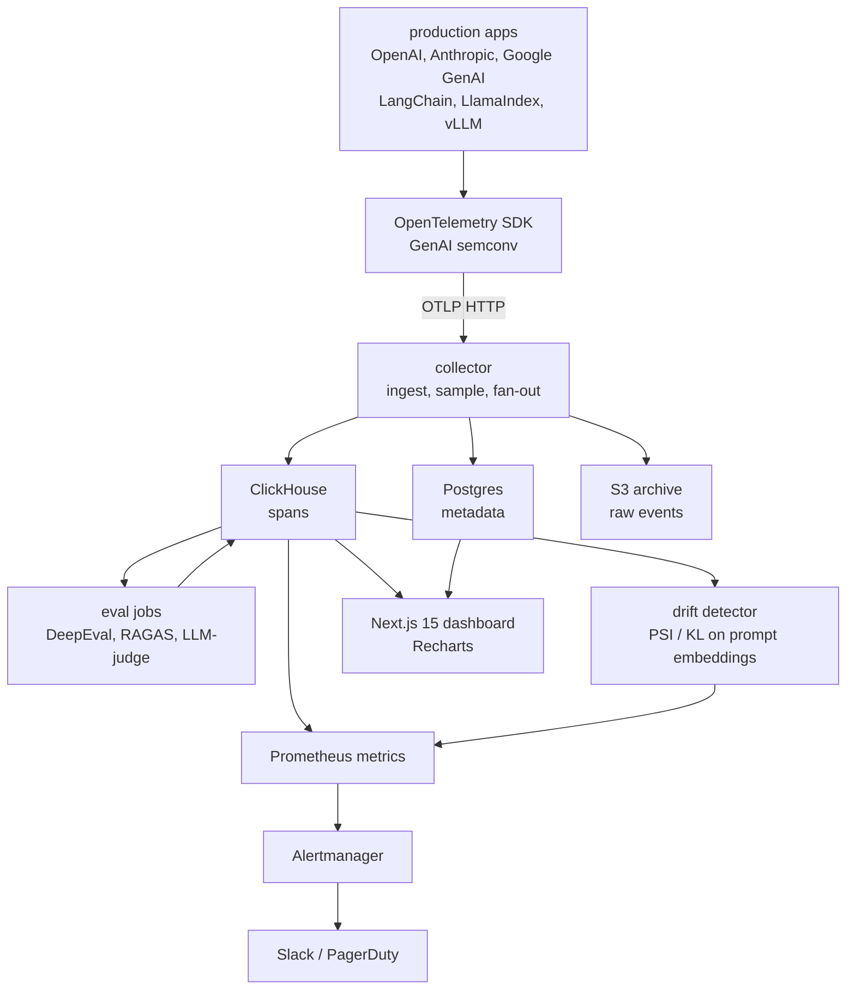

# Capstone 11 - LLM Observability 与 Eval Dashboard

> Langfuse 转向 open-core。Arize Phoenix 发布了 2026 GenAI semconv mappings。Helicone 和 Braintrust 都加码 per-user cost attribution。Traceloop 的 OpenLLMetry 成为事实上的 SDK instrumentation。Production shape 是：ClickHouse 存 traces，Postgres 存 metadata，Next.js 做 UI，再加上一小队 eval jobs（DeepEval、RAGAS、LLM-judge）跑在 sampled traces 上。构建一个 self-hosted dashboard，从至少四类 SDK families ingest，并演示它能在五分钟内捕捉到一次 injected regression。

**Type:** Capstone
**Languages:** TypeScript (UI), Python / TypeScript (ingest + evals), SQL (ClickHouse)
**Prerequisites:** Phase 11 (LLM engineering), Phase 13 (tools), Phase 17 (infrastructure), Phase 18 (safety)
**Phases exercised:** P11 · P13 · P17 · P18
**Time:** 25 hours

## 问题

到 2026 年，每个运行 production traffic 的 AI team 都会在 model 旁边保留一个 observability plane。Cost attribution、hallucination detection、drift monitoring、jailbreak signal、SLO dashboards、PII leak alerts。开源参考实现 Langfuse、Phoenix、OpenLLMetry 已经在 OpenTelemetry GenAI semantic conventions 上收敛，把它作为 ingest schema。现在你可以用一个 SDK instrument OpenAI、Anthropic、Google、LangChain、LlamaIndex 和 vLLM，并发送兼容的 spans。

你将构建一个 self-hosted dashboard：从至少四类 SDK families ingest traces，在 sampled traces 上运行一组小型 eval jobs，检测 drift，并发出 alerts。衡量标准是：给定一个刻意注入的 regression（某个 prompt 开始产生 PII），dashboard 能在五分钟内捕捉到并触发 alert。

## 概念

Ingest 使用 OTLP HTTP。SDK 产生 GenAI-semconv spans：`gen_ai.system`、`gen_ai.request.model`、`gen_ai.usage.input_tokens`、`gen_ai.response.id`、`llm.prompts`、`llm.completions`。Spans 落到 ClickHouse 中用于 columnar analytics；metadata（users、sessions、apps）落到 Postgres。

Evals 作为 batch jobs 跑在 sampled traces 上。DeepEval 评分 faithfulness、toxicity 和 answer relevance。Trace 携带 retrieval context 时，RAGAS 评分 retrieval metrics。Custom LLM-judges 运行 domain-specific checks（PII leak、off-policy response）。Eval runs 会作为 eval spans 写回同一个 ClickHouse，并链接到 parent trace。

Drift detection 观察随时间变化的 embedding-space distributions（prompt embeddings 上的 PSI 或 KL divergence）以及 eval-score trends。Alerts 进入 Prometheus Alertmanager，然后发往 Slack / PagerDuty。UI 使用 Next.js 15 和 Recharts。

## Architecture



## Stack

- Ingest：OpenTelemetry SDKs + GenAI semantic conventions；OTLP HTTP transport
- Collector：OpenTelemetry Collector，带 tail-sampling processor（用于 cost control）
- Storage：ClickHouse 存 spans，Postgres 存 metadata，S3 存 raw event archive
- Evals：DeepEval、RAGAS 0.2、Arize Phoenix evaluator pack、custom LLM-judge
- Drift：在 pooled prompt embeddings（sentence-transformers）上每周计算 PSI / KL
- Alerting：Prometheus Alertmanager -> Slack / PagerDuty
- UI：Next.js 15 App Router + Recharts + server actions
- SDKs supported out of the box：OpenAI、Anthropic、Google GenAI、LangChain、LlamaIndex、vLLM

## Build It

1. **Collector config。** 配置 OpenTelemetry Collector：OTLP HTTP receiver、tail-sampler（保留 100% errored traces 和 10% successes），以及导出到 ClickHouse 和 S3 的 exporters。

2. **ClickHouse schema。** 建立 `spans` table，columns 对齐 GenAI semconv：`gen_ai_system`、`gen_ai_request_model`、`input_tokens`、`output_tokens`、`latency_ms`、`prompt_hash`、`trace_id`、`parent_span_id`，再加一个存长 payloads 的 JSON bag。按 user_id 和 app_id 加 secondary indexes。

3. **SDK coverage test。** 用每个 SDK（OpenAI、Anthropic、Google、LangChain、LlamaIndex、vLLM）写一个 small client app，并用 OpenLLMetry auto-instrument。验证每个 SDK 都能产出 canonical GenAI spans，并落到 ClickHouse。

4. **Eval jobs。** Scheduled job 读取 last-15-min sampled traces，运行 DeepEval faithfulness、toxicity 和 answer relevance。输出作为 eval spans 链接到 parent trace。

5. **Custom LLM-judge。** PII-leak judge：给定 response，调用 guard LLM 评分 PII leak likelihood。高分 responses 进入 triage queue。

6. **Drift detection。** Weekly job 计算本周 pooled prompt embeddings 与 trailing 4-week baseline 之间的 PSI。如果 PSI 超过 threshold，则 alert。

7. **Dashboard。** Next.js 15 页面：overview（spans/sec、cost/user、p95 latency）、traces（search + waterfall）、evals（faithfulness trend、toxicity）、drift（PSI over time）、alerts。

8. **Alerting chain。** Prometheus exporter 读取 eval score aggregates 和 latency percentiles；Alertmanager 将 warnings 路由到 Slack，将 critical breaches 路由到 PagerDuty。

9. **Regression probe。** 注入一个 bug：被评估的 chatbot 开始以 1% 概率泄漏 fake SSNs。测量 MTTR：从 bug deployed 到 Slack alert。

## Use It

```console
$ curl -X POST https://my-otel-collector/v1/traces -d @trace.json
[collector]  accepted 1 trace, 3 spans
[clickhouse] inserted 3 spans (app=chat, user=u_42)
[eval]       DeepEval faithfulness 0.82, toxicity 0.03
[drift]      weekly PSI 0.08 (below 0.2 threshold)
[ui]         live at https://obs.example.com
```

## Ship It

`outputs/skill-llm-observability.md` 是交付物。给定一个 LLM application，dashboard 会 ingest 它的 traces，运行 evals，对 drift 发出 alerts，并在 Next.js 中展示 cost/user breakdown。

| Weight | Criterion | How it is measured |
|:-:|---|---|
| 25 | Trace-schema coverage | 产出 canonical GenAI spans 的 SDK families 数量（target: 6+） |
| 20 | Eval correctness | DeepEval / RAGAS scores vs hand-labeled set |
| 20 | Dashboard UX | Injected regression 的 MTTR（target：低于 5 分钟） |
| 20 | Cost / scale | 持续 ingest 1k spans/sec 且没有 backlog |
| 15 | Alerting + drift detection | Prometheus/Alertmanager chain end to end 演练 |
| **100** | | |

## 练习

1. 为 Haystack framework 添加 custom instrumentation。验证带有忠实 `gen_ai.*` attributes 的 canonical spans 落到 ClickHouse。

2. 在同一组 traces 上把 DeepEval 换成 Phoenix evaluators。测量两个 eval engines 之间的 score drift。

3. 强化 drift detector：按 app-id 而不是全局计算 PSI。展示 per-app drift trails。

4. 添加一个 “user impact” 页面：cost-per-user 和 failure-rate-per-user，并配上 sparklines。

5. 构建一个 tail-sampling policy：保留 100% toxicity > 0.5 的 traces，并对剩余 traces 做 10% stratified sample。测量引入的 sampling bias。

## 关键术语

| Term | What people say | What it actually means |
|------|-----------------|------------------------|
| GenAI semconv | “OTel LLM attributes” | 2025 OpenTelemetry spec 中用于 LLM span attributes（system、model、tokens）的规范 |
| Tail sampling | “Post-trace sample” | Collector 在 trace 完成后决定保留或丢弃它（可以看到 errors） |
| PSI | “Population stability index” | 比较两个 distributions 的 drift metric；> 0.2 通常表示 meaningful drift |
| LLM-judge | “Eval as model” | 一个 LLM 根据 rubric（faithfulness、toxicity、PII）给另一个 LLM 的 output 打分 |
| Tail-sampling policy | “Keep-rule” | 决定哪些 traces persist、哪些 drop 的规则；errored + sample-rate |
| Eval span | “Linked eval trace” | 携带 eval score 的 child span，链接到原始 LLM call span |
| Cost per user | “Unit economics” | 某个时间窗口内归因到 user_id 的 dollar cost；关键 product metric |

## 延伸阅读

- [Langfuse](https://github.com/langfuse/langfuse) — reference open-core observability platform
- [Arize Phoenix](https://github.com/Arize-ai/phoenix) — alternate reference with strong drift support
- [OpenLLMetry (Traceloop)](https://github.com/traceloop/openllmetry) — auto-instrumentation SDK family
- [OpenTelemetry GenAI semantic conventions](https://opentelemetry.io/docs/specs/semconv/gen-ai/) — ingest schema
- [Helicone](https://www.helicone.ai) — alternate hosted observability
- [Braintrust](https://www.braintrust.dev) — alternate eval-first platform
- [ClickHouse documentation](https://clickhouse.com/docs) — columnar span store
- [DeepEval](https://github.com/confident-ai/deepeval) — evaluator library
