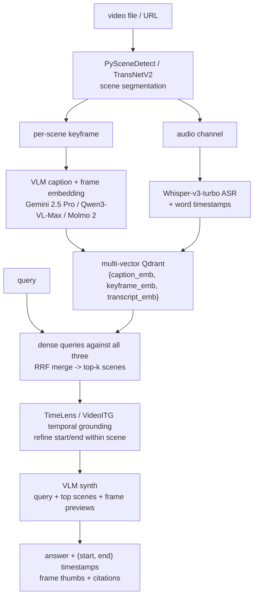

# Capstone 12 — 视频理解 Pipeline（Scene、QA、Search）

> Twelve Labs 产品化了 Marengo + Pegasus。VideoDB 交付了 CRUD-for-video API。AI2 的 Molmo 2 发布了 open VLM checkpoints。Gemini long-context 可以原生处理数小时视频。TimeLens-100K 定义了大规模 temporal grounding。2026 年的 pipeline 已经稳定：scene segmentation、per-scene caption + embedding、transcript alignment、multi-vector index，以及一个能用 (start, end) timestamps 加 frame previews 回答的 query。这个 capstone 的目标是 ingest 100 小时视频，达到公开 benchmarks，并测量 counting 和 action questions 上的 hallucination。

**Type:** Capstone
**Languages:** Python (pipeline), TypeScript (UI)
**Prerequisites:** Phase 4 (CV), Phase 6 (speech), Phase 7 (transformers), Phase 11 (LLM engineering), Phase 12 (multimodal), Phase 17 (infrastructure)
**Phases exercised:** P4 · P6 · P7 · P11 · P12 · P17
**Time:** 30 hours

## 问题

Long-form video QA 是 2026 规模下最吃 bandwidth 的 multimodal problem。Gemini 2.5 Pro 可以原生读取 2 小时视频，但把 100 小时视频 ingest 到可查询 corpus 里，仍然需要 scene-level index。Production shape 会组合 scene segmentation（TransNetV2 或 PySceneDetect）、使用 VLM 的 per-scene captioning（Gemini 2.5、Qwen3-VL-Max 或 Molmo 2）、transcript alignment（带 word timestamps 的 Whisper-v3-turbo），以及同时存储 caption、frame embedding 和 transcript 的 multi-vector index。Query pipeline 会用 (start, end) timestamps 加 frame previews 回答。

Benchmarks 是公开的（ActivityNet-QA、NeXT-GQA）再加你自己的 100-query custom set。Counting 和 action-type questions 上的 hallucination 是已知困难 failure class；这个 capstone 会显式测量它。

## 概念

Ingest 时有三条 pipelines 并行运行。**Scene segmentation** 把视频切成 scenes。**VLM captioning** 为每个 scene 生成 caption，并从 keyframe 生成 frame embedding。**ASR alignment** 生成 word-level timestamps。这三条 stream 通过 (scene_id, time range) join。每个 scene 在 multi-vector index（Qdrant）里拥有三种 vector types：caption embedding、keyframe embedding、transcript embedding。

Query time 时，natural-language question 会打到全部三种 vectors；结果用 RRF merge；一个 TimeLens-style temporal-grounding adapter 会在 top scene 中细化 (start, end) window。VLM synthesizer（Gemini 2.5 Pro 或 Qwen3-VL-Max）接收 query + top scenes + cropped frames，并用 cited timestamps 和 frame preview 回答。

Hallucination measurement 很重要。Counting（“how many people enter the room?”）和 action-type（“does the chef pour before stirring?”）问题出了名不可靠。需要把这些题的 accuracy 和 descriptive questions 分开报告。

## 架构



配套 SVG 资产：`assets/video-pipeline.svg`。

## Stack

- Scene segmentation：TransNetV2（2024-26 state-of-the-art）或 PySceneDetect。
- ASR：通过 faster-whisper 运行 Whisper-v3-turbo，并输出 word timestamps。
- VLM captioner + answerer：Gemini 2.5 Pro、Qwen3-VL-Max 或 Molmo 2。
- Temporal grounding：TimeLens-100K-trained adapter 或 VideoITG。
- Index：支持 multi-vector 的 Qdrant（caption / frame / transcript）。
- UI：Next.js 15，带 HTML5 video player 和 scene thumbnails。
- Eval：ActivityNet-QA、NeXT-GQA、自定义 100-question hand-labeled set。
- Hallucination benchmark：带人工标签的 counting 和 action-type subsets。

## Build It

1. **Ingest walker。** 接收 YouTube URLs 或 local MP4s。必要时 downscale 到 720p。持久化 `{video_id, file_path}`。

2. **Scene segmentation。** 运行 TransNetV2 或 PySceneDetect，生成 `[{scene_id, start_ms, end_ms, keyframe_path}]`。100 小时目标约为 6k-8k scenes。

3. **ASR pass。** 对 audio 运行 Whisper-v3-turbo；导出 word-level timestamps；切分成 per-scene transcript slices。

4. **VLM captioning。** 对每个 scene，使用 keyframe 和短 caption template 调用 Gemini 2.5 Pro（或 Qwen3-VL-Max）。产出 caption + frame embedding。

5. **Multi-vector index。** Qdrant collection 使用三个 named vectors。Payload：`{video_id, scene_id, start_ms, end_ms, keyframe_url}`。

6. **Query。** Natural-language question 触发三路 dense queries；用 reciprocal rank fusion merge；top-k=5 scenes。

7. **Temporal grounding。** 在 top scene 上运行 TimeLens-style adapter，细化该 scene 内的 (start, end) window。

8. **VLM synth。** 用 query + top-3 scene clips（作为 images 或 short clips）+ transcripts 调用 Gemini 2.5 Pro。要求输出 `(video_id, start_ms, end_ms)` citations。

9. **Eval。** 运行 ActivityNet-QA 和 NeXT-GQA。构建 100-query custom set。报告 overall accuracy + per-class breakdown（counting、action、descriptive）。

## Use It

```console
$ video-qa ask --url=https://youtube.com/watch?v=X "how many cars pass the intersection in the first minute?"
[scene]    23 scenes detected
[asr]      transcript complete, 4m12s
[index]    69 vectors written (23 scenes x 3)
[query]    top scene: scene 3 [01:32-01:54], confidence 0.84
[ground]   refined window: [00:12-00:58]
[synth]    gemini 2.5 pro, 1.4s
answer:    5 cars pass the intersection between 00:12 and 00:58.
citations: [scene 3: 00:12-00:58]
          [frame preview at 00:14, 00:27, 00:44, 00:51, 00:57]
```

## Ship It

`outputs/skill-video-qa.md` 是 deliverable。给定一个 YouTube URL 或 uploaded video，pipeline 会 index scenes，并用 timestamped citations 回答问题。

| Weight | Criterion | How it is measured |
|:-:|---|---|
| 25 | Temporal grounding IoU | Held-out grounding set 上的 intersection-over-union |
| 20 | QA accuracy | NeXT-GQA 和 custom 100-query |
| 20 | Ingest throughput | 每美元可处理的视频小时数 |
| 20 | UI and citation UX | Timestamp links、thumbnail strip、jump-to-frame |
| 15 | Hallucination rate | 单独统计 counting 和 action-type accuracy |
| **100** | | |

## 练习

1. 在 captioning pass 中把 Gemini 2.5 Pro 换成 Qwen3-VL-Max。用 human-rated 50-scene sample 报告 caption quality delta。

2. 把 per-scene frame embedding 降到一个 pooled vector，而不是 multi-vector。测量 retrieval regression。

3. 构建一个 “counting strict” mode：synthesizer 为每个 counted instance 提取 timestamp，用户点击验证。测量 user-verification 是否降低 hallucination。

4. Benchmark ingest cost：比较三种 VLM choices 的 hours-of-video-per-dollar。选择 sweet spot。

5. 添加 speaker-diarized transcript：在 audio 上运行 pyannote speaker diarization，并 embed per-speaker transcripts。演示 “what did Alice say about X?” queries。

## 关键术语

| Term | What people say | What it actually means |
|------|-----------------|------------------------|
| Scene segmentation | “Shot detection” | 在 shot boundaries 处把 video 切成 scenes |
| Multi-vector index | “Caption + frame + transcript” | 每种 representation 都有 named vector 的 Qdrant collection |
| Temporal grounding | “When exactly did it happen” | 为 query answer 细化 (start, end) window |
| Frame embedding | “Visual representation” | Keyframe 的 vector embedding；用于 scene-visual similarity |
| RRF fusion | “Reciprocal rank fusion” | 跨多个 ranked lists 的 merge strategy；经典 hybrid-retrieval trick |
| Counting hallucination | “Miscount” | VLMs 在 “how many X” 问题上的已知 failure mode |
| ActivityNet-QA | “Video-QA benchmark” | Long-form video QA accuracy benchmark |

## 延伸阅读

- [AI2 Molmo 2](https://allenai.org/blog/molmo2) — open VLM checkpoints
- [TimeLens (CVPR 2026)](https://github.com/TencentARC/TimeLens) — temporal grounding at scale
- [Gemini Video long-context](https://deepmind.google/technologies/gemini) — the hosted reference
- [VideoDB](https://videodb.io) — CRUD-for-video API reference
- [Twelve Labs Marengo + Pegasus](https://www.twelvelabs.io) — commercial reference
- [TransNetV2](https://github.com/soCzech/TransNetV2) — scene segmentation model
- [PySceneDetect](https://github.com/Breakthrough/PySceneDetect) — classic open alternative
- [ActivityNet-QA](https://arxiv.org/abs/1906.02467) — reference eval benchmark
