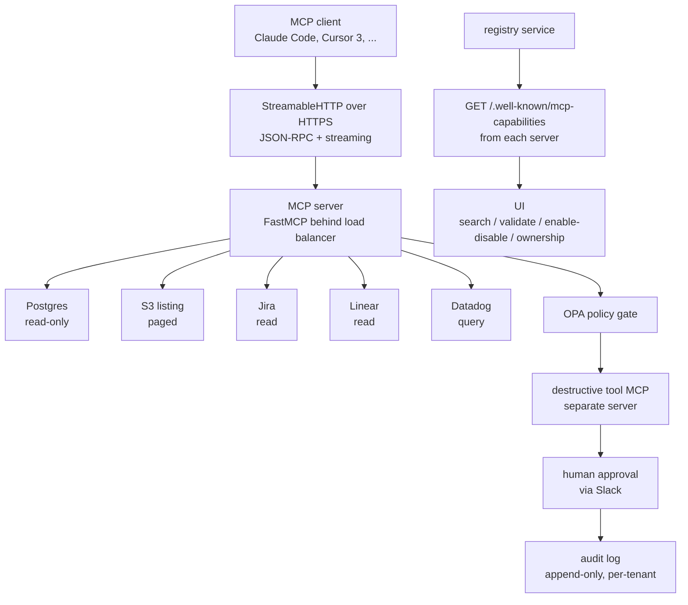

# Capstone 13 - 带 Registry 和 Governance 的 MCP Server

> Model Context Protocol 在 2026 年不再只是未来方向，而成了默认的 tool-use spec。Anthropic、OpenAI、Google 和各大 IDE 都发布了 MCP clients。Pinterest 公开了内部 MCP servers 生态。AAIF Registry 在 `.well-known` 下正式定义 capability metadata。AWS ECS 发布了 reference stateless deployment。Block 的 goose-agent 把同一协议放进 hosted assistant。2026 年的 production 形态是：StreamableHTTP transport、OAuth 2.1 scopes、OPA policy gating，以及一个让 platform teams 发现、验证、启用 servers 的 registry。你将端到端构建它。

**Type:** Capstone
**Languages:** Python（server, via FastMCP）或 TypeScript（@modelcontextprotocol/sdk）, Go（registry service）
**Prerequisites:** Phase 11（LLM engineering）, Phase 13（tools and MCP）, Phase 14（agents）, Phase 17（infrastructure）, Phase 18（safety）
**Phases exercised:** P11 · P13 · P14 · P17 · P18
**Time:** 25 hours

## 问题

MCP 已经成了 tool-use 的通用语。Claude Code、Cursor 3、Amp、OpenCode、Gemini CLI，以及每个 managed agent 都会消费 MCP servers。Production 难点不在于编写 server（FastMCP 已经让这件事很容易），而在于用企业级要求大规模部署它们：per-tenant OAuth scopes、对 destructive tools 使用 OPA policy、StreamableHTTP stateless scaling、用于 discovery 的 registry、每次 tool call 的 audit logs。Pinterest 的内部 MCP 生态和 AAIF Registry spec 给 2026 年设定了标杆。

你将构建一个暴露 10 个内部工具的 MCP server（Postgres read-only、S3 listing、Jira、Linear、Datadog 等），一个用于 platform discovery 的 registry UI，以及 destructive tools 的 human-approval gate。Load test 要展示 StreamableHTTP 的水平扩展能力。Audit trail 要能通过企业安全评审。

## 概念

MCP 2026 revision 要求 StreamableHTTP 成为默认 transport。不同于早期的 stdio-and-SSE 形态，StreamableHTTP 默认是 stateless：单个 HTTP endpoint 接收 JSON-RPC requests，流式返回 responses，并支持用于 notifications 的 long-lived connections。Stateless 意味着它可以放在 load balancer 后水平扩展。

Authorization 使用 OAuth 2.1，并采用 per-tool scopes。Token 携带类似 `jira:read`、`s3:list`、`postgres:query:readonly` 的 scopes。MCP server 在 tool-call time 检查 scopes，而不只是在 session start 检查。对于 high-risk tools，如果调用者的 scope 没有在最近 N 分钟内被提升为 `approved:by:human`，server 会拒绝调用；这个提升来自 Slack review card。

Registry 是独立服务。每个 MCP server 都暴露一个 `.well-known/mcp-capabilities` document，包含 tool manifest、transport URL、auth requirements。Registry 会 poll、validate 和 index。Platform teams 使用 registry UI 查看有哪些 tools、需要哪些 scopes、由哪个 team 负责。

## 架构



## 技术栈

- Server framework：FastMCP（Python）或 `@modelcontextprotocol/sdk`（TypeScript）
- Transport：StreamableHTTP over HTTPS（stateless）
- Auth：OAuth 2.1，workload identity 通过 SPIFFE / SPIRE
- Policy：每个 tool 使用 OPA / Rego rules；每次 request 调用 policy decision service
- Registry：self-hosted，消费 `.well-known/mcp-capabilities` manifests
- Human approval：destructive tools 使用 Slack interactive message
- Deployment：AWS ECS Fargate 或 Fly.io；每个 tenant 一个 server，或 shared server + tenant scoping
- Audit：按 tenant 写入 structured JSONL bucket，并记录 per-call lineage

## Build It

1. **Tool surface。** 暴露 10 个内部工具：Postgres read-only query、S3 list objects、Jira search/fetch、Linear search/fetch、Datadog metric query、PagerDuty on-call lookup、GitHub read-only、Notion search、Slack search、Salesforce read。每个 tool 都有 typed schema 和 scope label。

2. **FastMCP server。** Mount 这些 tools。配置 StreamableHTTP transport。添加 OAuth token introspection 和 scope enforcement 的 middleware。

3. **OPA policy。** 为每个 tool 写 Rego policy：哪些 scopes 允许调用、应用哪些 PII redaction、payload-size caps 是多少。每次 tool call 都调用 decision service。

4. **Registry service。** 独立的 Go 或 TS service：从已注册 servers poll `.well-known/mcp-capabilities`，用 JSON Schema validate，并暴露 list / search / validate / enable-disable UI。

5. **Capability manifest。** 每个 server 都暴露 `.well-known/mcp-capabilities`，包含：tool list、auth requirements、transport URL、owner team、SLO。

6. **Destructive tool separation。** 会修改状态的 tools（Jira create、Linear create、Postgres write）放在第二个 MCP server 上，并使用更严格的 auth flow：tokens 必须带有最近 15 分钟内通过 Slack card 提升得到的 `approved:by:human` scope。

7. **Audit log。** 按 tenant 写 append-only JSONL：`{timestamp, user, tool, args_redacted, response_redacted, outcome}`。写入前用 Presidio 做 PII redaction。

8. **Load test。** 用 100 个 concurrent clients 访问 StreamableHTTP。通过增加第二个 replica 展示水平扩展；证明 load balancer 可以在没有 session stickiness 的情况下重新分配请求。

9. **Conformance tests。** 对两个 servers 运行官方 MCP conformance suite。通过所有 mandatory sections。

## Use It

```console
$ curl -H "Authorization: Bearer eyJhbGc..." \
       -X POST https://mcp.internal.example.com/ \
       -d '{"jsonrpc":"2.0","method":"tools/call",
            "params":{"name":"postgres.readonly","arguments":{"sql":"SELECT 1"}}}'
[registry]   capability validated: postgres.readonly v1.2
[policy]    scope postgres:query:readonly present; allowed
[audit]     logged: user=u42 tool=postgres.readonly outcome=ok
response:    { "result": { "rows": [[1]] } }
```

## Ship It

`outputs/skill-mcp-server.md` 描述交付物：一个 production-grade MCP server + registry + audit layer，用于带 OAuth 2.1 scopes 和 OPA gating 的内部工具。

| Weight | Criterion | How it is measured |
|:-:|---|---|
| 25 | Spec conformance | StreamableHTTP + capability manifest 通过 MCP conformance tests |
| 20 | Security | Scope enforcement、每个 tool 的 OPA coverage、secret hygiene |
| 20 | Observability | 带 PII redaction 的 per-tool-call audit log |
| 20 | Scale | 100-client load test 的 horizontal scale demonstration |
| 15 | Registry UX | Discover / validate / enable-disable workflow |
| **100** | | |

## 练习

1. 增加一个新 tool（Confluence search）。在不修改 core server 的情况下，通过 registry validation flow 发布它。

2. 写一个 OPA policy，redact Postgres query results 中名为 `email`、`ssn` 或 `phone` 的 columns。用 probe query 练习它。

3. 在本地 latency 上 benchmark StreamableHTTP vs stdio。报告 per-call p50/p95。

4. 实现 per-tenant quota：每个 tenant、每个 tool 每分钟最多 N 次调用。通过第二条 OPA rule 强制执行。

5. 运行来自 [mcp-conformance-tests](https://github.com/modelcontextprotocol/conformance) 的 MCP conformance suite，并修复每个 failure。

## 关键术语

| Term | 大家常说 | 实际含义 |
|------|----------|----------|
| StreamableHTTP | "2026 MCP transport" | Stateless HTTP + streaming；替代 networked servers 中的 SSE + stdio |
| Capability manifest | "Well-known doc" | `.well-known/mcp-capabilities`，包含 tool list、auth、transport URL |
| OPA / Rego | "Policy engine" | Open Policy Agent，用外部规则授权 tool calls |
| Scope elevation | "Approved-by-human" | 通过 Slack approval 授予的短期 scope，destructive tools 必须具备 |
| Registry | "Tool discovery" | 从 capability manifests 索引 MCP servers 的服务 |
| Workload identity | "SPIFFE / SPIRE" | 用于 OAuth token issuance 的 cryptographic service identity |
| Conformance suite | "Spec tests" | 官方 MCP test battery，检查 StreamableHTTP + tool manifest correctness |

## 延伸阅读

- [Model Context Protocol 2026 Roadmap](https://blog.modelcontextprotocol.io/posts/2026-mcp-roadmap/) - StreamableHTTP、capability metadata、registry。
- [AAIF MCP Registry spec](https://github.com/modelcontextprotocol/registry) - 2026 registry spec。
- [AWS ECS reference deployment](https://aws.amazon.com/blogs/containers/deploying-model-context-protocol-mcp-servers-on-amazon-ecs/) - reference production deployment。
- [Pinterest internal MCP ecosystem](https://www.infoq.com/news/2026/04/pinterest-mcp-ecosystem/) - reference internal deployment。
- [Block `goose` MCP usage](https://block.github.io/goose/) - reference agent consumption pattern。
- [FastMCP](https://github.com/jlowin/fastmcp) - Python server framework。
- [Open Policy Agent](https://www.openpolicyagent.org/) - policy engine reference。
- [SPIFFE / SPIRE](https://spiffe.io) - workload identity reference。
