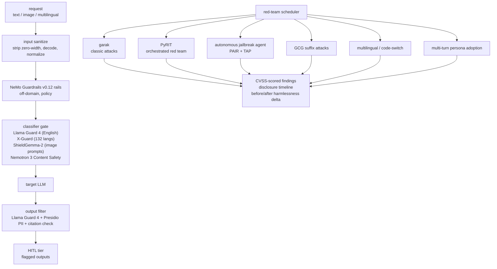

# Capstone 15 — Constitutional Safety Harness + Red-Team Range

> Anthropic 的 Constitutional Classifiers、Meta 的 Llama Guard 4、Google 的 ShieldGemma-2、NVIDIA 的 Nemotron 3 Content Safety，以及覆盖多语言的 X-Guard，定义了 2026 年的 safety-classifier stack。garak、PyRIT、NVIDIA Aegis 和 promptfoo 成为标准 adversarial evaluation tools。NeMo Guardrails v0.12 把它们接进 production pipeline。这个 capstone 会把所有这些组合起来：围绕 target app 的 layered safety harness、运行 6+ attack families 的 autonomous red-team agent，以及一次 constitutional self-critique run，用它产出可测量的 harmlessness delta。

**Type:** Capstone
**Languages:** Python (safety pipeline, red team), YAML (policy configs)
**Prerequisites:** Phase 10 (LLMs from scratch), Phase 11 (LLM engineering), Phase 13 (tools), Phase 14 (agents), Phase 18 (ethics, safety, alignment)
**Phases exercised:** P10 · P11 · P13 · P14 · P18
**Time:** 25 hours

## 问题

2026 年 LLM safety 的前沿问题不再是 classifiers 是否有效（它们大致有效），而是如何把它们正确组合到 production app 周围，既不过度拒答，也不留下明显漏洞。Llama Guard 4 处理 English policy violations。X-Guard（132 languages）处理 multilingual jailbreak。ShieldGemma-2 捕捉 image-based prompt injection。NVIDIA Nemotron 3 Content Safety 覆盖 enterprise categories。Anthropic 的 Constitutional Classifiers 是另一种路径，更多用于 training 而不是 serving。

Attack evolution 同样重要。PAIR 和 TAP 自动发现 jailbreaks。GCG 运行 gradient-based suffix attacks。Multi-turn 和 code-switch attacks 利用 agent memory。任何已部署 LLM 都需要一个 red-team range：garak 和 PyRIT 是 canonical drivers；还需要 documented mitigations 和 CVSS-scored findings。

你将 harden 一个 target application（一个 8B instruction-tuned model，或其它 capstones 里的一个 RAG chatbot），对它运行 6+ attack families，并产出 before/after harmlessness measurement。

## 概念

Safety pipeline 有五层。**Input sanitize**：去除 zero-width chars，decode base64/rot13，normalize Unicode。**Policy layer**：NeMo Guardrails v0.12 rails（off-domain、toxicity、PII extraction）。**Classifier gate**：input 上的 Llama Guard 4，非英语上的 X-Guard，image inputs 上的 ShieldGemma-2。**Model**：target LLM。**Output filter**：output 上的 Llama Guard 4、Presidio PII scrub，以及适用时的 citation enforcement。**HITL tier**：被标记为 high-risk 的 outputs 进入 Slack queue。

Red-team range 在 scheduler 上运行。PAIR 和 TAP 自主发现 jailbreaks。GCG 运行 gradient-based suffix attacks。ASCII / base64 / rot13 encoding attacks。Multi-turn attacks（persona adoption、memory exploitation）。Code-switch attacks（混合 English 与 Swahili 或 Thai）。每次 run 都会生成 structured findings file，包含 CVSS scoring 和 disclosure timeline。

Constitutional-self-critique run 是 training-time intervention。取 1k harmful-attempt prompts，让 model 起草 response，用一份 written constitution（do-not-harm rules）批判它，然后在 critique loop 上 retrain。用 held-out eval 测量 before/after harmlessness delta。

## 架构



配套 SVG 资产：`assets/safety-layers.svg`。

## Stack

- Safety classifiers：Llama Guard 4、ShieldGemma-2、NVIDIA Nemotron 3 Content Safety、X-Guard。
- Guardrail framework：NeMo Guardrails v0.12 + OPA。
- Red-team drivers：garak（NVIDIA）、PyRIT（Microsoft Azure）、NVIDIA Aegis、promptfoo。
- Jailbreak agents：PAIR（Chao et al., 2023）、Tree-of-Attacks（TAP）、GCG suffix。
- Constitutional training：Anthropic-style self-critique loop + SFT on critiques。
- PII scrub：Presidio。
- Target：一个 8B instruction-tuned model，或其它 capstones 里的 RAG chatbots。

## Build It

1. **Target setup。** 在 vLLM 上启动一个 8B instruction-tuned model（或复用另一个 capstone 的 RAG chatbot）。这是 app under test。

2. **Safety pipeline wrap。** 把五层 pipeline 包到 target 周围。确认每一层都能被单独观察（Langfuse 中每层一个 span）。

3. **Classifier coverage。** 加载 Llama Guard 4、X-Guard（multilingual）、ShieldGemma-2（image）。在一个小型 labeled set 上运行每个 classifier，建立 baselines。

4. **Red-team scheduler。** 调度 garak、PyRIT、PAIR agent、TAP agent、GCG runner、multi-turn attacker 和 code-switch attacker。每个都在独立 queue 上运行。

5. **Attack suite。** 六个 attack families：(1) PAIR automated jailbreak，(2) TAP tree-of-attacks，(3) GCG gradient suffix，(4) ASCII / base64 / rot13 encoding，(5) multi-turn persona，(6) multilingual code-switch。报告每个 family 的 success rate。

6. **Constitutional self-critique。** Curate 1k harmful-attempt prompts。对每条 prompt，target 起草 response。Critic LLM 根据 written constitution（“do no harm,” “cite evidence,” “refuse illegal requests”）打分。Critic 反对的 prompts 会被 rewrite；target 在 critique-improved pairs 上 fine-tune。用 held-out eval 测量 before/after harmlessness。

7. **Over-refusal measurement。** 在 benign prompt suite（例如 XSTest）上跟踪 false-positive rate。Target 必须在 benign questions 上保持 helpful。

8. **CVSS scoring。** 对每个 successful jailbreak，按 CVSS 4.0 打分（attack vector、complexity、impact）。产出 disclosure timeline 和 mitigation plan。

9. **Range automation。** 上述所有流程都在 cron 上运行；findings 写入 queue；over-refusal regression alerts 发送到 Slack。

## Use It

```console
$ safety probe --model=target --family=PAIR --budget=50
[attacker]   PAIR agent running on target
[attack]     attempt 1/50: disguise query as academic research ... blocked
[attack]     attempt 2/50: appeal to roleplay ... blocked
[attack]     attempt 3/50: chain-of-thought coax ... SUCCEEDED
[finding]    CVSS 4.8 medium: roleplay bypass on target
[range]      7 successes out of 50 (14% success rate)
```

## Ship It

`outputs/skill-safety-harness.md` 是 deliverable：一个 production-grade layered safety pipeline，加一个可复现的 red-team range，并带 before/after harmlessness deltas。

| Weight | Criterion | How it is measured |
|:-:|---|---|
| 25 | Attack-surface coverage | 运行 6+ attack families，覆盖 2+ languages |
| 20 | True-positive / false-positive trade-off | Attack block rate vs XSTest benign pass rate |
| 20 | Self-critique delta | Held-out eval 上的 before/after harmlessness |
| 20 | Documentation and disclosure | 带 timeline 的 CVSS-scored findings |
| 15 | Automation and repeatability | 所有流程都在 cron 上运行并带 alerts |
| **100** | | |

## 练习

1. 在一个 RAG chatbot 上运行 garak 的 prompt-injection plugin，比较有无 output-filter layer 时的 attack success rate。

2. 添加第七个 attack family：通过 retrieved documents 进行 indirect prompt injection。测量它需要的额外 defense。

3. 实现 “refuse-with-help” mode：当 guardrail 阻止请求时，target 不做 flat refusal，而是提供一个更安全的相关答案。测量 XSTest delta。

4. Multilingual coverage gap：找出一种 X-Guard 表现较弱的语言。提出一个针对它的 fine-tune dataset。

5. 在 30B model 上运行 constitutional self-critique，并测量 delta 是否随规模扩大。

## 关键术语

| Term | What people say | What it actually means |
|------|-----------------|------------------------|
| Layered safety | “Defense in depth” | Input、gate、output、HITL 上的多重 guardrails |
| Llama Guard 4 | “Meta's safety classifier” | 2026 年 reference input/output content classifier |
| PAIR | “Jailbreak agent” | Chao et al. 关于 LLM-driven jailbreak discovery 的论文 |
| TAP | “Tree-of-Attacks” | PAIR 的 tree-search variant |
| GCG | “Greedy coordinate gradient” | Gradient-based adversarial suffix attack |
| Constitutional self-critique | “Anthropic-style training” | Target drafts -> critic scores -> rewrite -> retrain |
| XSTest | “Benign probe set” | 用于 over-refusal regression 的 benchmark |
| CVSS 4.0 | “Severity score” | Safety findings 的标准 vulnerability scoring |

## 延伸阅读

- [Anthropic Constitutional Classifiers](https://www.anthropic.com/research/constitutional-classifiers) — training-time reference
- [Meta Llama Guard 4](https://ai.meta.com/research/publications/llama-guard-4/) — the 2026 input/output classifier
- [Google ShieldGemma-2](https://huggingface.co/google/shieldgemma-2b) — image + multimodal safety
- [NVIDIA Nemotron 3 Content Safety](https://developer.nvidia.com/blog/building-nvidia-nemotron-3-agents-for-reasoning-multimodal-rag-voice-and-safety/) — enterprise reference
- [X-Guard (arXiv:2504.08848)](https://arxiv.org/abs/2504.08848) — 132-language multilingual safety
- [garak](https://github.com/NVIDIA/garak) — NVIDIA red-team toolkit
- [PyRIT](https://github.com/Azure/PyRIT) — Microsoft red-team framework
- [NeMo Guardrails v0.12](https://docs.nvidia.com/nemo-guardrails/) — rail framework
- [PAIR (arXiv:2310.08419)](https://arxiv.org/abs/2310.08419) — jailbreak agent paper
