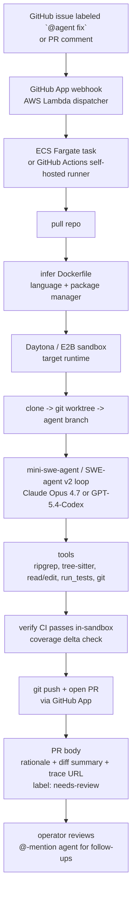

# Capstone 16 - GitHub Issue-to-PR 自主 Agent

> AWS Remote SWE Agents、Cursor Background Agents、OpenAI Codex cloud 和 Google Jules 都交付了同一种 2026 年产品形态：给 issue 打一个 label，就得到一个 PR。在 cloud sandbox 中运行 agent，确认 tests pass，然后发布一个带 rationale、可供 review 的 PR。难点在于自动复现 repo 的 build environment、防止 credential leakage、强制执行 per-repo budgets，并确保 agent 不能 force-push。这个 capstone 会构建 self-hosted 版本，并在 cost 和 pass rate 上与 hosted alternatives 对比。

**Type:** Capstone
**Languages:** Python（agent）, TypeScript（GitHub App）, YAML（Actions）
**Prerequisites:** Phase 11（LLM engineering）, Phase 13（tools）, Phase 14（agents）, Phase 15（autonomous）, Phase 17（infrastructure）
**Phases exercised:** P11 · P13 · P14 · P15 · P17
**Time:** 30 hours

## 问题

Async cloud coding agent 已经是一个不同于 interactive coding agents（capstone 01）的独立产品类别。它的 UX 是一个 GitHub label。你给 issue 标上 `@agent fix this`，worker 会在 cloud sandbox 中启动，clone repo，运行 tests，编辑文件，验证，然后打开一个 PR，并在 PR body 中写入 agent 的 rationale。没有 interactive loop，也没有 terminal。AWS Remote SWE Agents、Cursor Background Agents、OpenAI Codex cloud、Google Jules 和 Factory Droids 都收敛到了这个形态。

工程挑战很具体：environment reproduction（agent 必须在没有 cached dev image 的情况下从零构建 repo）、flaky tests（必须重跑或隔离）、credential scoping（GitHub App 使用最小 fine-grained permissions）、per repo per day 的 budget enforcement，以及 no-force-push policy。这个 capstone 会测量它相对 hosted alternatives 的 pass rate、cost 和 safety。

## 概念

Trigger 是 GitHub webhook（issue label 或 PR comment）。Dispatcher 把工作入队到 ECS Fargate 或 Lambda。Worker 把 repo 拉进 Daytona 或 E2B sandbox，并根据 repo 推断一个 generic Dockerfile（language、framework）。Agent 使用 mini-swe-agent 或 SWE-agent v2 loop，背后接 Claude Opus 4.7 或 GPT-5.4-Codex。它会迭代执行：read code、propose fix、apply patch、run tests。

Verification 是 gate。PR 打开前，完整 CI 必须在 sandbox 中通过。系统会计算 coverage delta；如果 coverage 下降超过阈值，PR 仍然会打开，但会被标记为 `needs-review`。Agent 会把 rationale 作为 PR description 发布，并创建一个 `@agent` thread，reviewer 可以在里面 ping 它做 follow-ups。

Safety 通过两个不同的 GitHub surfaces 做 scope 控制：App 提供一个 short-lived installation token，权限为 `workflows: read` 和狭窄的 repo contents / PR scopes；branch protection（不是 app permissions）强制执行 “no direct writes to `main`” 和 “no force-push”，并且 app 永远不加入 bypass list。对 `.github/workflows` 的 path-scoped read-only access 并不是真正的 GitHub App primitive，所以 agent 的 file-edit allow-list 必须在 worker 中强制执行。Per repo per day 的 budget ceilings 也在 dispatcher 层执行（例如，每个 repo 每天最多 5 个 PR，每个 PR 最多 20 美元）。

## 架构



## 技术栈

- Trigger：GitHub App with fine-grained token；webhook receiver 通过 Lambda 或 Fly.io
- Worker：ECS Fargate task（或 GitHub Actions self-hosted runner）
- Sandbox：每个 task 一个 Daytona devcontainer 或 E2B sandbox
- Agent loop：mini-swe-agent baseline 或 SWE-agent v2，使用 Claude Opus 4.7 / GPT-5.4-Codex
- Retrieval：tree-sitter repo-map + ripgrep
- Verification：in-sandbox full CI + coverage delta gate
- Observability：Langfuse，PR body 中链接 per-PR trace archive
- Budget：per-repo daily dollar ceiling；每个 repo 每天最多 PR 数

## Build It

1. **GitHub App。** Fine-grained installation token：issues read+write、pull_requests write、contents read+write、workflows read。Branch protection（唯一能做到这件事的 surface）强制执行 “no direct push to `main`” 和 “no force-push”；app 不在 bypass list 中。由于 GitHub App permissions 不是 path-scoped，worker 需要对 proposed diff 做 allow-list check，强制执行 “no writes under `.github/workflows`”。

2. **Webhook receiver。** Lambda function 接收 issue label / PR comment webhooks。按 label `@agent fix this` 过滤。把任务入队到 SQS。

3. **Dispatcher。** 从 SQS pop tasks。强制执行 per-repo per-day budget。启动一个 ECS Fargate task，并传入 repo URL、issue body 和一个 fresh Daytona sandbox。

4. **Environment inference。** 检测 language（Python、Node、Go、Rust）和 package manager（uv、pnpm、go mod、cargo）。如果 repo 中没有 Dockerfile，就动态生成一个。

5. **Agent loop。** 使用 mini-swe-agent 或 SWE-agent v2，模型为 Claude Opus 4.7。Tools：ripgrep、tree-sitter repo-map、read_file、edit_file、run_tests、git。硬限制：20 美元成本、30 分钟 wall-clock、30 个 agent turns。

6. **Verification。** Loop 结束后，在 sandbox 中运行完整 test suite。通过 jacoco / coverage.py 计算 coverage delta。如果 CI red：停止，不打开 PR。如果 coverage 下降超过 2%：打开 PR，并加上 `needs-review` label。

7. **PR posting。** Push agent branch。通过 GitHub API 打开 PR，内容包括：title、rationale、diff summary、trace URL、cost、turns。

8. **Credential hygiene。** Worker 使用 short-lived GitHub App installation token。Logs 在归档前会 scrub secrets。

9. **Eval。** 准备 30 个 seeded internal issues，难度各异。测量 pass rate、PR quality（diff size、style、coverage）、cost、latency。用同一组 issues 与 Cursor Background Agents 和 AWS Remote SWE Agents 对比。

## Use It

```console
# on github.com
  - user labels issue #842 with `@agent fix this`
  - PR #1903 appears 14 minutes later
  - body:
    > Fixed NPE in widget.dedupe() caused by null comparator entry.
    > Added regression test widget_test.go::TestDedupeNullComparator.
    > Coverage delta: +0.12%
    > Turns: 7  Cost: $1.80  Trace: langfuse:...
    > Label: needs-review
```

## Ship It

`outputs/skill-issue-to-pr.md` 是交付物。它是一个 GitHub App + async cloud worker，可以把带 label 的 issues 转成有 bounded cost 和 scoped credentials 的 review-ready PRs。

| Weight | Criterion | How it is measured |
|:-:|---|---|
| 25 | Pass rate on 30 issues | End-to-end success（CI green + coverage OK） |
| 20 | PR quality | Diff size、coverage delta、style conformance |
| 20 | Cost and latency per resolved issue | 每个 PR 的美元成本和 wall-clock |
| 20 | Safety | Scoped token、per-repo budget、no force-push、credential hygiene |
| 15 | Operator UX | Rationale comments、retry affordance、@-mention follow-up |
| **100** | | |

## 练习

1. 增加一个 “fix flaky test” mode：label `@agent stabilize-flake TestX` 会在 sandbox 中把 test 运行 50 次，并提出一个能稳定它的最小修改。

2. 在三个 shared issues 上与 Cursor Background Agents 比较 cost。报告哪些工具在哪些场景胜出。

3. 实现一个 budget dashboard：per-repo per-day cost、per-user cost。对 anomaly 发出 alert。

4. 构建一个 “dry-run” mode，它会打开一个 draft PR，但不运行 CI，让 reviewers 能低成本检查 plan。

5. 增加 retention policy：超过 7 天未 merge 的 PR branches 会被自动删除。

## 关键术语

| Term | 大家常说 | 实际含义 |
|------|----------|----------|
| GitHub App | "Scoped bot identity" | 带 fine-grained permissions 和 short-lived installation token 的 App |
| Async cloud agent | "Background agent" | 在 cloud sandbox 中运行的 non-interactive worker，不是 terminal |
| Environment inference | "Dockerfile synthesis" | 检测 language + package manager；如果没有 Dockerfile 就生成一个 |
| Verification | "CI-in-sandbox" | 打开 PR 前，在 worker 内运行完整 test suite |
| Coverage delta | "Coverage preservation" | 从 base 到 agent branch 的 test coverage 百分比变化 |
| Per-repo budget | "Daily ceiling" | Dispatcher 层强制执行的美元和 PR-count 上限 |
| Rationale | "PR body explanation" | Agent 对改了什么、为什么改的总结；必须写在 PR body 中 |

## 延伸阅读

- [AWS Remote SWE Agents](https://github.com/aws-samples/remote-swe-agents) - canonical async cloud agent reference。
- [SWE-agent](https://github.com/SWE-agent/SWE-agent) - CLI reference。
- [Cursor Background Agents](https://docs.cursor.com/background-agent) - commercial alternative。
- [OpenAI Codex（cloud）](https://openai.com/codex) - hosted competitor。
- [Google Jules](https://jules.google) - Google 的 hosted version。
- [Factory Droids](https://www.factory.ai) - alternate commercial reference。
- [GitHub App documentation](https://docs.github.com/en/apps) - scoped bot identity。
- [Daytona cloud sandboxes](https://daytona.io) - reference sandbox。
