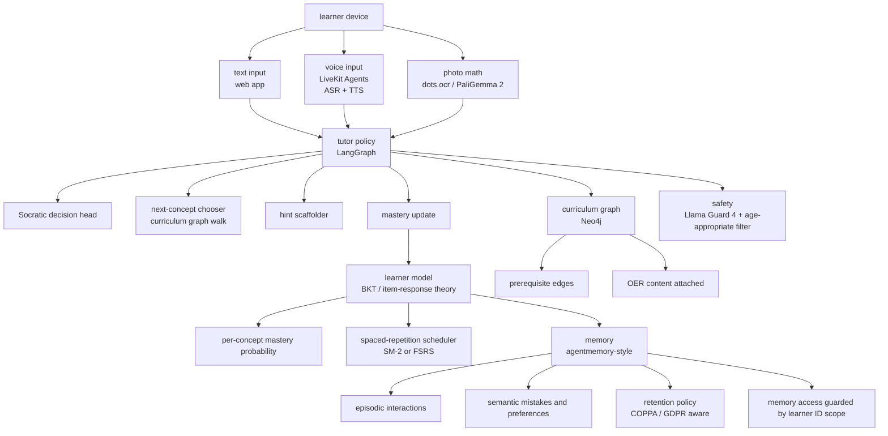

# Capstone 17 - Personal AI Tutor（自适应、多模态、带记忆）

> Khanmigo（Khan Academy）、Duolingo Max、Google LearnLM / Gemini for Education、Quizlet Q-Chat 和 Synthesis Tutor 都在 2026 年大规模交付了 adaptive multimodal tutoring。共同形态是：Socratic policy（绝不只是直接倒答案）、每次 interaction 后都会更新的 learner model（Bayesian knowledge tracing style）、voice + text + photo-math input、curriculum graph retrieval、spaced-repetition scheduling，以及面向 age-appropriate content 的 hard safety filters。这个 capstone 要求你交付一个 subject-specific tutor（K-12 algebra 或 intro Python），用 10 名 learners 做两周 efficacy study，并通过 content-safety audit。

**Type:** Capstone
**Languages:** Python (backend, learner model), TypeScript (web app), SQL (curriculum graph via Postgres + Neo4j)
**Prerequisites:** Phase 5 (NLP), Phase 6 (speech), Phase 11 (LLM engineering), Phase 12 (multimodal), Phase 14 (agents), Phase 17 (infrastructure), Phase 18 (safety)
**Phases exercised:** P5 · P6 · P11 · P12 · P14 · P17 · P18
**Time:** 30 hours

## 问题

Adaptive tutoring 曾经只是 ed-tech research niche。到 2026 年，它已经成为 consumer product。Khanmigo 部署在美国大多数 school districts。Duolingo Max 达到数千万 MAUs。Google 的 LearnLM / Gemini for Education 为 Google Classroom 中的 tutoring 提供能力。Quizlet Q-Chat 与 flashcards 并列出现。Synthesis Tutor 因 tutor-for-curious-kids 走红。共同元素是：multimodal input（type、speak、photograph equations）、Socratic pedagogy（先提问，后解释）、每次 interaction 后都会更新的 learner model，以及严格的 age-appropriate safety。

你将为一个具体 cohort 构建这样的系统。衡量标准是真实的 efficacy study：10 名 learners 在两周内完成 pre-test 和 post-test。Voice loop 必须感觉自然（capstone 03 sub-stack）。Memory 必须尊重 privacy。Safety filter 必须通过面向 K-12 的 COPPA-aware red-team。

## 概念

四个组件。**Tutor policy** 是 Socratic loop：当 learner 直接要答案时，policy 会提出 leading question；当 learner 答对时，它会移动到下一个 concept；当 learner 卡住时，它会给出 scaffolded hint。**Learner model** 是 Bayesian knowledge tracing（或一个简单变体），在每次 interaction 后更新每个 curriculum node 的 mastery probability。**Curriculum graph** 是一个带 prerequisite edges 的 concepts Neo4j；policy 遍历这个 graph 来选择下一个 concept。**Memory** 是 episodic + semantic store（agentmemory-style），保存 past interactions、mistakes 和 preferences。

UX 是 multimodal。Text input 用于 typed answers。Voice input 使用 LiveKit + Whisper（复用 capstone 03）。Photo input 用 dots.ocr 或 PaliGemma 2 处理 math problems。Voice output 使用 Cartesia Sonic-2。Safety 使用 Llama Guard 4 加 age-appropriate filter（阻断 adult content、violence、self-harm），并配合 COPPA-aware memory retention policy。

Efficacy study 是交付物。10 名 learners，pre-test 和 post-test，两周。报告 learning gain delta 和 confidence interval。与 non-adaptive baseline 对比（同样内容以线性方式交付，不使用 tutor policy）。

## Architecture



## Stack

- Subject choice：K-12 algebra 或 intro Python（二选一，深入做）
- Tutor policy：LangGraph over Claude Sonnet 4.7（带 prompt caching）
- Learner model：Bayesian knowledge tracing（classic）或用于 spacing 的 FSRS
- Curriculum graph：concepts + prerequisite edges + OER content 的 Neo4j
- Memory：agentmemory-style persistent vector + episodic + semantic store
- Voice：LiveKit Agents 1.0 + Cartesia Sonic-2（复用 capstone 03 sub-stack）
- Photo math：dots.ocr 或 PaliGemma 2 做 equation recognition
- Safety：Llama Guard 4 + custom age-appropriate filter
- Eval：Bloom-level question generation、pre/post test harness、efficacy study tooling

## Build It

1. **Curriculum graph。** 构建一个包含 50-150 个 concept nodes 的 Neo4j（例如 K-12 algebra，从 “number line” 到 “quadratic formula”），并添加 prerequisite edges。为每个 node 附上 OER content（Open Textbook、OpenStax）。

2. **Learner model。** 用 priors 初始化 Bayesian knowledge tracing：guess、slip、learn-rate。每次 interaction 后更新 per-concept mastery。按 learner 持久化。

3. **Tutor policy。** LangGraph nodes：`read_signal`（learner 的 answer 是 correct / partial / stuck？）、`select_concept`（遍历 curriculum graph，选择最高优先级 concept）、`scaffold`（Socratic prompt）、`update_mastery`。

4. **Memory。** 每次 interaction 写入 episodic store。Mistakes 和 preferences 会提升为 semantic memory。COPPA-aware retention policy：1 年后自动删除，并可由 parent 访问。

5. **Voice path。** 将 LiveKit Agents worker 接到 tutor policy。ASR 使用 Whisper-v3-turbo。TTS 使用 Cartesia Sonic-2。支持 barge-in（复用 capstone 03 mechanics）。

6. **Photo-math path。** 上传或拍摄图片；运行 dots.ocr 或 PaliGemma 2 识别 equation；作为 structured input 送入 tutor。

7. **Safety。** 每个 model output 都经过 Llama Guard 4 + age-appropriate filter（阻断 self-harm、adult content、violence）。Memory access 按 learner ID 限定 scope；提供 parental access surface 用于 deletion。

8. **Efficacy study。** 10 名 learners，pre-test（standardized 30-question baseline），两周 tutor interaction（每周 3 sessions），post-test。与一个 10 名 learners 的 non-adaptive baseline cohort 比较，内容相同。

9. **Weekly progress reports。** 为每个 learner 自动生成 PDF summary，包含 topics explored、mastery trajectories 和 recommended next steps。

## Use It

```console
learner: "I don't understand why 3x + 6 = 12 means x = 2"
[signal]   stuck
[concept]  'isolating variables' (prerequisite: addition-subtraction-equality)
[scaffold] "what number would you subtract from both sides to start?"
learner: "6"
[signal]   correct
[mastery]  addition-subtraction-equality: 0.62 -> 0.77
[concept]  continue 'isolating variables'
[scaffold] "great. now what is 3x / 3 equal to?"
```

## Ship It

`outputs/skill-ai-tutor.md` 是交付物。它是一个 subject-specific adaptive tutor，具备 multimodal input、learner model、memory、safety，以及经过测量的 efficacy。

| Weight | Criterion | How it is measured |
|:-:|---|---|
| 25 | Learning gain delta | 10 名 learner、两周 study 中的 pre/post-test delta |
| 20 | Socratic fidelity | Transcript samples 上的 rubric score |
| 20 | Multimodal UX | Voice + photo + text end to end coherent |
| 20 | Safety + privacy posture | Llama Guard 4 pass rate + COPPA-aware retention |
| 15 | Curriculum breadth and graph quality | Concept coverage + prerequisite graph consistency |
| **100** | | |

## 练习

1. 在启用和不启用 adaptive learner model（random concept order）两种情况下运行 efficacy study。报告 delta。预期 adaptive 会赢，但差距大小才是有趣数字。

2. 添加一个 multimodal probe：同一个 concept question 分别以 text、voice 和 photo 形式交付。测量 learners 是否会在自己偏好的 modality 下更快收敛。

3. 构建 parent dashboard：topics practiced、mastery trajectories、upcoming concepts、safety events（任何 guardrail hits）。保持 COPPA-aligned。

4. 添加 language-switch mode：tutor 接受 Spanish input，并用 Spanish 教学。测量 X-Guard coverage。

5. 对 memory privacy 做压力测试：验证 learner A 即使通过 voice-clip re-ingest attack，也无法看到 learner B 的数据。记录 attempted access 并 alert。

## 关键术语

| Term | What people say | What it actually means |
|------|-----------------|------------------------|
| Socratic policy | “Ask, do not dump” | Tutor 提出 leading question，而不是直接给出答案 |
| Bayesian knowledge tracing | “BKT” | 用于每个 concept mastery probability 的 classic learner-model equations |
| FSRS | “Free Spaced Repetition Scheduler” | 2024 spaced-repetition scheduler，比 SM-2 更好 |
| Curriculum graph | “Concept DAG” | 带 prerequisite edges 的 concepts Neo4j |
| Episodic memory | “Per-interaction log” | 每次 interaction 都被存储，供之后 retrieval |
| Semantic memory | “Learned pattern store” | 从 episodic 中压缩提升出来的 mistakes 和 preferences |
| COPPA | “Kids privacy law” | 美国法律，限制对 13 岁以下儿童的数据收集 |

## 延伸阅读

- [Khanmigo (Khan Academy)](https://www.khanmigo.ai) — reference consumer K-12 tutor
- [Duolingo Max](https://blog.duolingo.com/duolingo-max/) — reference language-learning tutor
- [Google LearnLM / Gemini for Education](https://blog.google/technology/google-deepmind/learnlm) — hosted reference model
- [Quizlet Q-Chat](https://quizlet.com) — alternate reference
- [Synthesis Tutor](https://www.synthesis.com) — startup reference
- [FSRS algorithm](https://github.com/open-spaced-repetition/fsrs4anki) — spaced-repetition scheduler
- [Bayesian Knowledge Tracing](https://en.wikipedia.org/wiki/Bayesian_knowledge_tracing) — learner-model classic
- [LiveKit Agents](https://github.com/livekit/agents) — voice stack
