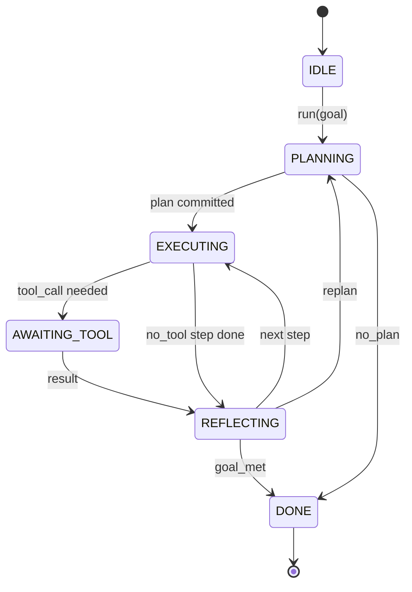

# Agent Harness 循环契约

> Harness 才是 agent。Model 只是协处理器。本课把 loop contract 固定下来，让任何 model 都能接入同一个形状。

**Type:** Build
**Languages:** Python
**Prerequisites:** Phase 13 lessons 01-07, Phase 14 lesson 01
**Time:** ~90 minutes

## 学习目标

- 将 agent harness loop 规定为带显式 transitions 的确定性状态机。
- 实现十个 lifecycle hook topics，让 operator 可以接入 policy、telemetry 和 guardrails。
- 定义两个 pull points，让 loop 把控制权交还给 caller，并在 fresh input 上恢复。
- 强制执行 per-session budgets（turns、tool calls、wall-clock），并确保超限时不泄漏 partial state。
- 发出包含十一个 event types 的 typed stream，让下游 UI 和 tracers 无需直接检查 loop 就能订阅。

## 框架

一个无人值守运行四十轮的 coding agent 不是 chat loop。它是一个状态机：operator 可以拦截它的节点，也可以审计它的边。只要把 contract 写下来，替换 model、tools 或 policies 就不再是 refactor，而只是一次 registration call。

本课构建的就是这个 contract。我们命名六个 states、十个 hook topics、两个 pull points、十一个 event types，以及一个 budget envelope。Harness 中的其他部分（tool registry、JSON-RPC transport、dispatcher、planner）都会插入这个形状。

## 状态

Loop 有六个 states。五个是 active。一个是 terminal。



`IDLE` 是唯一合法入口。`DONE` 是唯一合法出口。`AWAITING_TOOL` 是唯一会产生 pull point 的 state。其他 transitions 都是内部 transitions。

这个状态机是 deterministic 的。给定同一份 event log，harness 会重新进入同一个 state。这个性质让你可以 replay sessions 做 debugging，而不必重新调用 model。

## Hook topics

Hooks 是 operator 进入 loop 的接口。Harness 会触发十个 topics。每个 topic 可以有任意数量的 subscribers。Subscribers 按 registration order 触发。Subscriber 可以 mutate payload，可以 raise 来 abort turn，也可以返回 sentinel 来 skip next step。

```text
before_plan         after_plan
before_tool_call    after_tool_call
before_step         after_step
on_error
on_pause
on_budget_exceeded
on_complete
```

这个形状对应 Claude Code、Cursor 和 OpenCode 到 2025 年中期共同收敛出的模式。名字是 functional 的，不是 branded 的。阻止 `rm -rf` 的 hook 放在 `before_tool_call`。发送 OpenTelemetry span 的 hook 放在 `after_step`。在 paused session 上恢复的 hook 放在 `on_pause`。

## Pull points

Loop 会两次交还控制权。第一次是在 `AWAITING_TOOL`，因为没有 tool result 就无法继续。第二次是在 `on_pause`，因为 budget 已耗尽，或某个 hook 明确请求 human review。

Pull point 不是 exception。它是一次 return。Caller 检查 harness state，获取 harness 请求的内容，然后调用 `resume(payload)`。Harness 从停止处继续。这和 Python generator 是同一种形状。Pull point 之上的 transport 由你选择：在 TUI 中它是 keypress；在 MCP 中它是 `tools/call`；在 queue 上它是 job poll。

## Event stream

Loop 会在 contract 中的特定点把 events append 到 typed stream。这个 stream 是 append-only 的，subscribers 可以从任意 offset replay。已实现的十一个 event types 是：

- `session.start`：调用 `run(goal)` 时发出一次
- `plan.draft`：planner 返回 draft plan 时发出
- `plan.commit`：draft 被提交为 active plan 后发出
- `step.start`：每个 executing step 开始时发出
- `step.end`：每个 executing step 结束时发出
- `tool.call`：需要 tool 的 step 把控制权交给 caller 时发出
- `tool.result`：带 tool result 调用 resume 时发出
- `tool.error`：带 error 调用 resume，或 hook abort call 时发出
- `budget.warn`：达到 budget limit 时发出
- `session.pause`：loop 因 pause（budget 或 hook）而 yield 时发出
- `session.complete`：loop 到达 `DONE` 时发出一次

Events 不复制 hook payloads。Hooks 是 imperative 的（mutate、abort）。Events 是 observational 的（record、ship）。把它们当作彼此正交的机制。

## Budget envelope

一个 session 带三个 limits：turn count、tool call count、wall-clock seconds。每一轮都会让 turns 加一。每次 tool call 都会让 tool calls 加一。Wall-clock 在每个 state transition 上检查。任何 limit 达到时，loop 会触发 `on_budget_exceeded`，发出 `budget.warn`，然后在下一个 pull point 上带着 budget-exceeded reason transition 到 `IDLE`。

Budget 不是 kill switch。它是 yield。Caller 决定是扩展 budget 并 resume，还是关闭 session。

## 本课不做什么

它不调用 model。它不注册真实 tools。它不实现 transport。这些是接下来四课的内容。本课把 contract 钉牢，让后四课可以接进来，而不用重写 loop。

`main.py` 中的 deterministic planner 是 stand-in。它返回一个 hardcoded 的三步 plan，其中两步需要 tool result。重点是 loop，不是 plan。

## 如何阅读代码

`HarnessLoop` 是主类。它持有 state，触发 hooks，发出 events。`Budget` 跟踪 limits。`Event` 是 stream 上的 typed envelope。`HookRegistry` 是 dispatch table。`_transition` 是唯一改变 state 的函数，所以 state machine invariants 都集中在一个地方。

先从上到下读 `main.py`。然后读 `code/tests/test_loop.py`。Tests 会固定每个 transition 和每个 hook 的 firing order。

## 继续深入

在 production 中构建 harness，最难的不是状态机，而是让 contract 可执行。Contract 必须经受 planner hot reload。它必须经受返回 malformed JSON 的 tool。它必须经受一个在四十轮 session 的三分之二处、于 `before_tool_call` 中 raise 的 hook。本课 tests 会覆盖这些 failure modes。运行它们。打破它们。添加更多 cases。

下一课会添加 tool registry。再下一课是 JSON-RPC transport。再之后是 dispatcher。到第二十四课时，本文件中的 loop 会带着真实 budgets，对真实 tools 运行真实 plan。
