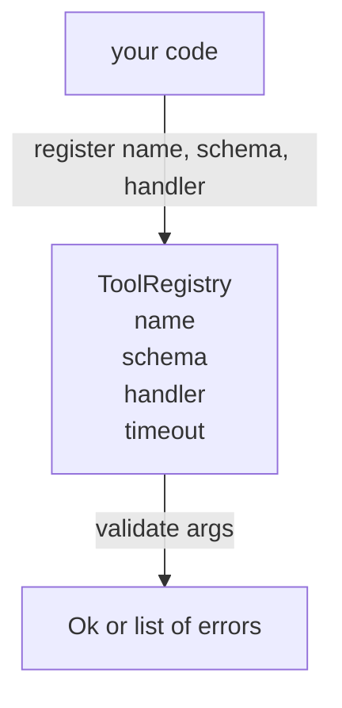

# 带 Schema Validation 的 Tool Registry

> Agent 无法验证的 tool，就是 agent 无法调用的 tool。先构建 registry 和 schema checker，再构建 tools。

**Type:** Build
**Languages:** Python
**Prerequisites:** Phase 13 lessons 01-07, Phase 14 lesson 01
**Time:** ~90 minutes

## 学习目标

- 维护一个 typed registry：tool name → schema → handler，让 dispatcher 查询一次之后就可以信任。
- 实现 JSON Schema 2020-12 的一个子集，覆盖实际 tool calls 中 90% 会用到的 keywords。
- 返回精确的、json-pointer-shaped error paths，让 model 能在一次 round trip 内自我修正。
- 默认拒绝重复注册；只有显式 override 才能替换，因为 silent overwrites 正是 production tool catalogs 漂移的方式。
- 保持 validator 纯净（无 I/O、无时间、无 globals），这样它可以在 replay log 上重新运行。

## 为什么 registry 先于 tool

2026 年的 coding agent 拥有的 registered tools，已经多到无法全部塞进 model 的单个 context window。一个非平凡 harness 会注册两百个 tools，并在任意 turn 暴露其中十到四十个。Registry 是这些问题的 source of truth：“有哪些 tools”、“它们的 arguments 长什么样”、“我要调用哪个 handler”。一旦这三个答案固定，harness 的其它部分就可以停止猜测。

我们要避免的错误是：只交付 handlers 而没有 schemas，或者只交付 schemas 而没有 validation。这两种都很常见。两者都会把下一层（第二十三课中的 dispatcher）变成猜谜游戏，而唯一的失败模式就是 handler 抛出的 stack trace。

## Tool record 长什么样

```text
ToolRecord
  name        : str          (unique, lowercase alphanumeric and underscore segments separated by dots, e.g., snake_case.segment.case)
  description : str          (one line, shown to the model)
  schema      : dict         (JSON Schema 2020-12 subset)
  handler     : Callable     (async or sync, returns Any)
  idempotent  : bool         (dispatcher uses this for retry decisions)
  timeout_ms  : int          (override per-tool dispatcher default)
```

Schema 是 validator 唯一接触的字段。Handler 对 validator 是 opaque 的。我们有意把它们分开。Schema 是 data。Handler 是 code。把两者混在一起，会诱使你把 validation logic 放进 handler，而这正是我们要阻止的 bug。

## JSON Schema 2020-12 子集

完整的 2020-12 spec 可以写成一篇论文。这里我们只需要八个 keywords。

```text
type           string / number / integer / boolean / object / array / null
properties     map of property name -> schema
required       list of property names
enum           list of allowed primitive values
minLength      integer, applies to strings
maxLength      integer, applies to strings
pattern        ECMA-262-compatible regex, applies to strings
items          schema applied to every array element
```

这足以覆盖 tool API 实际需要的 shape。我们没有加入的 keywords（oneOf、anyOf、allOf、$ref、conditionals）在 production schemas 中是有效的，但会把 validator 变成一个带 cycles 的 tree walker。我们构建的是 registry，不是 JSON Schema engine。

## JSON Pointer error paths

Validation 失败时，validator 返回一组 errors。每个 error 都携带一个指向 input 内部位置的 json-pointer path。Pointer 是以 slash 开头的一串 property names 和 array indices。

```json
{"a": {"b": [1, 2, "x"]}}
```

上面字符串 `"x"` 的路径是 `/a/b/2`。

Model 读取 error paths 的效果比读取句子更好。如果 schema 要求 `args.user.email`，但 model 传了一个 integer，那么 error 应该是 `/user/email`，并带上 `expected_type: string`。Model 可以在下一次调用中直接修正，不需要再来一轮自然语言解释。

## Registration and override

`register(name, schema, handler, **opts)` 默认拒绝 re-registration。Caller 必须传入 `override=True` 才能替换。这是 operational hygiene。代码库的两个部分悄悄注册同一个 tool name，是那种会在 production 里花一周才找到的 bug。

Registry 暴露三个 read methods。`get(name)` 返回 record 或 raise。`validate(name, args)` 返回一个 `Ok` 或 errors list。`names()` 按 registration order 返回 tool names。

## Validator 是什么，不是什么

它是对 schema tree 的一次递归 single pass。它是纯函数。它不调用 handlers。它不做 type coercion（字符串 `"42"` 不能通过 number schema）。它也不会 silent truncate。

它不是 security boundary。Validation 通过后，恶意 handler 仍然可能行为不当。第二十三课中的 dispatcher 会添加 timeout 和 sandbox layers。Registry 添加的是 shape。

## Shape



## 如何阅读代码

`code/main.py` 定义了 `ToolRegistry`、`ToolRecord`、`ValidationError` 和八个 validator functions。Validator 根据 `schema["type"]` dispatch（或者把带 `enum` 的 schema 当作 untyped enum check）。每个 type validator 返回 empty list 或一组 `ValidationError`。Top-level walker 会拼接 errors，并在递归下降时 prepend path segments。

`code/tests/test_registry.py` 覆盖 registration、override、validation success、带 paths 的 validation failure，以及这个子集中的每个 keyword。

## Going further

这节课完成后，你会想加的两个 extensions 是：针对 local definitions block 的 `$ref` resolution，以及用于 strict shape 的 `additionalProperties: false`。两者都很小。随着 tool catalog 超过五十个 tools，两者也都很常见。我们在本课中省略它们，是为了让文件保持在一次阅读内。

下一课（二十二课）会构建 JSON-RPC stdio transport，把这个 registry 暴露给 model client。再下一课（二十三课）会把两者包装到带 timeouts 和 retries 的 dispatcher 后面。
