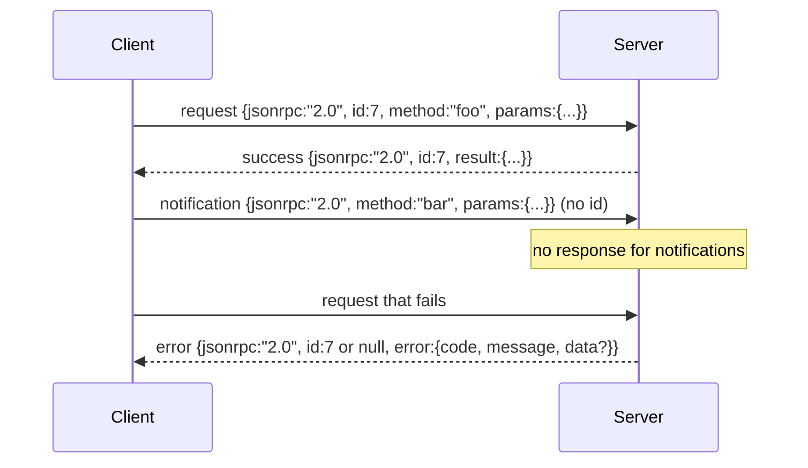

# 基于 Newline-Delimited Stdio 的 JSON-RPC 2.0

> Model client 和 tool server 之间的 transport 是 stdio 上的 JSON-RPC。亲手实现一次，你就会理解每一层 framing 在替你付出什么代价。

**Type:** Build
**Languages:** Python
**Prerequisites:** Phase 13 lessons 01-07, Phase 14 lesson 01
**Time:** ~90 minutes

## 学习目标

- 使用 stdin 和 stdout 上的 newline-delimited JSON 来表达 JSON-RPC 2.0。
- 映射五个标准错误码（-32700、-32600、-32601、-32602、-32603），并用正确语义暴露它们。
- 区分 requests、responses、notifications 和 batches，不发明新的 envelope keys。
- 对每一行单独处理一个 parse error，不让它污染后续 stream。
- 用 `io.BytesIO` 构建一个 self-terminating demo，让 lesson 不需要 spawn child process 也能运行。

## 为什么 JSON-RPC 仍然是通用语

2026 年，一个 coding agent 在单次 session 里可能会和十几个 tool servers 通信。每个 server 都是一个独立进程或远程 endpoint。Wire format 从 2013 年以来基本没有变。JSON-RPC 2.0 是一份两页规范。它能活下来，是因为替代方案（gRPC、每次调用一个 HTTP request、自定义 binary）都会强加 JSON-RPC 没有的取舍：它们会在 streaming、batching 或 transport-coupling 中选择一边。JSON-RPC 在 stdio、sockets、websockets 和 HTTP 上都是对称的；只要双方遵守 spec，client 就能驱动一个从未见过的 server。

本课构建的是 stdio variant。Newline-delimited JSON。每个 request 是一行。每个 response 是一行。Transport boundary 是 `\n`。

## Wire shape

存在四种 envelope shapes。两种由 client 发出，两种由 server 发出。



Notification 没有 `id`。Server 不能回复 notification。如果 server 给 notification 返回 response，client 就无法把它挂回任何 call site。这个单一规则让 framing math 保持简单。

Batch 是 requests 或 notifications 组成的 JSON array。Server 返回 responses array，顺序可以任意；每个 non-notification entry 对应一个 response。如果 batch 中每一项都是 notification，server 什么也不发回。

## 五个错误码

```text
-32700  Parse error      JSON could not be parsed
-32600  Invalid Request  Envelope shape is wrong
-32601  Method not found
-32602  Invalid params
-32603  Internal error
```

-32000 到 -32099 之间的 codes 保留给 server-defined errors。其它都属于 application-defined。本课只使用这五个。如果 handler 抛异常，transport 会把它包装成 -32603，并在 `data.exception` 中放入 exception class name。

Parse error 有一个特殊规则。Response 中的 `id` 是 `null`，因为 request 甚至没有 parse 到足以抽取 id 的程度。

## Newline framing 与 BytesIO demo

Transport 一次读取一行。一行是直到并包含 `\n` 的 bytes。如果某一行无法 parse，transport 会写入一个 `id: null` 的 -32700 response，然后继续。Stream 不会被污染。下一行会被重新 parse。

在本课中，我们把一对 `io.BytesIO` 包装成 stdin 和 stdout。Server 读取 requests 直到 EOF，为每一项写入 responses，然后返回。Client 再把 responses 读回来。不 spawn process。没有 timeouts。Transport behavior 与真实 subprocess pipe 相同，因为 Python 的 `io` interface 暴露的是同样的 `.readline()` 和 `.write()` contract。

## Method dispatch

Transport 不知道有哪些 methods。它把调用交给 harness 提供的 callable：`handler(method, params)`。Handler 返回 result 或抛异常。三个 exception classes 会映射到具体 codes。

```text
MethodNotFound -> -32601
InvalidParams  -> -32602
Anything else  -> -32603 with exception name in data
```

Transport 从不看 tool registry。Registry 位于 handler 后面。这就是我们想要的 layering。Transport 负责说 JSON-RPC。Registry 负责说 tool shapes。Dispatcher（第 23 课）把它们缝起来。

## 错误时的 stream 行为

```text
client writes              server reads             server writes
---------------            -----------              -------------
{...valid request...}      parses ok                {...response, id matches...}
{...broken json...         parse fails              {id:null, error: -32700}
{...valid request...}      parses ok                {...response, id matches...}
{...missing method...}     invalid envelope         {id:X, error: -32600}
```

Broken JSON line 不会停止 loop。缺少 `method` field 不会停止 loop。Handler exception 不会停止 loop。Transport 会一直读到 EOF。

## Notifications 与 asymmetric flows

Notification 是 fire-and-forget。Harness 用 notifications 表达 progress events、cancellation signals 和 log lines。Notification 让 long-running tool 可以 stream status updates，而不需要每条 status 都做一次 round trip。

本课实现一个 outbound notification helper：`write_notification`。Server 用它在 request 进行中发出 progress。Demo 展示这个 pattern：一个 request 进来，handler 发出两个 progress notifications，然后写入最终 response。

## 如何阅读代码

`code/main.py` 定义了 `StdioTransport`、parse helper（`parse_request`）、三个 write helpers（`write_response`、`write_error`、`write_notification`），以及 dispatch loop `serve`。错误码常量位于 module scope。

`code/tests/test_transport.py` 覆盖五个错误码、notifications（不写 response）、batches（array in、array out、跳过 notifications）、broken JSON（parse error 后继续），以及 handler 在 mid-call 写 notification 的 asymmetric flow。

## 继续深入

这个 transport 足够支撑后续 lessons。Production transports 会再加三件事。第一，能在 forwarding 中保留下来的 correlation id field（你的 `id` 已经承担这个角色，但在 mesh 里还需要一个 outer trace id）。第二，cancellation channel（类似 `$/cancelRequest` 的 notification，携带 in-flight call 的 id）。第三，content-type negotiation handshake，让同一个 socket 可以同时说 JSON-RPC 和 Streamable HTTP。这些都不会改变 wire。它们只是增加 metadata。
