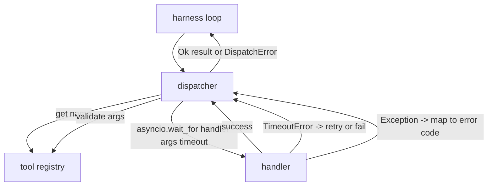
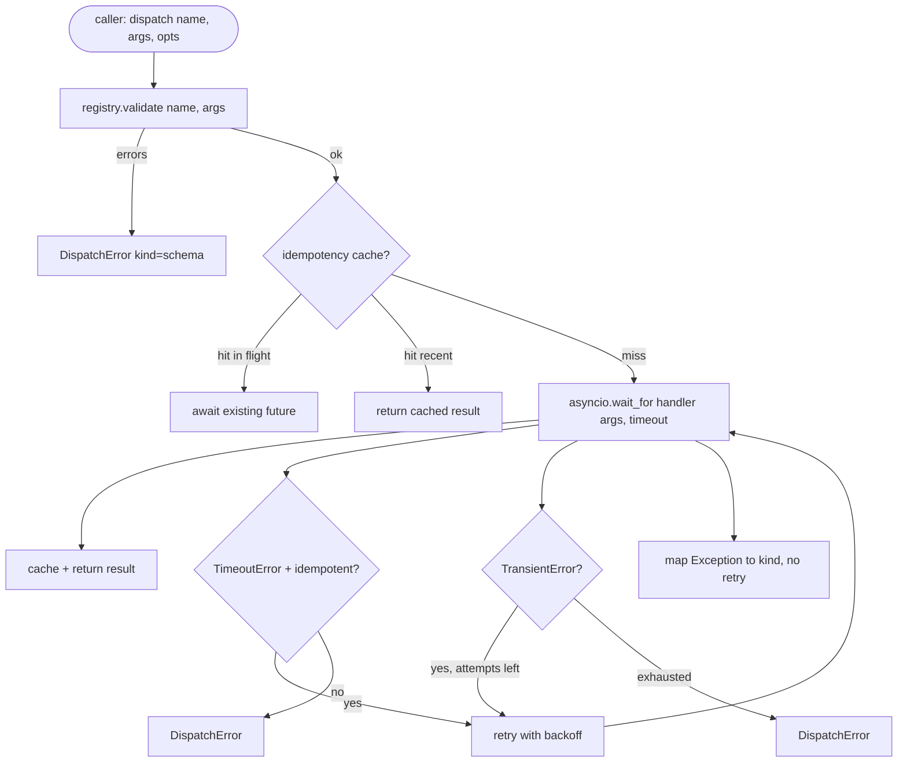

# Function Call Dispatcher

> Dispatcher 是 harness 为 schema 中每个承诺付账的地方。Timeouts、retries、dedupe、error mapping，全都集中在这一层边界上。

**Type:** Build
**Languages:** Python
**Prerequisites:** Phase 13 lessons 01-07, Phase 14 lesson 01
**Time:** ~90 minutes

## 学习目标

- 用 per-call timeout 包装 tool handler，让它返回 typed error，而不是挂住整个 loop。
- 应用带 jitter 和最大尝试次数的 exponential backoff retry。
- 基于 idempotency key 对 retries 去重，避免一个与慢速 original 竞争的 retry 被执行两次。
- 将 handler exceptions 和 transport faults 映射到 harness loop 已经理解的统一 error envelope。
- 用 concurrency limit 约束 parallel dispatch，避免四十个 tool calls 的 fan-out 耗尽 event loop。

## Dispatcher 所在的位置

它位于 harness loop（lesson twenty）和 tool registry（lesson twenty-one）之间。Transport（lesson twenty-two）把输入喂给 loop。Loop 把一个 tool call 交给 dispatcher。Dispatcher 调用 registry，运行 handler，然后返回 result 或 JSON-RPC-shaped error envelope。



Dispatcher 是唯一知道 timers、retries 和 idempotency 的层。Loop 不知道。Registry 不知道。Handler 不知道。隔离这些职责正是重点。

## Timeouts

每个 tool 都有默认 timeout。Registry record 携带 `timeout_ms`。当 harness 传入 per-call override 时，dispatcher 会覆盖默认值。这里使用 `asyncio.wait_for`。Timeout 发生时，handler task 会被 cancel，dispatcher 返回 `DispatchError(kind="timeout")`。

对 non-idempotent tools 来说，timeout 默认不是 retryable error。一个 `db.write` timeout 之后，可能已经 commit，也可能没有。Retry 可能会重复写入。Dispatcher 遵守 registry record 中的 `idempotent` flag。Idempotent tools 会 retry；non-idempotent tools 不会。

## 带 exponential backoff 的 retries

Retry policy 最多三次尝试。Backoff 是 exponential，并带 jitter。

```text
attempt 1  -> delay 0
attempt 2  -> delay 0.1s * (1 + random[0..0.5])
attempt 3  -> delay 0.4s * (1 + random[0..0.5])
```

只有 `timeout` 和 `transient` errors 会 retry。`schema` error、`not_found` 或 `internal` error 不会 retry。Schema errors 是 deterministic。Retry 不会改变结果，只会消耗 budget。

Retry loop 会尊重 harness 提供的 budget。如果 caller 的 budget 剩余 tool calls 为零，dispatcher 会在第一次 attempt 前 fail fast，并返回 `kind="budget_exceeded"`。

## Idempotency key dedupe

Original 仍在 in flight 时触发 retry，是一个真实的 production bug。第一次 call 在 4.9 秒时卡住（刚好低于 timeout）。Retry 在 5 秒时触发。现在两个 requests 同时竞争同一个 backend。如果这个 tool 是 `payments.charge`，你就收了两次钱。

Dispatcher 接收可选的 `idempotency_key`。如果某个 call 到来时，同一个 key 已经 in flight，dispatcher 会等待已有 future，并返回它的 result。Cache 在 completion 后保留 key 六十秒，用来吸收 late retries。

Key 是 caller 的责任。Harness 从 planner 派生它：`f"{step_id}:{tool_name}:{hash(args)}"`。Dispatcher 不自己发明 key，因为只从 arguments 派生 key 会让两个语义不同的 calls 看起来相同。

## Error envelope

失败的 dispatch 返回单一形状。

```text
DispatchError
  kind        : "timeout" | "transient" | "schema" | "not_found" | "internal" | "budget_exceeded"
  message     : str
  attempts    : int
  jsonrpc_code: int   (one of -32601, -32602, -32603)
```

Harness loop 将 `kind` 映射到下一个 state。`schema` 和 `not_found` 进入 `on_error` 并触发 replan。`timeout` 和 `transient` 进入 `on_error`，是否 replan 取决于 attempts。`budget_exceeded` 触发 `on_budget_exceeded`。

## Fan-out 的 concurrency limit

`gather(*calls)` 会同时运行所有 coroutines。四十个 tool calls 意味着四十个 open sockets 或四十个 subprocess pipes。大多数 backends 都不喜欢一个 client 发起四十个 parallel connections。

Dispatcher 用 semaphore 包装 `gather`。默认 concurrency limit 是八。每个 call 在 dispatch 前 acquire semaphore，并在完成后 release。Caller 看到的是 `gather`-shaped output，但实际 scheduling 是有界的。

## 单次 call 的流程



## 如何阅读代码

`code/main.py` 定义 `Dispatcher`、`DispatchError` 和 `TransientError`。Dispatcher 在构造时接收 registry。Async `dispatch(name, args, ...)` 是唯一入口。Per-attempt timeouts 在 `_run_with_retries` 内部用 `asyncio.wait_for` 直接应用。`gather_bounded(calls)` 使用 concurrency limit 运行多个 dispatches。

`code/tests/test_dispatcher.py` 覆盖 timeout firing、transient 上 retry、schema error 上不 retry、idempotency dedupe（两个带相同 key 的 concurrent calls 折叠为一次 handler invocation），以及 concurrency limiting（semaphore 的实际效果）。

Tests 使用 `asyncio.sleep(0)` 和 deterministic `Counter`-based handlers，所以它们会在毫秒级完成，不依赖 wall-clock timing。

## 继续扩展

Production dispatchers 通常还会添加两个扩展。第一，在每个 transition 上做 structured logging（loop 的 event stream 已经给了你一部分，但 dispatcher 也应该发出 `dispatch.attempt` 和 `dispatch.retry` events）。第二，circuit breakers：当某个 tool 在一个窗口内出现 N 次 failures 后，进入 cool-down period，dispatches 会立即返回 `kind="circuit_open"`，而不是尝试 handler。这两者都可以叠加在这个 dispatcher 之上，而不改变 contract。

Lesson twenty-four 会把 dispatcher 粘到一个 plan-and-execute agent 上，让你看到全部四个 pieces 如何一起运转。
