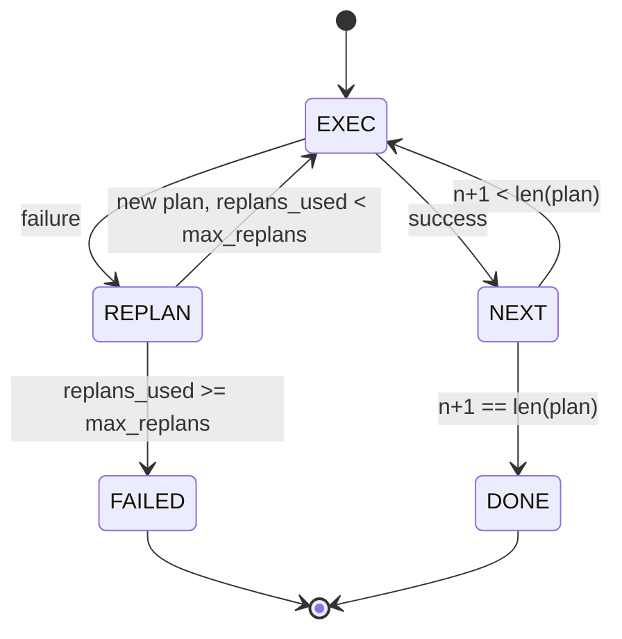

# Plan-Execute 控制流

> 无法经受失败的 plan 只是 script。能够 replan 的 script 才是 agent。先构建 replanner。

**Type:** Build
**Languages:** Python
**Prerequisites:** Phase 13 lessons 01-07, Phase 14 lesson 01
**Time:** ~90 minutes

## 学习目标

- 将 plan 表示为有序的 typed steps，让 executor 能推理 progress 和 outcome。
- 按顺序执行 steps，并在失败时把控制权受控地交回 planner。
- 从当前 cursor 开始 replan，并把 prior error 放进 context，让下一版 plan 有信息依据。
- 每次 revision 都发出 plan diff，让下游 tracer 或 UI 能展示 plan 为什么改变。
- 强制执行两个 budgets：hard step ceiling 和 hard replan ceiling。

## Plan and execute，而不是 chain-of-thought

Chain-of-thought agent 会发出 tokens，然后让 loop 猜 tool call 在哪里结束。Plan-and-execute agent 会先发出 structured plan，然后确定性地执行每个 step。Plan 是 harness 可以 introspect 的 data。Execution 是 harness 把这些 data 交给 dispatcher 运行。

两个部分。一个 planner 生成 plan。一个 executor 运行 plan。有趣的工作发生在 executor 遇到 failure 的时候。三种选择：

```text
1. Abort         (return failed, surface the error)
2. Skip          (mark step failed, continue with the rest)
3. Replan        (hand the error to the planner, get a new plan from the cursor)
```

Replan 是把 script 变成 agent 的那一步。

## Step shape

```text
Step
  id              : int           (monotonic within a plan revision)
  tool_name       : str
  args            : dict
  expected_outcome: str           (planner's stated success condition)
  result          : Any | None
  error           : str | None
```

`expected_outcome` 是 planner 随 step 一起发出的短句。Executor 不会强制检查它。它有两个用途：replanner 在修订 plan 时会读取它；event stream 会发出它，让 tracer 能展示 “this step was supposed to do X.”

## Planner shape

```python
def planner(goal: str, history: list[Step], last_error: str | None) -> list[Step]:
    ...
```

这是一个 pure function。`goal` 是 user goal。`history` 是已经执行过的 steps（其中 results 和 errors 已填入）。第一次调用时 `last_error` 是 None，之后每次调用都是最近一次 failure message。Planner 返回从 cursor 开始的 next plan。

Planner 不知道 executor。它不知道 retries。它不知道 timeouts。它只生成 plan。仅此而已。

## Executor

Executor 是一个小状态机。每个 step 都通过 dispatcher 运行。Outcome 有三种：success、failure-replannable、failure-fatal。Replannable failures 会交回 planner。Fatal failures（budget exceeded、replan ceiling hit）会返回一个 `FAILED` session result。



## Revision 上的 plan diffs

当 planner 在 failure 后返回一个新 plan 时，executor 会发出一个 `plan.diff` event，带三个 fields。

```text
removed: list of step ids that were in the old plan and are not in the new
added  : list of step ids in the new plan that were not in the old
revised: list of step ids whose tool_name or args changed
```

Tracer 或 UI 可以把它渲染成 removed steps 上的 strikethrough，以及 added steps 上的 highlight。重点不是 diff format。重点是 revision 是一个可见 event，而不是一次 silent rewrite。

## 两个 budgets，都是 hard

`max_steps` 限制整个 session 中 step executions 的总数，包括 replans。默认值是十二。一个线性的五步 plan 如果 replan 两次，并且每次新增三步，就会达到十六次 executions，从而超出 budget。Executor 会拒绝这个 replan，并返回 FAILED。

`max_replans` 限制第一次 plan 之后 planner 被调用的次数。默认值是五。这个 limit 更重要。一个 planner 如果连续五次返回同一个 broken plan，否则会一直 loop 到 step budget 抓住它。限制 replans 会让 failure 更快，也让原因更清楚。

## 本课中的 deterministic planner

本课不调用 model。课程提供一个 deterministic planner，它根据 `last_error` 选择 plan。

```text
last_error is None    -> emit a four-step plan
last_error matches X  -> emit a three-step plan that routes around X
last_error matches Y  -> emit a two-step plan that gives up gracefully
otherwise             -> return [] (signals nothing to replan)
```

这足以测试 executor 在每条 transition path 上的行为：success、replan-once、replan-twice、replan-exhaustion，以及 step-budget exhaustion。

## Result shape

```text
SessionResult
  status      : "completed" | "failed"
  reason      : str     ("goal_met" | "step_budget" | "replan_budget" | "no_plan")
  history     : list[Step]
  revisions   : list[PlanDiff]
  events      : list[Event]
```

第二十课中的 harness loop 可以直接读取它。第二十三课中的 dispatcher 执行每个 step。第二十一课中的 registry 验证每个 step 的 args。第二十二课中的 transport 会通过 JSON-RPC 把整个 flow 暴露给 model client。

## 如何阅读代码

`code/main.py` 定义 `PlanExecuteAgent`、`Step`、`PlanDiff`、`SessionResult`，以及 deterministic planner。Executor 是一个单独的 `run(goal)` method，返回 `SessionResult`。Plan diff 通过比较 step ids 和 `(tool_name, args)` tuples 计算。

`code/tests/test_agent.py` 覆盖 linear success、mid-plan failure 后 replan once、返回 `failed:replan_budget` 的 replan exhaustion、step-budget exhaustion，以及 plan-diff event format。

## 继续深入

接入真实 model 后，你会想要两个 extensions。第一，partial-plan caching：当一个六步 plan 的前三步成功、第四步失败时，你不想重跑前三步。Executor 已经保留 history；planner 只需要读取它。第二，parallel branches：当前 executor 是严格 sequential 的。如果 planner 发出 independent branch（`gather_step` 而不是 `next_step`），就可以通过 dispatcher 并发运行两个 tool calls。

两者都会带来真实复杂度。两者都更适合在 linear executor 已经被 pin 住之后添加。这就是本课做的事。
