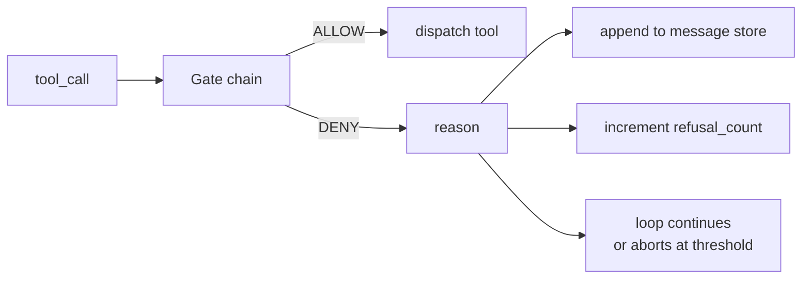
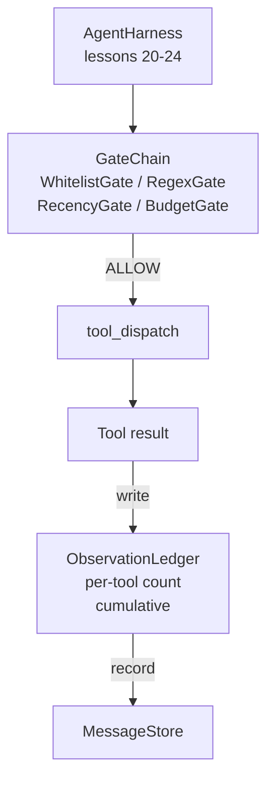

# Capstone Lesson 25：Verification Gates 与 Observation Budget

> 没有 verification layer 的 agent harness，只是披着外套的愿望。本课构建一条 deterministic gate chain：它决定一个 tool call 是否允许触发、agent 能看到多少 tool output，以及当 agent 已经读得太多时 loop 必须何时停止。这条 chain 由小而命名清晰的 gates 加上 observation ledger 组成；ledger 会追踪 model 已经看到的每一个 token。

**Type:** Build
**Languages:** Python (stdlib)
**Prerequisites:** Phase 19 · 20-24 (Track A1: agent loop, tool registry, message store, prompt builder, model router), Phase 14 · 33 (instructions as constraints), Phase 14 · 36 (scope contracts), Phase 14 · 38 (verification gates)
**Time:** ~90 minutes

## 学习目标

- 构建一个带 deterministic `evaluate(call)` method 的 `VerificationGate` protocol。
- 把 budget、recency、whitelist 和 regex gates 组合成一条具备 short-circuit semantics 的 chain。
- 通过按 tool 和 turn 索引的 `ObservationLedger` 追踪每一次 observation。
- 当 cumulative observation budget 会被超过时，拒绝 tool call。
- 暴露一个 structured `GateDecision` record，供 downstream observability ingest。

## 问题

当 agent harness 允许 model 自由调用 tools 时，真实使用的第一个小时内就会出现三类 bug。

第一类是 unbounded observation。对一个 200K-line repo 做 grep，会把 50 万 tokens 的 output 倒进下一轮。Model 每 kilobyte 只看到一个 match，剩下的 context 都被浪费了。Token bill 很高，而且 agent 在任务上变得更差，而不是更好。

第二类是 stale recency。一个 long-running task 会累积五十次 tool calls。Model 重新读取第三轮的第一个 `read_file`，并把它当作 live state。第 47 轮做出的 edits 没有出现，因为 prompt builder 先序列化了最早的 observations。

第三类是 privilege creep。一个 research task 从调用 `web_search` 开始，随后不知为何运行了 `shell`，因为 model 编造了一个 tool name，而 harness 默认 permissive。等有人读取 trace 时，`/tmp` 里已经有一个 junk file，并且某个 curl 已经打到了 private API。

Verification gate 是 harness 中负责说“不”的组件。它不是 model。它不是 judge。它是 `(call, history, ledger)` 的 deterministic function，返回带 reason 的 ALLOW 或 DENY。Reason 会被记录。Model 会被告知。Loop 继续或 abort。

## 概念



Gate 可以是任何具备 `evaluate(call, ctx) -> GateDecision` method 的对象。Chain 是一个 ordered list。Evaluation 会在第一个 deny 处 short-circuit。顺序很重要：便宜的 structural gates 要先于昂贵的 token-counting gates 运行。

本课提供四个 gates：

- `WhitelistGate`。Allowed tool names 是一个 explicit set。任何集合外的 tool 都会被 denied。这是最便宜的 gate，会第一个运行。
- `RegexGate`。Tool arguments 会与 regex 匹配。适合拒绝带 `rm -rf` 的 shell calls，或打向 internal IPs 的 HTTP calls。它只依赖 call payload。
- `RecencyGate`。Model 只看到最近 N turns 的 observations。更旧的 observations 会被 masked。若某个 tool call 的结果会扩展一个已经 aged out 的 observation window，gate 会拒绝它。
- `BudgetGate`。Model 在整个 session 中读过的 cumulative tokens 有 ceiling。当 ledger 显示 ceiling 已经达到时，之后所有 tool calls 都会被 denied。

Observation ledger 是 bookkeeping。每个成功 tool call 写入一行：tool name、turn、tokens emitted、cumulative。Ledger 回答两个问题：model 总共看过多少，以及它看过 tool X 的多少。Budget gate 读取前者。你会在练习中写的 per-tool budget gate 会读取后者。

## 架构



Harness 会询问 chain。Chain 要么点头，要么拒绝。如果点头，tool 运行，ledger 计数，result 被 append 到 message store。如果拒绝，model 会收到一条 system message 形式的 refusal，loop 决定 retry 还是 abort。

## 你将构建什么

实现是一个 `main.py` 加 tests。

1. `Observation` 和 `ToolCall` dataclasses 定义 wire shapes。
2. `ObservationLedger` 记录 `(turn, tool, tokens)` rows，并回答 `cumulative()` 和 `per_tool(name)`。
3. `GateDecision` 携带 `(allow, reason, gate_name)`。
4. `VerificationGate` 是 protocol。每个 gate 都实现 `evaluate(call, ctx)`。
5. `GateChain` 包装一个 ordered list。它依次调用每个 gate，返回第一个 deny；如果所有 gates 通过，则返回 allow。
6. Demo 运行一个很小的 synthetic agent loop。三轮。第三轮触发 budget gate，loop 报告一次干净的 refusal，并带 non-zero refusal count。

Token counter 故意使用很粗糙的 `len(text) // 4` heuristic。本课重点是 gate plumbing，而不是 tokenizer。Production 中应替换为真实 tokenizer。

## 为什么 chain order 很重要

Deny 比 allow 便宜。`WhitelistGate` 是 O(1) hash lookup。`RegexGate` 是 O(pattern * argv)。`RecencyGate` 读取 message store 的一个小 slice。`BudgetGate` 读取整个 ledger。你按 ascending cost 排序，让 denied call 在执行昂贵工作前 short-circuit。

你也按 blast radius 排序。Whitelist 是最强的 claim：这个 tool 不在 contract 中。Regex gate 紧随其后：这个 argument 不在 contract 中。Recency 之后：harness 仍然关心，但 call 在结构上合法。Budget 最后，因为按定义，它只会在其他所有检查都通过后触发。

## 它如何与 Track A 的其余部分组合

前几课已经给了你 loop、tool registry、message store、prompt builder 和 model router。本课加入 model 与 tools 之间的层。第 26 课会交付 sandbox：gate chain 说 ALLOW 后，dispatcher 会把 tool call 交给它。第 27 课会交付 eval harness，并把 refusal counts 记录为 quality signal。第 28 课会把 gate decisions 接入 OpenTelemetry spans。第 29 课会把这些部分缝合成一个可工作的 coding agent。

## 运行方式

```bash
cd phases/19-capstone-projects/25-verification-gates-observation-budget
python3 code/main.py
python3 -m pytest code/tests/ -v
```

Demo 会打印逐轮 trace，包括每个 gate decision，并以 0 退出。Tests 覆盖 ledger、每个 gate 的 isolation、chain short-circuit，以及 synthetic loop end-to-end。
