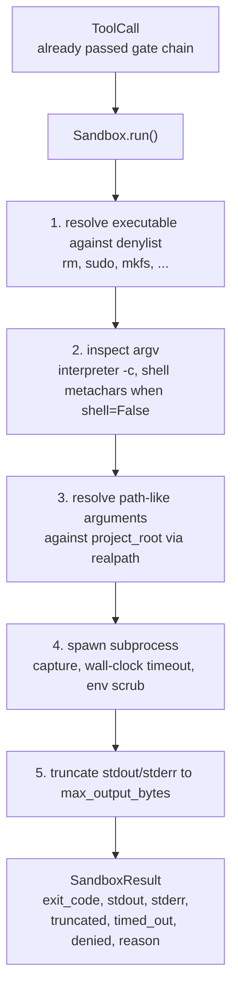
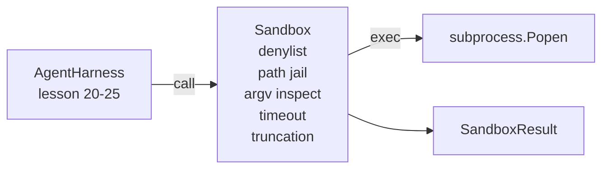

# Capstone Lesson 26: 带拒绝列表和路径 Jail 的沙箱运行器

> 验证门决定一次工具调用是否应该运行；沙箱决定它真正运行时会发生什么。本课会交付一个子进程运行器：拒绝危险可执行文件，拒绝危险的 argv 形状，把每个文件路径限制在项目根目录内，截断过大的输出，并用墙钟超时杀掉失控进程。它是模型和操作系统之间两层防线中的第二层。

**Type:** Build
**Languages:** Python (stdlib)
**Prerequisites:** Phase 19 · 25 (verification gates and observation budget), Phase 14 · 33 (instructions as constraints), Phase 14 · 38 (verification gates)
**Time:** ~90 minutes

## Learning Objectives

- 构建一个封装 `subprocess.run` 的 `Sandbox` 类，支持超时、输出捕获和截断。
- 根据拒绝列表中的命令名，以及 argv 检查器中的结构规则，拒绝一次命令。
- 拒绝任何解析后落在声明项目根目录之外的路径参数。
- 在 shell 模式关闭时拒绝 shell 元字符。
- 返回结构化的 `SandboxResult`，让下游可观测性代码和评测框架可以直接消费。

## The Problem

一个能调用 shell 的编码 agent，可以在一次回合里安装后门、窃取密钥、弄坏开发者电脑，或者刷出云账单。成本最低的防御是不要给它 shell。第二低成本的防御，是用一个沙箱对一组精确模式说“不”。

agent 轨迹里会反复出现三类失败。

第一类是危险命令本身。`sudo`、`chmod -R 777`、`rm -rf`、`mkfs`、`dd` 这类命令不应该出现在普通课程运行器里。它们既不帮助学习，也会把一个小失误变成真实损害。

第二类是危险 argv 形状。命令名可能看起来无害，但参数里藏着另一层解释器，例如 `python3 -c "import os; os.system('rm -rf sandbox')"`。如果 `shell=False`，命令里还不应该出现 `|`、`&`、`>`、反引号、`$(` 这类 shell 元字符。

第三类是路径逃逸。`../secrets.txt`、绝对路径、符号链接跳转，都可能把“只在项目目录内操作”的意图变成“改动项目外文件”。沙箱必须先把路径规范化到真实路径，再断言它仍然以项目根目录为前缀。

## The Concept

第 25 课的验证门是运行前策略：它判断一次工具调用是否通过约束链。本课的沙箱是运行时包裹层：它假设调用已经通过验证门，然后在真正生成子进程之前再次收紧边界。



结果对象用普通退出码表达真实进程结果，并用哨兵退出码表达沙箱层的拒绝或超时。调用方不需要解析散乱字符串，只要检查 `denied`、`timed_out`、`truncated` 和 `reason` 即可。

## Architecture



沙箱不是调度器，也不是策略引擎。它只回答一个窄问题：这个已经被选中的命令，能否在当前项目根目录和当前运行预算下安全地启动，并且如何把结果交回给 harness。

## What you will build

1. `SandboxResult`：保存 `exit_code`、`stdout`、`stderr`、`duration_ms`、`timed_out`、`truncated`、`denied` 和 `reason`。
2. `SandboxConfig`：保存项目根目录、拒绝列表、超时时间、最大输出字节数，以及环境变量清理规则。
3. `Sandbox.run(argv, cwd=None)`：接收 argv 列表，执行所有检查，启动子进程，并返回 `SandboxResult`。
4. `_check_path_jail`：识别像路径的参数，使用 `realpath` 解析，再拒绝任何不在项目根目录下的路径。
5. argv 检查器：拒绝危险解释器形状、shell 元字符和拒绝列表命令，包括 `/bin/rm`、`/usr/bin/rm` 这类带路径的形式。
6. 单元测试和演示：覆盖允许命令、拒绝命令、路径逃逸、输出截断、超时和结构化结果。

## Why this is not a real sandbox

这个组件不是操作系统级安全边界。它没有提供容器、虚拟机、`chroot`、命名空间、seccomp、macOS sandbox profile、用户隔离或网络隔离。拒绝列表也不是完备安全模型；它只是一个可读、可测、适合教学的防护层。

真实对抗环境需要更硬的边界：最小权限用户、只读挂载、临时工作目录、网络禁用、资源限制、进程树清理、容器或虚拟机隔离，以及默认拒绝的工具 allowlist。本课的重点是让 agent harness 先拥有一个确定性、可观察、可组合的运行时防线。

## Running it

```bash
cd phases/19-capstone-projects/26-sandbox-runner-denylist
python3 code/main.py
python3 -m pytest code/tests/ -v
```

演示应该展示：安全命令会返回零退出码；危险命令会在生成子进程之前被拒绝；失控命令会触发超时；过大的输出会被截断，同时 `SandboxResult` 会保留足够的元数据供后续观测和评测使用。

## How this composes with the rest of Track A

第 25 课的 gate chain 负责在工具调用进入运行器之前做策略判断。本课的 sandbox 负责在运行器真正接触操作系统之前做最后一道运行时检查。

第 27 课的评测 harness 可以把这个沙箱作为固定执行后端，这样 fixture task 不会意外越界。第 28 课的可观测性链路可以把 `SandboxResult` 转成 span 属性和事件。第 29 课的端到端编码任务 demo 则把验证门、沙箱、评测和观测合在一起，形成一条完整的安全执行路径。
