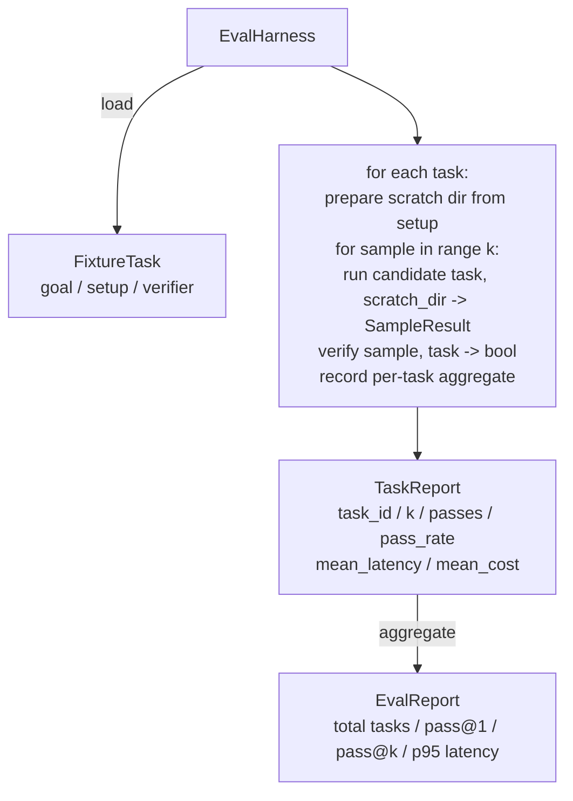

# Capstone Lesson 27: 使用 Fixture 任务的评测 Harness

> 编码 agent 的质量，取决于你用来度量它的任务套件。本课会构建一个评测 harness：它接收一组 fixture 任务目录，把每个任务交给候选 agent 执行，用确定性 verifier 给出通过或失败，并把结果聚合成 pass@1、pass@k、平均延迟和平均成本。这个 harness 是区分回归和重构的事实来源。

**Type:** Build
**Languages:** Python (stdlib)
**Prerequisites:** Phase 19 · 25 (verification gates), Phase 19 · 26 (sandbox runner), Phase 14 · 30 (eval-driven agent development), Phase 14 · 19 (SWE-bench and GAIA benchmarks)
**Time:** ~90 minutes

## Learning Objectives

- 把 fixture task 定义为 goal、setup 和 verifier 三元组。
- 为每个任务评分多次 sample run，并计算 pass@1 和 pass@k。
- 把延迟和成本聚合成均值与第 95 百分位指标。
- 将确定性 verifier（文件 diff、退出码、正则匹配）接入可复用函数。
- 输出结构化 JSON 报告，让回归跟踪脚本可以直接摄取。

## The Problem

没有评测 harness 的 agent benchmark 会反复遭遇三类失败。

第一类是未经验证的通过。agent 声称它修好了 bug，人类扫一眼 diff，测试套件被标成绿色，三周后回归测试又暴露同一个 bug。agent 的推理看起来合理，但实际上什么也没修好。

第二类是未被发现的回归。一次 prompt template 变更让 agent 在显眼任务上好 4%，却在安静任务上差 14%。如果没有 goldset 和逐任务分数，这个回归会进入 main，直到客户投诉才浮出水面。

第三类是逐任务漂移。周一评测跑了 100 个任务，周五只跑了 95 个，因为有人重命名了 5 个 fixture。通过率看起来提高了 5%。其实没有。

harness 的作用，就是把这些失败变成事实。它每次都按可复现顺序运行每个 fixture，并用返回 true 或 false 的确定性检查器验证结果。

## The Concept

```mermaid
flowchart LR
  F1[fixtures/task_001/<br/>task.json + expected/] --> Harness
  F2[fixtures/task_002/<br/>...] --> Harness
  Harness[Harness<br/>for each task:<br/>setup / run agent k samples /<br/>verify each sample /<br/>record latency, cost]
  Harness --> Report[EvalReport<br/>pass@1 / pass@k<br/>mean ms / p95 ms<br/>mean cost]
```

`FixtureTask` 是一个小 JSON 文件，加上可选的 `expected/` 目录。JSON 声明 `id`、`goal`（喂给 agent 的 prompt）、`setup` 块（放入 scratch dir 的文件）和 `verifier` 块。`verifier` 块会命名 harness verifier registry 里的一个函数，并提供它的参数。

三种 verifier 形状可以覆盖大多数有用任务。

第一种是 `file_equals`。agent 运行之后，把指定文件和期望内容做比较。这适合捕捉“用这个精确方式修复这个 bug”的任务。

第二种是 `regex_match`。对指定文件内容做正则匹配。这适合捕捉“函数必须存在并返回 X”这类存在多种可接受解法的任务。

第三种是 `shell_exit_zero`。harness 通过第 26 课的沙箱运行一条 shell 命令，并且只有当命令以零退出码结束时才认为任务通过。这适合捕捉“测试必须通过”的任务。

harness 会把每个任务运行 `k` 次。Pass@k 是 `1 - (1 - p)^k`，其中 p 是经验通过率；harness 也报告原始计数，方便你发现方差。延迟是每个 sample 的墙钟时间。成本则来自 agent 自报（token 数、USD，或两者都有）；harness 会跨 sample 求和，并展示逐任务和整体数字。

```figure
pass-at-k
```

## Architecture



candidate 是一个 callable：`Callable[[FixtureTask, str], SampleResult]`。harness 用 `tempfile.mkdtemp()` 创建 scratch directory，并把它的路径作为普通字符串传给 candidate。harness 不关心 candidate 如何工作。candidate 可以是确定性 patch applier（适合 harness 自测）、真实 LLM agent，或者 fuzzer。契约就是 `SampleResult`。

## What you will build

`main.py` 会交付：

1. `FixtureTask` dataclass。
2. `SampleResult` dataclass：`success_self_reported`、`latency_ms`、`cost_units`、`edits`。
3. 带 `to_dict()` 的 `TaskReport`、`EvalReport` dataclass。
4. `VerifierRegistry`，把 verifier 名称映射到函数。内置 verifier：`file_equals`、`regex_match`、`shell_exit_zero`。
5. `EvalHarness` class。它针对候选对象运行一个任务目录，并返回 `EvalReport`。
6. 捆绑在 `tasks/` 里的五个 fixture task：
   - `fizzbuzz` 里的 off-by-one
   - `factorial` 里的 missing return
   - 错误消息里的 typo
   - 空函数体
   - linked-list traversal 里的 off-by-one
7. 一个确定性 reference candidate（`apply_known_fixes`），harness 用它演示干净的 pass@1 = 1.0。
8. demo 会打印 `EvalReport` JSON，并以零退出码结束。

fixture task 作为 JSON 文件捆绑在 `tasks/` 中，同时在 `tasks/<id>/buggy/` 和 `tasks/<id>/expected/` 下配有源文件。harness 会把 buggy 复制到 scratch dir，把它交给 candidate，然后对 expected 做验证。

## Why pass@k and not just pass@1

真实 LLM agent 是随机的。pass@1 为 0.6 看起来像失败；pass@5 为 0.95 则说明 agent 大多数时候能得到正确答案，但早期 sample 经常选错。此时修复方向是采样和排序，不一定是更多训练。Pass@k 会让这一点显现出来。

Pass@k 会和 pass@1 一起报告，因为 pass@k 也会掩盖真实失败：如果模型试 20 次才对 1 次，你并没有一个可用的 agent。harness 会同时展示两者。

## How this composes with the rest of Track A

第 25 课产出了 gate chain。第 26 课产出了 sandbox。harness 会在任何 `shell_exit_zero` verifier 中使用 sandbox。第 28 课会把每次 harness 运行包进一条 OTel trace。第 29 课会在捆绑 fixture 的其中一个任务上运行端到端 demo，并断言 reference candidate 的 pass@1 = 1.0。

## Running it

```bash
cd phases/19-capstone-projects/27-eval-harness-fixture-tasks
python3 code/main.py
python3 -m pytest code/tests/ -v
```

demo 会以 JSON 打印 `EvalReport`，其中包含 pass@1、pass@5、平均延迟和逐任务明细。退出码为零。测试会覆盖 verifier 函数、pass@k 数学、fixture 加载，以及捆绑 reference candidate 的 harness 端到端运行。
