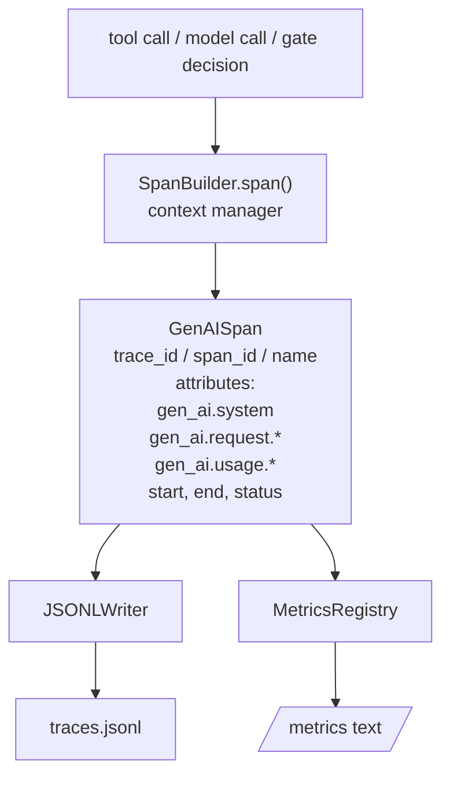
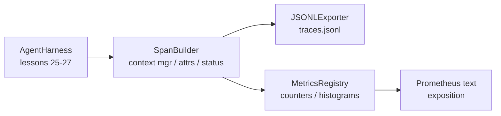

# Capstone Lesson 28: 使用 OTel GenAI Span 和 Prometheus 指标做可观测性

> 没有可观测性的 agent harness，就是一个会花钱的黑盒。本课会手写一个 span builder：它发出符合 OpenTelemetry GenAI 语义约定的记录，把它们写入 JSON-Lines 文件，每行一个 span，并用 Prometheus 文本格式暴露 counter 和 histogram。整个实现只用 Python 标准库，并且可以离线运行。

**Type:** Build
**Languages:** Python (stdlib)
**Prerequisites:** Phase 19 · 25 (verification gates), Phase 19 · 26 (sandbox), Phase 19 · 27 (eval harness), Phase 13 · 20 (OpenTelemetry GenAI), Phase 14 · 23 (OTel GenAI conventions)
**Time:** ~90 minutes

## Learning Objectives

- 构建一个符合 OpenTelemetry GenAI 语义约定形状的 span data class。
- 实现一个 JSONL exporter，每行写入一个自包含 span。
- 构建带 label 的 counter 和 histogram，并输出 Prometheus text-format exposition。
- 用 span context manager 包裹任意 callable，记录耗时、状态和异常。
- 验证发出的 span 能通过 `json.loads` 往返解析，并符合规范形状。

## The Problem

生产环境里的编码 agent 每个回合都会产生三类 artifact：一次模型调用、一次工具执行，以及一次 verification gate 决策。没有结构化 telemetry，这些 artifact 都很难派上用场。

第一类失败是缺失 trace。周二出了问题，但唯一记录是一段 500 行聊天日志。没有记录说明哪个工具运行过、耗时多久、prompt 里放了多少 token，或者 gate 是否拒绝了什么。agent 作者只能猜。

第二类失败是不可解析的 trace。harness 写了 span，却使用了自己临时发明的字段名。Grafana、Honeycomb、Jaeger 或本地 CLI 里的任何工具都读不懂它们。团队栈里已有的工具能力被浪费了，因为 span 不是标准格式。

第三类失败是没有聚合指标。你可以在 trace 里看到一次很慢的工具调用，却无法回答“过去一小时里 `read_file` 调用的 p95 latency 是多少？”这个问题，因为你只有 trace，没有 metric。

OpenTelemetry GenAI 语义约定正是为此存在的。它们定义了一小组标准属性，让不同 LLM 框架里的 span emitter 共享同一种字段语言。只要 harness 写出这些属性，任何 OTel 兼容后端都能读取。

## The Concept



harness 中的每个 operation 都会产生一个 span。span 包含 trace id（整次 agent invocation）、span id（当前这一个 operation）、name（例如 `gen_ai.chat`、`gen_ai.tool.execution`）、遵循 GenAI 约定的 attributes、开始和结束时间，以及 status。

GenAI 约定标准化了这些属性键：`gen_ai.system`（provider，例如 `anthropic`、`openai`）、`gen_ai.request.model`（model id）、`gen_ai.request.max_tokens`、`gen_ai.usage.input_tokens`、`gen_ai.usage.output_tokens`、`gen_ai.response.model`、`gen_ai.response.id`、`gen_ai.operation.name`，以及工具专用键 `gen_ai.tool.name` 和 `gen_ai.tool.call.id`。

exporter 写出 JSONL。每行一个 JSON object。这是下游工具可以 stream、grep 和 import 的最简单格式。真实 OTel exporter 会使用 OTLP gRPC；本课的 JSONL exporter 是离线等价物，并且能在每台工作站上以零退出码运行。

metric 与 trace 并排存在。每次工具调用都会递增一个 counter：`tools_called_total{tool="read_file"}`。histogram 会记录观测到的延迟：`tool_latency_ms{tool="read_file"}`。两者都会序列化成 Prometheus text exposition format，这是 pull-based metrics 的事实标准。

```figure
trace-spans
```

## Architecture



`SpanBuilder` 是入口点。它创建 `GenAISpan`，填入 W3C 风格的 trace/span id，记录 nanosecond timestamp，并在 context manager 退出时把 status、exception event 和结束时间写入 span。然后它把 span 交给 exporter，同时更新 metrics。

`JSONLExporter` 负责持久化 trace。`MetricsRegistry` 负责在内存里维护 counter 和 histogram。`prometheus_exposition(registry)` 把这些指标渲染成 Prometheus 文本格式，因此本地 demo、CI 日志和后续课程都能直接读取。

## What you will build

`main.py` 会交付：

1. `GenAISpan` dataclass：`trace_id`、`span_id`、`parent_span_id`、`name`、`attributes`、`start_unix_nano`、`end_unix_nano`、`status`、`status_message`、`events`。
2. `SpanBuilder` class，提供 `span(name, attrs, parent=None)` context manager。
3. `JSONLExporter` class，提供 `export(span)`，每次追加一行。
4. `Counter` 和 `Histogram` class，以及 `MetricsRegistry`。
5. `prometheus_exposition(registry)`，生成 text-format output。
6. `wrap_tool_call(name)` decorator，发出 span 并更新 metrics。
7. demo：合成一次完整 agent invocation（`gen_ai.chat` span 包住 tool span），写出 `traces.jsonl`，打印 Prometheus exposition，并以零退出码结束。

## Why hand-rolled instead of opentelemetry-sdk

OTel Python SDK 是真实依赖。它也包含数千行代码，OTLP exporter 涉及多个进程，而且运行时成本会淹没一节课的预算。手写版本教的是 wire format。生产环境里，你会把同一组 attributes 接入真实 SDK，然后得到 OTLP exporter、batching 和 resource detection。

这些约定是稳定的。本课发出的 wire format 到 2030 年也会继续可解析，因为 OTel 不会破坏 GenAI attribute 名称；它们只会添加新名称。

## How this composes with the rest of Track A

第 25 课产出了 gate chain。第 26 课产出了 sandbox。第 27 课产出了 eval harness。第 28 课让这三者都变得可观察。第 29 课会把端到端 demo 的每一步都包进 span，并在最后打印 Prometheus 文本。

## Running it

```bash
cd phases/19-capstone-projects/28-observability-otel-traces
python3 code/main.py
python3 -m pytest code/tests/ -v
```

demo 会在课程工作目录中发出一个 `traces.jsonl`（结尾会清理），然后打印三个 span 的 sample，再打印 counter 和 histogram 的 Prometheus exposition。测试会验证 span 可以序列化并往返解析、标准 GenAI attributes 存在、counter 能正确递增，以及 histogram exposition 包含期望的 bucket counts。
