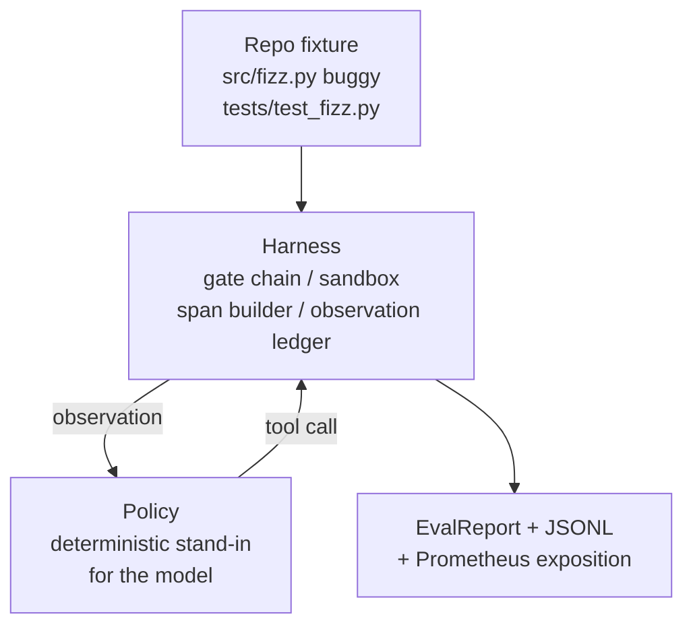
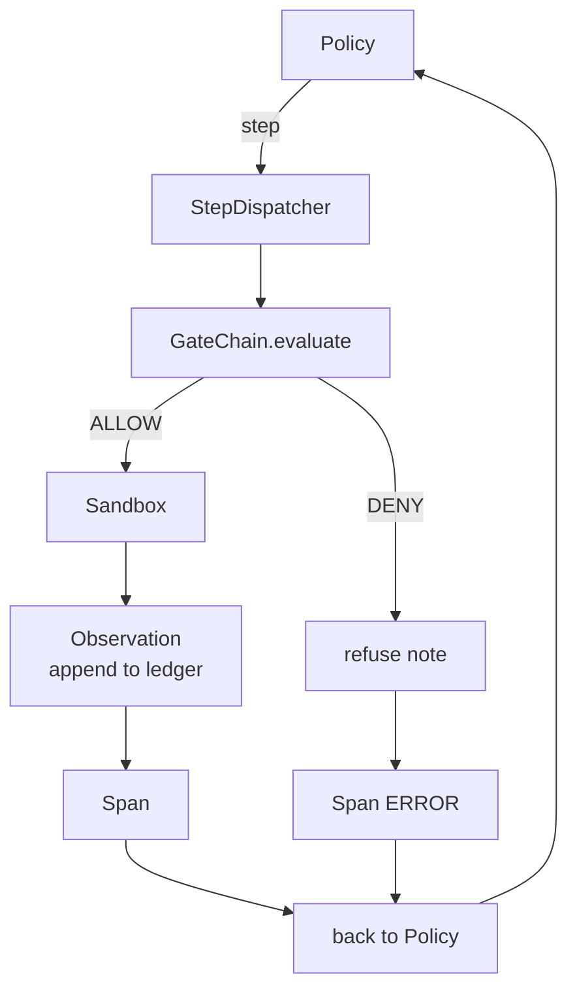

# Capstone Lesson 29: Harness 上的端到端编码 Agent

> 这是 Track A 的兑现时刻。本课会把 gate chain、sandbox、eval harness 和 OTel span 缝合成一个可工作的编码 agent，在一个多文件 Python 项目里修复一个真实但很小的 fixture 级 bug。这个 agent 是确定性 policy，不是 LLM；这种替换让课程可复现，也说明真正有意思的部分一直是 harness。契约保持相同：真实模型可以接入 policy 这个位置。

**Type:** Build
**Languages:** Python (stdlib)
**Prerequisites:** Phase 19 · 25 (verification gates), Phase 19 · 26 (sandbox), Phase 19 · 27 (eval harness), Phase 19 · 28 (observability), Phase 14 · 38 (verification gates), Phase 14 · 41 (workbench for real repos), Phase 14 · 42 (agent workbench capstone)
**Time:** ~90 minutes

## Learning Objectives

- 把 gate chain、sandbox、eval harness 和 span builder 组合成一个 agent loop。
- 实现一个确定性 policy，使用 `read_file`、`run_tests` 和 `write_file` 修复 fixture bug。
- 在端到端运行中强制执行全局 step budget 和 observation token budget。
- 为完整运行发出 OTel GenAI trace 和 Prometheus metrics。
- 验证 agent 在少于 12 步内解决 fixture，并且合法工具触发零次 gate trip。

## The Problem

多数 agent demo 都是孤立运行的：一个单独的 sandbox、一个单独的 eval harness、一个单独的 span emitter。它们看起来都没问题。一旦组合起来，接缝就会显现。

gate chain 说 ALLOW，但 sandbox 因为 chain 没预料到的原因拒绝执行。eval harness 记录为 pass，但 OTel span 显示 gate 拒绝了 agent 声称使用过的工具。Prometheus counter 本该递增一次，却递增了两次。observation budget 被超出，但 agent 仍继续运行，因为预算只在 chain 里跟踪，sandbox 并不知道。

本课是整条 track 的集成测试。agent 必须按顺序完成这些事：读取项目、运行测试、根据测试失败识别 bug、写入修复、重新运行测试，然后停止。每个 operation 都经过 gate chain。每次工具执行都经过 sandbox。每一步都包在 span 里。最后由 eval harness 给整个过程评分。

## The Concept



agent 的 policy 是一个状态机。它有五个状态。

`SURVEY`：agent 读取项目列表。下一个状态是 `RUN_TESTS`。

`RUN_TESTS`：agent 运行测试命令。如果测试通过，状态机以成功停止。否则下一个状态是 `INSPECT`。

`INSPECT`：agent 读取失败的源文件。下一个状态是 `FIX`。

`FIX`：agent 写入修正后的文件。下一个状态是 `VERIFY`。

`VERIFY`：agent 再次运行测试命令。如果测试通过，以成功停止。否则以失败停止。

每个状态都对应一次工具调用。每次工具调用都通过 gate chain。如果某次工具调用被拒绝，agent 会在 trace 中报告拒绝并停止。

fixture bug 是 `fizz.py` 里的 off-by-one。确定性 policy 会通过正则表达式从测试失败消息里检测 bug，并发出修正后的文件。把 policy 替换成 LLM 不会改变 harness 契约。

## Architecture



dispatcher 是连接 policy 和 harness primitive 的薄层。policy 只发出工具调用意图；dispatcher 负责把它送进 gate chain，调用 sandbox，追加 observation，更新 span 和 metrics，并把结果交回 policy。

## What you will build

`main.py` 会交付：

1. 以和第 25-28 课相同名称复制的最小 harness primitives：`GateChain`、`Sandbox`、`ObservationLedger`、`SpanBuilder`、`MetricsRegistry`。
2. `CodingAgentPolicy` class：带五个状态的状态机。
3. `Repo` helper：准备一个包含捆绑 buggy fixture 的 scratch dir。
4. `AgentRun` class：驱动 policy，通过 harness dispatch，并返回 `AgentRunReport`。
5. 一个捆绑 fixture（`fixture_repo/`），包含 `src/fizz.py`、`tests/test_fizz.py`，以及供 eval harness 使用的 `expected/` tree。
6. demo：端到端运行 policy，打印逐步 trace，断言通过，并打印 metrics。

## Why the policy is not an LLM

真实 LLM 需要 API key、网络调用和不可验证的随机性。本课关心的是 harness。替换成确定性 policy，可以让课程在任何开发者电脑上运行，不需要外部依赖，也让测试套件能够断言精确的 step count。

本课的 policy 是 LLM agent 行为的严格子集。policy 读取 repo，看到失败测试，识别行号，并发出修复。LLM 会在同一个 harness 契约下走同一条 loop；bookkeeping 完全相同。

## What the demo asserts

端到端 demo 在退出时断言五件事，测试套件也会以程序方式重新断言它们。

policy 在少于 12 步内解决了 fixture。

observation budget 从未被超出。

合法工具触发了零次 gate denial。（agent 从未编造一个会被拒绝的工具名。）

每一步在 `traces.jsonl` 中都有对应 span。

Prometheus exposition 包含 `tools_called_total{tool="read_file"}` 条目和 `tool_latency_ms` histogram。

## How this composes with the rest of Track A

本课就是集成层。第 25 课写了 gate chain。第 26 课写了 sandbox。第 27 课写了 eval harness。第 28 课写了 observability。第 29 课证明它们可以作为一个系统工作。真实 agent harness 会从这里扩展：把确定性 policy 换成模型，把捆绑 fixture 换成真实 repo 任务，把 JSONL exporter 换成 OTLP。

## Running it

```bash
cd phases/19-capstone-projects/29-end-to-end-coding-task-demo
python3 code/main.py
python3 -m pytest code/tests/ -v
```

demo 会打印逐步 trace、最终 eval report 和 Prometheus exposition。退出码为零。测试覆盖 policy 状态转移、合成工具调用上的 gate refusal、捆绑 fixture 上的端到端运行，以及 step-budget invariants。
