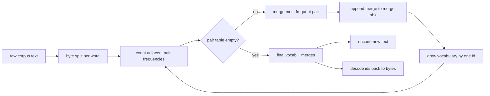
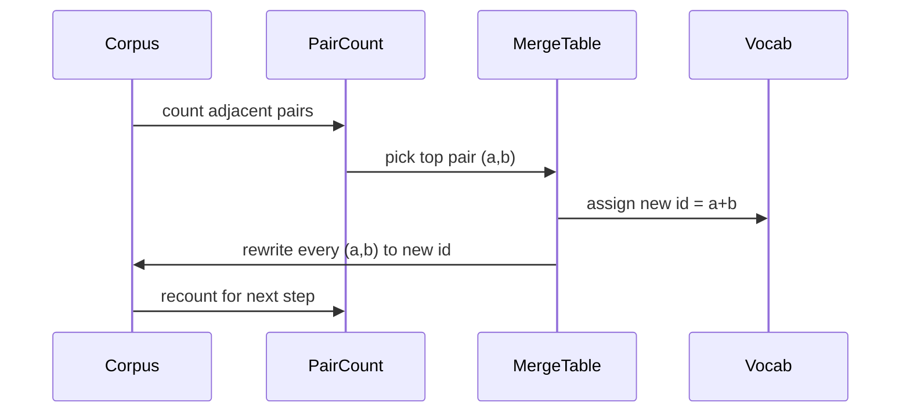

# 从零实现 BPE Tokenizer

> 字节进入，id 出来，id 再回到同一串字节。构建每个现代文本模型仍然从这里开始的 tokenizer。

**Type:** Build
**Languages:** Python
**Prerequisites:** Phase 04 lessons, Phase 07 transformer lessons
**Time:** ~90 minutes

## Learning Objectives
- 通过反复合并最频繁的相邻 symbol pair，从原始文本语料训练一个 Byte-Pair Encoding vocabulary。
- 实现确定性的 merge table，并把它应用到新文本上，生成 subword id 流。
- 将任意 UTF-8 输入 round-trip 成 id 再还原回来，不丢失信息。
- 预留并保护 special tokens（`<|endoftext|>`、`<|pad|>`），让它们在训练和解码中保持稳定。
- 解释为什么 byte-level alphabet 是通用 tokenizer 的正确底层基础。

## The frame

语言模型从来不会直接看见文本。它看见的是整数。把字符串映射成整数列表，再映射回来的那一层，就是 tokenizer。如果这一层做错了，训练过程中的每一条 loss curve 都在测量错误的东西。

面向通用文本模型的 subword tokenizer 中，Byte-Pair Encoding 是主流家族之一。它的想法很小：从一个已知 alphabet 开始，找到训练语料中出现最频繁的相邻 symbol pair，把它合并成一个新 symbol。重复这个过程，直到 vocabulary 达到目标大小。编码新文本时，则按同样顺序复用同一份 merge list。

我们会构建 byte-level 变体。alphabet 是 256 个原始 byte，而不是 Unicode code point。正是这个选择，让 tokenizer 能处理任意 UTF-8 输入，而不需要回退到 unknown token。

## The pipeline

训练侧和推理侧共享同一份 merge table。这种共享就是契约。如果你在推理时改变 merge 顺序，就会解码出另一条不同的 id 流。

## The byte alphabet

前 256 个 id 预留给原始 byte `0x00` 到 `0xFF`。这保证每个输入字符串在任何 merge 发生之前，都已经能用 vocabulary 表达。byte block 之后，我们再为 special tokens 预留一小段范围。训练循环永远不会把这些 id 作为 merge target，因为我们会把它们完全排除在预分词流之外。

pretokenizer 会在训练看到语料之前，按空白和标点边界切分 corpus。没有这个切分，BPE merge 步骤会很乐意学习跨越词边界的 merge，vocabulary 会被常见整句或短语填满。有了切分，merge 会留在词内部，结果更容易泛化。

## The training loop

每个训练 step 都做三件事。它遍历 corpus 中的每个 word，统计当前 symbol 序列里每个相邻 pair 的出现次数，并按这个 word 自身出现的频率加权。它选择 count 最高的 pair。然后把这个 pair 的每次出现重写成一个新 symbol，新 symbol 的 id 是 vocabulary 中下一个空位。最后记录这次 merge。

每一步的成本，与用 symbol sequence 列表表达的 corpus 大小呈线性关系。对于一百万个 word、目标 vocabulary 为一万个 id 的设置，循环也能在数秒内完成，因为随着 merge 生效，symbol sequence 会逐渐变短。

## Encoding fresh text

推理阶段不会调用 merge counter。它会按学习到的顺序应用 merge table。对于一个新 word，encoder 从 byte split 开始。它扫描当前序列，寻找 rank 最低的 merge，也就是最早学到且当前可应用的 merge。执行这次 merge 后，它再次扫描。直到 merge table 里没有任何 merge 能应用到当前序列，循环结束。

按 rank 排序这一点，让编码过程具有确定性，并且能在相同输入上匹配训练行为。越早学到的 merge 越靠近 table 顶部，也会越先应用。如果两个 merge 可以应用在同一位置，rank 更低的那个胜出。

## Special tokens

Special token 是 byte stream 永远不会自然产生的 id。我们手动预留它们。本课两个就够了。

- `<|endoftext|>` 在预训练中分隔文档。它告诉模型：“这里开始一个新文档，不要让前一个文档的上下文泄漏进来。”
- `<|pad|>` 填充短序列，让一个 batch 可以组成矩形 tensor。训练时 loss mask 会隐藏它。

encoder 接受一个 flag，控制是否允许输入中出现 special token。flag 关闭时，字符串 `<|endoftext|>` 和 `<|pad|>` 会被当作拼出它们的普通 byte 来 tokenize。flag 开启时，这些字面字符串会映射到预留 id，并且不会参与任何 merge。

## Round-trip guarantee

先 encode 再 decode，必须精确返回输入 bytes。decoder 会按顺序拼接每个 id 的 byte expansion。由于每个 id 要么是原始 byte，要么是两个已知 id 的拼接，递归展开总会终止在原始 byte 上。然后 decoding 返回这些 byte 拼出的 UTF-8 字符串。

本课测试套件会在未见过的句子、包含 Unicode emoji 的句子，以及包含字面 `<|endoftext|>` token 的句子上检查这个性质。

## What this lesson does not do

它不会构建最大型生产 tokenizer 那种 regex-driven pretokenizer。这里的 pretokenizer 只是一个很小的空白和标点切分器。它足以在小训练语料上产生合理 merge，并且与后续课程链条的契约保持不变。下一课会把 tokenizer 当作黑盒，在它之上构建 sliding-window dataset。

它也不会并行化 pair counter。Python 循环处理几千个 word 的 corpus，远不到一秒就能完成。对于更大的 corpus，显然的做法是按 word 并行统计 pair，然后 reduce。

## How to read the code

`main.py` 定义了四个核心对象。`BPETokenizer` 保存 vocabulary、merge table 和 special-token table。`train` 是训练循环。`encode` 是推理路径。`decode` 是 byte 拼接。底部 demo 会在内置 corpus 上训练一个小 tokenizer，编码一个 held-out sentence，把 id 解码回来，并打印二者。`code/tests/test_bpe.py` 中的测试固定了 round-trip 性质、special-token 预留和 merge ordering。

运行 demo。然后把 demo 里的目标 vocabulary size 从 300 改成 600，观察 held-out sentence 的编码长度如何下降。那条曲线就是 BPE compression curve。
