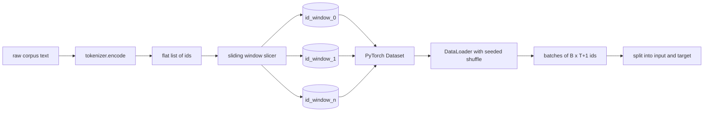
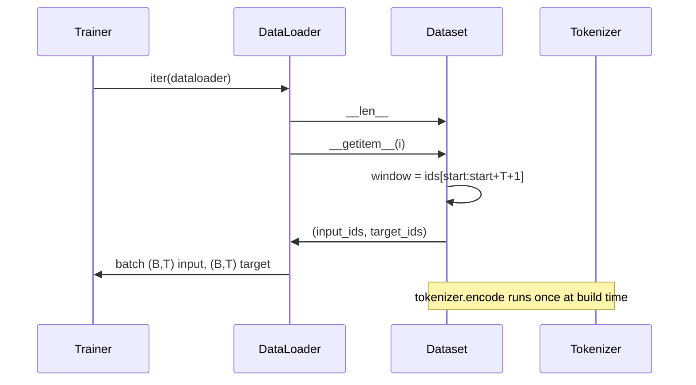

# 带 Sliding Window 的 Tokenized Dataset

> 一次 pretraining run 是从 token ids 到 gradients 的函数。本课构建把 ids 喂进去的传送带。

**Type:** Build
**Languages:** Python
**Prerequisites:** Phase 04 lessons, Phase 07 transformer lessons, Lesson 30 of this phase
**Time:** ~90 minutes

## 学习目标

- 通过调用一次 tokenizer，将 raw corpus 转换成 token ids stream。
- 用可配置 overlap stride，把 id stream 切成 fixed-length windows。
- 构建一个 PyTorch Dataset，为 next-token prediction 返回 input 和 target tensors。
- 用 DataLoader 包装 dataset，并使用 per-epoch seeded deterministic shuffle。
- 推理 stride、redundancy 和 effective dataset size 之间的权衡。

## 框架

一次 pretraining run 会一次读取一批 token ids，并更新 model。每个 batch 的 shape 由 training contract 固定。对于 causal language model，batch 中有 `(B, T)` input ids 和 `(B, T)` target ids，其中 target 是 input 左移一位。Data pipeline 的任务，是从可能有数 GB raw text 的 corpus 中，以 deterministic 和 reproducible 的方式按需产出这个 contract。

本课构建这条 pipeline。上一课的 tokenizer 把 text 转成一条很长的 flat ids list。Sliding window 把这条 list 切成 training examples。自定义 Dataset 把 examples 暴露为 tensors。DataLoader 将它们组成 batches，并用已知 seed shuffle。

## Shape contract

Causal LM 消费 shape 为 `(B, T)` 的 ids，其中 `B` 是 batch size，`T` 是 context length。位置 `t` 的 target 是位置 `t+1` 的 input。这意味着每个 training example 覆盖 `T+1` 个 raw ids。Window stride 控制连续 examples 之间有多少 overlap。

Slicer 永远不会跨越 corpus boundary。如果最后一个 window 没有足够 ids 填满 `T+1` 个位置，slicer 会丢弃它。用 `<|pad|>` padding tail 也是有效选择，但它会让 loss mask 变复杂。本课选择 drop。

## 为什么需要 sliding window

Pretraining corpus 是一条很长的 ids stream。如果 model 只看到 non-overlapping windows，每个 training example 都会教它同样的 `T` 个 boundaries。调整 stride 会移动这些 boundaries，让 model 看到更多样的 predict-next-token tasks。

Stride 为 `T` 时，windows 互不重叠。Stride 为 `T // 2` 时，会产生 50% overlap，并让 effective dataset 翻倍。Stride 为 `1` 时，overlap 最大，dataset 会按 `T` 倍增长。代价是每个 epoch 需要更多 compute。收益是更多 boundary diversity。多数 pretraining runs 会使用等于 context length 的 stride，因为 corpus 已经大到 model 一个 epoch 都跑不完，所以 boundary diversity 的论点会弱一些。

## Dataset class

PyTorch Dataset 有两个必需方法。`__len__` 返回 examples 数量。`__getitem__` 返回一个 example，形状是一对 tensors。我们的 Dataset 存储 encoded id stream 和 stride。索引时动态计算 window start，因此无论 stride 产生多少 examples，memory cost 都只是一份 id stream。

Shift-by-one 发生在 `__getitem__` 内部。Dataset 返回 `(input, target)`，其中 `input = window[:-1]`，`target = window[1:]`。两者都是 PyTorch long tensors。Training loop 会把它们当作 ground truth。

## Deterministic shuffle

带 `shuffle=True` 的 DataLoader 会从 PyTorch random generator 中读取。通过传入按 epoch seeded 的显式 `torch.Generator`，我们可以让每次 run 重启后都得到同样的 shuffle。当你想比较两个只差一个 hyperparameter 的 runs 时，这个性质很重要。没有 seed 时，两个 runs 会以不同顺序看到 data，loss curves 会因为与改动无关的原因而分叉。

本课中的 seed contract 很简单：`epoch_seed = base_seed + epoch_index`。Base seed 在构造时传入。Epoch index 由 trainer 在每个 epoch 顶部递增。使用同一个 base seed 重新运行时，每个 epoch 总会看到同样的顺序。

## Batch sampler

PyTorch 的默认 sampler 会无放回地均匀随机选择 indices。这正是 pretraining 所需的。对于小数据集上的 finetuning，contract 也相同。DataLoader 通过调用 `__getitem__` `B` 次并 stack results 来组装 batch。因为每个 example 都按 construction 拥有相同长度，所以不需要 padding logic。

本课为了简单，将 `num_workers=0`。在 production run 中，workers 会并行化 `__getitem__` calls。对我们的 pipeline 来说，这基本是 no-op，因为工作只是从 in-memory tensor 中 slice；但同一个 Dataset API 可以干净地支持 workers。

## Counting examples

对于长度为 `N` 的 id stream、context length `T` 和 stride `S`，examples 数量是 `max(0, 1 + (N - (T + 1)) // S)`。本课将这个计算暴露为 Dataset 上的 static method，让 trainer 无需迭代就能计算 total steps per epoch。

## 本课不做什么

它不从 disk stream。Corpus 会完整 encode 到 memory 中，并作为单个 tensor 持有。对于几百万 ids 的 corpus，这远低于一百 MB，而且正适合本课形状。Disk streaming 是另一个独立 concern，可以通过替换 storage 接进来，同时保持 Dataset contract 不变。

它不处理 multiple documents。Corpus 被当作一条连续 id stream。用多个 documents 构建 corpus 时，会通过插入 `<|endoftext|>` ids 来编码 next-document boundary。Model 会学习如何围绕这个 boundary 做 prediction。

## 如何阅读代码

`main.py` 定义两个 classes 和一个 helper。`SlidingWindowDataset` 是 PyTorch Dataset。`make_dataloader` 返回一个带 seeded generator 的 configured DataLoader。`_encode_corpus_to_ids` 是一次性的 tokenizer call。底部 demo 会在进程内构建一个小 tokenizer，encode 一个内置 corpus，构造 dataset 和 dataloader，打印一个 batch，并断言 shape contract。`code/tests/test_dataset.py` 中的 tests 固定 window count formula、shift-by-one property、deterministic shuffle 和 stride trade-off。

运行 demo。然后把 context length 从 16 改成 32，观察每个 epoch 的 examples 数量如何下降。那个数字就是你的 steps-per-epoch budget。
