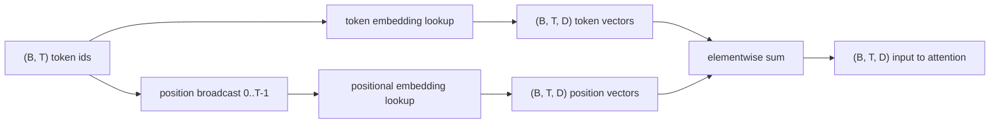
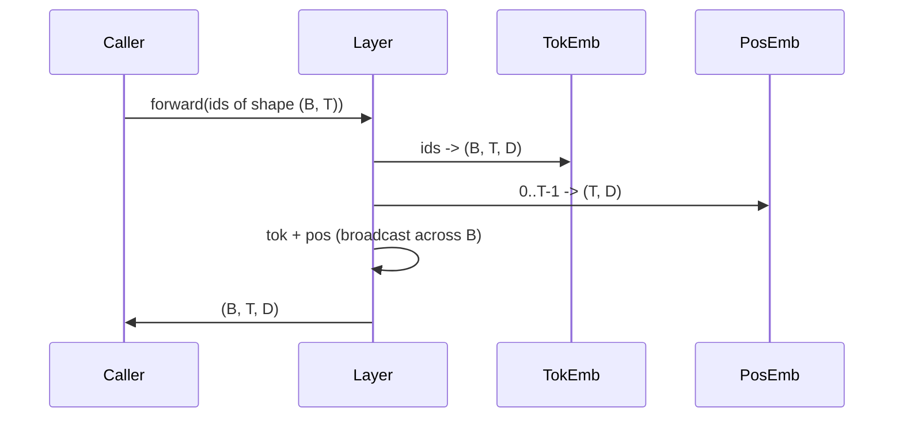

# Token 与 Positional Embeddings

> Ids 是整数。模型想要的是向量。它们之间隔着两张 lookup tables，而 positional table 的选择会塑造模型能学到什么。

**Type:** Build
**Languages:** Python
**Prerequisites:** Phase 04 lessons, Phase 07 transformer lessons, Lessons 30 and 31 of this phase
**Time:** ~90 minutes

## 学习目标

- 构建一个 token-embedding lookup table，把 vocabulary ids 映射为 dense vectors。
- 构建一个按 position index 的 learned positional-embedding lookup table。
- 构建一个按 position index 的 fixed sinusoidal positional embedding，不引入参数。
- 把 token embeddings 和 positional embeddings 组合成 transformer block 的单一输入。
- 对比 learned embeddings 与 sinusoidal embeddings 在 length generalization 和 parameter count 上的差异。

## 框架

模型第一次接触 token id，是在 token-embedding matrix 中做 row lookup。这个 matrix 每个 vocabulary id 一行，每个 model dimension 一列。Lookup 返回一个 vector，后续模型会把它当作这个 id 的 meaning。Backprop 会更新 forward pass 中用到的那些 rows。随着训练推进，这些 rows 的几何结构会学会在不同方向上编码 similarity。

只有 token ids 并没有顺序。模型需要第二个信号，告诉它 position one 和 position seventeen 不一样。这个信号有两个主流选择：learned positional embedding（一张第二 lookup table，每个 position 一行）和 fixed sinusoidal positional embedding（一个无参数的数学公式）。选择会带来后果。Learned table 是参数，并受限于模型训练时的 maximum context length。Sinusoidal table 理论上 parameter-free，公式可以扩展到任意 position；但本课的 `SinusoidalPositionalEmbedding` 会在 `max_context_length` 处预计算固定 table，超过这个 bound 时它的 `forward` 会 raise。因此这里两个 modules 都会强制最大 context length。即便 table 足够大能 index，模型在超过训练长度后仍然可能表现吃力。

本课会构建这两种 positional embedding，并把它们与 token embedding 组合成下一课 attention block 的单一输入。

## Shape contract

Embedding stage 的输入是一批 token ids，shape 为 `(B, T)`。输出是 shape 为 `(B, T, D)` 的 tensor，其中 `D` 是 model dimension。每个 batch element 都有相同的 context length `T`。每个 position 都有相同的 vector dimension `D`。



组合方式是 sum，不是 concatenation。Summing 会让 `D` 在整个网络中保持不变，也让模型可以在每个 feature 上自行决定 token meaning 还是 position 更占主导。

## Token embedding matrix

Token embedding 是一个 shape 为 `(V, D)` 的 parameter tensor，其中 `V` 是 vocabulary size。PyTorch 把它暴露为 `nn.Embedding(V, D)`。初始化时，entries 会从一个小 Gaussian 中采样；对 transformer-scale models 来说，传统上 mean 为 0，standard deviation 约为 `0.02`。具体 init 没那么重要，重要的是 across runs 保持一致。

Forward pass 是一次单独的 indexing operation。PyTorch 通过 gather rows，把 `(B, T)` 的 int64 ids 映射为 `(B, T, D)` 的 floats。Backward pass 只会把 gradients 累积到 forward pass 中被 touched 的 rows。两个没有出现在 batch 中的 rows，在这一步会收到 zero gradient。

一个细节：token embedding 和模型末端的 output projection 经常 share weights（weight tying）。发生这种情况时，每个 backward pass 都会通过 output side 触碰 embedding 的每一行。本课把二者作为独立 modules 暴露，但在完整模型中，同一个 matrix 可以同时扮演两个角色。

## Learned positional embedding

Learned positional embedding 是第二个 `nn.Embedding`，shape 为 `(max_context_length, D)`。Lookup 使用 position id `0, 1, 2, ..., T-1` 作为 key。Forward pass 会把 position vector broadcast 到 batch dimension。

Learned table 的缺点是：如果模型只训练到 position `T-1`，那它就不能查询 position `T`。这一行不存在。使用这种方案的 production decoder-only models 会把 maximum context length 烧进 architecture，并拒绝处理更长输入。

## Sinusoidal positional embedding

Sinusoidal positional embedding 是从 position 到 vector 的函数。Position `p` 和 feature `i` 会产生：

```python
angle = p / (10000 ** (2 * (i // 2) / D))
emb[p, 2k]     = sin(angle)
emb[p, 2k + 1] = cos(angle)
```

这个函数没有参数。每个 position 都有唯一 vector。Wavelength 会在 feature dimensions 上按几何方式变化，因此较低 dimensions 编码 coarse position，较高 dimensions 编码 fine position。

同时选择 `sin` 和 `cos` 带来的性质是：position `p + k` 的 vector 是 position `p` 的 vector 的线性函数。这给 attention layer 留出了一条容易学习 relative-position offsets 的路径。模型不需要一个单独参数来表达 “look five tokens back”。

本课在 construction 时一次性计算完整 sinusoidal table，并在 forward time index 它。

## 组合方式

Input pipeline 按顺序做三件事。读取 token ids。查找 token vectors。加上 positional vectors。返回 sum。



Sum step 中的 broadcasting 会沿 batch dimension 复制 `(T, D)` positional tensor。因为 positional tensor 在 unsqueeze 后 shape 是 `(1, T, D)`，PyTorch 会自动处理。

## Contrastive analysis

本课会在同一组 inputs 上运行两种 variants，并打印两个 diagnostics。

第一个是 parameter count。Learned variant 会在 token embedding 之外额外增加 `max_context_length * D` 个参数。Sinusoidal variant 增加 0 个。

第二个是 neighbouring positions 的 embeddings 之间的 cosine similarity。Sinusoidal variant 因为函数是连续的，会呈现平滑且可预测的 decay。Learned variant 在 initialization 时 similarity 接近随机，因为 rows 是独立采样的。训练之后，learned variant 通常也会发展出类似的 smooth structure，但它必须从数据中发现这个结构。

## 本课不做什么

本课不构建 rotary positional encoding（RoPE）或 AliBi。它们是 production transformers 中的现代选择。它们都遵循与这里 embeddings 相同的 shape contract（对 shape 为 `(B, T, D)` 的 vectors 应用 position-dependent transformation），但它们是在 attention-projection step 应用，而不是在 input 处应用。下一课会构建 attention block，其中一个 optional extension 是把 rotary 融入 query-key projections。

本课也不训练 embedding。Training 需要 loss，而 loss 需要 model output，model output 又需要 attention 和 LM head。那是下一课和再下一课的内容。

## 如何阅读代码

`main.py` 定义三个 modules。`TokenEmbedding` 包装 `nn.Embedding(V, D)`。`LearnedPositionalEmbedding` 包装 `nn.Embedding(L, D)`。`SinusoidalPositionalEmbedding` 预计算 table，并把它作为 buffer 暴露。`EmbeddingComposer` 把一个 token embedding 和一个 positional embedding 绑在一起。文件底部的 demo 会打印 shapes、parameter counts，以及 neighbour-position similarity diagnostic。`code/tests/test_embeddings.py` 中的 tests 固定 shape、broadcast behaviour、parameter count 和 sinusoidal formula。

运行 demo。然后把 model dimension `D` 从 64 改成 32，观察 sinusoidal wavelength bands 如何变化。
