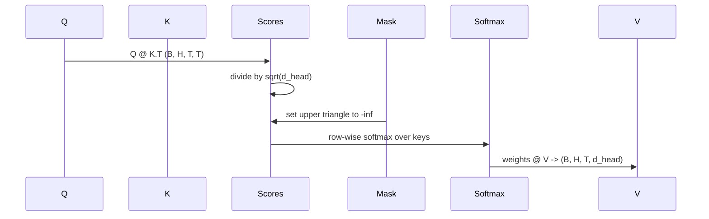

# 多头自注意力

> 一次线性投影，三种视图，H 个并行 heads，一个 mask。这就是模型实际使用的 attention block。

**Type:** Build
**Languages:** Python
**Prerequisites:** Phase 04 lessons, Phase 07 transformer lessons, Lessons 30 through 32 of this phase
**Time:** ~90 minutes

## 学习目标

- 把 batched Query/Key/Value projection 实现为一个线性层，再切分成 H 个 heads。
- 用正确的 normalization 和 dtype handling 计算 scaled dot-product attention。
- 应用 causal mask，阻止某个位置 attending to 未来位置。
- 检查固定输入上的 per-head attention weights，并推理每个 head 在看哪里。
- 在 toy task 上训练一个小 attention block，观察 loss 随着 heads 专门化而下降。

## 框架

Attention 是一个函数，让某个 token 的 representation 能从同一 sequence 的其它 tokens 拉取信息。Self-attention 表示 queries、keys 和 values 都来自同一个 input。Multi-head 表示 projection 被切成 H 个并行 attention problems，它们的输出会 concatenate，再投影回去。

高效实现模式是：用一个 linear layer 从 `D` 投影到 `3 * D`，再切成三个 views，然后 reshape 成 H 个 heads，每个 head 的大小是 `D // H`。Matmul、softmax 和 weighted sum 都作为 batched tensor operations 执行，因此 heads 可以在 accelerator 上并行运行。

本课会构建这个 block。它还会加入 causal mask，让同一段代码可以作为 decoder-only language model 中的 attention layer。下一课会把这个 block 堆叠成完整 transformer，再下一课会训练它。

## Shape contract

输入是 `(B, T, D)`。输出是 `(B, T, D)`。Mask 是 `(T, T)`，或者能 broadcast 到这个形状。在 block 内部，中间 tensors 的 shape 是 `(B, H, T, d_head)`，其中 `d_head = D // H`。约束是 `D % H == 0`。

```mermaid
flowchart LR
    A["(B, T, D) input"] --> B[Linear D -> 3D]
    B --> C["split into Q, K, V"]
    C --> D["reshape to (B, H, T, d_head)"]
    D --> E["scores = Q @ K.T / sqrt(d_head)"]
    E --> F[apply causal mask]
    F --> G[softmax over keys]
    G --> H["context = weights @ V"]
    H --> I["reshape to (B, T, D)"]
    I --> J[output Linear D -> D]
    J --> K["(B, T, D) output"]
```

两个 linear layers（QKV projection 和 output projection）是这个 block 中唯一的参数。Mask、softmax、matmuls 和 reshapes 都没有参数。

## QKV split

朴素实现会有三个独立 linear layers，分别对应 Q、K 和 V。高效实现只有一个 layer，输出 `3 * D` 个 features，然后 split 结果。二者在数学上等价，因为三次分别乘以 `(D, D)` weights 的 matrix multiplication，正好等价于一次乘以由它们堆叠而成的 `(3D, D)` weight 的 matrix multiplication。

高效版本更快，因为 accelerator 只需要 launch 一次 matmul，而不是三次。它也更容易初始化，因为三个 sub-matrices 位于同一个 parameter tensor 中，可以一起初始化。

## Head reshape

Split 之后，Q、K、V 各自都是 `(B, T, D)`。为了把它变成 H 个并行 attention problems，我们先 reshape 到 `(B, T, H, d_head)`，再 transpose 到 `(B, H, T, d_head)`。Head dimension 现在紧挨着 batch dimension，因此 PyTorch 会把 per-head attention 当作跨 `B * H` 个独立实例的 batched operation。

`d_head` dimension 保持在最后，因此 score matmul `Q @ K.transpose(-2, -1)` 会沿这个维度做 contraction。结果是 shape 为 `(B, H, T, T)` 的 per-head attention scores。

## Scaling

Scores 会在 softmax 前除以 `sqrt(d_head)`。如果没有这个 scaling，dot products 会随着 `d_head` 增大而变大，把 softmax 推到一个几乎所有概率质量都集中在单个 entry、其它 entries 接近 0 的区域。这个区域里的 gradients 很小，learning 会停滞。除以 `sqrt(d_head)` 可以让 scores 的 variance 在不同 head sizes 下大致保持稳定。

## Causal mask

Decoder-only language model 在预测 next token 时只能 condition on 过去。Mask 会强制这一点。具体来说，在 softmax 之前，`(T, T)` score matrix 对角线以上的每个 entry 都会被替换成 negative infinity。Softmax 之后，这些位置的权重会变成 0。

我们会在 construction 时把 mask 注册为 buffer，这样它会和 model 位于同一 device 上，同时不属于 gradient graph。Mask 覆盖这个 block 可能看到的最大 context length。Forward time 会 slice 左上角的 `(T, T)` 区域。

## Output projection

得到 per-head context vectors `(B, H, T, d_head)` 后，我们 transpose 回 `(B, T, H, d_head)`，reshape 到 `(B, T, D)`，然后应用最后一个 `(D, D)` linear projection。Output projection 让模型可以混合 heads。没有它，H 个 heads 只能通过后续 layers 重新组合，这会给 block 加上人为限制。

## Attention weight inspection

本课会在 forward pass 上暴露一个 `return_weights=True` flag。设置之后，block 会在 output 之外返回 shape 为 `(B, H, T, T)` 的 per-head attention weights。Demo 会在一个短 input 上打印某个 head 的 weights heatmap，让你看到 causal-triangle structure 和 per-position focus。

在训练好的模型中，不同 heads 会学到不同 patterns。有些 heads attend to 紧前一个 token。有些 heads attend to sequence 开头。有些 heads 几乎均匀地分散 attention。这个 inspection hook 是做 interpretability work 的入口。

## Training demo

`main.py` 底部的 demo 会把 attention block 接到一个 tiny LM head 上，并在 repeat task 上训练整个模型。Input 的每一行都是一个 random id 在 context 中重复得到的序列。Target 是 shifted by one 的 input，因此模型必须学会 next token 和 previous token 相同。Loss 是 cross-entropy。当 H=4、D=32、T=12、vocabulary 为 64 时，CPU 上三轮训练会让 loss 从随机水平（大约 `log(64) ~ 4.16`）下降到远低于 `1.0`。

Demo 的目的不是训练有用模型。目的是确认 gradients 会流经 block 的每个部分，并且 heads 能在答案显而易见的问题上学到东西。

## 本课不做什么

本课不会添加 feed-forward block。真实模型中的 transformer layer 是 attention 后接一个 two-layer MLP，并在二者周围加 residual connection 和 layer norm。下一课会添加这些内容。

本课不会实现 rotary 或 AliBi positional encoding。二者都在同一个 block 的 QKV projection step 应用，但它们属于单独教学单元。这里构建的 block 只要在 matmul 前变换 Q 和 K，就能兼容其中任意一种。

本课不会实现 inference 用的 KV cache。跨 forward passes 缓存 keys 和 values，是让 autoregressive decoding 变快的优化。它会改变 K 和 V tensors 的 shape contract，但不改变 Q。它属于 inference 课程。

## 如何阅读代码

`main.py` 定义 `MultiHeadSelfAttention`。这个 class 持有两个 linear layers 和一个 registered mask buffer。Forward pass 会依次完成 projection、reshape、score、mask、softmax、weight、reshape 和最后的 projection。文件底部的 demo 会构建一个小模型：用 token 和 positional embeddings 以及 LM head 包装 attention，在 copy task 上训练三轮，并打印 loss curve 和 per-head attention heatmap。`code/tests/test_attention.py` 中的 tests 会固定 shape contract、causality property、softmax property、head-split property 和 gradient flow。

运行 demo。然后把 `n_heads` 从 4 增加到 8（保持 `d_model=32`，所以 `d_head=4`），观察 heatmap 如何变化。
