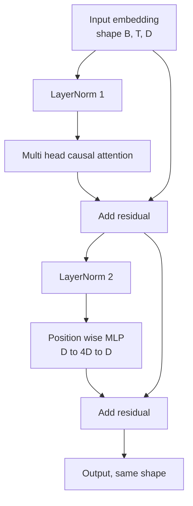
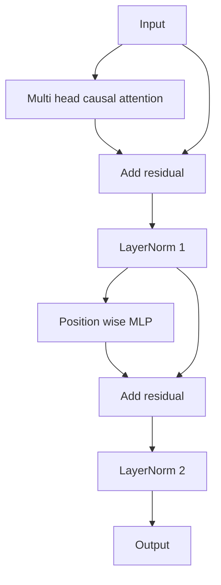

# 从零实现 Transformer Block

> 一个 block 是每个现代 decoder LLM 的基本单元。LayerNorm、multi-head attention、residual、MLP、residual。Pre-LN 变体不靠 warmup 也能稳定训练。Post-LN 变体则是原始论文采用的版本。本课会并排构建二者，并展示在常见学习率下，哪一个能撑过 12 层 stack。

**Type:** Build
**Languages:** Python
**Prerequisites:** Phase 19 lessons 30 to 33 (tokenizer, embeddings, attention math, batched data loader)
**Time:** ~90 minutes

## 学习目标

- 用 PyTorch 从四个运动部件构建 transformer block：LayerNorm、multi-head causal attention、residual connections、position-wise MLP。
- 把 LayerNorm 放进两种配置（pre-LN 与 post-LN），并解释为什么其中一种无需 warmup 也能稳定训练。
- 在 multi-head attention 内实现 causal masking，让 token `i` 不能看到 token `j > i`。
- 追踪 12 层 stack 中两个变体的 gradient flow，并用实际结果读懂差异，而不是靠直觉带过。
- 在下一课组装 1.24 亿参数 GPT 时，把这个 block 当作可直接插入的基本单元复用。

## 问题

Transformer 就是一个 block 反复堆叠。Block 只要写错一次，再重复十二次，你得到的模型要么在第一个 epoch 就发散，要么一路都要依赖 warmup 技巧。本课会看到的两个 failure modes 并不稀奇。它们正是学习者第一次朴素堆叠 blocks 时最容易撞上的问题：一个是 attention layer 看到了未来 token；另一个是 LayerNorm 放在了无法在深度上驯服 residual signal 的位置。

一旦看清楚，修复就是机械的。Block 恰好有两条 residual paths，也恰好有两个 normalization positions。位置选对之后，剩下的 stack 只是 bookkeeping。

## 核心概念

每个 decoder-only transformer block 都是一个函数：接收 shape 为 `(batch, sequence, embedding)` 的 tensor，并返回相同 shape 的 tensor。内部由两个 sublayers 完成主要工作。



这是 pre-LN 变体。LayerNorm 位于 residual branch 内部，在 sublayer 之前。Residual connection 则把未归一化的 signal 向前传递。

Post-LN 变体会把 LayerNorm 移到 residual add 之后。



Shape 完全相同。训练行为完全不同。对于 post-LN，沿 residual path 反向传播的 gradient 必须穿过 LayerNorm。在 12 层深度和 `3e-4` 学习率下，这条 gradient 会缩小得足够快，以至于需要 warmup schedule。Pre-LN 让 residual path 保持未归一化，因此 gradients 能干净地传播回 embedding layer。也正因为这个原因，GPT-2 之后的模型采用的是 pre-LN 配置。

### Causal multi-head attention

Attention sublayer 会把 input 分别投影成 query、key、value 三个 tensors。每个 tensor 都会从 `(B, T, D)` reshape 成 `(B, H, T, D/H)`，其中 `H` 是 head count。Scaled dot-product attention 会在每个 head 内计算 `softmax(Q K^T / sqrt(d_k))`，把 upper triangle mask 成 negative infinity，通过 softmax 应用 mask，然后乘以 `V`。多个 heads 会重新 concatenate 成单个 `(B, T, D)` tensor，再做一次输出 projection。Mask 是让模型具备 causal 性质的唯一部件。忘记 mask，就等于训练了一个会作弊的模型。

### MLP

Position-wise MLP 会对每个 token 独立应用同一套 two-layer network。Hidden width 是 embedding width 的四倍，activation 使用 GELU，第二个 linear 后接 dropout。MLP 内部没有 token 彼此通信。所有 token mixing 都发生在 attention 里。

### Residual connections 做两件事

它们让跨深度的 gradient path 变成加法形式，从而把 12 层中的 gradient norm 维持在合理尺度。它们也让每个 block 学习对当前 running representation 的 additive update，而不是整块替换。两种效果合在一起，正是这个 block 能 scale 的原因。

## Build It

`code/main.py` 实现了：

- `class LayerNorm`：带可学习 scale 和 shift，使用 biased eps，并按 token vector 应用。
- `class MultiHeadAttention`：包含 `num_heads`、`head_dim = d_model // num_heads`、fused QKV projection、registered causal mask、attention dropout 和 residual dropout。
- `class FeedForward`：包含两个 linear layers、GELU activation、dropout。
- `class TransformerBlock`：通过 `pre_ln` flag 在两个变体之间切换。
- 一个 demo：用相同 input 构建 6 层 pre-LN stack 和 6 层 post-LN stack，并打印 (a) output shape，(b) 一次 backward pass 后 embedding 处的 gradient norm。

运行：

```bash
python3 code/main.py
```

输出会并排检查两个 stacks 的 shape 与 gradient norms。在相同学习率下，pre-LN stack 的 embedding gradient 比 post-LN stack 大一个数量级左右；这就是 pre-LN 不靠 warmup 也能训练的经验信号。

## 技术栈

- `torch` 用于 tensor math、autograd 和 `nn.Module` plumbing。
- 不使用 `transformers`，不使用 pretrained weights。Block 从 primitives 实现。

## 生产环境中的常见模式

有三种模式会把教材里的 block 变成能交付的实现。

**Fused QKV projection.** 三个独立 linear layers 需要三次 kernel launches 和三次 matmuls。一个宽度为 `3 * d_model` 的 linear layer 可以在一次 launch 中完成同样的工作，然后沿最后一个 axis split 输出。Fused path 在每种 accelerator 上都更快，也匹配 GPT-2、LLaMA 和 Mistral reference implementations 的做法。

**Registered causal mask buffer.** Mask 只依赖 maximum context length。在构造时用 `register_buffer` 分配一次，每次 forward pass 只 slice 当前 active window，就可以避免每次调用都重新分配。忘记这一点，会让 mask 在 long context 下变成 allocator hot spot。

**Dropout 放两处，不是三处。** Dropout 应该放在 attention softmax 之后（attention dropout），以及 MLP 第二个 linear 之后（residual dropout）。对 residual 本身做 dropout 会破坏 additive identity，而这条 identity 正是深层网络中 gradient 能流动的原因。一些早期实现曾经在这里犯错，并为此付出训练脆弱的代价。

## Use It

- 本课的 block 可以不经修改，直接插入第 35 课的 GPT assembly。
- Pre-LN 变体是现代 open weights LLM 的常用选择。Post-LN 变体是 2017 年原始 attention paper 使用的选择。理解二者，足以读懂你会遇到的任何 decoder architecture。
- 把 GELU 换成 SiLU，就得到 LLaMA family 的 activation。把 LayerNorm 换成 RMSNorm，就得到 LLaMA family 的 normalization。骨架不变。

## 练习

1. 给 block 中的每个 linear 添加 `bias=False` flag。现代 open weights LLM 的 linear layers 通常没有 biases。测量在一个 12 层、768 dim 的模型中能节省多少参数。
2. 用手写 RMSNorm 替换 `nn.LayerNorm`，并验证 output shape 不变。
3. 添加一个 flag，让 forward 返回第一个 head 的 attention weights，shape 为 `(B, T, T)`。绘制 upper triangle，确认 softmax 后它为 zero。
4. 构建一个 sanity check：把 shape 为 `(2, 16, 384)`、`H=6` 的 tensor 分别送入两个变体，并在权重初始化相同、dropout 设为 zero 时断言 forward outputs 不同（例如 `not torch.allclose`）。

## 关键术语

| Term | What people say | What it actually means |
|------|-----------------|------------------------|
| Pre-LN | “Pre norm” | LayerNorm 位于 residual branch 内部、每个 sublayer 之前；residual 携带未归一化 signal |
| Post-LN | “Post norm” | LayerNorm 位于 residual add 之后；这是 2017 年论文采用、且通常需要 warmup 的做法 |
| Causal mask | “Triangle mask” | 把 attention logits 的 upper triangle 设为 negative infinity，让 token i 在 j 大于 i 时不能读取 token j |
| Fused QKV | “Combined projection” | 用一个宽度为 3D 的 linear 代替三个宽度为 D 的 linears；一次 kernel，一次 matmul |
| Residual stream | “Skip connection” | 从上到下流经每个 block 的未归一化 tensor；每个 block 都向它添加内容 |

## 延伸阅读

- Phase 7 lesson 02（self attention from scratch）：理解这个 block 底下的 attention math。
- Phase 7 lesson 05（full transformer）：理解同一骨架的 encoder-decoder 版本。
- Phase 10 lesson 04（pre training mini GPT）：理解这个 block 会接入的训练流程。
- Phase 19 lesson 35（本 track）：把十二个这样的 blocks 堆成一个 GPT model。
