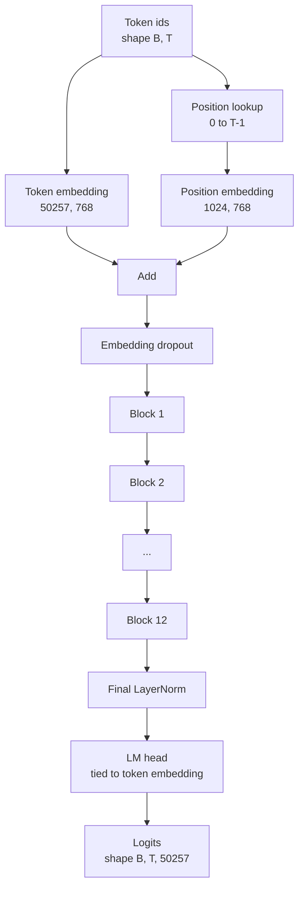
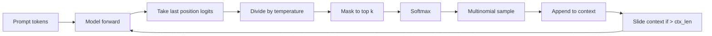

# GPT 模型组装

> 十二个 blocks 叠起来，加上 token embedding、learned position embedding、最终 LayerNorm，以及一个绑定权重的 language model head，这就是完整的 1.24 亿参数 GPT 模型。本课会把这些部件组装成一个可运行的 class，统计参数量以确认模型匹配参考 124M 形状，并用 multinomial sampling、temperature 和 top-k 生成文本。

**Type:** Build
**Languages:** Python
**Prerequisites:** Phase 19 lessons 30 to 34
**Time:** ~90 minutes

## 学习目标

- 把第 34 课的 transformer block 组装成完整 GPT 模型：token embedding、position embedding、N 个 blocks、最终 LayerNorm、language model head。
- 复现 1.24 亿参数配置：vocab 50257、context 1024、embedding 768、十二个 heads、十二层。
- 将 language model head 权重绑定到 token embedding，并解释为什么这在该规模下能节省约 3800 万参数。
- 用 multinomial sampling、temperature scaling 和 top-k truncation 从 prompt 生成文本，并用 sliding window 保持 context length。
- 对照 124M 目标测量参数量和 forward pass 成本。

## 问题

Transformer block 本身什么也做不了。你需要把 token ids 变成 vectors，混入位置信息，让它们穿过 stack，再投影回 vocabulary logits。漏掉这四步中的任何一步，模型要么无法 forward，要么位置语义漂移，要么无法说话。

模型形状同样重要。参考 GPT-2 small 在上面的精确配置下是 1.24 亿参数。这些数字不是魔法。Vocab 50257 乘以 embedding 768，就是 token table。Position 1024 乘以 768，就是 position table。十二个 blocks，每个约 700 万参数，总计 8400 万。最终 head 通过 weight tying 复用 token table。把这些部分加起来，就落在 124M。一个参数量对不上参考值的模型，通常说明你把某处接错了。

## 核心概念



Token ids 会变成 token vectors。Position ids 会变成 position vectors。二者相加后送入 stack。最终 LayerNorm 是 blocks 外面的一块，几乎所有现代变体都保留了它。LM head 会复用 token embedding matrix，这就是 weight tying 的含义。

### 权重绑定

Token embedding 的 shape 是 `(vocab, d_model)`。Language model head 需要从 `d_model` 投影回 `vocab`。这两个矩阵正好互为转置。把两者绑定起来，意思是字面上使用同一个 parameter tensor，用两次。Vocab 50257、d_model 768 时，这个 matrix 有 3800 万个参数。不绑定，你要付两份参数；绑定，你只付一份。同时梯度信号也会稍微更干净，因为 embedding 和 head 会一起更新。

### Position embedding 是 learned，不是 sinusoidal

GPT-2 使用 learned position embedding。Position table 是一个 shape 为 `(1024, 768)` 的 parameter tensor。模型在每次 forward 时查询 position 0 到 T-1，并把查到的向量加到 token embedding 上。这是最简单的位置方案；RoPE、ALiBi、T5 relative bias 都是替代方案，而 124M 参考模型使用的就是 learned position table。

### 生成：temperature、top-k、multinomial

生成是 autoregressive 的。每一步，模型都会在每个 position 上返回覆盖完整 vocabulary 的 logits。你只取最后一个 position 的 logits，除以 temperature，可选地把 top k 之外的 logits mask 成 negative infinity，再 softmax 得到 probabilities，并从这个分布中采样一个 token。



三个旋钮，三种不同影响。Temperature 接近 0 时会塌缩成 greedy。Temperature 为 1 时匹配模型的自然分布。Top-k 为 1 就是 greedy。Top-k 为 40 会过滤长尾。组合方式很重要；下一课训练时，会把 generation 当作定性评估信号。

## Build It

`code/main.py` 实现：

- `class GPTConfig` dataclass，带有 124M 默认值：`vocab_size=50257`、`context_length=1024`、`d_model=768`、`num_heads=12`、`num_layers=12`、`mlp_expansion=4`、`dropout=0.1`、`use_bias=True`、`weight_tying=True`。
- `class GPTModel`，包含 token embedding、position embedding、embedding dropout、十二个 `TransformerBlock`、最终 LayerNorm，以及一个在 flag 开启时绑定到 token embedding 的 `lm_head`。
- `count_parameters` helper，返回 unique parameter count，因此统计时会正确处理 weight tying。
- `generate` function，实现 temperature、top-k、multinomial 和 sliding-window context。
- 一个 demo：构建模型，打印参数量并对照 124M 参考值，然后从固定 prompt 生成一小段 sequence，展示整条 pipeline 能端到端跑通。

运行：

```bash
python3 code/main.py
```

输出包括：参数量与 124M 参考值的对照、从随机 prompt 生成的 token ids，以及一条确认 LM head 和 token embedding 在开启 tying 时共享 storage 的信息。

为了让 demo 跑得快，脚本也会端到端运行一个 tiny config（`d_model=64`、`num_layers=2`），并 inline 打印生成的 token sequence。124M config 会被构建，但只执行参数统计和一次 forward pass。

## 技术栈

- `torch` 用于 tensor math、autograd 和 module plumbing。
- `code/main.py` 在本地重新实现第 34 课使用的同一种 block pattern。

## 生产中的常见模式

有三个模式决定了模型只是能跑，还是能交付。

**把 residual projections 初始化得更小。** Attention 的 output projection 和 MLP 的第二个 linear 都会直接进入 residual add。如果用和其他 linear 一样的 standard deviation 初始化它们，residual stream 会随深度增长，并把最终 LayerNorm 推进过热区域。把这两个 projection 的 std 按 `1 / sqrt(2 * num_layers)` 缩放，residual stream 就能在十二层里保持在合理范围。

**缓存 position id tensor，不要每次重算。** `torch.arange(T)` 会在每次 forward 时分配新内存。在 `__init__` 中按最大 context 分配一次，每次调用只切出前 T 个 entries，就能跳过 allocator 往返。

**在 parameter 级别绑定权重，不只是 copy。** 设置 `lm_head.weight = token_embedding.weight` 会共享 tensor；copy 不会。Optimizer 需要更新一个 parameter，autograd graph 也需要一次 accumulation。如果你只是 copy，head 会逐渐偏离 embedding，weight tying 就没有收益。

## Use It

- 本课的 model class 与下一课要训练的模型形状相同。
- 把 learned position embedding 换成 RoPE，就能在不触碰 block 或 head 的情况下得到 LLaMA family 的位置方案。
- 把 GELU 换成 SiLU，把 LayerNorm 换成 RMSNorm，就能得到 LLaMA family 的其余改动。
- Generation function 可以配合任何 logits source 使用，不只限于这个模型。你可以在第 37 课从 pretrained GPT-2 文件中取 logits，并复用同一个 generation loop。

## 练习

1. 解除 LM head 与 token embedding 的绑定，然后重新统计参数量。验证差值是 50257 乘以 768，也就是 3800 万。
2. 用 construction time 计算出的 sinusoidal table 替换 learned position embedding。确认模型仍能 forward，并且参数量减少 786,432。
3. 给 generation 添加 `greedy=True` flag，让它跳过 sampling 并选择 argmax。确认 sequence 在多次运行中是 deterministic 的。
4. 添加一个 `repetition_penalty` knob，在 softmax 前把 prompt 或生成历史中出现过的任何 token 的 logit 除以一个常数。在固定 prompt 上展示大于 1 的值会减少输出中的重复次数。
5. 在 `top_k` 旁边添加 `top_p`（nucleus）sampling。用两行检查确认保留下来的 tokens 的概率和超过 `top_p`。

## 关键术语

| Term | What people say | What it actually means |
|------|-----------------|------------------------|
| Weight tying | "Tied embeddings" | LM head 和 token embedding 共享同一个 parameter tensor；节省 vocab 乘以 d_model 个参数，并匹配 GPT-2 参考模型 |
| Position embedding | "Learned positions" | 一张 shape 为 (context length, d_model) 的独立 table，加到 token vectors 上；端到端学习 |
| Sliding window context | "Context cap" | 当 prompt 加 generated tokens 超过 context length 时，丢弃最旧的 tokens，让 active window 能放下 |
| Top-k sampling | "K truncation" | 保留值最高的 K 个 logits，把其余 logits mask 成 negative infinity，再在剩余项上 softmax |
| Temperature | "Sampling temperature" | 在 softmax 前用 T 除以 logits；T 小于 1 会 sharpen，T 等于 1 保持自然分布，T 大于 1 会 flatten |

## 延伸阅读

- Phase 19 lesson 34，了解本模型堆叠的 block。
- Phase 19 lesson 36，了解用 cross entropy loss 驱动本模型的 training loop。
- Phase 19 lesson 37，了解如何把 pretrained GPT-2 weights 加载进这个精确架构。
- Phase 7 lesson 07（GPT causal language modeling），了解 next token prediction 的数学。
- Phase 10 lesson 04（pre training mini GPT），了解同一架构上的原始训练流程。
