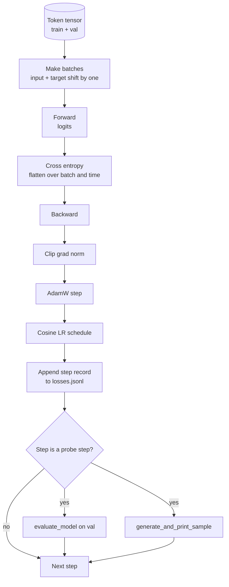

# Training Loop 与 Evaluation

> 不测量的 loop 会骗人。本课构建驱动 GPT model 的 training loop：带 weight decay split 的 AdamW、warmup 加 cosine learning rate schedule、`calc_loss_batch` helper、在 held out data 上运行的 `evaluate_model`、每 K steps 一次的 `generate_and_print_sample` qualitative probe，以及一个后续可绘图的 losses JSONL log。同一套骨架可以训练你未来会构建的每一个 decoder LLM。

**Type:** Build
**Languages:** Python
**Prerequisites:** Phase 19 lessons 30 to 35
**Time:** ~90 minutes

## 学习目标

- 构建一个 training loop，用正确的 input 和 target alignment 为 next token prediction 计算 cross entropy loss。
- 配置 AdamW，让 weight decay 应用于 weight tensors，而不应用于 LayerNorm 或 bias tensors。
- 实现带 linear warmup 和 cosine decay 的 learning rate schedule，并读取随时间变化的 LR。
- 用 `evaluate_model` 在 held out split 上评估，让 eval loss 可以跨 runs 比较。
- 每 K steps 用 `generate_and_print_sample` 生成 qualitative sample，在 loss curve 之前捕捉 divergence。
- 把 per step loss 持久化到 JSONL，方便后续 reload、plot，并把 training log 作为 deliverable 发布。

## 问题

一个只打印 loss、什么都不做的 training script 会以三种方式失败。它无法告诉你 loss 是否因为正确原因下降（model 可能只是 overfit training set，根本没有学会泛化）。它无法告诉你 divergence 是否正在开始（loss 可能 spike 一步后恢复，也可能 spike 一步后崩掉）。它无法告诉你 model 学到了什么（loss 是 scalar，而 generated sample 是一段文字）。如果 loop 不测量，这三种失败都会隐藏起来。

本课的 loop 用三种方式测量。每一步测 training batch loss。每 K steps 测 held out batch loss。每 K steps 从固定 prompt 生成 continuation。Training log 落到 JSONL 中，因此 artifact 就是这个 loop 的证词。

## 概念



两个不明显的部分是 loss alignment 和 AdamW decay split。

### Loss alignment

模型会在每个位置预测下一个 token。如果 input batch 是 tokens `[t0, t1, t2, t3]`，target batch 必须是 `[t1, t2, t3, t4]`。Cross entropy 在 flatten 后的 shape `(batch * seq, vocab)` 上计算，对应 flatten 后的 target `(batch * seq,)`。如果忘记 shift，你训练的就是让模型预测自己；loss 会收敛到 0，但学不到有用能力。

### AdamW decay split

Weight decay 正则化 weight tensors，但不正则化 normalization scales 或 biases。对 LayerNorm scale 施加 decay 会慢慢把 scale 推向 0，并破坏 normalization。对 bias 施加 decay 在数学上无害，但浪费计算。标准 split 是：matrix shaped tensors（linear weights、embedding tables）使用 decay；任何看起来像 scale 或 shift 的参数都不使用 decay。

### Warmup 加 cosine schedule

Warmup 会在前几百步把 learning rate 从 0 ramp 到 target，让 optimizer state 有时间填充。Cosine decay 会在剩余 steps 中把 learning rate 降回接近 0，让最后阶段用小 step size 微调 weights。这个组合是 open weights LLM training 中最常见的 schedule，因为它移除了前一千步和最后一千步中大部分脆弱时刻。

### Held out evaluation

`evaluate_model` 会从 validation split 运行固定数量的 batches，累积 loss，除以 batch count，然后返回。没有 gradient。没有 dropout。给定相同 seed 和相同 split，这个数字在不同 runs 之间可复现。把 held out loss 和 training loss 放在一起报告，是发现 overfitting 的方法。

### Qualitative sampling as an early signal

如果一个 model 的 training loss 降得很好，但 generated samples 全是同一个 token，它是坏的。如果 loss curve 看起来很平，但 generated samples 正在变成连贯词语，它正在学习。Qualitative probe 比读完整曲线更快，也能抓住 scalar 漏掉的模式。

## Build It

`code/main.py` 实现：

- `make_batches(token_ids, batch_size, context_length)`：把一个长 token tensor 切成 input 和 target pairs。
- `calc_loss_batch(model, inputs, targets)`：执行 forward、flatten，并返回 scalar cross entropy。
- `evaluate_model(model, val_loader, max_batches)`：在 no grad 下迭代固定数量的 validation batches，并返回 mean loss。
- `generate_and_print_sample(model, prompt, max_new_tokens)`：在固定 prompt 上运行 lesson 35 的 generation function，并打印结果。
- `build_param_groups(model, weight_decay)`：生成 AdamW 的 two-group parameter list。
- `cosine_with_warmup(step, warmup_steps, total_steps, max_lr, min_lr)`：返回给定 step 的 LR。
- `train(...)`：运行 loop，持久化 `outputs/losses.jsonl`，并每 `eval_every` steps 打印 eval loss 和 sample。
- 一个 demo：在 synthetic data 上训练 tiny model 少量 steps，写入 JSONL log，并在 probe points 打印 eval loss 和 sample。这个 demo 在 CPU 上不到一分钟即可运行。

运行：

```bash
python3 code/main.py
```

输出：per step loss line、每个 probe step 的 eval loss、每个 probe step 的 generated sample，以及最终可用 `json.loads` 逐行读取的 `outputs/losses.jsonl`。

## 技术栈

- `torch` 用于 autograd、optimizer 和 modules。
- `main.py` 在本地重新实现 lesson 35 的 `GPTModel` 和支持 modules。

## 生产中的模式

三个模式会把 textbook loop 变成可以放心跑一整夜的东西。

**Gradient norm clipping 不可少。** 一个坏 batch（异常数据、LR spike、数值边界情况）会产生巨大 gradient，把数小时训练成果抹掉。在 `backward` 之后、`step` 之前调用 `torch.nn.utils.clip_grad_norm_(params, max_norm=1.0)`，可以让 optimizer 保持在安全范围内。Clipping value 是一个自由参数；1 是能在大多数设置里活下来的默认值。

**使用 resumable JSONL logging，而不是 pickled state。** Per step loss records 以 `{"step": int, "train_loss": float, "lr": float}` 的 JSONL lines 存储很耐用：任何 crash 都会留下可读 artifact，可以 grep，可以用三十行 Python plot，也可以通过读取 last step 恢复训练。Pickled state 会把你绑在生成该文件时的精确 module layout 上，跨 refactor 很脆。

**Eval batches 来自固定 slice。** Validation tokens 在 script start 时被切成 batches，而不是动态生成。Reproducibility 依赖 eval batches 在每次 run 中完全相同；否则比较两个 runs 的 eval loss 时，测到的可能和 batch shuffle 一样多，而不只是 model。

## Use It

- 本课中的 loop 是训练真实数据上 124M model 的同一套骨架。把 synthetic token tensor 换成 `datasets`-style loader，loop 不需要改就能运行。
- JSONL log 是把 training run 转成 evidence 的 deliverable。下一课会用它比较 fresh trained checkpoint 和 pretrained checkpoint。
- Qualitative sample probe 是 scalar loss 无法替代的 catch-all。

## 练习

1. 增加 `weight_decay_groups()` unit tests，确认 scale 和 bias parameters 进入 no decay group，而 linear 和 embedding weights 进入 decay group。
2. 把 synthetic random tokens 替换成一个小文本文件中的 bytes，让 demo 在可读文本上训练。确认 generated sample 使用了文件中出现过的 characters。
3. 给 cosine schedule 增加一个 `min_lr` floor，值为 `max_lr` 的 10%，然后重新 plot。
4. 除了 JSONL log，每 `eval_every` steps 保存一个 checkpoint。增加 `resume_from` flag，重新加载 model state 和 optimizer state。
5. 在 loss 旁边记录 per step throughput（tokens per second），确认它保持在稳定区间。

## 关键术语

| Term | 大家常说 | 实际含义 |
|------|----------|----------|
| Loss alignment | "Shift by one" | Input tokens 位于 positions 0..T-1，target tokens 位于 positions 1..T；cross entropy 在 flattened shapes 上计算 |
| Decay split | "Two groups" | AdamW 接收带 weight decay 的 matrix shaped tensors，以及不带 decay 的 scale 或 bias tensors |
| Warmup | "Ramp" | Learning rate 在固定步数内从 0 爬升到 target，让 optimizer state 得以填充 |
| Eval batches | "Held out batches" | Validation token tensor 的固定 slice，在 script start 时只切一次，每个 probe 都相同使用 |
| Qualitative probe | "Sample print" | 每 K steps 从固定 prompt 生成一小段文本，捕捉只看 loss 会隐藏的 failure modes |

## 延伸阅读

- Phase 19 lesson 35：loop 所驱动的 model。
- Phase 19 lesson 37：把 pretrained weights 加载进同一个 model。
- Phase 10 lesson 04（pre training mini GPT）：在真实数据上的训练流程。
- Phase 10 lesson 10（evaluation）：cross entropy loss 之外更广的 eval surface。
