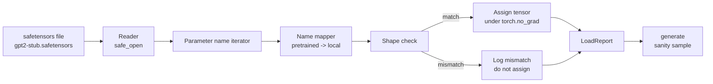

# 加载预训练权重

> 从零训练一个 124M parameter model 是预算决策；加载一个已发布 checkpoint 是日常操作。本课会把 safetensors 文件中的 GPT-2 风格 pretrained weights 加载进第 35 课的精确 architecture，逐项走过 parameter name mapping，并用 sanity generation 证明加载确实生效。无网络、无第三方 loaders、无不透明魔法。

**Type:** Build
**Languages:** Python
**Prerequisites:** Phase 19 lessons 30 to 36
**Time:** ~90 minutes

## 学习目标

- 使用 `safetensors` Python library 读取 safetensors 文件，并检查 tensor names 和 shapes。
- 将每个 pretrained parameter name 映射到第 35 课 GPT model 内部的一个 parameter。
- 处理 published GPT-2 weights 与本 track model 之间不同的两套命名约定：`wte/wpe/h.N.attn.c_attn/c_proj` 和 `mlp.c_fc/c_proj`，对应本地的 `tok_embed/pos_embed/blocks.N.attn.qkv/out_proj` 和 `mlp.fc1/fc2`。
- 在任何 weight assignment 发生之前，检测并拒绝 shape mismatch，同时给出清晰错误。
- 用加载后的 weights 生成一小段 continuation，并确认 tokens 来自 loaded distribution，而不是 randomly initialized distribution。

## 问题

Published weights 并不是为你的 architecture 打包的。它们携带的是原始实现使用的 names。Pretrained file 中有 `transformer.h.0.attn.c_attn.weight`，shape 是 `(2304, 768)`；你的 model 期望 `blocks.0.attn.qkv.weight`，shape 也是 `(2304, 768)`（同一个 matrix，只是 layout convention 不同），或者你的 model 使用 `nn.Linear`，它会以转置方式存储 matrix。同一个 parameter 会带着三种微妙不同的身份出现：name、shape、byte layout。Loader 必须协调这三者。

盲目 copy 的 loader 会把正确 tensor 放到错误位置，然后你会得到一个生成乱码的 model。遇到 shape 不同就拒绝 copy、但什么都不记录的 loader 会让你猜到底哪个 tensor 没落下。本课中的 loader 是显式的：每一次 assignment 都会 log，每个 shape 都会检查，`LoadReport` 会汇总 hits、misses 和 shape mismatches，让你能读懂发生了什么。

## 概念



Name mapper 只是一个从 string 到 string 的函数。Shape check 是一个 if。Assignment 发生在 `torch.no_grad()` 内部，这样 autograd 不会追踪加载过程。Report 保存每个 name 的 outcome。

### GPT-2 命名约定

Published GPT-2 weights 使用如下 names：

| Pretrained name | Shape | Meaning |
|-----------------|-------|---------|
| `wte.weight` | (50257, 768) | Token embedding |
| `wpe.weight` | (1024, 768) | Position embedding |
| `h.N.ln_1.weight` | (768,) | Block N 的 LayerNorm 1 scale |
| `h.N.ln_1.bias` | (768,) | Block N 的 LayerNorm 1 shift |
| `h.N.attn.c_attn.weight` | (768, 2304) | Fused QKV linear weight |
| `h.N.attn.c_attn.bias` | (2304,) | Fused QKV linear bias |
| `h.N.attn.c_proj.weight` | (768, 768) | Attention output projection |
| `h.N.attn.c_proj.bias` | (768,) | Attention output projection bias |
| `h.N.ln_2.weight` | (768,) | LayerNorm 2 scale |
| `h.N.ln_2.bias` | (768,) | LayerNorm 2 shift |
| `h.N.mlp.c_fc.weight` | (768, 3072) | MLP fc1 weight |
| `h.N.mlp.c_fc.bias` | (3072,) | MLP fc1 bias |
| `h.N.mlp.c_proj.weight` | (3072, 768) | MLP fc2 weight |
| `h.N.mlp.c_proj.bias` | (768,) | MLP fc2 bias |
| `ln_f.weight` | (768,) | Final LayerNorm scale |
| `ln_f.bias` | (768,) | Final LayerNorm shift |

有两个意外点需要提前计划。`c_attn`、`c_proj`、`c_fc` linears 相对于 `nn.Linear.weight` 期望的布局是转置存储的。Loader 会在 assignment 时转置。LM head 根本不在文件里；model 依靠与 `wte` 的 weight tying，所以一旦 `wte` 落下，head 就通过 aliasing 设置。

### 本地命名约定

本 track 的 model 使用更描述性的 names：

| Local name | Meaning |
|------------|---------|
| `tok_embed.weight` | Token embedding |
| `pos_embed.weight` | Position embedding |
| `blocks.N.ln1.scale` | Block N 的 LayerNorm 1 scale |
| `blocks.N.ln1.shift` | LayerNorm 1 shift |
| `blocks.N.attn.qkv.weight` | Fused QKV |
| `blocks.N.attn.qkv.bias` | Fused QKV bias |
| `blocks.N.attn.out_proj.weight` | Attention output projection |
| `blocks.N.attn.out_proj.bias` | Output projection bias |
| `blocks.N.ln2.scale` | LayerNorm 2 scale |
| `blocks.N.ln2.shift` | LayerNorm 2 shift |
| `blocks.N.mlp.fc1.weight` | MLP fc1 |
| `blocks.N.mlp.fc1.bias` | MLP fc1 bias |
| `blocks.N.mlp.fc2.weight` | MLP fc2 |
| `blocks.N.mlp.fc2.bias` | MLP fc2 bias |
| `final_ln.scale` | Final LayerNorm scale |
| `final_ln.shift` | Final LayerNorm shift |

Mapping 是一个固定函数。本课把它作为 dict 提供，loader 会遍历它。

### Stub fixture

真实 GPT-2 weights 大约 0.5 GB。Demo 不会下载它们；第一次运行时会生成一个小 safetensors fixture，它使用精确的 GPT-2 命名约定，并采用适合 12-block、d_model 192（而不是 768）model 的 shapes。这个 fixture 结构足以覆盖 loader 中的每条 code path。把 fixture 换成真实文件后，loader 无需修改也能工作。

## Build It

`code/main.py` 实现：

- 一个第 35 课 `GPTModel` 的小型复刻，让本课 self contained。
- `make_pretrained_to_local(num_layers)`，用于展开 per-layer entries。
- `load_safetensors(model, path)`，用于遍历 names、映射 names、检查 shape、转置 conv1d-style weights，并在 `torch.no_grad()` 下 assign。返回 `LoadReport`。
- `make_stub_safetensors(path, cfg)`，用于生成一个带精确 pretrained naming convention 的 fixture file。
- 一个 demo：首次运行时创建 `outputs/gpt2-stub.safetensors`，构建 fresh model，捕获一段 random init 的 generated continuation，加载 stub，再捕获另一段 continuation，打印两者，并验证它们不同（加载确实改变了 model）。

运行：

```bash
python3 code/main.py
```

输出包括：fixture path、per-name load log、`LoadReport` summary、load 前 continuation、load 后 continuation，以及一个 fixture 中故意注入的 bad tensor 上的 shape mismatch，用来覆盖 failure path。

## Stack

- `safetensors` 用于 on-disk format 和 streaming reader。
- `torch` 用于 model 和 assignment math。
- 不使用 `transformers`，不使用 `huggingface_hub`，不做 network calls。

## 野外 production patterns

三个 pattern 会让 loader 在面对你没有亲手创建的 weights 时仍能可靠工作。

**任何 assignment 前都先 validate 文件。** 打开文件，列出每个 tensor name 及其 dtype 和 shape，运行完整 mapping 和 shape checks，全部成功后再开始 assign。Half-loaded models 是 silent failure machines。

**记录每次 assignment 的 source name 和 destination name。** 当结果看起来不对时，log 会告诉你哪个 tensor 落到了哪里；替代方案是读 hexdumps。本课中的 `LoadReport` dataclass 会追踪 `loaded`、`missing`、`unexpected` 和 `shape_mismatch` lists，并在最后打印 summary。

**LM head 是 weight tying alias，不是单独 copy。** 在加载 `tok_embed` 后设置 `model.lm_head.weight = model.tok_embed.weight` 是 canonical pattern。把 embedding matrix copy 到一个新的 `lm_head.weight` parameter 中会破坏 tying，并悄悄让 parameter count 翻倍。

## Use It

- 只要 safetensors 文件使用 pretrained naming convention，这个 loader 就能工作。真实 GPT-2 files（small / medium / large / xl）无需改代码即可使用；只有 model config 不同。
- 更新 name map 后，同样 pattern 可以扩展到 LLaMA、Mistral、Qwen weights。Shape checks 和 report 保持一致。
- Load 后做 sanity generation 是一个很快的 gate：如果 post-load samples 看起来和 pre-load samples 一样，就说明 load 没有改变 model，也就是 mapping 悄悄漏掉了每个 tensor。

## 练习

1. 给 loader 添加 `dtype` 参数，在 assignment 时把每个 tensor cast 到目标 dtype（`bfloat16`、`float16`、`float32`）。确认 `float32` model 可以 downcast 到 `bfloat16`，并且仍能 generate。
2. 添加 `expected_layers` 参数，拒绝加载 `h.N` indices 与 model `num_layers` 不匹配的 checkpoint。
3. 把 loader 接进第 35 课的 generation function，产出两段 side-by-side samples：一段来自 random init，一段来自 loaded fixture。
4. 添加 export path：使用 pretrained naming convention，把当前 model state 写入一个新的 safetensors 文件。Round trip loader，并确认 report 中 shape mismatches 为零。
5. 扩展 `NAME_MAP` 以处理 LLaMA naming convention（无 biases、RMSNorm、fused qkv layout），并在你生成的 stub LLaMA fixture 上重新运行 loader。

## 关键术语

| Term | 大家常说 | 实际含义 |
|------|----------|----------|
| Name map | “Key remapping” | 从 pretrained tensor names 到 local parameter names 的函数；通常是一个 literal dict，并用 loop 展开每层 index |
| Shape mismatch | “Bad shape” | Pretrained tensor 存在于 mapped name 下，但 dimensions 与 local parameter 不一致；loader 拒绝 assign 并记录这一对 |
| Transpose-on-load | “Conv1d layout” | Published GPT-2 以 nn.Linear 期望布局的转置存储 attention 和 MLP projections；loader 在 assignment 时转置 |
| Weight tying alias | “Shared LM head” | 设置 `model.lm_head.weight = model.tok_embed.weight`，让 head 和 embedding 共享 storage；因此 head 不在文件里 |
| Load report | “Coverage summary” | 一个小 dataclass，追踪 loaded、missing、unexpected 和 shape_mismatch lists；打印它就能判断 load 是否成功 |

## 延伸阅读

- Phase 19 lesson 35：接收这些 weights 的 architecture。
- Phase 19 lesson 36：产出相同 shape checkpoint 的 training loop。
- Phase 10 lesson 11（quantization）：内存紧张时如何处理 loaded weights。
- Phase 10 lesson 13（building a complete LLM pipeline）：围绕 load 和 inference 的完整 lifecycle。
