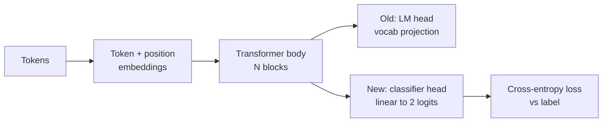
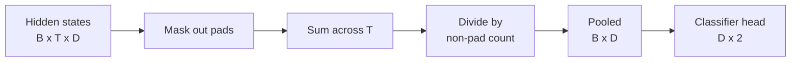
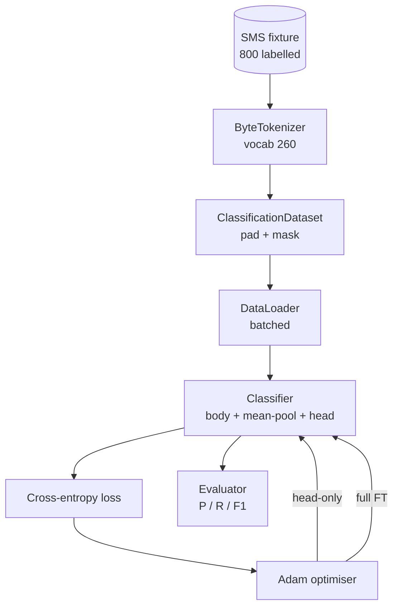

# Capstone Lesson 38：通过 Head Swap 微调分类器

> Track B 的第一个 capstone。预训练语言模型是一叠 self-attention blocks，最后接一个 token-prediction head。当你需要做 spam vs ham 时，head 是错的，但 body 大多是对的。本课会把 head 拆掉，把一个 two-class linear layer 接到 pooled representation 上，并用两种方式训练 classifier：只训练 final layer，以及 full fine-tuning。Eval 是 held-out split 上的 precision、recall 和 F1。你会学到每种策略带来什么、又花掉什么。

**Type:** Build
**Languages:** Python (torch, numpy)
**Prerequisites:** Phase 19 lessons 30-37 (NLP LLM track: tokenizer, embedding table, attention block, transformer body, pre-training loop, checkpointing, generation, perplexity)
**Time:** ~90 minutes

## 学习目标

- 在不重新初始化 body 的前提下，用 classification head 替换 language-model head。
- 实现两种 training regimes：frozen body（head-only）和 full fine-tuning，并共享同一个 training loop。
- 构建 tokenizer-aware data pipeline，支持 padding、mask padding，并 pool attention output。
- 从 raw logits 计算 precision、recall、F1 和 confusion matrix。
- 推理 parameter count、training time 和 head-room 之间的权衡。

## 问题

你已经在 generic corpus 上预训练了一个小 transformer。Output head 会把 last hidden state 投影到 1000-token vocabulary。现在你有 800 条标注为 spam 或 ham 的 SMS messages，想做 binary classifier。有三种选择。

错误选择是用这 800 个 examples 从零训练一个 fresh classifier。Pretrained model 的 body 已经编码了有用结构：word identity、position、simple co-occurrence。把它扔掉就是浪费之前训练它的 compute。

两个正确选择是：head swap + body frozen，以及 head swap + body trainable。Head-only training 快、几乎不占额外 memory，并且在这么少的数据上不太容易 overfit。Full fine-tuning 更慢，在小数据上可能 overfit，但当 downstream domain 偏离 pretraining corpus 时，它能达到更高 accuracy。

本课会同时构建两者，让你能在同一个 fixture 上比较它们。

## 概念

Model 是一个函数 `f_theta(tokens) -> hidden_states`。Head 是一个函数 `g_phi(hidden) -> logits`。Swapping heads 的意思是保留 `theta`，替换 `g_phi`。Body 的 parameters 是昂贵部分。Head 只是一个 linear layer。

两个 trainable parameter sets 很重要：

- `theta`（body）：每个 attention block 都有数万 weights。
- `phi`（head）：`hidden_dim * num_classes` weights 加一个 bias。

在 head-only training 中，你对 `phi` 计算 gradients，并让 `theta` 的 gradients 为零。PyTorch 允许你通过在 body parameters 上设置 `requires_grad=False` 来做到这一点。Optimizer 只会看到 head，body 保持 frozen。

在 full fine-tuning 中，你允许 gradients 回流穿过整个 stack。Body 的 weights 会漂移以适配 classification objective。风险是小数据上的 catastrophic forgetting：body 的 pretraining 被 overfitting noise 冲掉。

## Pooling 问题

Classifier 需要每个 sequence 一个 vector，而不是每个 token 一个 vector。三种常见选择：

- **Mean pool**：按 attention mask 对 sequence 上的 hidden states 求加权平均。
- **CLS pool**：在前面加一个 special token，只使用它的 output。这是 BERT 的做法。
- **Last-token pool**：使用最后一个 non-padding token。这是 GPT-class classifiers 的做法。

本课使用带显式 attention-mask weighting 的 mean pooling。它最简单，对不同 sequence lengths 给出稳定信号，而且不需要预训练 CLS token。

## 数据

`code/main.py` 会 deterministic 地生成 800 条 SMS messages，平衡为 400 条 spam 和 400 条 ham。Generator 使用 fixed seed，选择 templates 并替换 slot fillers，生成长度在 5 到 25 tokens 之间的 messages。真实 datasets 会有这个 fixture 没有的 noise。Fixture 的重点是 reproducibility。

Data 按 80/20 切分：640 train，160 test。Splits 是 stratified 的，所以 test set 保持 50/50 balance。一个带已知 balance 的 held-out set 能让 precision 和 recall 成为诚实数字。

## Metrics

Binary classification 中 class 1 是 positive class（spam）。Counts 是：

- `TP`：预测为 spam，实际也是 spam。
- `FP`：预测为 spam，实际是 ham。
- `FN`：预测为 ham，实际是 spam。
- `TN`：预测为 ham，实际也是 ham。

三个 headline metrics：

- `precision = TP / (TP + FP)`。被标记为 spam 的 messages 中，有多少实际是 spam？
- `recall = TP / (TP + FN)`。真实 spam 中，有多少被 model 标记出来？
- `F1 = 2 * P * R / (P + R)`。Precision 和 recall 的 harmonic mean。

Confusion matrix 会把四个 counts 打印成 2x2 grid。Demo 会把两种 training regimes 的结果都写到 stdout。

## 架构

Body 是一个刻意很小的 transformer：vocab 260、hidden 64、4 heads、2 blocks、max sequence 32。它足够小，可以在 CPU 上 90 秒内把两种 regimes 都训练到 convergence。本课中它并不是已经预训练好的；相反，`pretrain_quick` helper 会在同一个 fixture 的 text 上做五个 epochs 的 LM training，让 body 有一个 non-trivial starting point。这让课程保持 self-contained。

## 你将构建什么

Implementation 是一个 `main.py` 加一个 test module（`code/tests/test_main.py`）。

1. `ByteTokenizer`：把 bytes 映射到 ids，保留一个 pad id。
2. `Block`：带 multi-head attention 和 feed-forward layer 的 transformer block。Pre-norm。
3. `LMBody`：token + position embeddings，加一叠 blocks。返回 hidden states。
4. `MeanPool`：沿 sequence axis 做 mask-weighted average。
5. `Classifier`：body、pool、linear head。两种 regimes 共享同一个 body instance。
6. `freeze_body` 和 `unfreeze_body`：切换 body parameters 上的 `requires_grad`。
7. `train_classifier`：一个共享 loop。接受 model 和 optimizer，optimizer 会根据当前可训练 parameter group 配置。
8. `evaluate`：运行 test set 并返回 `Metrics(precision, recall, f1, confusion)`。
9. `run_demo`：简短预训练 body，然后训练并评估 head-only，再训练并评估 full，打印两个 reports，并以 zero exit。

## 为什么比较很重要

Head-only regime 通常训练更快，而且 underfit 得更优雅。在这个 fixture 上，head-only training 二十个 epochs 后通常能看到 precision 接近 0.9、recall 接近 0.85。Full fine-tuning 大约慢三倍，最终结果根据 random seed 可能上下浮动几个点。

本课不选赢家。它教你读懂数字和成本。在 800 examples 和 tiny body 上，head-only 是正确选择。在 80,000 examples 和更大的 body 上，full fine-tuning 开始值得投入。你从本课带走的 contract 是 API：同一个 `train_classifier` function 处理两者，切换只是一行调用。

## Stretch goals

- 添加第三种 regime：只 unfreeze 最后一个 block。这有时叫 partial fine-tuning。它比 full FT 成本低，又比 head-only 学得多。
- 添加 learning-rate scheduler。Head 上使用 cosine schedule、body 上使用更小的 constant rate，是常见 production setup。
- 用 learned attention pool 替换 mean pooling：一个带单个 learned query 的小 attention layer。在更长 sequences 上，这通常优于 mean pool。

Implementation 给了你 hooks。Tests pin 住 contract。数字由你继续推进。
