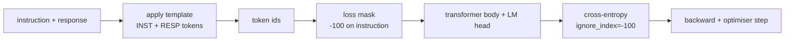
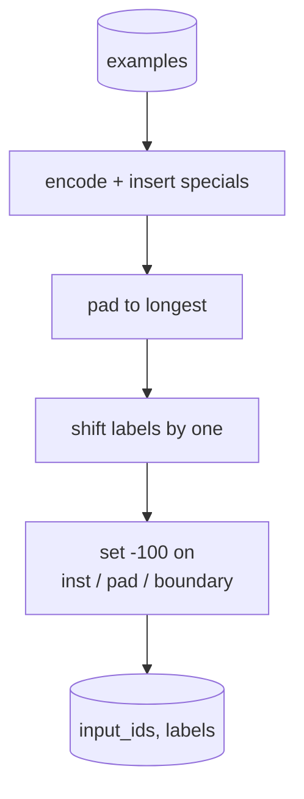
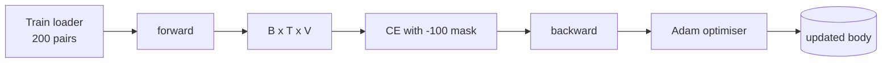

# Capstone Lesson 39: 通过监督微调做 Instruction Tuning

> 一个 pretrained base model 可以延续序列，但不会遵循指令。Supervised fine-tuning 是修复这一点的最小改动：把 instruction 和期望 response 的配对样例喂给模型，并训练主体预测 response tokens。技巧在于：loss 只应该统计 response，而不是 instruction。本课会构建一个 Alpaca-style SFT loop，包含自定义 collate function，用 `ignore_index=-100` mask 掉 instruction tokens，在 200 条 instruction-response pairs 上训练，并用 held-out split 的 exact-match 做评估。

**Type:** Build
**Languages:** Python (torch, numpy)
**Prerequisites:** Phase 19 lessons 30-37 (NLP LLM track: tokenizer, embedding table, attention block, transformer body, pre-training loop, checkpointing, generation, perplexity)
**Time:** ~90 minutes

## 学习目标

- 把成对的 instruction-response data 格式化成带显式边界 tokens 的单一 causal sequence。
- 构建一个 collate function，mask 掉 instruction tokens，让 cross-entropy 只统计 response tokens。
- 在 SFT objective 下训练 tiny transformer body，并观察 eval metric 的变化。
- 实现尊重 response-start boundary 的 greedy generation 和 temperature-sampled generation。
- 在 generated completions 上计算 held-out exact-match。

## 问题

一个用 next-token prediction 训练出来的 base model 不知道什么是 instruction。给它字符串 `"What is the capital of France?"`，它会继续这个问题，或者编出一句新话。模型拥有语言，但没有格式契约。

SFT 契约是一种 string template。每个训练样例都会变成一个包含三个区域的单一 sequence：

```text
<INST> What is the capital of France? <RESP> The capital of France is Paris.
```

边界 tokens 是训练时预留的 special tokens。模型会学到 `<RESP>` 后面的所有内容都是 response，而 response 才是被评分的部分。Base model 的 next-token objective 仍然适用；只是它现在训练在一个每条样例都具有这种形状的 corpus 上。

但这里有个陷阱。如果你把整个 sequence 送进 vanilla cross-entropy loss，你也在训练模型预测 instruction tokens。Instruction 是已给定内容。你想让这些位置的 gradient 为零。修复方法就是 mask。

## 核心概念



`ignore_index` 是 `torch.nn.functional.cross_entropy` 的一个特性。任何 target position 等于 `ignore_index` 时，都贡献零 loss 和零 gradient。PyTorch 中的惯例值是 `-100`。Collate function 会为每个 example 构建两个 tensors：`input_ids`（完整 sequence）和 `labels`（`input_ids` 的副本，但 instruction positions 会被覆盖成 `-100`）。

模型在 forward pass 中会看见完整 sequence；attention 可以 attend 到 instruction。Loss 只统计 response tokens。这正是我们想要的：condition on the instruction，predict the response。

## 数据

`main.py` 中会 deterministic 地生成 200 对 instruction-response pairs。它们覆盖六类任务：

- factual single-shot（X 的首都）
- arithmetic
- list extraction
- one-sentence summary
- code（print、sort）
- definition

每类任务都有 templated instruction 和 deterministic response。这是刻意保持简单的。Exact-match 很脆，本课使用的 fixture 中，正确答案就是某一个具体字符串。真实 SFT datasets 需要 fuzzy metrics；原则完全相同。

Split 是 160 train、40 test。Test set 覆盖全部六类任务，因此可以报告 per-category exact-match。

## Tokenisation 和 Padding

Tokenizer 是 byte-level，并有三个 reserved specials：

- `INST_ID = 256`：标记 instruction region 的开始。
- `RESP_ID = 257`：标记 instruction 和 response 之间的边界。
- `PAD_ID = 258`：用于 variable-length batches 的 padding。

Sequence 是 `[INST] inst_bytes [RESP] resp_bytes [PAD]*`。Collate function 会：

1. Tokenise 每个 example。
2. 把 batch 中每个 example pad 到该 batch 的最长 sequence。
3. 构建 `labels` = shifted-by-one 的 `input_ids`（causal LM target），其中：
   - Instruction region 替换为 `-100`。
   - Padding region 替换为 `-100`。
   - `RESP_ID` boundary position 本身替换为 `-100`（你不训练模型预测 boundary token；它预测的是后续内容）。



Shift 是标准 causal trick：`input_ids` 的 position `i` 预测 position `i+1`，因此 `labels[i] = input_ids[i+1]`（input 会丢掉最后一个 position，target 会丢掉第一个 position）。Mask 会在 shift 之后应用，这样才能落到正确位置。

## Training



这个 loop 是标准 PyTorch SFT loop。Adam，learning rate 大约 3e-4 到 1e-3，在这个 fixture 上训练十到二十个 epochs，无 scheduler。模型足够小（hidden 96、2 blocks、max length 64），可以在 CPU 上两分钟内训练到收敛。

每五个 epochs，loop 会在 held-out set 上运行一个小 eval pass 并打印 exact-match。看着 exact-match 从 epoch one 的 0.0 升到 epoch fifteen 左右的 0.85，是本课的回报：你能看到模型同时学会格式和答案。

## Generation

Eval 时，模型收到 instruction prefix `[INST] inst_bytes [RESP]`，然后生成 tokens，直到：

- sequence 达到 `max_len`，或者
- 模型触发一个 special stop heuristic：连续两个 sentence-ending bytes（`.`、`!`、`?`）。

本课提供 greedy decoding，以及一个可选 temperature sampler。Exact-match 使用 greedy，因为 temperature 会让 metric 变成 stochastic。真实系统通常会 sample，然后用 fuzzy judge 评估；那条 pipeline 是第 41 课。

## Exact-Match Evaluation

Exact-match 是最严格的文本指标。Predicted response string 会被 normalise（lowercase、strip whitespace、collapse double spaces），然后与同样 normalise 后的 reference response 比较。每个 example 的 metric 不是 1 就是 0。Aggregate 是 mean。

真实 SFT pipelines 会用 token-level F1（第 41 课）和 judge model 补充 exact-match。Exact-match 仍然有用，因为它毫不含糊；如果它说 0.7，就表示正好 70 percent 的 test instructions 逐字符生成了 gold response。

## 你会构建什么

实现是一份 `main.py` 加 tests。

1. `InstructionTokenizer`：byte-level encoder，带 reserved specials。可以 encode instruction prefix 或完整 pair。
2. `make_dataset`：用固定 seed 生成覆盖六类任务的 200 pairs。
3. `SFTDataset`：每个 example 返回 `(input_ids, labels)`，并已准备好 mask。
4. `sft_collate`：dynamic padding，构建 batch tensor，在 instruction 和 pad positions 上设置 `-100`。
5. `TinyGPT`：transformer body 加 tied 或 untied LM head。
6. `train_sft`：SFT loop，带 per-epoch eval hooks。
7. `generate`：从 prefix 做 causal decode，支持 greedy 或 sampled，并带 stop heuristic。
8. `exact_match`：normalised string comparison，返回 `[0, 1]` 内的 float。
9. `run_demo`：构建数据，训练二十个 epochs，评估，打印 per-category breakdown，并在成功时以 zero exit 结束。

## 为什么 mask 重要

没有 mask 时，loss 会把 instruction tokens 也当作 targets。模型会学习预测 instruction。这是另一个不同 objective，会以两种方式产出更差的模型。第一，模型容量被浪费用来重建用户总会提供的 input。第二，在大多数 batches 中，instruction tokens 多于 response tokens，因此 response loss 在 gradient sum 中占比更小；optimizer 在你真正关心的部分上的 effective learning rate 会比预期更低。Mask 不是润色，它就是 objective。

## Stretch goals

- 添加 learning-rate warmup，再接 cosine decay。SFT 比 pretraining 对 LR 更敏感。
- 添加 per-token loss logging，并画出 training 期间的 loss curve。注意早期 epochs 由 template tokens（`<RESP>`、常见 prefixes）主导，后期 epochs 由真实 answer tokens 主导。
- 把 eval 扩展到 BLEU-1 或 chrF。Exact-match 会低估那些用 paraphrase 产出相同答案的 models。
- 添加带 multi-turn formatting 的 chat template，并在包含 follow-ups 的 fixture 上训练。

这份实现给了你 format contract、mask 和 loop。从 base model 到 instruction follower，objective 的改变就是一个 collate function。
