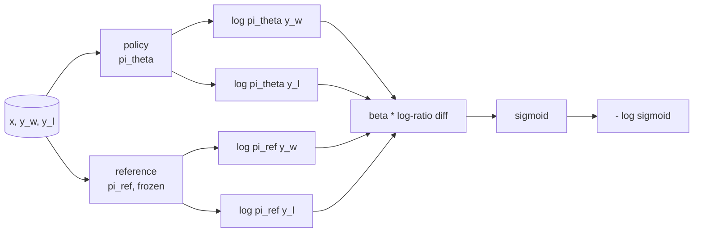
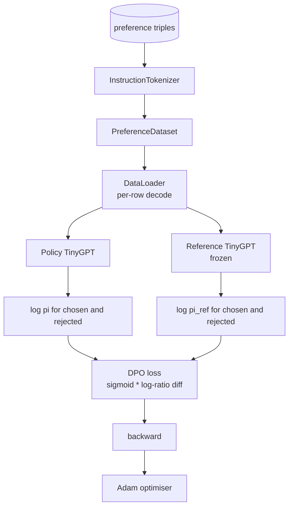

# Capstone Lesson 40: 从零实现 Direct Preference Optimization

> Reward models 和 PPO 是经典 RLHF stack。DPO 把这套 stack 折叠成一个 supervised loss，直接用 preference pairs 拟合 policy。本课会从 reward-difference identity 推导 DPO loss，交付一个可运行的 reference model + policy model，计算 per-token log-probabilities，并在 chosen/rejected completions 的 preference fixture 上训练一个 tiny transformer。Tests 会固定 loss math 和 gradient direction，让你知道实现确实匹配论文。

**Type:** Build
**Languages:** Python（torch, numpy）
**Prerequisites:** Phase 19 lessons 30-37（NLP LLM track: tokenizer, embedding table, attention block, transformer body, pre-training loop, checkpointing, generation, perplexity）
**Time:** ~90 minutes

## 学习目标

- 将 DPO loss 推导为 scaled log-ratio difference 上的 sigmoid，并把它连接到 implicit reward。
- 构建一对 reference model + policy model：reference 冻结，policy 可训练。
- 在两个模型下计算 sequence-level log-probabilities，并 mask prompt tokens。
- 在 `(prompt, chosen, rejected)` triples 上训练 policy，观察 chosen log-prob 相对 rejected 上升。
- 用 tests 固定 loss math、gradient sign 和 reference invariance。

## 问题

你有一个 SFT model。它能跟随指令，但输出不稳定；有些 completions 清晰，有些冗长或错误。你还有一个小型 preference pairs 数据集：同一个 prompt 下，人类把一个 completion 标为 chosen，另一个标为 rejected。

经典 RLHF 答案是两阶段 pipeline。先在 preferences 上训练 reward model。再用 PPO 根据 reward 优化 policy。这个方法有效，但昂贵：PPO 期间内存中要放两个模型，要用 KL control 让 policy 靠近 reference，reward model 脆弱时还会出现 reward hacking。

DPO 用一个 supervised loss 替代这两个阶段。Reward model 不再显式存在。Policy 直接在 preference pairs 上训练，并显式带有指向 SFT reference 的 KL penalty。在 Bradley-Terry preference model 下，它拥有相同的最优解，但代码少得多。

## 概念

从 Bradley-Terry model 开始。给定 prompt `x` 和两个 completions：`y_w`（chosen）与 `y_l`（rejected），人类偏好 `y_w` 的概率是：

```text
P(y_w > y_l | x) = sigmoid( r(x, y_w) - r(x, y_l) )
```

其中 `r` 是某个 latent reward function。RLHF 会先从 preferences 拟合 `r`，再训练 policy `pi`，在 KL anchor 下最大化 `r`：

```text
max_pi   E_{x, y~pi} [ r(x, y) ] - beta * KL(pi || pi_ref)
```

DPO 推导观察到，在这个目标下的 optimal policy `pi*` 可以用 `r` 写成 closed form：

```text
pi*(y | x) = (1/Z(x)) * pi_ref(y | x) * exp( r(x, y) / beta )
```

对 `r` 重新整理：

```text
r(x, y) = beta * ( log pi*(y | x) - log pi_ref(y | x) ) + beta * log Z(x)
```

`log Z(x)` 项对 `y_w` 和 `y_l` 是相同的（它依赖 `x`，不依赖 `y`），所以在计算 preference difference 时会抵消：

```text
r(x, y_w) - r(x, y_l) = beta * ( log pi_theta(y_w|x) - log pi_ref(y_w|x)
                                - log pi_theta(y_l|x) + log pi_ref(y_l|x) )
```

把它代入 Bradley-Terry sigmoid，并对 preference pairs 取 negative log likelihood：

```text
L_DPO(theta) = - E_{(x, y_w, y_l)} [
  log sigmoid( beta * ( log pi_theta(y_w|x) - log pi_ref(y_w|x)
                       - log pi_theta(y_l|x) + log pi_ref(y_l|x) ) )
]
```

这就是 loss。它是每个 example 一个 scalar 上的 sigmoid，由四个 log-probabilities 计算而来。没有单独 reward model。没有 PPO。Loss 中没有显式 KL term；KL constraint 已经被烘进 closed-form derivation。



## Gradient 的符号

训练前有一个很有用的 sanity check。对 `log pi_theta(y_w | x)` 求梯度：

```text
d L_DPO / d log pi_theta(y_w | x) = - beta * (1 - sigmoid(z))
```

其中 `z` 是 sigmoid 的 argument。对所有 `z` 来说，这个值都是负数；也就是说，提高 policy 对 chosen completion 的 log-probability 会降低 loss。对称地，对 `log pi_theta(y_l | x)` 的梯度是正数：提高 rejected log-probability 会提高 loss。训练会把 chosen 往上推，把 rejected 往下压。Reference 是冻结的；它不会移动。

## 数据

本课附带十二个 preference triples。每个都是 `(prompt, chosen, rejected)`。Chosen completion 简短而精确。Rejected 则冗长、偏题或错误。这些 pairs 覆盖 lesson 39 中相同的 task families（capital、arithmetic、list），所以从 SFT base 出发的 policy 有一个合理起点。

这个 fixture 故意很小。Production 中 DPO 会使用数万对 preferences；这里的重点是 loss math 和 loop 能在 tiny dataset 上端到端运行，并且 chosen-versus-rejected log-prob gap 会明显增长。

## Reference Invariance

DPO 实现必须谨慎处理 reference model。Reference 是冻结在原地的 SFT model。必须满足三个性质：

- Reference parameters 永远不会收到 gradients。
- Reference log-probabilities 在 epochs 之间永远不变。
- Policy 从与 reference 相同的 weights 开始。（最优 `theta` 是 reference 加上 learned update；把 policy 初始化为 reference copy 是定义良好的起点。）

实现通过以下方式强制这些性质：

- Reference forward passes 包裹在 `torch.no_grad()` 中。
- 对每个 reference parameter 设置 `requires_grad=False`。
- Reference 构建后，通过 `policy.load_state_dict(reference.state_dict())` 构建 policy。

## 架构



Model 是 lesson 39 中使用的同一个 TinyGPT（decoder-only、causal、byte tokeniser）。Reference 和 policy 共享 architecture；训练中 policy 的 weights 会偏离 reference，而 reference 保持冻结。

## 你将构建什么

实现由一个 `main.py` 加 tests 组成。

1. `InstructionTokenizer`：带 `INST` 和 `RESP` specials 的 byte tokeniser。Shape 与 lesson 39 相同。
2. `TinyGPT`：decoder-only transformer。Shape 与 lesson 39 相同，所以即便你跳过 39，本课也是 self-contained。
3. `make_preferences`：返回十二个 `(prompt, chosen, rejected)` triples。
4. `sequence_log_prob`：给定 model、prompt prefix 和 completion，返回 completion 上 next-token log-probabilities 的总和（prompt-position 不贡献）。
5. `dpo_loss`：接收四个 log-probabilities 和 `beta`，返回 per-example loss tensor 和用于 logging 的 implicit reward delta。
6. `train_dpo`：per-epoch loop，计算 policy 和 reference 下 chosen/rejected 的 log-probs，应用 loss，并执行 Adam step。
7. `evaluate_margins`：返回任意时刻 policy 下 mean chosen-rejected log-probability margin。
8. `run_demo`：从一个小 warm-up pretrain 构建 reference 和 policy，复制 weights，训练三十步，打印 per-step loss 和 margin，并以成功状态退出。

## 为什么 DPO 有效

在 Bradley-Terry preference model 下，DPO 在数学上等价于 RLHF，只是 reward 的参数化不同。Implicit reward `r(x, y) = beta * (log pi(y|x) - log pi_ref(y|x))` 可以从 preferences 中识别出来，但只到某个关于 `x` 的函数为止；这个函数会在 difference 中抵消。Closed-form policy 让你跳过显式 reward model。KL constraint 是结构性执行的：`pi` 相对 `pi_ref` 的任何偏离都会让 log-ratio 变大，而 sigmoid 会饱和，从而在 policy 移动太远时削弱 gradient。Reference 是你的 safety net。

## Stretch goals

- 给 log-probability sum 加 length normalisation：除以 completion length。Length bias 是 DPO 已知 failure mode，模型会偏向选择较短 completions，因为它们的 log-probabilities 在绝对值上更大。
- 增加 IPO variant 的 loss：把 sigmoid + log 替换成 `(z - 1)^2`。比较它在 fixture 上的 convergence。
- 增加 label-smoothing parameter，在 hard chosen-rejected label 和 uniform 0.5 之间插值。
- 用一个更小、更便宜的 model 替换 reference（knowledge distillation 风味）。

这个实现给你 loss、reference invariance 和 training loop。数学是本课的核心。代码让数学变得具体。
