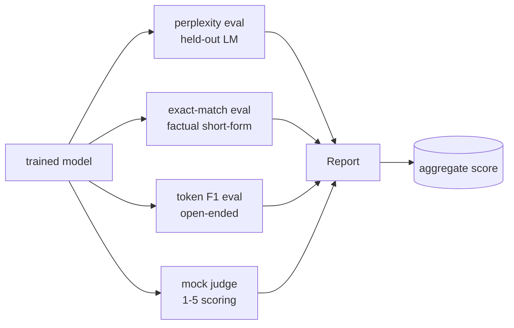
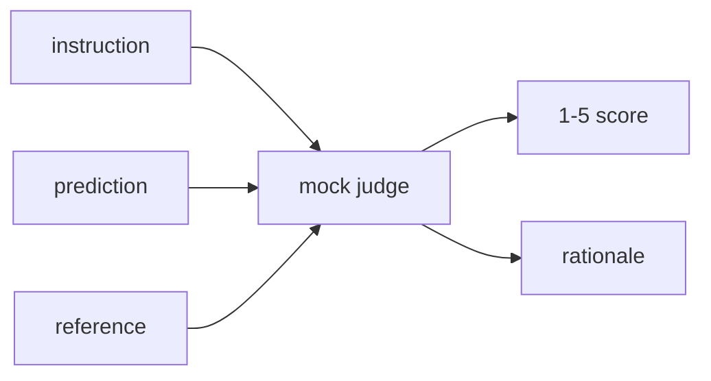
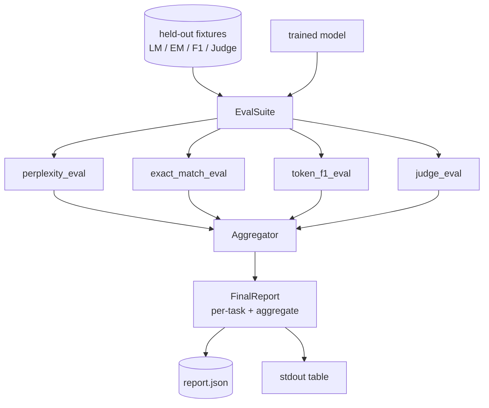

# Capstone Lesson 41：完整评估流水线

> Training 是你可以用 loss curves 监控的部分。Evaluation 是你必须设计的部分。本课构建一条统一 eval pipeline：接收任意训练好的 language model，在它上面运行四类异构 eval，把结果聚合成 per-task report，并提供一个本地 mock LLM-as-judge，让整个 loop 不依赖网络也能跑通。这四类 eval 覆盖每个要发布的模型都需要的维度：language modelling（perplexity）、short-form correctness（exact-match）、open-form similarity（token F1）和 qualitative scoring（judge）。

**Type:** Build
**Languages:** Python (torch, numpy)
**Prerequisites:** Phase 19 lessons 30-37 (NLP LLM track: tokenizer, embedding table, attention block, transformer body, pre-training loop, checkpointing, generation, perplexity)
**Time:** ~90 minutes

## 学习目标

- 在一个 tiny transformer 上，用 masked-token accounting 计算 held-out perplexity。
- 在 short-form factual prompts 上运行 exact-match eval。
- 用 normalization 计算 prediction string 与 reference string 之间的 token-level F1。
- 构建一个本地 mock LLM-as-judge，用 1-5 分为 model outputs 打分。
- 把四类 eval 聚合成一份 single weighted report，并包含 per-task breakdown。

## 问题

单一 metric 永远无法描述一个 language model。Perplexity 能说明模型拟合语言分布的程度，但无法说明它是否会回答问题。Exact-match 能说明模型是否生成 gold string，但会惩罚正确的 paraphrases。Token F1 会宽容 paraphrase，但也会被与错误内容的 lexical overlap 欺骗。LLM-as-judge 能捕捉 qualitative dimensions，但成本高，而且具有 stochastic 性质。

你真正想要的是同时拥有这四类 eval 的 pipeline。每个 eval 都覆盖其他 eval 漏掉的维度。每个 eval 都运行在为该 metric 塑形的不同 held-out data subset 上。最终 report 会把 per-task numbers 和 aggregate 并排展示，让 reviewer 一眼看出模型正在做哪些 trade-offs。

本课会在一个文件里端到端构建这条 pipeline。

## 概念

每个 eval 都是一个函数：`(model, dataset) -> EvalResult`。Result 携带 metric value、用于检查的 per-example details，以及用于 aggregate 的 name。Pipeline 会用一份 config 把它们组合起来，config 决定运行哪些 eval，以及如何给它们加权。

## 正确计数的 Perplexity

Perplexity 是 `exp(mean negative log-likelihood per token)`。实现时有两个陷阱：

- Mean 必须在真实 token positions 上计算，而不是在 batch * sequence 上计算。Padding tokens 必须从 denominator 中排除，否则 perplexity 会看起来比实际更好。
- 模型预测的是 next token，因此 position `i` 的 logits 预测 position `i+1` 的 token。这里的 off-by-one 错误很安静：loss 仍然能训练，但 metric 会失去意义。

Eval 会按 batch 累积 non-pad positions 上的 `-log p(token)` 总和，以及 per-batch token count，最后再相除。这比对 per-batch perplexities 求平均更数值稳健（后者会让 short sequences 权重过低），并且匹配 textbook definition。

## 带 Normalization 的 Exact-match

Harness 会先 normalize prediction 和 reference，再比较：

- Lowercase。
- Strip surrounding whitespace。
- 把内部连续 whitespace 折叠成单个 space。
- 如果两侧只差 trailing terminal punctuation（`.`、`!`、`?`），则移除它。

Normalization 让 exact-match 在实践中更有用。模型回答 `"Paris"` 是对的；回答 `"Paris."` 也是对的；回答 `"  paris  "` 也是对的。Metric 仍然要求 normalization 后 answer 是同一个 string。

## 正确做法的 Token F1

Token F1 是在 bag-of-tokens 上计算 precision 和 recall 的 harmonic mean。步骤如下：

1. Normalize prediction 和 reference（规则与 exact-match 相同）。
2. 把二者都 split 成 tokens list（whitespace tokenisation）。
3. 计算 multiset intersection。
4. Precision = `intersection_count / len(pred_tokens)`。Recall = `intersection_count / len(ref_tokens)`。F1 = harmonic mean。

如果 prediction 和 reference 都为空，F1 为 1（vacuous match）。如果只有一边为空，F1 为 0。这个模式匹配 SQuAD evaluation reference，并能在 paraphrases 上产出稳定数字。

## 本地 Mock LLM-as-Judge

真实 judge 通常是 API 后面的 frontier model。本课要求 judge 可以 offline 运行。Mock judge 是一个 deterministic scorer：接收 instruction、model prediction 和 reference，返回 `{1, 2, 3, 4, 5}` 中的一个 score，以及一行 rationale。Scoring rules 是显式的：

- 如果 normalized prediction 等于 normalized reference，给 5。
- 如果 prediction 和 reference 之间的 token F1 至少为 0.8，给 4。
- 如果 token F1 位于 `[0.5, 0.8)`，给 3。
- 如果 token F1 位于 `[0.2, 0.5)`，给 2。
- 其他情况给 1。

这不是真正的 judge，但它拥有正确 interface。以后只要改一个 function，就能换成真实模型。Pipeline 不关心背后是谁。

## Aggregation

Aggregate 是 normalized eval scores 的 weighted mean。每个 eval 都报告自己在 `[0, 1]` 区间内的数字：

- Perplexity：按 `1 / (1 + log(perplexity))` normalize。Perplexity 为 1 时映射到 1，趋向 infinity 时映射到 0。
- Exact-match：已经在 `[0, 1]` 内。
- Token F1：已经在 `[0, 1]` 内。
- Judge：除以 5。

Weights 可配置。默认 mix 是 0.2 perplexity、0.3 exact-match、0.3 token F1、0.2 judge。权重选择是一个 product decision；本课把这个 knob 暴露出来，方便你实验。

## 架构

`EvalSuite` 是一个很薄的 orchestrator。每个 individual eval 都是一个 free function，接收 `(model, tokenizer, dataset, config)`，并返回一个 `EvalResult`。`Aggregator` 收集 results 并产出 final report。Demo 会打印 table，并写入一份 JSON copy，供 downstream CI ingest。

## 你将构建什么

Implementation 是一个 `main.py` 加 tests。

1. `TinyGPT`：与 lessons 38-40 使用的 decoder-only architecture 相同，直接包含在本课中，让 lesson self-contained。
2. `InstructionTokenizer`：带 INST / RESP / PAD specials 的 byte tokeniser。
3. 四类 fixtures：一个 LM corpus、一个 EM set、一个 F1 set、一个 judge set。每类二十个 examples，deterministic。
4. `perplexity_eval`：返回 `EvalResult`，包含 perplexity value 和 per-token loss histogram。
5. `exact_match_eval`：返回 mean EM 和 per-example records。
6. `token_f1_eval`：返回 mean token F1 和 per-example records。
7. `mock_judge` 和 `judge_eval`：返回 per-example score 与 rationale，以及整个 set 的 mean score。
8. `Aggregator.normalise`：per-eval normalization rule。
9. `Aggregator.aggregate`：weighted mean 和组装后的 report。
10. `run_demo`：短暂训练一个 tiny model，运行四类 eval，打印 report table，写入 JSON，并在成功时 zero exit。

## 阅读 Report

Report 有三层。最上面是 aggregate score。下面是四个 per-eval numbers。再下面是用于 diagnostics 的 per-example breakdown。Failing CI run 通常只需要 aggregate，但追查 regression 的 reviewer 需要 per-example breakdown，才能看清模型在哪些 inputs 上错了。

JSON dump 使用 stable keys，因此 CI dashboard 可以跨版本绘制 trend lines。Pretty-printed table 是给训练结束后盯着 terminal 的人看的。

## Stretch goals

- 添加 calibration eval：模型的 softmax probabilities 是否匹配它的 accuracy？按 confidence 给 predictions 分 bucket，并报告每个 bucket 的 empirical accuracy。
- 添加 robustness eval：给每个 example 标注 perturbation（typo、paraphrase、distractor），并报告每类 perturbation 上的 metric drop。
- 用 HTTP call 后面的真实模型替换 mock judge。Function signature 不变。
- 添加 per-task weight learning：不使用固定 weights，而是根据 models 的 target preference order 拟合 weights。

Implementation 给了你四类 eval、aggregator 和 report。真实 evaluation pipelines 会在上面继续叠加更多维度；pattern 不变：每个 eval 一个 function，一个 aggregator，一份 report。
