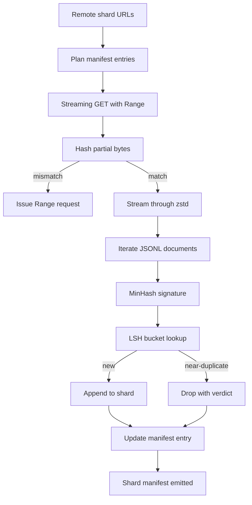

# 大规模语料下载器

> 训练语言模型远在第一次 forward pass 之前就已经开始。Corpus 必须落到磁盘上，完成 decompression、deduplication，并变成可寻址的数据；而且在网络进度停在 4% 之前，resume story 就要已经设计好。本课会构建一个 streaming downloader：拉取 compressed shards，用 Zstandard 边下载边解压，用 MinHash 加 locality-sensitive hashing 给 near-duplicates 做 fingerprint，并写出一个后续 pipeline 可以信任的 shard manifest。

**Type:** Build
**Languages:** Python
**Prerequisites:** Phase 19 lessons 30-37
**Time:** ~90 minutes

## 学习目标

- 使用 `urllib` stream remote shards，并用 `zstandard` 解压，避免把整个文件 buffer 到内存。
- 通过针对已验证 byte offset 发出 HTTP `Range` requests，恢复 partial downloads。
- 为每个 document 构建 MinHash signature，并用 LSH 分桶，让 near-duplicates 发生 collision。
- 输出 shard manifest，记录 content hash、byte size、document count 和 dedup verdict。

## 问题

第一次在 200 GB corpus 上训练时，网络在 41% 处断开，脚本带着一个 `urllib` exception 退出。第二次它在 78% 处断开。到 99% 时，你已经把 loop 重写了三遍。从第一分钟起就必须设计的两个 failure modes 是 partial-download resume 和 duplicate document removal。二者都有成熟解法；二者也经常被跳过，因为 pipeline 一开始只是一个逐渐长出牙齿的 `requests.get` 一行脚本。

Resume 是 HTTP 问题。Server 必须 honour `Range`，client 必须根据磁盘上的记录跟踪 verified offset，而 verified offset 必须能在 process death 后保留下来。如果 offset 和文件哪怕只差一个 byte，resumed download 写入的就是垃圾，corpus 会以一种直到 tokenization 阶段才暴露的方式被破坏。

Deduplication 是 signature 问题。Exact-hash dedup 会漏掉 near-duplicates：同一篇 Wikipedia article 带着三种不同 boilerplate footers 出现；同一个 code file 换了一个 license header；同一篇 blog post 在每个链接上都多了 tracking parameter。MinHash 加 LSH 能以 sub-linear cost 抓住这些情况。成本是每个 document 一个 signature，以及每个 signature 一次 bucket lookup。

## 概念



### 使用 `urllib` streaming

Standard-library `urllib.request.urlopen` 会返回一个 file-like object。把它包进 `zstandard.ZstdDecompressor().stream_reader`，bytes 就会从 network 经过 decompressor 流入 document iterator，全程不需要在内存中 materialise compressed shard 或 decompressed shard。唯一的 memory cost 是 line buffer、当前 document 的 MinHash signature，以及 LSH index。

### 使用 `Range` resume

Downloader 会为每个 shard 写两个文件：shard 本身和一个 `.partial.json` checkpoint。Checkpoint 记录 `verified_bytes`、`expected_size`、`sha256_prefix`（在前 `verified_bytes` 个 bytes 上计算）以及 source URL。启动时，downloader 会读取 checkpoint，重新计算磁盘 bytes 的 `sha256_prefix`，并且只有在 recomputed hash 匹配时才 resume。如果 hash 错了，就丢弃 partial，从 byte zero 重新下载。Silent corruption 不可能发生，因为 verified bytes 会被检查，而不是被假设正确。

### MinHash 加 LSH

MinHash 会在固定空间内估计两个 sets 的 Jaccard similarity。对于 document，这个 set 是它的 shingles（overlapping n-grams）。Signature 是 `k` 个 minimum hash values，每个值来自一个独立 hash function。两个 Jaccard similarity 为 `s` 的 documents，在 signature 的任意单个 component 上相同的概率就是 `s`。

LSH 随后把 `k` 个 components 分成 `b` 个 bands，每个 band 有 `r` rows，其中 `k = b * r`。两个 documents 至少在一个 band 中 collision 的概率是 `1 - (1 - s^r)^b`，它会在你用 `(b, r)` 调出来的 `s` 附近形成一个 sharp threshold。Typical corpus dedup 的 threshold 是 `s = 0.8`，LSH 研究文献中常用 `k = 128`、`b = 32`、`r = 4` 达到这个位置。

### Shard manifest 作为契约

Downloader 唯一持久化输出是 manifest。Manifest 对每个 shard 保存 URL、decompressed byte count、document count、dedup 后的 unique document count，以及 final shard file 的 sha256。下游 tokenization 读取的是 manifest，而不是 directory listing。如果某个 shard 缺失，或者它的 sha256 不对，manifest 会告诉下一阶段拒绝启动。Manifest 是“数据已经下载”和“数据已经下载且可验证”之间的决定性边界。

## Build It

`code/main.py` 实现了：

- `ShardPlanner` - 读取 shard URLs 列表，并生成 planned manifest entries。
- `StreamingDownloader` - 打开带 optional `Range` 的 `urllib` stream，写入 temporary file，在每个 chunk 后更新 `.partial.json` checkpoint，并在 resume 时验证 sha256 prefix。
- `ZstdDocIterator` - 把 file-like stream 包进 `zstandard.ZstdDecompressor`，每一行 yield 一个 document。
- `MinHasher` - 使用一组固定 hash seeds，为 string 生成 `k`-component signature。
- `LSHIndex` - 按 band 给 signatures 分桶，并报告 collisions。
- `Dedup` - 组合 hasher 和 index，把每个 document 标记为 `keep` 或 `near_duplicate`，并附上 matching shard id。
- `ManifestWriter` - 收集 per-shard stats，并写出 `manifest.json`。

文件底部的 demo 会在磁盘上构建一个小 synthetic corpus，用 `zstandard` 压缩它，通过 `file://` URL 下载，执行 dedup，并打印 manifest。

运行：

```bash
python3 code/main.py
```

脚本会以 zero exit 退出，并打印 manifest summary。

## Production Patterns

有四种 patterns 可以把本课扩展到真实 corpora。

**Checkpoint before write。** `.partial.json` 必须在 bytes append 到 shard 之前完成 `fsync`。否则 power loss 会反转顺序：shard bytes 已在磁盘上，checkpoint 却没有记录它们；下一次 resume 会以为 verified bytes 更少，于是 duplicated suffix bytes 会破坏文件。先 checkpoint，再 write。这和 write-ahead log 是同一种纪律。

**Sharded LSH index。** 在 200 GB 规模上，覆盖整个 corpus 的单个 LSH index 放不进 RAM。按 first band hash 分区 LSH index，把 partitions 存到磁盘上，并且只查询新 signature 会落入的那个 partition。成本是每个 document 多一次 disk read；收益是 LSH index 不再是硬性的 memory ceiling。

**Tombstone, not delete。** Dropped duplicates 会以 verdict `near_duplicate` 和它 collision 到的 document 的 shard id 记录在 manifest 中。直接删除会丢掉 duplicate 与 keeper 之间的链接。Tombstoning 会保留 audit trail，并允许下游 pass 在 threshold 上改变主意。

**Manifest 中的 per-shard sha256，加上 manifest sha256。** Manifest 本身也要有 content hash。下游 stages 会先验证 manifest hash，再信任 per-shard entries。否则 manifest 就是 silent attack surface：只要攻击者能编辑一个文件，就能破坏整个 pipeline。

## Use It

Production patterns：

- **每次 CI run 都支持 resume。** CI runners 是 ephemeral 的。Downloader 必须假设每次 run 都是 fresh disk，并从 cache 或 remote 中恢复。`--cache-dir` 是 first-class flag。
- **Dedup before tokenization。** Tokenization 很贵。对同一个 document 跑两次，就是为了同一条 loss curve 支付两倍成本。Dedup 位于 tokenization 上游，而不是下游。
- **Manifest as merge gate。** Training run 从 pinned commit 读取 manifest sha256。新的 dataset version 需要新的 manifest commit。Code 和 data 之间的链接是 git，不是口耳相传。

## Ship It

在真实项目中，`outputs/skill-corpus-downloader.md` 会描述哪些 URLs 会喂给 downloader、checkpoint directory 如何布局、dedup 使用什么 shingle width 和 `(k, b, r)` triple，以及 manifest 在 version control 中放在哪里。本课交付的是 engine。

## 练习

1. 添加一个 `--shingle-width` flag，并测量 widths 3、5、9 下 dedup verdict 如何变化。为 chosen default 做辩护。
2. 通过 sniffing magic bytes，在 zstd 旁边添加 gzip support。Downloader 不应该要求 caller 指定 codec。
3. 添加 `--resume-only` mode：如果找不到 checkpoint，就拒绝开始 fresh download。这在 CI 中很有用，可以避免某次 run 意外重新拉取 200 GB。
4. 把 LSH index 移到 shelf 或 sqlite file 中，并测量相对 in-memory variant 的 throughput。
5. 在 startup 时添加 manifest sha256 check。如果磁盘上的 manifest 与 `manifest.lock` 中的 manifest hash 不一致，downloader 应该 fail closed。

## 关键术语

| Term | 常见说法 | 实际含义 |
|------|----------|----------|
| Shard | “A file” | Corpus 的一个 self-contained slice，带有自己的 sha256，并作为 resume 和 dedup 的单位 |
| MinHash signature | “Fingerprint” | 一个 set 的 `k`-component sketch，其中每个 component 都是某个独立 hash 在这个 set 上的 minimum |
| LSH band | “Bucket” | 一组 `r` 个 signature components，作为 collision detection 的单个 bucket key |
| Verified bytes | “Resume offset” | 磁盘上 sha256 prefix 与 checkpoint 匹配的 bytes；唯一可以安全 resume 的 offset |
| Manifest | “The index” | Downloader 产物的唯一 durable record，包含 content hashes |

## 延伸阅读

- [RFC 7233](https://datatracker.ietf.org/doc/html/rfc7233) - HTTP Range requests，也就是 resume protocol
- [Zstandard format specification](https://datatracker.ietf.org/doc/html/rfc8478) - 让 streaming decompression 安全的 frame format
- [MinHash](https://en.wikipedia.org/wiki/MinHash) - 本课使用的 signature family
- [Locality-sensitive hashing](https://en.wikipedia.org/wiki/Locality-sensitive_hashing) - dedup threshold 背后的 banding scheme
- Phase 19 · 43 - downloader 喂给它的 HDF5 tokenized corpus
- Phase 19 · 44 - 在这个 corpus 上训练的 cosine schedule
- Phase 19 · 45 - 消费这个 schedule 的 AMP loop
