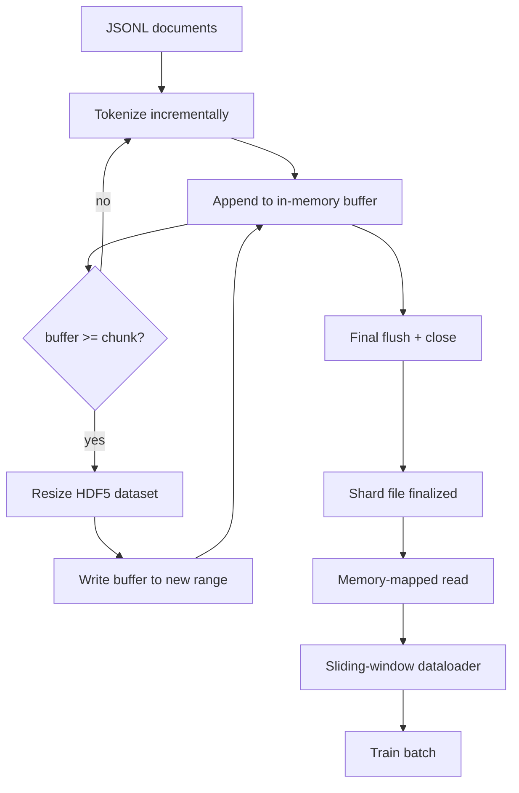

# HDF5 Tokenized Corpus

> 下载后的 corpus 必须落到 trainer 能以 line speed stream 的布局里。磁盘上的 JSONL 扛不住 16 个 dataloader workers。带 resizable、chunked integer dataset 的 HDF5 可以。本课构建 streaming tokenization 到 resizable HDF5 dataset、多文件 sharded write、训练时 memory-mapped read，以及一个能按正确 packing 产出 fixed-length sequences 的 sliding-window dataloader。

**Type:** Build
**Languages:** Python
**Prerequisites:** Phase 19 lessons 30-37
**Time:** ~90 minutes

## 学习目标

- 将 documents stream 到一个 deterministic chunking 的 resizable HDF5 integer dataset。
- 将写入分片到多个 HDF5 files 中，让 failure 有边界，也让 parallelism 成为可能。
- 通过 HDF5 的 page-cache-backed chunked layout 读回 tokens，让 dataloader 只在 batch time copy 到 batch buffers。
- 实现一个 sliding-window dataloader，按明确 packing rules 发出 fixed-length training sequences。

## 问题

现代 language-model training run 会在几十个 workers 上，以每秒数十万 samples 的速度读取 tokens。磁盘上的 JSONL 在第一次 cold-cache page fault 时就会崩掉：JSON parser 很慢，document boundaries 不能 addressable，seek 到 “sample 4,217,884” 需要扫描文件。即使是压缩效果很好的 Parquet 也不适合，因为 trainer 想要的不是 columns；它想要一条具备 O(1) random access 的 flat token stream。

HDF5 合适，是因为它提供了 chunked、resizable、integer-only dataset，并且 chunks 在 read time 对 page cache 友好。Trainer 请求 `tokens[3,200,000 : 3,200,8192]` 这样的 slice，HDF5 会把所需 hyperslab 从 page cache copy 到一个 fresh allocated NumPy array。成本是每个 worker 一个 open file handle，以及 chunk-sized page-cache footprint；相比 decoding JSONL 的成本，这几乎可以忽略。

构建难点是让 write side 诚实可靠。Resizable datasets 很容易被误用：一次写一个 document，HDF5 file 会碎片化到不可用；一次 resize 写入所有 documents，进程一死整个 shard 都丢。正确纪律是 buffer-then-extend，让 buffer size 匹配 chunk size，并使用 sharded write 将 workload 分到多个 files，保证 crash 最多损失一个 shard。

## 概念



### 正确使用 resizable HDF5

Token dataset 使用 `maxshape=(None,)` 和固定 `chunks=(chunk_size,)` 创建。写入过程会先把 tokens buffer 到一个长度为 `chunk_size` 的 NumPy array 中。当 buffer 填满时，dataset 按恰好 `chunk_size` resize，然后把 buffer 写入新的 range。Shard 结束时，残余 buffer 会写入最后一个 partial range。每次 write 都是 contiguous 且 chunk-aligned，除了最后一次；reader 会根据 shard HDF5 attributes 中记录的 `token_count` 截断它。

### Sharded write

单个 HDF5 file 是单点故障。Pipeline 会并行写 shards：Phase 19 lesson 42 的每个 input shard 都会产出一个 HDF5 output shard。`shards.json` index 会逐 shard 记录 file path、token count、document count，以及 tokens 的 sha256。Trainer 读取 `shards.json` 来计算 global offsets，并验证 corpus。

### Memory-mapped read

训练时，每个 worker 以 `swmr=True` mode 打开自己负责的 HDF5 files，并请求 `tokens[start:stop]`。一旦 chunk 变热，HDF5 的 chunk layout 会让这成为 page-cache-backed read。Worker 永远不会 materialise 整个 file：slice 会 copy 到 dataloader 的 batch buffer，然后 dataloader 在 batch time copy 到 pinned-memory training tensor。Hot path 在每次 chunk transition 时只有一个 syscall；其余都是 RAM access。

### Sliding-window dataloader

Dataloader 是唯一知道 training-sequence length 的 stage。它在 global token stream 中随机选择一个 start index，读取 `window_size + 1` 个 tokens，然后返回 `(input, target) = (tokens[:-1], tokens[1:])`。Document boundaries 不强制切断：window 可以跨越两个 documents，中间有显式 `boundary_token_id`，让 model 学会使用 separator。这是标准 packing rule；也是初学者常忘的一条规则，忘掉之后 corpus 会变成 8% training boundary tokens 和 92% natural text。

## Build It

`code/main.py` 实现：

- `Tokenizer` - 一个 byte-level deterministic tokenizer，足够支撑 demo。接口是 `encode(text) -> list[int]` 和 `vocab_size`。
- `HDF5ShardWriter` - 打开一个 resizable integer dataset，将 tokens buffer 到 chunk size，按 fixed-size strides resize 和 write，并在 close 时把 `token_count` 和 `sha256` 记录为 HDF5 attributes。
- `ShardedTokenizationPipeline` - 迭代 input documents，把它们路由到 writer，并发出 `shards.json` index。
- `MmapTokenStore` - 打开 shard files 做 memory-mapped reads，计算 global offsets，并暴露单一 `get_slice(start, stop)` API。
- `SlidingWindowDataloader` - 从 global stream 中选择 random windows，并 yield `(input_ids, target_ids)` NumPy arrays。

文件底部的 demo 会构建一个小型 in-memory corpus，将其 tokenize 到两个 shards，通过 memory map 打开它们，运行 dataloader 取 10 个 batches，并打印每个 batch 的 shape 和 checksum。

运行：

```bash
python3 code/main.py
```

脚本以 zero exit 结束，并打印 batch checksums。

## Production Patterns

四个 pattern 可以把本课扩展到真实 training run。

**Chunk size 等于 typical read。** Trainer 每个 sample 读取 `window_size + 1` 个 tokens。将 HDF5 chunk 设置为 `window_size` 的倍数，reads 就能 page-cache aligned。Chunk 不匹配会让 throughput 下降一半，因为每个 sample 都会触碰两个 chunks。

**Token count 存 attributes，不存 dataset。** Dataset 的尾部 slice 可能只是 partial full，因为 chunk size 不一定整除 document boundary。把真实 `token_count` 存为 dataset 上的 HDF5 attribute，并让 reader 截断到这个值。否则 reader 会走到末尾的 zero-padded tokens 中，model 就会学着预测 zero。

**Sharded sha256 + parallel verification。** 每个 shard 都有自己的 token bytes sha256。Trainer 可以在训练开始前并行验证所有 shards。错误 sha256 会让 run 早失败，而不是在十六小时后的第三个 epoch 才失败。

**两侧都使用 `swmr=True`，writer 使用 `libver="latest"`。** Single-Writer-Multiple-Reader mode 要求 writer 用 `libver="latest"` 打开，预先创建所有 dataset，然后设置 `file.swmr_mode = True`。之后 writer 必须在每次 resize 后调用 `dataset.flush()`，这样以 `swmr=True` 打开的 reader workers 才能看到一致数据。跳过 `libver="latest"` 或在 structural changes 后才启用 SWMR，是常见的 “file is locked” failure 来源。

## Use It

Production patterns：

- **每个 source shard 一个 HDF5。** Downloader（lesson 42）每个 URL 发出一个 shard；tokenization（本课）每个 source shard 发出一个 HDF5。1:1 mapping 让 resume 和 partial-failure recovery 变得简单。
- **Boundary token id。** Boundary token 是 tokenizer vocab 的一部分，也是 dataloader 唯一会注入的 token。如果 model 应该忽略它，training loss 会 mask boundary token；否则 model 学会把它当成 sequence separator。
- **`shards.json` 是 source of truth。** 添加新 shard 意味着写 HDF5、计算 sha256、append 一个 entry。Trainer 在 startup 时读取一次这个文件，之后不再碰 directory listing。

## Ship It

在真实项目中，`outputs/skill-hdf5-tokenized-corpus.md` 会描述哪个 tokenizer 喂给 pipeline、哪个 chunk size 匹配 trainer window、`shards.json` 在 version control 中的位置，以及 dataloader workers 如何在 files 间 shard。本课交付 engine。

## 练习

1. 给 HDF5 writer 添加 `--compression gzip` flag，并在 demo corpus 上测量 throughput cost。为默认选择辩护。
2. 给 sliding-window dataloader 添加 deterministic seed，并验证相同 seed 的两次运行会产生完全相同的 batches。
3. 添加 `--validate` mode：读取每个 shard，重新计算其 tokens sha256，并与 `shards.json` 比较。CI 应该在训练开始前运行它。
4. 比较 chunk sizes 等于、等于一半、等于两倍 window size 时的 dataloader throughput。报告 page-cache effect。
5. 添加 `--max-document-tokens` flag，在 write time 截断特别长的 documents。为相对 read time 决策的取舍辩护。

## 关键术语

| Term | 大家常说 | 实际含义 |
|------|----------|----------|
| Resizable dataset | “Append-only” | 一个带 `maxshape=(None,)` 的 HDF5 dataset，通过 chunk-sized strides 的 `resize` calls 增长 |
| Chunked layout | “How HDF5 stores it” | 固定大小的 on-disk pages，kernel 可以 memory-map，dataloader 可以 contiguous read |
| `swmr` mode | “Read-while-write” | Single-Writer-Multiple-Reader mode，让 dataloader workers 安全共享 file |
| Shard index | “shards.json” | 所有 token shards 的 durable index，包含 offsets 和 content hashes |
| Sliding window | “Training sample” | Global token stream 的 fixed-length slice，trainer 会把它与 shift-by-one target 配对 |

## 延伸阅读

- [HDF5 chunking documentation](https://docs.hdfgroup.org/hdf5/v1_14/) - 本课使用的 chunked、resizable dataset layout。
- [h5py user guide](https://docs.h5py.org/en/stable/) - HDF5 的 Python bindings。
- [NumPy memory mapping](https://numpy.org/doc/stable/reference/generated/numpy.memmap.html) - HDF5 通过 h5py 暴露的 read-side primitive。
- Phase 19 · 42 - downloader，其输出由本课 tokenize。
- Phase 19 · 44 - 消费这个 dataloader 的 cosine schedule。
- Phase 19 · 45 - 包裹 training step 的 AMP loop。
