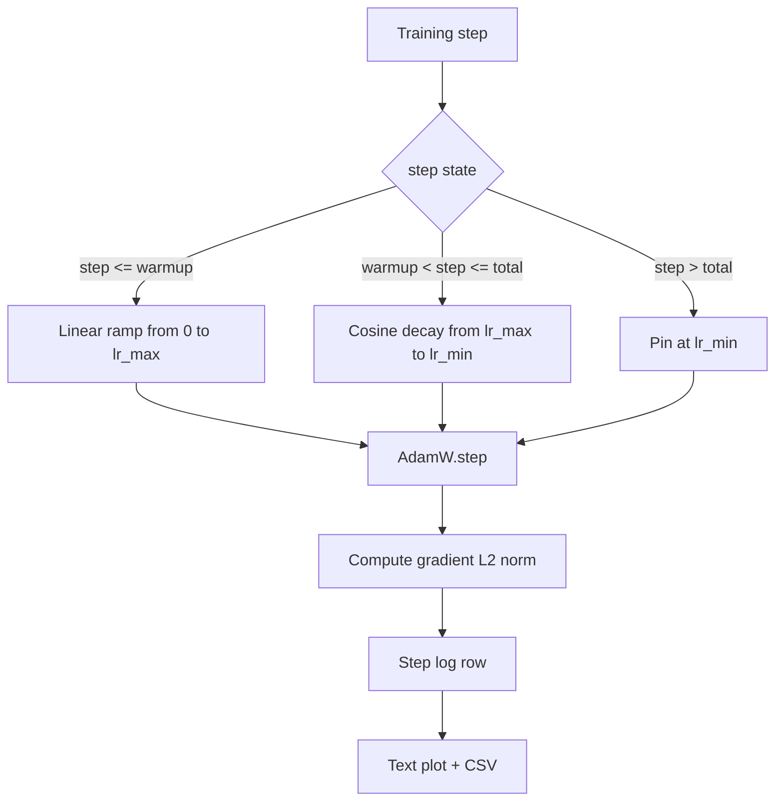

# 带 Linear Warmup 的 Cosine LR

> Learning-rate schedule 是仅次于 loss function 的第二重要决策。AdamW 搭配 cosine decay 和 linear warmup 是现代 language-model training 的默认选择，因为它让模型在脆弱的前一千次更新中看到较小的 effective step size，再 ramp 到配置的 peak，然后平滑 decay 回接近 0。本课会构建这个 schedule，绘制训练 steps 上的曲线，把 gradient norms 与 schedule 一起记录，并证明 schedule 遵守 warmup、peak 和 decay boundaries。

**Type:** Build
**Languages:** Python
**Prerequisites:** Phase 19 lessons 30-37
**Time:** ~90 minutes

## 学习目标

- 实现一个 AdamW optimizer，并连接到带 linear warmup 的 cosine learning-rate schedule。
- 在任意 step 计算 schedule 的精确值，避免跨 runs 的 floating-point drift。
- 把 gradient L2 norm 和 learning rate 并排记录，让 training health 可观测。
- 把 schedule 渲染为人眼可读的 text plot，以及任意工具都能消费的 CSV。

## 问题

训练的前一千次 updates 最吵。模型 weights 还接近 initialization。Optimizer 的 running second-moment estimate 还没有稳定。Gradient norm 又大又 noisy。如果这些 updates 中 learning rate 已经处于 peak，模型要么直接 diverge，要么落入一个永远逃不出的 loss plateau。两个常见修复分别是 gradient clipping（Phase 19 lesson 45 的主题）和一个从小开始再 ramp up 的 learning-rate schedule。

Cosine-with-warmup schedule 有三个 regions。从 step zero 到 `warmup_steps`，learning rate 从 0 线性缩放到配置的 peak `lr_max`。从 `warmup_steps` 到 `total_steps`，learning rate 沿 cosine curve 的上半段，从 `lr_max` decay 到 `lr_min`。超过 `total_steps` 后，learning rate 固定在 `lr_min`，这样即使 trainer 配置错误、跑过头，也不会悄悄离开 schedule。

构建难点在于 schedules 很容易出现 off by one。这个 off-by-one 会在训练六小时后表现为 learning rate 在模型开始 overfit 的时刻高出或低出 1%。除非在 boundaries 上穷尽测试，否则它几乎不可见。

## 概念



### Warmup formula

对于 `warmup_steps > 0` 且 `step` 位于 `[0, warmup_steps]` 的情况，learning rate 是 `lr_max * step / warmup_steps`。退化情况 `warmup_steps = 0` 被视为 “no warmup”：schedule 在 step zero 直接从 `lr_max` 开始，并立即进入 cosine decay。有些 test harnesses 会传入 `warmup_steps = 0`，检查 schedule 仍然能产生可用曲线。

### Cosine formula

对于 `step` 位于 `(warmup_steps, total_steps]` 的情况，learning rate 是 `lr_min + 0.5 * (lr_max - lr_min) * (1 + cos(pi * progress))`，其中 `progress = (step - warmup_steps) / max(1, total_steps - warmup_steps)`。在 `step = warmup_steps` 时，cosine 计算为 `cos(0) = 1`，得到 `lr_max`，与 warmup endpoint 完全匹配。在 `step = total_steps` 时，cosine 计算为 `cos(pi) = -1`，得到 `lr_min`，与 decay endpoint 完全匹配。

两个 endpoints 上的 continuity 不是偶然。它正是把 schedule 实现为一个关于 `step` 的单一函数，而不是把三个不同函数粘起来的原因。第一次修改 `lr_max` 时，粘起来的 schedule 就可能丢掉一个 boundary。

### Floor after total steps

对于 `step > total_steps`，learning rate 保持在 `lr_min`。Contract 是明确的：schedule 不报错，也不 extrapolate；它固定在 floor，并让 trainer 记录 warning。需要延长训练的 trainers 应该修改 schedule 的 `total_steps`，而不是修改 loop。

### 把 gradient norm 和 rate 一起记录

Schedule 是 training health 的一半。Gradient norm 是另一半。Training loop 每一步都记录二者。Divergent training run 会先出现 gradient norm spike，然后 loss 才变化；调得好的 warmup 会让 norm 随 rate 线性上升；过于 aggressive 的 peak 会表现为 warmup 后 norm 仍然偏高。磁盘上的 dataset 是 `step, lr, grad_l2_norm, loss`。CSV 是唯一持久记录。

## Build It

`code/main.py` 实现：

- `CosineWithWarmup`：一个 stateless function，按配置 schedule 提供 `lr(step) -> float`。
- `TrainState`：把 model、`AdamW` optimizer 和 schedule 包装进一个 step function。
- `TrainState.step`：运行一次 forward pass、一次 backward pass，记录 gradient L2 norm，并把 `lr(step)` 应用到 optimizer。
- `plot_schedule_ascii`：把 schedule 渲染成人眼可读的 text plot。
- `write_schedule_csv`：每个 step 输出一行 learning rate。

文件底部的 demo 会构建一个 tiny `nn.Linear` model，在固定 input batch 上训练 20 steps，并打印每一步的 learning rate、gradient norm 和 loss。Schedule 也会被渲染成 text plot，用于 visual sanity check。

运行：

```bash
python3 code/main.py
```

脚本会以 0 退出，并打印 per-step training log 和 schedule plot。

## Production Patterns

四个模式会把 schedule 提升为 production artifact。

**Schedule 存在 config 中，而不是 code 中。** Trainer 从一个提交到 git 的 YAML 或 JSON config 读取 `warmup_steps`、`total_steps`、`lr_max`、`lr_min`。因为 config 是 content-addressed，schedule 可复现；因为 config 是 PR diff 的一部分，schedule 可审计。

**Step counter 是 monotonic，并且与 epochs 解耦。** 当 dataset 被 sharded 或 dataloader 重启时，一些 frameworks 会混淆 step 和 epoch。Schedule 应该从 trainer checkpoint 读取 `global_step`，而不是从 local counter 读取。Resumed run 能在正确的 schedule position 继续，因为 step counter 是持久 axis。

**Run directory 中有 schedule plot。** 每次 training run 都把 `outputs/lr_schedule.png`（或本课中的 text plot）写入 run directory。Reviewer 浏览目录时，不需要重新运行任何东西就能 sanity-check schedule。这能在 PR 阶段捕捉 misconfigured-schedule 类 bug。

**Log row schema 固定。** `step, lr, grad_l2_norm, loss`，顺序就是这样。Downstream notebook 或 dashboard 会读取这个 schema；如果不 bump version 就重命名 column，会让所有现有 dashboard 失效。

## Use It

Production patterns：

- **先 sweep peak，再 sweep 其它。** `lr_max` 是最敏感的 knob。先在 small model 上 sweep 它；optimal `lr_max` 与 model size 的缩放很弱，因此 small-model sweep 是一个强 prior。
- **Warmup 是 total steps 的 fraction，不是绝对数量。** 一个 200-million-step run 如果只有 2,000 warmup steps，几乎刚开始就到 peak；一个 20,000-step run 使用同样数量，则 warmup 占 10%。把 warmup 配成 fraction（典型值：1-3%），让 schedule 随 training duration 缩放。
- **`lr_min` 非零是有意为之。** 设为 `lr_max` 的 10% 的 floor，可以让 optimizer 在 long tail 中继续学习。`lr_min = 0` 的 schedule 会产生看起来很漂亮的 training curve，但 model 其实还没有完成训练。

## Ship It

在真实项目中，`outputs/skill-cosine-warmup.md` 会描述哪个 config 携带 schedule、global counter 从 trainer 的哪一步读取，以及哪个 `lr_max` sweep 产生了部署值。本课交付的是 engine。

## 练习

1. 增加 inverse-square-root variant 的 schedule，并在 200-step toy training run 上比较它。哪条曲线产生更低的 final loss？
2. 增加一个 `--restart` flag，在 `total_steps / 2` 处加入第二次 warmup。论证 warm restarts 在 toy run 上是有帮助还是有害。
3. 增加一个 unit test，验证 schedule 是连续的：对于 `[0, total_steps]` 中的每个 step，差值 `|lr(step+1) - lr(step)|` 都被 `lr_max / warmup_steps` 约束。
4. 把 schedule 接入 `torch.optim.lr_scheduler.LambdaLR`，让它能与 framework code 组合。本课使用 plain step function；wrapper 改变了什么？
5. 增加一个 `--plot-png` flag，通过 `matplotlib` 写出真实 plot。论证本课的 text plot 和 PNG 哪一个更适合作为 CI runs 的默认输出。

## 关键术语

| Term | 大家常说 | 实际含义 |
|------|----------|----------|
| Warmup | "Slow start" | 在前 `warmup_steps` 次 updates 中，从 0 线性 ramp 到 `lr_max` |
| Cosine decay | "Smooth drop" | 在剩余 steps 中，从 `lr_max` 到 `lr_min` 的 upper-half cosine curve |
| Floor | "After training" | 超过 `total_steps` 后 schedule 固定的 `lr_min` 值 |
| Gradient norm | "L2 of grads" | 拼接后的 gradient vector 的 Euclidean norm，每 step 记录 |
| Global step | "Schedule axis" | 一个跨 restarts 保持的 monotonic step counter，用来驱动 schedule |

## 延伸阅读

- [Loshchilov and Hutter, SGDR: Stochastic Gradient Descent with Warm Restarts（arXiv 1608.03983）](https://arxiv.org/abs/1608.03983) - cosine schedule 的 reference paper。
- [Loshchilov and Hutter, Decoupled Weight Decay Regularization（arXiv 1711.05101）](https://arxiv.org/abs/1711.05101) - AdamW 的 reference paper。
- [PyTorch torch.optim.lr_scheduler](https://docs.pytorch.org/docs/stable/optim.html#how-to-adjust-learning-rate) - step functions 如何与 framework schedulers 组合。
- Phase 19 · 42 - 这个 schedule 会消费其 corpus 的 downloader。
- Phase 19 · 43 - 与这个 schedule 共同演化的 dataloader。
- Phase 19 · 45 - gradient clipping 和 AMP，是 loop 的下一层。
