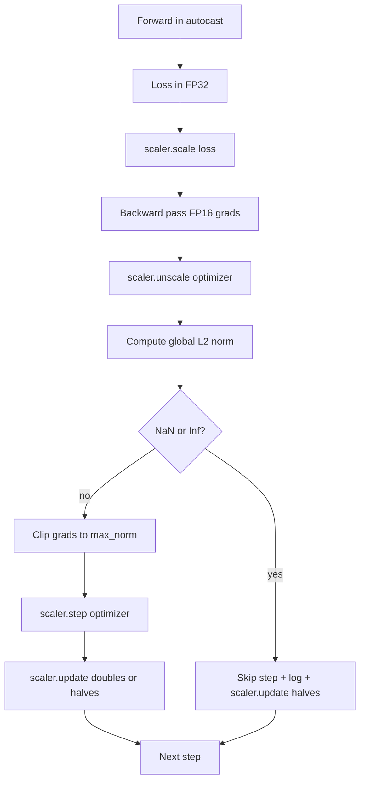

# Gradient Clipping 与 Mixed Precision

> 上一课的 optimizer 和 schedule 假设 gradients 是正常的。它们通常并不正常。单个坏 batch 就能让 gradient norm 暴涨三个数量级。Mixed-precision training 会进一步放大这个问题，因为 loss 侧会引入 FP16 overflow。本课会构建生产训练不可缺少的两条安全带：把 gradients clip 到配置好的 global L2 norm，以及一个带 autocast 和 GradScaler 的 mixed-precision loop，能够检测 NaN 与 Inf，干净地跳过 step，并记录 scaling factor 供事后排查。

**Type:** Build
**Languages:** Python
**Prerequisites:** Phase 19 lessons 30-37
**Time:** ~90 minutes

## 学习目标

- 计算所有 parameter gradients 的 global L2 norm，并在超过配置阈值时原地 clip。
- 用 autocast 加 GradScaler 包住一个 training step，让 FP16 forward 和 backward passes 能从 overflow 中活下来。
- 检测 loss 或 gradient 中的 NaN 与 Inf，跳过 optimizer step，并记录这次 skip。
- 每一步报告 GradScaler 的 scaling factor，让长串 skips 能立即暴露。

## 问题

昨天还能干净运行的 training run，在 step 8,217 时 loss curve 突然垂直上升。罪魁祸首是一个 batch，它的 gradient norm 是 4,200，是之前峰值的二十倍。没有 clipping，optimizer 会应用一个 step，把模型过去一小时学到的东西全部重置掉。若使用 norm 1.0 的 global L2 clip，同一个 batch 只会贡献一个 unit-norm update；loss 会留在趋势线上；run 能活下来。

Mixed-precision training 通过用 FP16 计算 forward pass 和大部分 backward pass，把 throughput 推高 2-3 倍。代价是 FP16 的 exponent range 很窄。一个在 FP16 中 overflow 的典型 gradient 会变成 Inf，Inf 会在后续 layers 中传播成 NaN，并在下一次 optimizer step 时把每个 weight 都设成 NaN。PyTorch 的 GradScaler 通过在 backward pass 前把 loss 乘以一个很大的 scaling factor，并在 optimizer step 前用同一个 factor 反向缩放 gradients 来解决这个问题。如果在 unscale 时任何 gradient 是 Inf 或 NaN，scaler 会跳过这个 step，并把 scaling factor 减半；如果之前 N 个 steps 都干净，scaler 会把 factor 翻倍。整个训练过程中，这个 factor 会找到 FP16 range 允许的最高值。

构建问题在于把两者正确接线。先 clip 再 unscale，threshold 就落在 scaled gradients 上；先 unscale 再 clip，则 GradScaler 的操作顺序很关键。正确顺序是：`scaler.scale(loss).backward()`，然后 `scaler.unscale_(optimizer)`，然后 `clip_grad_norm_`，然后 `scaler.step(optimizer)`，最后 `scaler.update()`。任何其他顺序都会产出一个静默损坏的 loop。

## 核心概念



### Global L2 norm

Global L2 norm 是把所有 gradient vector 拼接起来之后的 Euclidean norm，不是逐 parameter 的 norm。PyTorch 用 `torch.nn.utils.clip_grad_norm_(parameters, max_norm)` 实现它。这个 function 会返回 clip 前的 norm，因此本课可以同时记录自然 norm 和 clipped value；这对诊断“我们是否每一步都在 clipping”很必要。

### autocast 与 GradScaler

`torch.amp.autocast(device_type)` 是一个 context manager，会选择性地让 eligible operations（大多数 matmul-class operations）在 FP16 中运行。`torch.amp.GradScaler(device_type)` 是一个 helper，会在 backward 前 scale loss，并在 optimizer step 前 inverse-scale gradients。二者是配套设计的；只用其中一个，是测试应该捕获的配置错误。

本课使用 CPU autocast，因为 CI 能运行它；同样 pattern 只要把 `device_type="cpu"` 改成 `device_type="cuda"`，就能原样迁移到 CUDA。CPU 上的 GradScaler 是一个 stub（CPU autocast 默认已在 BF16 中运行，不需要 loss scaling），但本课保留这些 call sites，让 wiring 与 GPU loop 完全一致。

### NaN 和 Inf 检测

检测发生在两个位置。第一，loss 本身会在 backward 前用 `torch.isfinite` 检查；Inf 或 NaN loss 无法产生有用 gradients，因此不进入 optimizer，直接跳过。第二，在 `scaler.unscale_(optimizer)` 之后，本课会用 `has_non_finite_grad(...)` 扫描 unscaled gradients，并把任何 Inf 或 NaN 都视为 skip。两项检查合起来覆盖 forward-pass 和 backward-pass 两类 failure modes。

### Scaling factor diagnostics

Scaling factor 是 GradScaler 的内部状态。本课每一步都会读取 `scaler.get_scale()`，并把它和 learning rate、gradient norm 一起记录。健康 run 会看到 scaling factor 以 2 的幂逐渐上升，直到在接近 `2^17` 或 `2^18` 的位置饱和。异常 run 会看到 factor 在高低值之间振荡，这说明模型的 gradients 有时在 range 内，有时不在。没有 logging，这个诊断信号就不可见。

## Build It

`code/main.py` 实现：

- `clip_global_l2_norm`：对 `torch.nn.utils.clip_grad_norm_` 的 wrapper，返回 pre-clip 和 post-clip norm。
- `has_non_finite_grad`：扫描 gradients 中 NaN 和 Inf 的 helper。
- `AmpTrainState`：包装 model、`AdamW` optimizer、GradScaler 和 autocast device。暴露 `step(inputs, targets)`，运行完整的 clipping、scaling 和 skip-on-NaN pipeline。
- `StepLog` 和 `SkipLog`：structured per-step records。
- 一个 demo：训练一个小 `nn.Linear` model 20 steps，在 step 5 向 gradient 注入 Inf 以触发 skip path，并打印得到的 log。

运行：

```bash
python3 code/main.py
```

脚本以 zero exit 结束，并打印 per-step log；每一行都标记为 `STEP` 或 `SKIP`，且至少有一行是 `SKIP`。

## 生产模式

四个 pattern 会把这个 loop 提升成生产 training step。

**Skip counter 应该是 alert，而不只是 log line。** 每次 training run 中出现少量 skipped steps 是健康的。每个 epoch 出现数百次 skips 则是硬告警：模型处在 FP16 无法容纳的 regime 中，loop 正在静默失败。本课追踪 1,000-step rolling skip rate；在生产中，rate 超过 5 percent 就应该 page。

**Clip threshold 放在 config 里。** `max_norm = 1.0` 是现代 language-model training 的默认值。先在小模型上 sweep 它；更大的 thresholds 让模型能从真正困难的 batches 中恢复，小的 thresholds 会限制最坏情况，但代价是 noisier loss curve。这个 threshold 应该和第 44 课的 schedule 一起放在同一份 YAML 或 JSON config 中。

**Norm log 与 schedule 一起进入 CSV。** CSV columns 是 `step, lr, grad_l2_pre_clip, grad_l2_post_clip, loss, skipped, skip_reason, scaler_scale`。Reviewer 打开文件时，一行里能看到 schedule、gradient story、scaling factor 和 skip outcome（带 reason）。把这些 columns 拆到多个文件中，会制造错位分析的温床。

**`scaler.update()` 每一步都要运行，即便 skip。** 干净 step 上，scaler 会读取 no-inf counter，递增它，并可能把 factor 翻倍。Skipped step 上，scaler 会把 factor 减半并重置 counter。忘记在 skip path 调用 `update()`，就是产生“scaling factor 从来不变”这个 bug 的原因。

## Use It

生产 patterns：

- **Autocast device 要匹配 optimizer device。** GPU training 使用 `torch.amp.autocast(device_type="cuda")`；CPU 使用 `torch.amp.autocast(device_type="cpu")`。混用 devices 会产生静默 type error，最后表现为 loss curve 看起来正常，但模型没有学习。
- **Backward 前检查 loss。** `torch.isfinite(loss).all()` 是一次 tensor reduction；成本可以忽略，而在 NaN loss 上省下的是整个 training step。永远运行它。
- **在 `zero_grad` 中使用 `set_to_none=True`。** 这会把 gradients 设为 `None` 而不是 zero，让 optimizer 跳过未受影响 parameter groups 的计算。这个设置是免费的 throughput improvement，也稍微减少 bug surface。

## Ship It

在真实项目中，`outputs/skill-clip-amp.md` 会描述 training step 使用哪个 clip threshold 和 autocast device，per-step CSV 在 version control 中放在哪里，以及 production skip-rate alert threshold 是多少。本课交付的是这个 engine。

## 练习

1. 用真实 loss spike 替换 synthetic Inf injection（把某个 batch 的 target 乘以 1e8），并验证 skip path 会触发。
2. 添加 `--bf16` 模式，把 autocast 切到 BF16 而不是 FP16。BF16 的 exponent range 比 FP16 更宽，通常很少需要 loss scaling；验证同一 demo 上 skip rate 降到 zero。
3. 添加一个 unit test，确认 gradient-clip wrapper 在没有发生 clipping 时也能正确返回 pre-clip 和 post-clip norm。
4. 添加 rolling-window skip-rate 计算，以及一个 CLI flag：如果该 rate 连续 100 steps 超过配置阈值，就让 run fail。
5. 把 loop 接到 canonical CSV 写入逻辑（`step, lr, grad_l2_pre_clip, grad_l2_post_clip, loss, skipped, skip_reason, scaler_scale`），并通过每行后 flush 确认文件能在 Ctrl-C 后保留下来。

## 关键术语

| Term | 大家常说 | 实际含义 |
|------|----------|----------|
| Global L2 norm | "Clip target" | 跨所有 trainable parameters 拼接后的 gradient vector 的 Euclidean norm |
| autocast | "Mixed precision" | 在 `with` block 内对 eligible operations 选择性执行 FP16（或 BF16） |
| GradScaler | "Loss scaler" | 在 backward 前乘大 loss，并在 optimizer step 前反向缩放 gradients 的 helper |
| Skip | "Bad step" | 因 gradient 或 loss 非有限而被拒绝的 optimizer step；scaler 会把 factor 减半 |
| Scaling factor | "Scaler state" | GradScaler 当前的 multiplier；干净运行一段后翻倍，每次 skip 时减半 |

## 延伸阅读

- [Micikevicius et al., Mixed Precision Training (arXiv 1710.03740)](https://arxiv.org/abs/1710.03740) - 原始 loss-scaling 提案
- [Pascanu, Mikolov, Bengio, On the difficulty of training recurrent neural networks (arXiv 1211.5063)](https://arxiv.org/abs/1211.5063) - gradient-clipping 参考论文
- [PyTorch torch.amp.GradScaler](https://docs.pytorch.org/docs/stable/amp.html) - 本课包装的 scaler API
- [PyTorch torch.nn.utils.clip_grad_norm_](https://docs.pytorch.org/docs/stable/generated/torch.nn.utils.clip_grad_norm_.html) - 本课使用的 clipping primitive
- Phase 19 · 42 - downloader，它的 corpus 会喂给这个 loop
- Phase 19 · 43 - 这个 loop 消费的 dataloader
- Phase 19 · 44 - 与这个 loop 组合的 schedule
