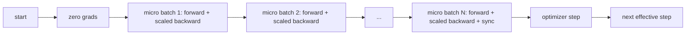
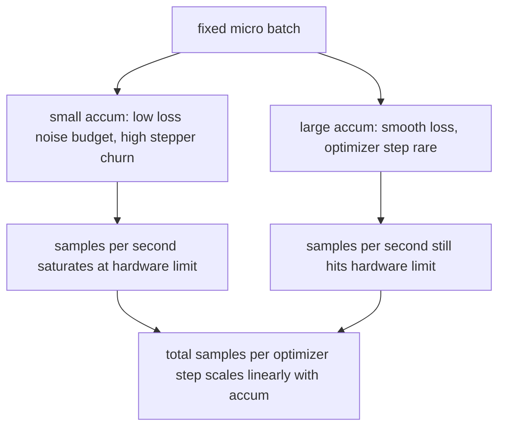

# Gradient Accumulation

> 用你负担不起的 effective batch 训练，一次只跑一个 micro-batch。缩放 loss，暂缓 optimizer step，让 gradients 累积起来。

**Type:** Build
**Languages:** Python
**Prerequisites:** Phase 19 lessons 42 to 45
**Time:** ~90 minutes

## 学习目标

- 推导 effective batch 恒等式：`effective_batch = micro_batch * accum_steps`。
- 实现 per-micro-batch loss scaling，让 accumulated gradient 匹配一次 full-batch backward。
- 跳过 optimizer synchronization，直到最后一个 micro-batch（sync-on-last-step）。
- 读取 throughput against effective batch curve，并解释 diminishing return。

## 问题

你想以 512 的 effective batch 训练，因为 loss curve 更平滑，optimizer step 在这个规模下也更有意义。桌上的 accelerator 在 32 个 examples 后就会内存耗尽。把 batch 翻倍不是选项。把 model 减半也不是选项。这个领域从 2017 年开始反复使用的技巧，是运行 16 次 backward passes，让 gradients 在 parameter buffers 里累积，并且只有当计数达到目标时才 step optimizer。

风险在于，loss 不再是大 batch 下的同一个数。16 个 mini-batches 的 cross entropy 如果直接相加，会是一个 full batch loss 的 16 倍。不做 scaling 时，gradient direction 是对的，但 magnitude 是错的，optimizer step 会大 16 倍。修复方法只是一次除法。它也很容易被忘掉。

## 概念



Contract 很短：

- 每个 micro-batch 的 loss 都要在 `backward()` 前除以 `accum_steps`。PyTorch 默认会把 gradients sum 到 `param.grad` 中；这个除法会把 running sum 推回正确尺度。
- Optimizer step 只在每个 effective batch 的最后一个 micro-batch backward 后触发。中途 step 会让之后所有计算依赖的 parameters 都偏掉。
- Optimizer state（momentum buffers、Adam moments）每个 effective step 只前进一次，而不是每个 micro-batch 前进一次。否则 exponential moving averages 会看到错误频率，并提前耗尽 schedule。
- 在单设备上，这只是 bookkeeping。在 multi-rank cluster 上，同样 pattern 会把非最后 micro-batches 包在 `no_sync` context 中，跳过 gradient all-reduce；最后一个 micro-batch 一次性 reduce 完整 accumulated gradient，而不是付 N 次网络成本。

### 代码中的等价性证明

```python
loss = criterion(model(x_full), y_full)
loss.backward()
opt.step()
```

等价于

```python
for x, y in chunks(x_full, y_full, n):
    scaled = criterion(model(x), y) / n
    scaled.backward()
opt.step()
```

除了 floating point summation order 的差异。Loop 结束时，accumulated gradient buffer 与一次 single full-batch backward 产生的是同一个 tensor。本课代码会在 `equivalence_check` 中用小于 `1e-4` 的 max-abs difference 断言它。

### 成本去了哪里

每个 micro-batch 都需要一次 forward 和一次 backward。使用 accumulation 时，你用时间换 memory。`outputs/accum-curve.json` 中的 throughput curve 展示了固定 micro-batch 下，effective batch 增长会发生什么：



没有免费午餐。`accum_steps` 翻倍，会让每个 optimizer step 的 wall time 翻倍。改变的是 gradient estimate 的 variance：在相同 wall budget 下，你做了更少的 optimizer steps，但每一步都平均了更多 samples。文献会把 large batch 和 small batch 视作不同 optimization problems；本课关注的是机械实现，而不是统计学。

## Build It

`code/main.py` 是可运行 artifact。它做三件事。

### Step 1: equivalence check

`equivalence_check()` 用同一个 seed 构建同一网络的两份 copy。一份在一次 forward pass 中看 16-sample batch。另一份看四个 4-sample chunks，并把 loss 除以四。函数会在 optimizer step 前比较 gradient buffers，在 step 后比较 parameters。断言是 `max_abs_diff < 1e-4`。

### Step 2: sync-on-last-step pattern

`train_one_optimizer_step` 遍历 micro-batches。除了最后一个 micro-batch，每个都会进入 `no_sync_context(model)`。在单进程中，这个 context 是 no-op；在 DDP 中，这就是跳过 gradient all-reduce 的地方。无论哪种情况，bookkeeping 都相同。`sync_counter` 记录我们离开 no_sync scope 的次数；对于 N 个 micro-batches，count 是每个 effective step 一次，而不是 N 次。

### Step 3: throughput curve

`sweep_effective_batches` 使用固定 micro-batch 和一组 accumulation steps 运行同一个 model。每个 setting 会记录：

- `samples_per_sec`：看到的 total samples 除以 wall time
- `median_step_ms`：每个 effective step 的 50th percentile
- `sync_calls`：执行过的 collective points
- `avg_loss`：sweep optimizer steps 的平均 loss

输出落在 `outputs/accum-curve.json`，可以从 notebook 复用。

运行：

```bash
python3 code/main.py
```

脚本会先打印 equivalence diff，再打印 sweep table，最后打印 JSON path。Exit code 为 zero。

## Use It

在 production training 中，gradient accumulation 通常藏在一个 knob 后面。PyTorch pattern 是 `accumulation_steps = effective_batch // (micro_batch * world_size)`。这里不允许使用的 frameworks 也只是包装了同一个 loop，但步骤相同：scale the loss、skip sync on non-final micros、accumulate、step once。

野外三个 pattern：

- Micro-batch size 用来饱和 device memory。更小会浪费 accelerator cycles。更大会 crash。
- Effective batch 根据 learning rate schedule 选择。Large effective batches 需要 scaled learning rates 和 warmup；这就是 2017 年以来常说的 linear scaling rule。
- Accumulation count 是两者之间的桥梁，也是唯一能在 runtime 自由调整、而不用重写 data loader 的 knob。

## Ship It

`outputs/skill-gradient-accumulation.md` 捕获这个 recipe，让同伴能把它放进新 repo：按 `accum_steps` 缩放 loss，非最后 micros 跳过 optimizer sync，每个 effective batch 只 step optimizer 一次，把 throughput against effective batch 记录为 JSON，让 trade-off 可见。

## 练习

1. 用 `--num-steps 100` 重新运行 sweep，并绘制 samples per second against effective batch。曲线在哪里变平？
2. 添加一个错误 scaling variant（不除以 N），并展示 step 1 时它相对 reference 的 parameter diff。
3. 把 SGD 换成 AdamW，并确认 optimizer state 每个 effective step 前进一次，而不是每个 micro-batch 前进一次。
4. 引入真正的 `DistributedDataParallel` wrapper，并把 `no_sync_context` route 到它的方法。确认每个 effective batch 的 sync_calls 会下降 N-1。
5. 修改 equivalence check，比较两种不同 micro splits（2 by 8 vs 4 by 4），并解释需要放宽的 tolerance。

## 关键术语

| Term | 大家常说 | 实际含义 |
|------|----------|----------|
| Micro batch | The batch you forward | 单次 forward pass 中能放进 memory 的 slice |
| Accum steps | Backward passes per step | 一次 optimizer step 前累加的 backward 次数 |
| Effective batch | The batch | Micro batch 乘以 accum steps，再乘以 data parallel world size |
| Loss scaling | Divide by N | 每个 micro-batch 的除法，让 summed gradients 匹配 full batch |
| Sync on last | Skip the rest | 只在 accumulation window 最后一次 backward 上运行 gradient collective |

## 延伸阅读

- PyTorch docs on `DistributedDataParallel.no_sync`：sync-on-last-step trick 的 production 版本。
- Goyal et al., 2017：large batch training 的 linear scaling 论文，也是关心 effective batch 的 canonical reason。
- PyTorch issue tracker：gradient accumulation 与 mixed precision unscaling 的交互。
- Phase 19 lessons 42 to 45：本课假设的 model、data loader、optimizer 和 trainer scaffolding。
- Phase 19 lesson 47：checkpoint and resume，让长 accumulation run 能经受 wallclock cap。
