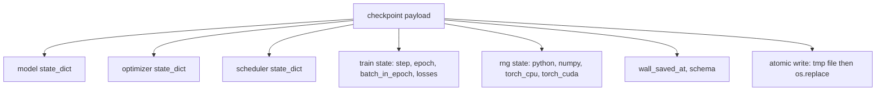
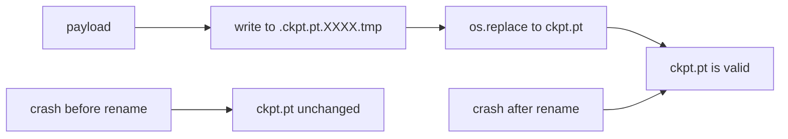
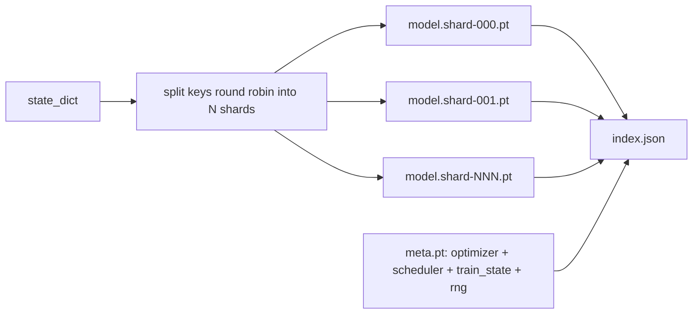

# Checkpoint Save 与 Resume

> 训练中断会杀死 runs；checkpoints 让它们继续。把 model、optimizer、scheduler、loss history、step counter 和 RNG state 原子化保存起来，这样任意时刻被 kill，磁盘上仍然留下一个有效文件。

**Type:** Build
**Languages:** Python
**Prerequisites:** Phase 19 lessons 42 to 45
**Time:** ~90 minutes

## 学习目标

- 把完整 training state 捕获到单个 payload 中，让它可以被重新加载到一个 fresh process。
- 实现 atomic save：先写 temp，再 rename，确保 crash 不会留下 half-written file。
- 恢复 Python、NumPy 和 PyTorch 的 RNG state，让 resume 后的 loss 与 uninterrupted baseline 匹配。
- 为不再适合放进单个文件的大模型构建 sharded checkpoint layout，使用 hash-verified shards 和 JSON index。

## 问题

你设置了一个 18 小时的 training job。Wallclock cap 是 4 小时。第 11 小时时，cluster 因为某个高层批准了 kernel upgrade 而 reboot。没有 checkpoints，你只能从头开始。没有 resume，你还会丢掉 optimizer state；这些 state 花了前 11 小时才学出来。所以即使 model weights 活下来了，AdamW moments 也没了，下一步会突然朝一个 training trajectory 早已越过的方向猛跳。

正确 artifact 是一个单一文件，包含继续训练所需的一切：model parameters、optimizer state、scheduler state、用于 plots 的 loss history、当前 step/epoch/batch-in-epoch counters，以及每个 randomness 来源的 RNG state。没有 RNG state，resumed loss curve 就是另一条曲线。同一个 model，同一份 data，不同 shuffle、不同 dropout mask、dashboard 上就是不同数字。

Atomic save 是 contract 的另一半。直接写入最终 filename，意味着 crash 发生在 mid-write 时会留下 corrupt file；resume 读到的是垃圾。先写入同一目录中的 temporary file，再 rename，意味着 mid-write crash 只会让上一个 good file 保持不变。在 POSIX file systems 上，rename 是 atomic 的。

## 概念



### 五个 state buckets

| Bucket | 为什么重要 |
|--------|------------|
| Model | Weights 和 buffers；model 本身是什么。 |
| Optimizer | Momentum 和 adaptive moments；没有它们，下一步就是不同的 optimization problem。 |
| Scheduler | Learning rate 位于曲线上的位置；cosine schedules 尤其在意。 |
| Train counters | Step、epoch、batch-in-epoch，以及绘制 dashboard 的 loss history。 |
| RNG state | Dropout、data shuffling 和 model 内部 sampling 的 determinism。 |

### Atomic save



两条规则。第一，temporary file 与 target 位于同一目录，这样 rename 才留在同一个 file system 中；cross-device renames 不是 atomic。第二，temporary name 每次 attempt 都唯一，避免两个 writers 相互覆盖。

### Sharded checkpoints

当 model 变大时，single-file payload 会变得太大：加载太慢、检查太难，并且 network share 在 mid-read 抖一下就很痛苦。修复方法是把 parameter state 拆成 shards，再写一个小 index 把它们绑定起来。



Index 记录 shard count、每个 shard 的 sha256，以及 meta file 的 sha256。任何 hash mismatch 时，loader 都会 loud failure。Shards 可以落在不同物理磁盘上；meta 很小，会先读。

### Resume 继续 mid epoch

Resume 如果直接跳到下一个 epoch 开始，会浪费从几分钟到一天不等的工作。修复方法是保存 `(epoch, batch_in_epoch)` 加 RNG state。Load 后，training loop 会把 random number generator fast-forward 到当前 epoch 中已经消费过的 batches 之后，并从 `batch_in_epoch` 继续。本课代码精确执行这件事；断言是 resume 后的 loss trajectory 与 uninterrupted baseline 在 interruption point 后的差异小于 1e-4。

## Build It

`code/main.py` 提供四个 primitives 和一个 demo driver。

### Step 1: capture and restore RNG state

`capture_rng_state` 返回一个 dict，包含 Python 的 `random.getstate`、NumPy 的 `np.random.get_state`，以及 PyTorch CPU 和 CUDA RNG bytes。`restore_rng_state` 执行反向操作。CPU tensor 是一个 uint8 byte buffer，PyTorch RNG 知道如何消费它。

### Step 2: atomic save

`atomic_save` 把 payload 写入 target directory 中的 temp file，然后用 `os.replace` 把它交换到 final name。`atomic_write_json` 对 sharded index 做同样的事。

### Step 3: full checkpoint round trip

`save_checkpoint` 把 model、optimizer、scheduler、train state 和 RNG 打包进一个 dict。`load_checkpoint` 反向恢复它，并返回一个 `TrainState`。`schema` field 是 upgrade hook：未来格式变化会 bump version string，并由 loader dispatch。

### Step 4: sharded variant

`save_sharded_checkpoint` 会把 parameter keys round-robin 分配到 N 个 shards，使用各自的 atomic save 写出每个 shard，写出包含 optimizer、scheduler 和 train state 的 meta file，并写出带 shard sha256s 的 JSON index。`load_sharded_checkpoint` 会先验证每个 shard，再合并。

### Step 5: resume demo

`run_resume_demo` 训练一个 small model 到 `total_steps`，在 `interrupt_at` 保存 checkpoint，然后继续训练。第二个 process 恢复 checkpoint，并运行剩余 steps。函数返回 interruption point 后两条 loss trajectories 的 max absolute difference。恢复 RNG 后，差异为 0 或仅为 floating-point noise。

运行：

```bash
python3 code/main.py
```

Single-file 和 sharded demos 都会断言 max-diff 小于 1e-4。Summary 会写入 `outputs/resume-demo.json`。

## Use It

Production training stacks 会把 checkpointing 作为 trainer 的一部分发布。形状相同：model + optimizer + scheduler + counters + RNG，原子化写入，按 step 命名，让 latest 很容易找到。Sharded layouts 支撑 large model loading 的 parallel reads；`index.json` 是让它能工作的关键。

需要强制执行三个模式：

- **Schema 是 payload 中的 string。** Migrations 根据它分支。没有 schema，你就无法演进格式而不破坏旧 runs。
- **每个 shard 都 sha256。** Silent truncated download 是最糟糕的 bug；loader 要么 fail fast，要么 fail late。
- **保持 checkpoint cadence 诚实。** 每 N steps 保存一次，并且每 wallclock-minute 保存一次，二者取更短。否则一次长 step crash 会浪费整个窗口的工作。

## Ship It

`outputs/skill-checkpoint-save-resume.md` 是任意新 training script 的 recipe：payload shape、atomic write、RNG capture、sharded index。把这个 skill 放进 repo，在 periodic save site 接入 `save_checkpoint`，在 startup 接入 `load_checkpoint`，run 就能活过 kills。

## 练习

1. 把 round-robin sharding 替换成按 parameter group sharding（以 `.weight` 结尾的 layers vs `.bias`）。什么时候每种 layout 更合适？
2. 扩展 save loop，保留最近 K 个 checkpoints，并 prune 更旧的。磁盘很小时，正确的 K 是多少？
3. 增加 `--ckpt-every-seconds` flag，按 wallclock interval 触发保存，而不只是按 step count。
4. 增加一个 checksum verification path，在 startup 扫描目录中的每个 checkpoint，并报告哪些 corrupt。
5. 实现一个 `migrate_v1_to_v2` function，向 payload 增加一个新 field，并 bump schema string。让 load 同时容忍两个版本。

## 关键术语

| Term | 大家常说 | 实际含义 |
|------|----------|----------|
| Atomic save | "Write and pray" | 先写入同目录 temp file，再用 os.replace 放到 target name |
| State dict | "The weights" | Model parameters 和 buffers，以 parameter name 为 key |
| Sharded checkpoint | "Big model file" | 多个 shard files、一个 meta file，以及带 sha256s 的 JSON index |
| RNG state | "Random seed" | 捕获 python random、numpy、torch CPU、torch CUDA 的状态；不只是 seed |
| Mid-epoch resume | "Restart" | Fast-forward RNG，并从同一 epoch 中的下一个 batch 继续 |

## 延伸阅读

- POSIX `rename` semantics：`os.replace` 所依赖的 atomicity claim。
- PyTorch 关于 `torch.save` 和 `torch.load` 的文档，包括 cross-device restores 用的 `map_location`。
- Phase 19 lesson 46：本课 checkpoint payload 能跨越的 gradient accumulation。
- Phase 19 lesson 48：本方案兼容其 state dict format 的 distributed wrappers。
- Linux kernel `fsync` documentation：atomic rename 背后的 durability guarantee。
